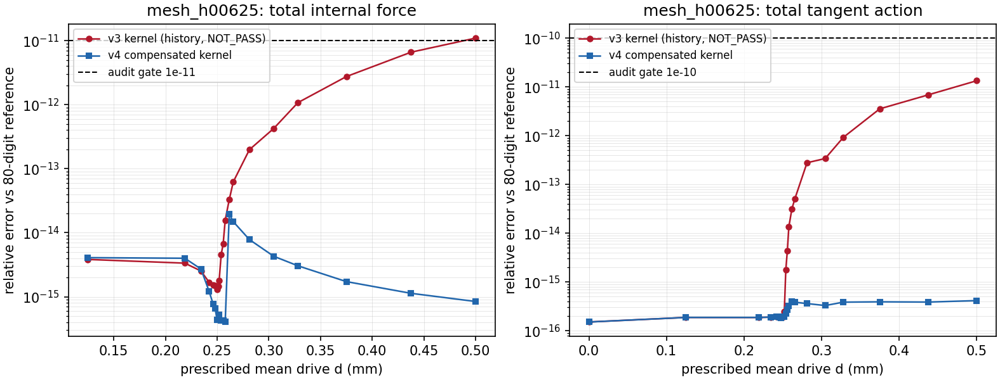

> 2026-10-21 L-CTIPAFORCE1 **执行PASS**／图像QA pass_root_visual_inspection_with_visibility_limits／阶段完成True：完成两种alpha同1.06峰节点弱力空间对照，实际计数 {'sources': 2, 'node_raw_rows': 1130, 'matched_node_pairs': 565, 'descriptive_node_differences': 3390, 'mask_group_original_rows': 8, 'mask_group_matched_pairs': 4, 'mask_group_component_differences': 24, 'whole_resultant_component_differences': 6}；两张新力图和原值/差量可审查。无新科学求解或资格升级；见[实际记录](lf_data_preparation/native_interface_001/lf_circle_tip_alpha_force_001/RESULTS.md)。原历史说明保留如下。

> 2026-10-21 L-CTIPACOMP1 **执行PASS**／图像QA pass_root_visual_inspection_with_visibility_limits／阶段完成True：完成两种alpha已有普通结果对照，实际计数 {'sources': 2, 'baseline_original_targets': 20, 'new_original_targets': 20, 'raw_values': 40, 'matched_pairs': 20, 'metric_fields': 13, 'descriptive_differences': 260}；两张新标量图和原值/差量可审查。无新科学求解或资格升级；见[实际记录](lf_data_preparation/native_interface_001/lf_circle_tip_alpha_comparison_001/RESULTS.md)。原历史说明保留如下。

> 2026-10-21 L-CTIPAPATH1 **执行PASS**／图像QA pass_root_visual_inspection_with_visibility_limits／阶段完成True：汇总alpha=2.5e-7四段已有0→1.06→0 mm加载卸载结果；统一计数 {'raw_rows': 23, 'timeline_rows': 20, 'merged_boundary_anchors': 3, 'same_input_pairs': 7, 'segments': 4, 'requested_targets': 20}，保留原始来源与历史，完成同位移原值/差量和两张新图。不新增力学计算或修改原资格；见[实际记录](lf_data_preparation/native_interface_001/lf_circle_tip_alpha_path_001/RESULTS.md)。原历史说明保留如下。

> 2026-10-21 L-CTIPAUNLOAD3 **执行PASS**／五图QA pass_root_visual_inspection_with_visibility_limits／阶段完成True：新α2.5e-7从成功卸载1.00 mm按五个新请求目标回程至零；生产 success，保存态 6。原15目标前缀未重放，五组65原标量差只描述且origin原leg保留；到零仅输入回程完成，旧峰值HP不授卸载态，资格及历史保持；见[实际记录](<lf_data_preparation/native_interface_001/lf_circle_tip_alpha_unload_003/RESULTS.md>)。原历史说明保留如下。

> 2026-10-20 L-CTIPAUNLOAD2 **执行PASS**／五图QA pass_root_visual_inspection_with_visibility_limits／阶段完成True：新α2.5e-7从已验证卸载1.05 mm仅继续至1.00 mm；生产 success，保存态 2。原14目标前缀未重放，不访任务峰值1.06，旧峰值HP不授卸载态，所有资格和历史保持；见[实际记录](<lf_data_preparation/native_interface_001/lf_circle_tip_alpha_unload_002/RESULTS.md>)。原历史说明保留如下。

> 2026-10-20 L-CTIPAUNLOAD1 **执行PASS**／五图QA pass_root_visual_inspection_with_visibility_limits／阶段完成True：新α2.5e-7从已验证父峰值1.06 mm首次卸载至1.05 mm；生产 success，保存态 2。父13目标未重放，旧父HP不授卸载态，所有资格和历史保持；见[实际记录](<lf_data_preparation/native_interface_001/lf_circle_tip_alpha_unload_001/RESULTS.md>)。原历史说明保留如下。

> 2026-10-20 L-CTIPAREF1 **执行PASS／图像QA pass_root_visual_inspection**：新α=2.5e-7、r9/(80,40)、right92/Lr80布置的accepted12/global12/1.06 mm单峰保存态参考；HP启动/完成 2/2，阶段完成True。生产13态只核1态，不扩展至完整路径或全矩阵所有列；旧α参考不迁移，保原历史及资格；见[实际记录](lf_data_preparation/native_interface_001/lf_circle_tip_alpha_reference_001/RESULTS.md)。原历史说明保留如下。

> 2026-10-20 L-CTIPALPHA1 **执行PASS**／图像QA pass_with_visibility_limits／六图QA完成True／阶段完成True：仅α由5e-7减至2.5e-7，从零请求原13个加载目标至1.06 mm；生产 success、实际保存态 13，保留partial及原内部历史，同定义差量只描述；旧α的HP不继承，不以分段基线总CPU作纯α性能判断。见[实际记录](<lf_data_preparation/native_interface_001/lf_circle_tip_alpha_001/RESULTS.md>)。原历史说明保留如下。

> 2026-10-20 L-CTIPFORCE1 **执行PASS**／图像QA pass_root_visual_inspection／阶段完成True：解释已有1.06 mm加载峰值的下半固定工件565节点弱式力、四类掩码及material/Hu分量，保留原值并记录描述性重组差，生成两张新图；不新增力学计算或升级资格。见[实际记录](<lf_data_preparation/native_interface_001/lf_circle_tip_force_001/RESULTS.md>)。原历史说明保留如下。

> 2026-10-20 L-CTIPPATH1 **执行PASS**／图像QA pass_root_visual_inspection／阶段完成True：汇总已有14段0→1.06→0 mm加载卸载结果；统一计数 {'raw_rows': 33, 'timeline_rows': 20, 'merged_boundary_anchors': 13, 'same_input_pairs': 7, 'segments': 14, 'requested_targets': 20}，保留原始来源与历史，完成同位移原值/差量和两张新图。不新增力学计算或修改原资格；见[实际记录](lf_data_preparation/native_interface_001/lf_circle_tip_path_001/RESULTS.md)。原历史说明保留如下。

> 2026-10-20 L-CTIPUNLOAD3 **执行PASS**／图像QA pass_root_visual_inspection_with_minor_layout_note／阶段完成True：固定圆形工件r9/(80,40)、right92/Lr80，从成功卸载1.00 mm保存态按五个请求目标继续回程至0 mm；生产 success，保存态 6，helper/outer pass/pass。本次只执行后缀，完整前缀未重放；原资格与历史保持。见[实际记录](lf_data_preparation/native_interface_001/lf_circle_tip_unload_003/RESULTS.md)。原历史说明保留如下。

> 2026-10-19 L-CTIPUNLOAD2 **执行PASS**／图像QA pass_root_visual_inspection／阶段完成True：固定圆形工件r9/(80,40)、right92/Lr80，从成功卸载1.05 mm保存态继续卸载至1.00 mm；生产 success，保存态 2，helper/outer pass/pass。本次只执行后缀，完整前缀未重放；原资格与历史保持。见[实际记录](lf_data_preparation/native_interface_001/lf_circle_tip_unload_002/RESULTS.md)。原历史说明保留如下。

> 2026-10-19 L-CTIPUNLOAD1 **执行PASS**／图像QA pass_root_visual_inspection／阶段完成True：固定圆形工件r9/(80,40)、right92/Lr80，从成功1.06 mm保存态首次卸载至1.05 mm；生产 success，保存态 2，helper/outer pass/pass。本次只执行后缀，完整前缀未重放；原资格与历史保持。见[实际记录](lf_data_preparation/native_interface_001/lf_circle_tip_unload_001/RESULTS.md)。原历史说明保留如下。

> 2026-10-19 L-CTIPREF1 **执行PASS／图像QA pass_root_visual_inspection**：当前r9/(80,40)、right92/Lr80布置的accepted1/global12/1.06 mm保存态参考；HP启动/完成 2/2，阶段完成True。保原生产历史及资格；见[实际记录](lf_data_preparation/native_interface_001/lf_circle_tip_reference_001/RESULTS.md)。原历史说明保留如下。

> 2026-10-19 L-CTIPLOCAL3 **执行PASS／图像QA pass_root_visual_inspection**：r9/(80,40)、right92/Lr80，保存态1.05 mm/global11、1.06 mm/global12局部观察，阶段完成True；实际对账与空间解释见本卡；无新平衡求解，原资格及历史保持。见[实际记录](lf_data_preparation/native_interface_001/lf_circle_tip_local_003/RESULTS.md)。原历史说明保留如下。

> 2026-10-19 L-CTIPSTEP10 **执行PASS**／图像QA pass_root_visual_inspection／阶段完成True：固定圆形工件r9/(80,40)、right92/Lr80，从成功1.05 mm保存态延伸至1.06 mm；生产 success，保存态 2，helper/outer pass/pass。本次只执行后缀，完整前缀未重放；原资格与历史保持。见[实际记录](lf_data_preparation/native_interface_001/lf_circle_tip_step_010/RESULTS.md)。原历史说明保留如下。

> 2026-10-19 L-CTIPSTEP9 **执行PASS**／图像QA pass_root_visual_inspection／阶段完成True：固定圆形工件r9/(80,40)、right92/Lr80，从成功1.04 mm保存态延伸至1.05 mm；生产 success，保存态 2，helper/outer pass/pass。本次只执行后缀，完整前缀未重放；原资格与历史保持。见[实际记录](lf_data_preparation/native_interface_001/lf_circle_tip_step_009/RESULTS.md)。原历史说明保留如下。

> 2026-10-19 L-CTIPLOCAL2 **执行PASS／图像QA通过**：同1.03/1.04 mm两保存态，仅修介质定位图排版，原数据/范围/色标保持、无新力学求解。本阶段完成True；LOCAL1原失败历史保留。见[实际记录](lf_data_preparation/native_interface_001/lf_circle_tip_local_002/RESULTS.md)。原历史说明保留如下。

> 2026-10-19 L-CTIPLOCAL1 **执行PASS／图像QA未通过**：r9/(80,40)、right92/Lr80，两态1.03/1.04 mm保存数组局部观察；数值精确对账通过，定位图顶部标题重叠，原图保留、整阶段尚未完成；无新平衡求解，原资格及历史保持。见[实际记录](lf_data_preparation/native_interface_001/lf_circle_tip_local_001/RESULTS.md)。原历史说明保留如下。

> 2026-10-19 L-CTIPSTEP8 **PASS**：固定圆形工件r9/(80,40)、right92/Lr80，从成功1.03 mm保存态延伸至1.04 mm；生产 success，保存态 2，helper/outer pass/pass。本次只执行后缀，完整前缀未重放；原资格与历史保持。见[实际记录](lf_data_preparation/native_interface_001/lf_circle_tip_step_008/RESULTS.md)。原历史说明保留如下。

> 2026-10-19 L-CTIPSTEP7 **PASS**：固定圆形工件r9/(80,40)、right92/Lr80，从成功1.02 mm保存态延伸至1.03 mm；生产 success，保存态 2，helper/outer pass/pass。本次只执行后缀，完整前缀未重放；原资格与历史保持。见[实际记录](lf_data_preparation/native_interface_001/lf_circle_tip_step_007/RESULTS.md)。原历史说明保留如下。

> 2026-10-19 L-CTIPSTEP6 **PASS**：固定圆形工件r9/(80,40)、right92/Lr80，从成功1.00 mm保存态延伸至1.02 mm；生产 success，保存态 2，helper/outer pass/pass。本次只执行后缀，完整前缀未重放；原资格与历史保持。见[实际记录](lf_data_preparation/native_interface_001/lf_circle_tip_step_006/RESULTS.md)。原历史说明保留如下。

> 2026-10-19 L-CTIPSTEP5 **PASS**：固定圆形工件r9/(80,40)、right92/Lr80，从成功0.98 mm保存态延伸至1.00 mm；生产 success，保存态 2，helper/outer pass/pass。本次只执行后缀，完整前缀未重放；原资格与历史保持。见[实际记录](lf_data_preparation/native_interface_001/lf_circle_tip_step_005/RESULTS.md)。原历史说明保留如下。

> 2026-10-19 L-CTIPSTEP4 **PASS**：固定圆形工件r9/(80,40)、right92/Lr80，从成功0.95 mm保存态延伸至0.98 mm；生产 success，保存态 2，helper/outer pass/pass。本次只执行后缀，完整前缀未重放；原资格与历史保持。见[实际记录](lf_data_preparation/native_interface_001/lf_circle_tip_step_004/RESULTS.md)。原历史说明保留如下。

> 2026-10-19 L-CTIPSTEP3 **PASS**：固定圆形工件r9/(80,40)、right92/Lr80，从成功0.90 mm保存态延伸至0.95 mm；生产 success，保存态 2，helper/outer pass/pass。本次只执行后缀，完整前缀未重放；原资格与历史保持。见[实际记录](lf_data_preparation/native_interface_001/lf_circle_tip_step_003/RESULTS.md)。原历史说明保留如下。

> 2026-10-19 L-CTIPSTEP2 **PASS**：固定圆形工件r9/(80,40)、right92/Lr80，从成功0.75 mm保存态延伸至0.90 mm；生产 success，保存态 2，helper/outer pass/pass。本次只执行后缀，完整前缀未重放；原资格与历史保持。见[实际记录](lf_data_preparation/native_interface_001/lf_circle_tip_step_002/RESULTS.md)。原历史说明保留如下。

> 2026-10-19 L-CTIPSTEP1 **PASS**：固定圆形工件r9/(80,40)、right92/Lr80，从成功0.50 mm保存态延伸至0.75 mm；生产 success，保存态 2，helper/outer pass/pass。本次只执行后缀，完整前缀未重放；原资格与历史保持。见[实际记录](lf_data_preparation/native_interface_001/lf_circle_tip_step_001/RESULTS.md)。原历史说明保留如下。

> 2026-10-18 L-CTIPPILOT1 **PASS**：固定圆形工件0→0.25→0.50 mm短加载；生产 success，保存态 3，helper／outer pass／pass。原资格及历史保持；见[实际记录](lf_data_preparation/native_interface_001/lf_circle_tip_pilot_001/RESULTS.md)。原历史说明保留如下。

> 2026-10-18 L-CTIPPREP1 **PASS**：r9/(80,40)、右域84→92mm、Lr80输入与未变形检查72/72；无加载。见[tip对向及右介质记录](lf_data_preparation/native_interface_001/lf_circle_tip_preparation_001/RESULTS.md)。原历史正文保留如下。

> 2026-10-18 L-CRPILOT1 **PASS**：固定圆形工件0→0.25→0.50 mm短加载；生产 success，保存态 3，helper／outer pass／pass。原资格及历史保持；见[实际记录](lf_data_preparation/native_interface_001/lf_circle_right_pilot_001/RESULTS.md)。原历史说明保留如下。

> 2026-10-18 L-CRIGHT1 **PASS**：圆形工件r9从(71,40)右移至(74,40)mm，未变形检查53/53；已核实际84mm域、右侧1mm两列介质与原约束。无力学求解，短行程尚未执行。见[实际记录](lf_data_preparation/native_interface_001/lf_circle_right_preparation_001/RESULTS.md)。历史原文保留如下。

> 2026-10-18 L-CUNLOAD5 **PASS**：固定圆形工件从保存1.25 mm请求完成到0的剩余输入回程；生产 `success`，实际保存态 `7`，原资格及历史保持。见[实际记录](lf_data_preparation/native_interface_001/lf_circle_first_unload_005/RESULTS.md)。原历史保留如下。

> 2026-10-18 L-CUNLOAD4 **PASS**：固定圆形工件从保存1.35 mm继续回程至1.25 mm；生产 `success`，实际保存态 `2`，原资格及历史保持。见[实际记录](lf_data_preparation/native_interface_001/lf_circle_first_unload_004/RESULTS.md)。原历史保留如下。

> 2026-10-18 L-CUNLOAD3 **PASS**：固定圆形工件从保存1.40 mm首次回程至1.35 mm；生产 `success`，实际保存态 `2`，原资格及历史保持。见[实际记录](lf_data_preparation/native_interface_001/lf_circle_first_unload_003/RESULTS.md)。原历史保留如下。

> 2026-10-18 L-CUNLOAD2 **PASS**：复用既有reader进行有限首次卸载兼容验证，生产源码零修改／零安装，真实圆形回程尚未执行。见[实际记录](lf_data_preparation/native_interface_001/lf_circle_first_unload_002/RESULTS.md)。原历史保留如下。

> 2026-10-17 L-CUNLOAD1 **NOT_PASS**：保存load_only末态首次转ordered_cycle卸载功能；只改一个reader，有限tiny兼容验证，真实圆形回程尚未执行。见[实际记录](lf_data_preparation/native_interface_001/lf_circle_first_unload_001/RESULTS.md)。原历史保留如下。

> 2026-10-17 L-CSTEP5 **PASS**：复用load_only保存态延伸，固定圆形工件1.35→1.40 mm；生产 success，保存态 2，helper／outer pass／pass。原资格及历史保持；见[实际记录](lf_data_preparation/native_interface_001/lf_circle_step_005/RESULTS.md)。原历史说明保留如下。

> 2026-10-17 L-CLOCAL1 **PASS**：圆形1.35 mm保存J/Hu空间定位；3NPZ/8字段，无新平衡或默认HF修改。原S4结果/资格保持；见[实际记录](lf_data_preparation/native_interface_001/lf_circle_local_001/RESULTS.md)。原历史说明保留如下。

> 2026-10-17 L-CSTEP4 **PASS**：复用load_only保存态延伸，固定圆形工件1.25→1.35 mm；生产 success，保存态 2，helper／outer pass／pass。新目标6检查/5线搜索全接受/0二分，最小边界距离0.096332 mm、free-medium minJ=0.086236；建议下一步先做保存态局部定位（未执行，见同目录NEXT_STEPS.md）。原资格及历史保持；见[实际记录](lf_data_preparation/native_interface_001/lf_circle_step_004/RESULTS.md)。原历史说明保留如下。

> 2026-10-17 L-CSTEP3 **PASS**：复用load_only保存态延伸，固定圆形工件1.15→1.25 mm；生产 success，保存态 2，helper／outer pass／pass。新目标6检查/5次线搜索全接受/0二分，最小边界距离0.163972 mm、free-medium minJ=0.155533；建议下一步1.25→1.35 mm（未执行，详见同目录NEXT_STEPS.md）。原资格及历史保持；见[实际记录](lf_data_preparation/native_interface_001/lf_circle_step_003/RESULTS.md)。原历史说明保留如下。

> 2026-10-17 L-CREF1 **PASS**：圆形1.15 mm保存峰值独立参考；HP启动/完成 2/2。保原生产历史及资格；见[实际记录](lf_data_preparation/native_interface_001/lf_circle_reference_001/RESULTS.md)。原历史说明保留如下。

> 2026-10-17 L-CSTEP2 **PASS**：复用load_only保存态延伸，固定圆形工件1.00→1.15 mm；生产 success，保存态 2，helper／outer pass／pass。原资格及历史保持；见[实际记录](lf_data_preparation/native_interface_001/lf_circle_step_002/RESULTS.md)。原历史说明保留如下。

> 2026-10-17 L-CSTEP1 **PASS**：复用load_only保存态延伸，固定圆形工件0.75→1.00 mm；生产 success，保存态 2，helper／outer pass／pass。原资格及历史保持；见[实际记录](lf_data_preparation/native_interface_001/lf_circle_step_001/RESULTS.md)。原历史说明保留如下。

> 2026-10-16 L-CEXT1 **PASS**：load_only保存态延伸兼容验证与固定圆形工件0.50→0.75 mm；生产 success，保存态 2，helper／outer pass／pass。原资格及历史保持；见[实际记录](lf_data_preparation/native_interface_001/lf_circle_extension_001/RESULTS.md)。原历史说明保留如下。

> 2026-10-16 L-CPILOT1 **PASS**：固定圆形工件0→0.25→0.50 mm短加载；生产 success，保存态 3，helper／outer pass／pass。原资格及历史保持；见[实际记录](lf_data_preparation/native_interface_001/lf_circle_pilot_001/RESULTS.md)。原历史说明保留如下。

> 2026-10-16 L-CPREP1 **PASS**：圆形工件输入／未变形准备，25 / 25 检查；三目标加载未执行。先适配圆形保存态显示，后另卡短加载。见[实际记录](lf_data_preparation/native_interface_001/lf_circle_input_preparation_001/RESULTS.md)。原历史说明保留如下。

## 2026-10-16：两LF短加载批量消费实际闭卡（L-BFWD1 PASS）

本轮复用已准备fine/wave几何与原batch，明确新load_only [0,.25,.50]任务、原物理/门；实际结果为gripper_native_fine success/3接受态/最后d=0.5mm；gripper_wave_fine success/3接受态/最后d=0.5mm。outer/helper/batch/display分别pass/pass/success/pass，唯一终端8e5296/session26587 exit0；helper=1743.728596699999秒／4500秒；outer=1744.4946827999993秒／4560秒；SUP2采样峰=1119481856B／8589934592B。

[完整目标、实现、实际结果与限制](<lf_data_preparation/native_interface_001/lf_batch_forward_001/RESULTS.md>) · [原batch状态](<lf_data_preparation/native_interface_001/lf_batch_forward_001/run_001/batch/index.json>) · [实际人工页](<lf_data_preparation/native_interface_001/lf_batch_forward_001/run_001/REVIEW.md>) · [结果驱动的下一步](<lf_data_preparation/native_interface_001/lf_batch_forward_001/NEXT_STEPS.md>)

没有默认HF安装、新测试或HP，原两份25目标任务及旧结果保持。短加载不授完整路径、压力、有效夹持、卸载/释放、稳定性、独参或HF5资格，整体目标仍未完成。下方完整保留ff448447时原文，历史“下一步/待执行”不覆盖本条；发布/恢复以实际main回执为准。

## 2026-10-16：普通LF来源清单批量准备完成（L-BPREP1 PASS）

已安装批量LF输入准备API／CLI与六项有限测试；fine／wave各一次真实准备，通过掩码精确保持、原25目标共同任务、完整h0.5mm网格和现有batch纯元数据预检，生成未变形双设计图与状态表。三份新文件，旧HF源码／原科学门／旧结果保持；没有新构模、力学或HP，也未执行batch求解。

[人工检查页](<lf_data_preparation/native_interface_001/lf_batch_input_preparation_001/run_001/REVIEW.md>) · [输入状态表](<lf_data_preparation/native_interface_001/lf_batch_input_preparation_001/run_001/index.json>) · [完整结果与使用接口](<lf_data_preparation/native_interface_001/lf_batch_input_preparation_001/RESULTS.md>) · [下一步功能缺口](<lf_data_preparation/native_interface_001/lf_batch_input_preparation_001/NEXT_STEPS.md>)

本次只授输入准备与声明兼容，不授机械、压力、有效夹持、释放、稳定性、全路径独参或HF5资格。下一步先规划有限真实batch消费和预算，不重复两个完整循环；未来评价目录尚未创建。

## 2026-10-16：三设计同定义保存结果对照完成（L-TCOMP1 PASS）

独立HF研究层已用10普通JSON形成75条原值/25组三方、两张反力/工件作用与有限距离/分区场图及检查页。前两设计历史字典完整继承，第三wave绑定原25态与13/14参考，默认HF源码和原结果不改，无新科学求解。

三例共同任务定义一致，但拓扑附着数量、M分段失败/source epoch及各自有限参考覆盖分别保留。M13仅alias不授主源；三例全路径独参、压力/有效夹持/稳定性/HF5不升级。下一步依实际对照与接口缺口推进功能，详见本轮后续记录。

[三方人工检查页](<lf_data_preparation/native_interface_001/lf_three_comparison_001/run_001/REVIEW.md>) · [75行原值](<lf_data_preparation/native_interface_001/lf_three_comparison_001/run_001/comparison.json>) · [本轮完整记录](<lf_data_preparation/native_interface_001/lf_three_comparison_001/RESULTS.md>) · [下一步](<lf_data_preparation/native_interface_001/lf_three_comparison_001/NEXT_STEPS.md>)

## 2026-10-15：第三LF25态接口关联与带图检查页完成（L-TUSE1 PASS）

整体目标是独立HF返回普通LF几何的可恢复TMC响应与实际效果。第三wave完整0→1.20→0mm的25态、峰值13/首卸14既有参考及六份图像已通过现有公共摘要关联；25行原值表与内嵌图像检查页已生成，默认HF源码和全部原结果不改。

仅13/14标记matched reference，返回matched_partial；全25态参考和原producer flags保持false，不升级压力/有效夹持/稳定性/HF5。没有新科学求解或重绘。下一步据此准备三设计75原值/25组三方同定义对照，保各例来源与参考覆盖。

[带图人工检查页](<lf_data_preparation/native_interface_001/lf_third_delivery_001/run_001/consumer/REVIEW.md>) · [25行原值](<lf_data_preparation/native_interface_001/lf_third_delivery_001/run_001/consumer/states_table.json>) · [轻索引](<lf_data_preparation/native_interface_001/lf_third_delivery_001/run_001/light_index.json>) · [本轮完整记录](<lf_data_preparation/native_interface_001/lf_third_delivery_001/RESULTS.md>) · [三设计对照计划](<lf_data_preparation/native_interface_001/lf_third_delivery_001/THREE_DESIGN_PLAN.md>)

# 2026-10-15：第三LF峰值/首卸两态独立参考已PASS（2/25）

L-TREF1按当前直接请求唯一执行，accepted/original13加载1.20mm、14首卸1.15mm，各新HP80/120一次，共4次。保原十五门/归一化、全13440单元/27378DOF、三力与PORT方向切线、CSC/KKT及工件合力检查；全部通过，默认源码/原生产结果不改。总力误差约1.17e-15/1.30e-15（原门1e-11），总PORT切线约6.21e-17/4.87e-17（原门1e-10）。首卸独立残差约9.61e-10通过原独参1e-8门，原生产1e-9门也保持通过。

约4.71分钟、树采样峰1.282GB，161495项检查，42份输出已原窗口封存。双面板误差PNG/JSON完成，新PNG原分辨率检查一次，无新求解/生产F/T/测试/默认安装或旧媒体重绘。[目标、实施、原因、结果及限制](lf_data_preparation/native_interface_001/lf_third_reference_001/RESULTS.md) · [两态误差图](lf_data_preparation/native_interface_001/lf_third_reference_001/run_001/reference/reference_observations.png) · [保存参考摘要](lf_data_preparation/native_interface_001/lf_third_reference_001/run_001/reference/summary.json) · [结果驱动的下一步](lf_data_preparation/native_interface_001/lf_third_reference_001/NEXT_STEPS.md)。

第三例完整25态生产路径已完成；本轮只增加两选定态和一个PORT方向的独参，不升级全25态/全部列/压力/有效夹持/自由体稳定性或HF5资格。下一步直接复用现有公共摘要/消费者关联第三例并生成25行消费表，再供三设计统一对照；这些后续操作尚未执行，原API响应仍未关联新参考/媒体。

后续均在main，origin保持https://github.com/dudaxing/Compliant-TO-TMC.git。下方完整保留69d7ab7时代raw历史，旧“下一步/待执行”仅指当时；发布/恢复以实际回执及Git HEAD为准。

---
# 2026-10-15：第三个LF原25目标完整加载/卸载已实际PASS

L-CYCLE1按直接用户请求从零完成0→1.20→0mm，25原目标/25接受态，原物理条件及门保持，默认HF源码不改。峰值输入R0.266484676N、下半工件法向弱式作用0.058810521N（材料0.057949540N＋Hu0.000860980N），镜像双侧法向幅值和0.117621041N，bottom有限面首射线0.002374315mm，25态均无几何交叠/舍入歧义。实体峰值minJ0.974696，自由介质minJ3.86453e-5；这是近接触承载响应。

卸载回零R约1.68e-25N、q_out约-9.68e-25mm、工件Fy约-1.20e-27N，bottom/left射线恢复1/2mm。10对正同位移原目标标量近重合。179次Newton检查、186试探/32拒绝、0失败增量/二分；最大接受残差9.60874e-10仍在原1e-9门内。约199.1分钟/树采样峰1.94GB，219输出已原窗口封存。实际变形/反力/场3PNG、25帧GIF及收敛PNG/JSON完成，四PNG各检查一次。

[目标、实现、原因、物理结果与限制](lf_data_preparation/native_interface_001/lf_third_cycle_001/RESULTS.md) · [实际变形与反力](lf_data_preparation/native_interface_001/lf_third_cycle_001/run_001/view/comparison.png) · [真实收敛图](lf_data_preparation/native_interface_001/lf_third_cycle_001/run_001/convergence/convergence.png) · [25态动画](lf_data_preparation/native_interface_001/lf_third_cycle_001/run_001/view/lf_third_cycle/actual_states.gif) · [结果驱动的下一步](lf_data_preparation/native_interface_001/lf_third_cycle_001/NEXT_STEPS.md)。

下一步优先选定峰值13与首卸14做独立HP80/120参考（新候选，尚未执行），随后复用现有消费者做三设计同定义对照。当前原API响应尚未关联新媒体/参考；全25态独参、连续压力、有效夹持、自由工件释放/稳定性及HF5整体仍未完成。保存模型与source_geometry随结果目录，可从其他工作目录按显式repo读取；先读新RESULTS，不原地重启已关闭执行包装。

后续均在main，origin保持https://github.com/dudaxing/Compliant-TO-TMC.git。下方完整保留080273b时代raw历史，旧“待执行/下一步”只指当时；发布/恢复以实际交付回执和Git HEAD为准。

---
# 2026-10-15：第三个LF独立0→0.25→0.50mm试算PASS

L-PILOT1按直接用户请求唯一执行，三原目标/三接受态成功；0.5mm输入R0.085930828N、加权q_out0.481151214mm，bottom首射线间隔0.519139767mm，尚未达到夹持阶段。实体minJ0.987951803、自由介质minJ0.516400467。15次Newton检查、12试探全接受、0失败/二分；全部原门通过，约16.9分钟/树峰848691200B。实际变形/反力3PNG与3帧GIF、真实收敛PNG/JSON均完成。

[结果、改动、目标、原因与效果](lf_data_preparation/native_interface_001/lf_third_pilot_001/RESULTS.md) · [实际变形与反力](lf_data_preparation/native_interface_001/lf_third_pilot_001/run_001/view/comparison.png) · [收敛图](lf_data_preparation/native_interface_001/lf_third_pilot_001/run_001/convergence/convergence.png) · [三态动画](lf_data_preparation/native_interface_001/lf_third_pilot_001/run_001/view/lf_third_pilot/actual_states.gif) · [后续计算计划](lf_data_preparation/native_interface_001/lf_third_pilot_001/NEXT_STEPS.md)。为复用现有显示器，仅补齐load_only两路径标签并运行三个既有单胞控制器回归方法，未改机械算法/力核/门或旧保存结果。

下半工件弱式Fy0.000351243N不是有效夹持力。下一步建议原25目标0→1.20→0mm完整循环，从零开始；当前load_only末态不能直接转换续算。新完整路径/独参/压力/有效夹持/稳定性及HF5仍未完成。main开发，origin保持https://github.com/dudaxing/Compliant-TO-TMC.git。下方保留e010d20原raw历史；旧“待执行/下一步”仅描述当时，当前发布/恢复另核实际回执。

---
# 2026-10-15：第三个LF输入与未变形兼容性已通过

L-THIRD1按当前直接请求唯一执行：41项检查通过，原四掩码无损；新wave结构4349实体单元，与前两例分别1631/1099个实体单元不同。h0.5mm、13440单元、27378DOF，支撑/端口/固定工件约束兼容，case和自带source的model已保存。约18.72秒、进程树采样峰198811648B；一张四面板未变形图及完整记录完成，无新F/T/HP/平衡求解，制造资格仍pending。

[结果、目标、依据与限制](lf_data_preparation/native_interface_001/lf_third_input_001/RESULTS.md) · [结构/工件/两设计差异图](lf_data_preparation/native_interface_001/lf_third_input_001/run_001/undeformed_compatibility.png) · [结果驱动的下一步计划](lf_data_preparation/native_interface_001/lf_third_input_001/NEXT_STEPS.md)。下一步建议独立0→0.25→0.50mm pilot；当前短加载任务不能直接续为完整循环，pilot良好后完整25目标需另从零。本轮仅准备与未变形检查，第三例实际变形、反力、独参及有效夹持尚未产生。

后续均在main，origin保持https://github.com/dudaxing/Compliant-TO-TMC.git。下方保留ace8e92时代原文；旧“下一步/待执行”仅描述当时。当前入口见上述结果，发布/恢复以实际回执为准。

---
# 固定工件真实 API：24态完整路径与可视化已完成

2026-10-08，W-API1完整加载—卸载已完成；明确批准的W-VIEW1唯一一次保存观察/绘图也成功闭卡，几何24/24、节点力24/24，3 PNG与全24帧GIF可人工检查。原力学源、输入/材料/端口/约束保持，W-VIEW1新增F/T/求解/HP均0；原窗口不续用。

峰值d=1.2 mm：尖端到底面距离0.0057303162 mm，输入反力0.4072527715 N，下半工件Fy=0.1193619515 N，两侧法向幅值和0.2387239030 N；卸载后回到初始形态，力接近零。图为真实×1与显示镜像；力箭头为工件节点弱式力。J色图为单元平均，与最小积分点J分开。

[目标、实现、依据、效果与限制](functional_views/native_api_workpiece_20261008/complete_001/RESULTS.md) · [结构/尖端与力曲线](functional_views/native_api_workpiece_20261008/complete_001/run_001/view/comparison.png) · [全24态动画](functional_views/native_api_workpiece_20261008/complete_001/run_001/view/fixed_square/actual_states.gif) · [含图摘要响应](functional_views/native_api_workpiece_20261008/complete_001/run_001/response_with_views.json)。新views=matched仅表示保存观察/图件匹配，独参仍未提供，producer flags仍false；原API生产JSON未改。

整体目标仍为独立有限变形/TMC正向评估，HF不包含优化。新producer独参、接触压力/有效夹持、匹配网格/域收敛、圆体自身任务、自由体/摩擦、正式标签/排名及HF5整体仍未完成。main开发，origin保持https://github.com/dudaxing/Compliant-TO-TMC.git。

<details>
<summary>W-API1原生产闭卡记录（当时新HP/观察/渲染均0）</summary>

# 固定工件真实 CLI/API：完整加载—卸载已完成

2026-10-08，经用户明确批准，W-API1 唯一一次真实执行成功闭卡：24 原目标、24 接受态，1.2 mm 加载峰后卸载回 0 mm；CLI/batch/API/构模/求解/保存/摘要各一次，保存及摘要新增 F/T 为0。28 原 HF 源及36绑定不变。

峰值输入反力0.4072527715 N，加权输出位移1.0088461324 mm，下半工件 signed Fy=0.1193619515 N（材料0.1178513816、正则0.0015105699）；两侧法向幅值和0.2387239030 N，与 full mirrored net (-0.0048162478,0) N 分开。回零输入反力约1.208e-24 N。实际 helper2170.0202 s / outer2171.3780 s，原缓存生产门通过。

[目标、实现、理由、实际效果和限制](lf_data_preparation/native_interface_001/workpiece_forward_001/RESULTS.md)及[新真实 response](lf_data_preparation/native_interface_001/workpiece_forward_001/run_001/fixed_square/response.json)是本次恢复入口。新 HP/观察/渲染均0，reference/views未提供，producer flags仍false；旧固定工件48HP和旧图资格不转移。下一步优先复用保存态 viewer 展示新 API 数据，另立新范围/资源；W-API1已关闭不重跑。

整体目标仍是供外部 LF/N4 研究层使用的独立有限变形/TMC正向评估，不包含优化。接触/压力资格、匹配网格与域收敛、圆体自身任务、自由体/摩擦、正式标签及HF5整体仍未完成。main开发，origin保持 https://github.com/dudaxing/Compliant-TO-TMC.git。

</details>


# 独立TMC正向评价：两例批量链路已贯通

外部LF/N4普通几何进入明确物理任务后，HF完成一次正向评价并返回紧凑响应、失败原因和图链接。两例同任务小批量已完成真实生产、逐例独立参考及保存显示：各4个原目标态，各8次新HP，共16新HP；双例保存独审PASS。每例PNG/GIF覆盖全部4态，另存自有qualified_response，原生产response和index保持原字节。

| 设计 | 实际PNG | 全4态GIF | 自有qualified响应 |
|---|---|---|---|
| canonical | [结构与数值](lf_data_preparation/native_interface_001/batch_forward_001/run_001/view/canonical/native_mean_path.png) | [动画](lf_data_preparation/native_interface_001/batch_forward_001/run_001/view/canonical/native_mean_path.gif) | [JSON](lf_data_preparation/native_interface_001/batch_forward_001/run_001/qualified_response_canonical.json) |
| native_fine | [结构与数值](lf_data_preparation/native_interface_001/batch_forward_001/run_001/view/native_fine/native_mean_path.png) | [动画](lf_data_preparation/native_interface_001/batch_forward_001/run_001/view/native_fine/native_mean_path.gif) | [JSON](lf_data_preparation/native_interface_001/batch_forward_001/run_001/qualified_response_native_fine.json) |

图中×1为实际变形、×40为明确放大显示；本轮无工件且仅到.025 mm。两例是不同LF设计，且原生网格分别为1和0.5 mm，不能据此声称同设计网格收敛或排名。本轮无工件：body力为null，q_out是加权端口位移而非钳尖间隙。一般有效接触、连续压力、自由体/摩擦、匹配网格、重复性合同和HF5整体仍未完成；全切线列、能量/应力/应变HP没有被本轮授予。

下一步先核已有固定工件大行程任务，经现有薄API的具体实例缺口：逐项对照原任务路径、fixed_rigid几何、初始化选项、力摘要和保存输出，再选择最小功能接续。task1.1已支持square/circle及ordered_cycle，API已透传路径/模式，摘要已有body弱式力、holding、mirror/net和双侧法向幅值和；不重复实现这些入口。此处只是接续计划，没有启动新科学计算。

[本轮短报告](lf_data_preparation/native_interface_001/batch_reference_v2_001/RESULTS.md) · [恢复开发](docs/RESUME_DEVELOPMENT.md) · [批量用法](docs/NATIVE_BATCH_INTERFACE.md) · [功能矩阵](docs/PHYSICAL_FUNCTION_PROGRESS.md)。本轮新提交推送状态由发布记录确认。


<details>
<summary>历史阶段记录（原文完整保留；旧状态只对应当时）</summary>

B-REF2 更新：最小V2候选已完成作者、root与独立静审，尚未制卡、导入或执行；[具体新卡与源码](docs/evidence/native_batch_reference_v2_proposal_001/B-REF2_CARD.md)待新授权。原生产PASS、V1参考失败HP0及未生成批量图的状态保持。

## 当前：两例真实批量生产通过，独立参考包装已停止

两例无工件任务均完成 0→0.025 mm 的四个原目标态；输入反力分别为 0.00521459203 N 和 0.00375627879 N，生产残差、约束、固定边界及力平衡检查通过。新独立参考因包装误用 `coords` 而在读取模型时停止，实际模型字段为 `coordinates`；新 HP=0，细例参考及新批量图未执行。失败卡保留且不重试。当前正在准备最小 V2 包装和单独新卡，原力学源与生产证据不变。

整体目标仍是复用 LF/N4 几何与研究层，完成独立非线性 TMC 正向评价；HF 不包含优化器。固定工件加载/卸载已有真实结果与图，通用接触/连续压力、匹配网格及 HF5 整体仍未完成。两例为不同设计，不能由此作网格收敛或排名。[当前状态](docs/CURRENT_STATUS.md)；[新生产及失败记录](lf_data_preparation/native_interface_001/batch_forward_001/RESULTS.md)；[物理功能矩阵](docs/PHYSICAL_FUNCTION_PROGRESS.md)。main 开发，origin 保持 https://github.com/dudaxing/Compliant-TO-TMC.git。

以下保留历史记录；“真实两例尚未执行”等旧文字仅描述当时状态。

---

## 当前：薄批量入口已通过纯功能检查

两例顺序评价入口与 CLI 已实现，15项 JSON/mock 检查通过；真实科学调用为0。各例保持独立输入、输出与失败/参考/图来源，首个非success停止。新两例0.025mm计算尚未执行，HF5整体未完成。[批量用法与功能流程](docs/NATIVE_BATCH_INTERFACE.md)；[当前进度](docs/CURRENT_STATUS.md)。

---

以下完整原字节保留为7e54e34阶段历史；批量当前状态以上方为准。

## 当前：真实薄评价入口已完成小型正向任务

HF复用LF/N4几何与研究成果，提供独立正向力学评价，不含优化器。新入口从无关工作目录、显式repo完成无工件夹持器0→0.001mm（1µm）任务：2个真实接受态、4次新HP及保存图通过；真实构模、求解、缓存保存和响应生成各一次，默认complete/full/tangent与25个既有核心文件保持。前一阶段21项JSON/模拟集成是首次纯功能验证，本次才验证真实调用流程。

这项小任务检验接口接通与身份/保存语义；此前固定side18方体、4mm右介质域完整24态/48HP仍是大行程固定工件力学的独立证据。两者不混用资格。HF5整体、同任务比较/小批量、匹配网格、连续压力、有效接触定义、自由体和摩擦仍待完成；q_out是加权端口位移，不是钳尖间隙。

[本次效果与实际图](lf_data_preparation/native_interface_001/real_forward_001/RESULTS.md)；[接口用法](docs/NATIVE_EVALUATION_INTERFACE.md)。后续按现有物理证据选择同任务比较或匹配网格步骤，不重跑旧闭卡；开发统一main，origin保持https://github.com/dudaxing/Compliant-TO-TMC.git。

---

以下完整原字节为8330b821阶段历史；其中“新API真实任务尚待执行”等文字只描述当时状态，当前以上方及本次闭卡报告为准。

## 当前：薄原生评价接口已通过纯功能验证

HF保持独立正向评价、不含优化器；4mm固定方体完整24态、48新HP及已有变形/力视图仍是最近的实际力学证据。新增一次evaluate_native入口、保存JSON摘要及任意cwd CLI，21项功能测试和4份保存响应导出通过；25核心文件原字节保持，真实科学调用为0。本轮模拟集成不表示已从新入口执行真实任务，HF5整体尚未完成。

响应区分任务目标、请求终点和最后接受态；参考与图链接核对同结果/模型/全部状态身份。下一步独立新窗口执行小型真实API任务，再推进同任务比较与小批量；压力/接触判据和匹配网格等仍待验证。[接口用法与本轮效果](docs/NATIVE_EVALUATION_INTERFACE.md)。main开发，origin保持https://github.com/dudaxing/Compliant-TO-TMC.git；旧执行卡不重跑。

---

以下原字节保留为前一阶段历史；当前接口状态以上方及接口报告为准。

## 当前：4 mm右介质域完整正向评价已完成

HF复用LF/N4几何与研究成果，提供独立正向力学评价，不含优化器；开发统一main，origin保持https://github.com/dudaxing/Compliant-TO-TMC.git，HF5尚未完成。同固定side18中心(71,40)、h1/E1/γ=α=1e-6/Lr80，2→4mm域的新完整24态、48新HP及488232检查和保存视图通过；未借旧模型资格。

最大加载行程态d=1.2mm：半模型R=0.407252771N，下半工件Fy=0.119361952N，两侧法向幅值和=0.238723903N，有限tip底面距=0.00573031619mm。2|Fy|不是装配净力，q_out是加权端口位移。同原目标全曲线、材料/Hu分量及绝对量须一起看，不由峰值概括全路径或域/网格收敛。压力/接触定义、圆体自身完整任务、自由体/摩擦和HF5仍待实现或验证。

[完整报告](docs/WORKPIECE_ENLARGEMENT_20261007.md)；[实际进度](docs/evidence/workpiece_enlargement_20261007/right_margin4_progress.json)；[功能矩阵](docs/PHYSICAL_FUNCTION_PROGRESS.md)；[结构/力](functional_views/right_margin4_20261007/complete_001/view/comparison.png)；[距离/力](functional_views/right_margin4_20261007/complete_001/view/distances_forces.png)；[4mm动画](functional_views/right_margin4_20261007/complete_001/view/right4col/actual_states.gif)。异目录恢复main后以实际Git根定位；旧闭卡不重跑，下一项据整条2/4mm曲线选择一个物理或匹配网格步骤。默认tangent未切换，探索显式port_projection，HF不重写优化器。

---

以下整段原字节为收尾前历史；当前状态以上方及最新报告/进度为准。

<!-- current-front right-margin actualcomplete; predecessor abf62b04d0a384f3c9cfa352dd6232ad1d4ab3d1 -->

## 当前：右侧2 mm介质域完整对照已完成（2026-10-07）

HF本项目仅提供独立有限变形/TMC正向评估，不含优化器；复用LF/N4成果，供外部LF/N4研究层比较、优选并推进HF5评价接口；开发统一main，origin保持https://github.com/dudaxing/Compliant-TO-TMC.git，HF5尚未实现。固定side18中心(71,40)、右面80，分析域80→82；原物理坐标、h1/E1/gamma1e-6/alpha1e-6/Lr80/端口/支撑保持，只新增右介质列和相应顶边。

新analysis_domain API write_right_medium_geometry(parent_path,output_dir,right_columns:int)->Path，与prepare_analysis_domain.py CLI只生成新HF几何；原LF数据/provenance保留，全域不冒称LF native。任务geometry身份、DOF和PORT direction另行重建，tip按坐标(80,30)选择。5测试和准备27字段映射已通过；新完整24态、48新HP80/120、476733检查及实际视图通过。

新加载峰值d=1.2 mm：半模型R=0.407199455 N，下半体Fy=0.11923167 N，2|Fy|幅值和=0.238463339 N，钳尖底面距=0.00571667264 mm。2|Fy|不是完整装配净力；q_out为原加权端口位移。压力/接触判据、网格及域收敛、圆体/自由工件/摩擦仍待验证或实现。默认tangent不切换，探索仍显式port_projection。

[完整记录](docs/WORKPIECE_ENLARGEMENT_20261007.md)；[实际进度](docs/evidence/workpiece_enlargement_20261007/right_margin_progress.json)；[结构/力](functional_views/right_margin_20261007/complete_001/view/comparison.png)；[距离/力](functional_views/right_margin_20261007/complete_001/view/distances_forces.png)；[新实际动画](functional_views/right_margin_20261007/complete_001/view/right2col/actual_states.gif)。

从任意目录恢复main后按实际仓库根定位文件；几何CLI示意：python <仓库根>/hf_repo/scripts/prepare_analysis_domain.py --geometry <父geometry.json> --output <全新目录> --right-columns 2（不创建task或求解）。下一步根据本轮实际效果选择匹配网格和域余量敏感性，再推进压力/接触定义及HF5；未执行后续科学卡，旧资格不能转给新模型。

---

下面完整原文是abf62b04阶段历史，原字节保留；当前进度以上方和最新报告为准，旧已关闭卡不重跑。

<!-- current-front gamma-half complete 2026-10-07; historical predecessor 16ee4ebb67161e2c8bc9a27d8e44285308778171 -->

# Compliant-TO-TMC：γ 减半对照已完成（2026-10-07）

整体目标是复用 LF/N4 研究，完成独立 HF 有限变形／TMC 正向力学与可视化，再接回优化；整个项目仍在开发。后续统一在 `main`，origin 保持 `https://github.com/dudaxing/Compliant-TO-TMC.git`。

固定方块边长 `18 mm`、中心 `(71,40) mm`，对称下半体为 `[62,80]×[31,40] mm`，右面 `x=80 mm`，右侧介质余量仍为零。本次仅将 `gamma=1e-6` 改为 `5e-7`，其余物理参数、几何、端口、支撑与网格保持；24 个原始目标完成 `0→1.2→0 mm` 加载—卸载。

新工况完整24态通过；全部24态的新 HP80/120 参考共48次，465255项检查通过。加载峰值 `d=1.2 mm`：半模型输入反力 `R=0.406911563 N`，下半工件 `Fy=0.118620312 N`，对称两侧法向力幅值和 `2|Fy|=0.237240623 N`；钳尖到底面的有限距离为 `5.535555 μm`。`2|Fy|` 不是完整装配净力。

相同加载目标 `0.75–0.85 mm` 的 Fy 下降约42–43%，峰值下降0.3254%；因此不能概括为全路径不敏感。这是已通过独立数值参考的合力与变形对照，压力分布、物理接触／夹持判据仍未验证。

[报告末尾 γ 对照](docs/WORKPIECE_ENLARGEMENT_20261007.md)；[实际进度与证据](docs/evidence/workpiece_enlargement_20261007/gamma_half_progress.json)；[同目标力／间隙对照](functional_views/workpiece_gamma_20261007/complete_001/view/gamma_comparison/matched_force_gap.png)；[新工况24帧实际动画](functional_views/workpiece_gamma_20261007/complete_001/view/gamma5em7/actual_states.gif)。

本轮未改核心代码，默认 `initial_guess="tangent"` 保持；探索工况显式使用已有 `port_projection`。`q_out` 仍是加权竖向端口位移，与钳尖间隙分别报告。HF5 优化耦合尚未实现；圆体、自由工件及摩擦也未完成。

下一步路线是以 `gamma=1e-6` 基线在同一物理坐标下扩展右侧第三介质 **HF 分析域**：保留原 LF 数据、原子域的 native 网格 `h=1 mm`、E、alpha、`Lr=80 mm` 及端口／支撑位置，重建 DOF 与 direction，并按坐标选择钳尖。该域扩展尚未执行，不能继承本轮旧模型的资格。

---

以下完整原文是 **16ee4ebb 阶段历史**，逐字节保留当时的状态、计划与命令；当前进度以本页上方及最新报告为准，历史中的已关闭执行卡不应重跑。

<!-- current-front 2026-10-07; actual complete records; baseline b310033 -->

# Compliant-TO-TMC：独立 HF 力学评估器

目标是复用 LF/N4 已形成的几何、任务与研究成果，建立能独立运行的有限变形 TMC 正向评估器，输出有单位和方向的结构变形、输入反力、工件力及误差范围，并逐步接回优化研究。后续开发统一在 `main`；origin 保持 `https://github.com/dudaxing/Compliant-TO-TMC.git`。

本轮依据用户意见让工件靠右并放大：中心 `(71,40)` mm、边长 `18` mm，计算对称下半体 `[62,80]×[31,40]` mm；刚体固定，右面贴到分析域边界。输入平均位移沿 24 个目标走 `0→1.2→0` mm，观察接近、变形和卸载。原 x71/side16 完整工况继续作为对照；旧 x72 与本任务默认初猜的失败保持原记录。

当前实际结果：完整24态、原24目标和回零成功；新参考48 HP80/120、465220检查通过；峰值单侧Fy=0.119008 N、双侧法向幅值和=0.238015 N、钳尖底面距0.005701 mm（5.7 μm）。

[整体/力曲线](functional_views/workpiece_enlarge_20261007/complete_001/view/comparison.png)；[钳尖/应变/节点力](functional_views/workpiece_enlarge_20261007/fit_001/view/local_fit.png)；[24帧实际动画](functional_views/workpiece_enlarge_20261007/complete_001/view/projection001/actual_states.gif)。

NumPy 完整机械力、三分量切线与 CSC 组装、平均输入 KKT、固定工件与有序卸载、保存态的结构／力／J 可视化已经实现。新增可选 `initial_guess="port_projection"` 只改变初猜；默认路径、真实 KKT LU、反力预测和原验收门保持。15 项小模型测试已通过，大模型本轮资格以实际终态和新参考为准。

`R_input` 是半模型输入反力；工件下半体的 `Fy` 是另一个投影量；`2 abs(Fy)` 表示对称上下两侧法向力幅值之和。`q_out` 是原加权竖向端口位移，钳尖与工件有限面的间隙单独报告。压力分布与接触／夹持判据、匹配网格和介质参数、圆体／自由工件、HF5 耦合仍待实现或验证。

先读 [本轮目标、失败排查、真实效果和下一步](docs/WORKPIECE_ENLARGEMENT_20261007.md)、[当前状态](docs/CURRENT_STATUS.md) 与 [任意目录恢复](docs/RESUME_DEVELOPMENT.md)。根据本轮力、间隙与变形，先逐项检查同任务网格、gamma/alpha和右侧介质余量，再明确接触／夹持判据与压力，随后探索圆体、可动工件与优化接口。

---

## 历史记录

以下保留此前完整文字；其中“当前”“下一步”对应当时阶段。现在的结论和开发顺序以上方及本轮报告为准。

<!-- current-front 2026-10-05 (phase20261004); historical baseline 38ecc77cc14fee9fd0c69d026ed8df1e32b19bc2 -->

# Compliant-TO-TMC：独立 HF 力学评估器

目标是以普通自包含几何和显式物理任务，为既有研究层提供有单位、方向及有效范围的独立正向评价；HF 不依赖 LF 优化器运行。

pose002 已完整回零：17 态、34 次新 HP80/120、328767 项检查通过。

soft001：完整加载—卸载完成，14 个实际接受态；独立参考全量通过：28 次新 HP80/120、270829 项检查。实体E减半、gamma/alpha倍增，绝对介质Lamé/kr不变；局部接触边最大应变增加约9.06%，但钳尖右面距离.167270→.172489mm，工件Fy约减半，未证明更贴合。E1保留为当前基准，E.5为独立低驱动力探索。

[总体目标、实际结果、成本与资格](docs/WORKPIECE_SHIFT_AND_SOFTNESS_20261004.md)；[完整实际路径图](functional_views/workpiece_shift_20261004/complete_002/view/comparison.png)、[局部贴合与钳尖图](functional_views/workpiece_shift_20261004/fit_001/view/local_fit.png)；[本轮持续总记录](docs/evidence/workpiece_shift_20261004/final_comparison.json)。

旧 pose001 失败只作成本来源；[T44 v5 修正与独立验证](lf_data_preparation/native_workpiece_001/t44_direction_scaling_repair_001/README.md) 的资格限已捕获 T44，不延伸为一般接触或全列资格。

已实现原生固体与第三介质有限变形、固定工件、平均输入/自由输出、三切线与 KKT、完整有序卸载、三分量及全节点力保存和真实 ×1 图。 接受态资格限机械力、声明 PORT 方向切线作用、组装/平衡与工件投影；不含压力、应力 HP、辅助能量、全切线列或自由工件夹持。

下一步：优先定义最右钳尖与有限工件面的覆盖对齐；x72会触及x80分析域边界，必须作为新边界贴靠任务，不能继承x71资格，随后再比较局部软化，不继续盲目降低整体E。开发继续在 main；异目录恢复见 [恢复说明](docs/RESUME_DEVELOPMENT.md)，文件 verify 不等于复跑旧卡。

---

## 历史内容（截至 38ecc77，以下原字节保留）

以下‘最新/下一步/未完成’均指其当时时点；当前状态以本页上方和本轮总记录为准。

2026-10-04最新：**010的1.8 mm完整加载—卸载已完成，原11目标全部达到，包含原控制器额外.25 mm的12实际态；新Ref003全24 HP/232272项检查通过。** 输入峰反力.414394469 N、输出+y=2.08019363 mm，底/左有限法向射线.0317909716/2.85343057 mm，介质minJ=.00662089875、实体minJ=.955246548。见[整体目标、实现、排查、效果、全部失败/资源/资格与后续](lf_data_preparation/native_workpiece_001/coarse_square_cycle_010/RESULTS.md)、[实际12帧×1动画](functional_views/native_workpiece_cycle010_20261004/saved_render_001/animation_001/cycle010_actual_path.gif)、[J/Hu位置图](functional_views/native_workpiece_cycle010_20261004/saved_render_001/fields_001/peak_saved_J_Hu.png)。

新12次几何/12次全节点力观察、1836行节点CSV和位置图完成，右下角节点峰力模.0181035417 N。原010参考因错误完整计数假设在HP前失败、Ref002在16HP/7完整态后超时，均关闭保留；Ref003新预算独立全量重新计算，没有拼接旧前缀。T44/F77范围失败虽已按原控制器回滚二分，primitive根因仍未修复；新资格只覆盖接受机械态，不含失败trial、压力/夹持、能量、应力HP或切线全列。原生产flags保持false。下一优先定位已捕获范围问题，再补圆体边界观察并开展匹配形状工况；本轮圆/细网格/更大峰值未运行，整体项目仍未完成。以下逐字节保留先前记录，当前以本条和新报告为准。

2026-10-04最新：**新增全工件节点力API/CLI，5解析项一次通过；009保存九态全部153节点、1377行CSV核对通过。** 见[目标、实现、效果、显示问题修正与后续](functional_views/native_workpiece_nodal_20261004/square009_001/RESULTS.md)和[峰态材料/Hu/总节点力图](functional_views/native_workpiece_nodal_20261004/square009_view002/render_001/nodes_state_004.png)。峰态右底角节点力模0.0127476461 N，Hu局部反向抵消显著；合力仍与009一致。派生力矩未新增HP资格，节点力不是压力。

原001绘图零矢量假箭头已人工检出并保留；独立002仅改短箭头缩放，一次重绘相同数据通过。本轮无新力学/HP或更大行程求解。下一步依据底射线0.0767107 mm、介质minJ0.0280804，冻结小幅近接触峰值和完整卸载任务；圆体/尺寸位置/细网格继续作为独立工况。以下逐字节保留此前原文，当前以本条和新报告为准。

2026-10-04最新：**009保留原完整九目标，1.75mm加载与回零已完成；63F/36T，18次新HP/174111检查通过。** 显式256单元分块切线不改变数学或默认full；三份对照保存态（007初态、008峰态、007回零）逐字节等价，原前八态32整档相同，生产373.57秒在原600/660预算内。见[目标、变更、效果/成本、范围与下一步](lf_data_preparation/native_workpiece_001/coarse_square_cycle_009/RESULTS.md)及[实际九态×1动画](functional_views/native_workpiece_cycle009_20261004/saved_render_001/animation_001/cycle009_actual_path.gif)。

底面射线.0767107mm、左面2.83278mm，介质minJ=.0280804；几何无已测跨域内部重叠，尚未证明有效夹持、压力、能量或应力HP。旧008仍是time_limit失败。下一步补工件节点力位置图，再根据间隙/J规划近接触增量；圆/细网格未执行。以下逐字节保留此前时点原文，当前以本条与新报告为准。

2026-10-04最新：**008的1.75mm峰值已达到，但九目标完整循环因600秒时间限制失败，8接受态保存至卸载.5mm；新HP0，原卡已关闭。** 底/左首次法向射线约.0767107/2.83278mm；第三介质minJ=.0280804，实体minJ=.956236；无已测跨域内部重叠，不能认定有效夹持。见[目标、实现、原因、实际效果/成本/限制与下一步](lf_data_preparation/native_workpiece_001/coarse_square_cycle_008/RESULTS.md)和[实际峰/最后态与距离图](functional_views/native_workpiece_cycle008_20261004/partial_region_view_001/render_001/native_region_path.png)。

四张独立保存partial观测/绘图卡各一次通过，不是机械重试或HP资格；未补返回零点。main/origin保持，009仅计划未执行。以下完整保留此前时点原文，当前以本条及新报告为准。

# Compliant-TO-TMC：独立 HF 力学评估器

2026-10-04当前：**新增完整原生Q1跨域内部重叠和固定方体有限底/左面射线诊断，39解析项通过，007保存七态测量完成。** 峰1.5mm底射线=.359398367462mm、左射线=2.698810358664mm，均是有限面端点命中；初/返两面2mm。七态有效、无内部域重叠/模糊；完整包含、自身重叠和有效夹持未证明。旧left unsigned=1.661960666472mm至下方角点，不能当水平间隙。见[整体目标、实现、排查、效果、成本和后续](functional_views/native_region_geometry_20261004/RESULTS.md)、[×1结构/射线/七态三类距离图](functional_views/native_region_geometry_20261004/square007_view_003/render_001/native_region_path.png)。

001布尔返回类型首错与保存图001旧metadata角色首错均关闭并保留；各独立最小候选通过，zoom文字遮挡另图003修复、数据原字节相同。原旧边界/机械实现、27模型数组和007接受态fresh参考范围保持，新F/T/HP/solver0，pure来源basis非hooks监测；无新力学/能量/压力资格。峰底部靠近、有限左面远离，不能称有效夹持。

下一据此准备独立1.75mm有序循环并保留中间/返程真实态，仍未执行；不线性推断接触或保证收敛，先核J/quad/域/面及原fresh门。细/圆/更大行程、自由体、压力/夹持、H2/H3/HF5/ADJIT和整体HF未完成。main唯一主干，origin固定https://github.com/dudaxing/Compliant-TO-TMC.git；公开恢复仅文件身份。

以下保留以前时点原字节；当前以本条及持续记录末节为准。


2026-10-04当前：**同一粗方固定半工件的新0→.5→1→1.5→1→.5→0 mm完整机械循环成功；7实际接受态的14次新HP80/120与135364项原参考检查通过。** 45/45F、26/26T、1solve；峰输入R=.333178493234 N、自由+y输出=1.747632769069 mm、minJ=.168678218781。实际all/bottom unsigned边界距最低.358231982207 mm，卸载返回2 mm；返回最大节点位移模3.42228e-28 mm。见[整体目标、行动、原因、真实效果与限制](lf_data_preparation/native_workpiece_001/coarse_square_cycle_007/RESULTS.md)、[实际结构/力/变形/最近点图](functional_views/native_workpiece_cycle007_20261004/saved_001/render_001/cycle007_saved_path.png)。

本轮只扩物理任务，004/006的力学实现与原算法/门字节保持，6项接口测试未重跑；新的资格仅七个接受机械态的力、声明PORT方向、组装、平衡及工件合力，不包含辅助能量、应力HP、全列HP、一般接触或有效夹持。图仅读生产/已保存几何，原flags不回填；14fresh参考资格另见报告。旧003卸载失败/未知T25与closed005保持冻结。

下一先补封闭实体包容/相交和明确法向间隙诊断，再据实际结果选择1.75 mm或其它工况。正unsigned距离、left角点距离及第三介质小力不能直接作为夹持判据；1.75/2/3 mm、圆/细网格平衡尚未执行。压力/有效夹持、自由工件、H2/H3/HF5、AD/JIT及整体HF仍待完成。main为唯一开发主干，origin=https://github.com/dudaxing/Compliant-TO-TMC.git；公开恢复只核文件身份。

以下保留以前时点的原字节；当前以本条及持续记录末节为准。


2026-10-04当前：**同一粗方固定半工件的新0→.5→1→.5→0 mm完整机械循环成功，5实际接受态的10次新HP80/120与96,781项原门检查通过。** 31/31F、18/18T、1solve；峰输入R=.216813996933 N、自由+y输出=1.159355055764 mm、minJ=.458189164213。真实unsigned外边界距2→1.47194→.924425→1.47194→2 mm；各保存态无相交，尚未证明接触或有效夹持。见[目标、原因、问题排查、物理效果与限制](lf_data_preparation/native_workpiece_001/coarse_square_cycle_006/RESULTS.md)、[实际结构/力/变形/最近点图](functional_views/native_workpiece_cycle006_20261004/saved_001/render_001/cycle006_saved_path.png)。

本轮只扩物理任务，004实现与6项接口既有实测保持，未重复测试；schema1.2机械模式能量明确not_evaluated，原算法/门未变。005因冻结stage身份谓词错误在生产前闭卡、0新数值；006作者路径遗漏在正式安装前修正，原字节留存。新资格仅接受态机械力/声明PORT方向/组装/平衡与工件合力，不含能量、应力HP、全列HP或一般接触。图仅读生产，原独立flags不回填，fresh参考资格另见报告。

下一步新1.5 mm粗方加载—卸载，据实际minJ/距离/成本再考虑2/3 mm；1.5/2/3 mm、圆形/细网格平衡尚未执行。signed gap/包容/法向、压力/有效夹持、自由工件、H2/H3/HF5、AD/JIT及完整项目仍待完成。仅main开发，origin=https://github.com/dudaxing/Compliant-TO-TMC.git；公开恢复只核文件身份。

以下保留以前时点原字节；当前接续以上述新结果与持续记录末节为准。


2026-10-04当前：**可选机械模式已接入NumPy平均位移求解器；新的固定对称半方形工件0→0.5→0 mm完整加载—卸载成功，三个接受态的6次新HP80/120及58,197项原门检查通过。** 接口6项实际测试通过；本次生产17/17力、10/10切线、1求解，213.73秒。峰值R=.106253247986 N、自由输出+y=.575755712293 mm、minJ=.735764774113；卸载返回近初始。真实外边界距2→1.471935964045→2 mm，均无交叉；仍未证明有效夹持。见[目标、实现、原因、效果及全部限制](lf_data_preparation/native_workpiece_001/coarse_square_cycle_004/RESULTS.md)、[真实结构/力/变形图](functional_views/native_workpiece_cycle004_20261004/saved_001/render_001/cycle004_saved_path.png)、[实际边界距离](functional_views/native_workpiece_cycle004_20261004/boundary_saved_001/RESULTS.md)。

默认complete响应保持原17字段；新response_mode=mechanical/schema1.2保存16力字段/3切线/full CSC，并明确材料能量not_evaluated/qualified:false/field_present:false。原控制器/CI/T/B52/收敛门未放宽。旧003卸载失败及未捕获T25问题保留；新三态资格限声明task/source的力、PORT方向作用、组装和平衡，不包含能量/应力HP/全列切线/一般接触。图只读生产所以标题仍PRODUCTION ONLY UNQUALIFIED；fresh参考资格另读本报告，不回填原生产flags。

下一步同一粗方形固定工件的新1 mm递增加载与卸载，根据实际收敛/minJ/距离/费用再推进2/3 mm；圆形r8/细方/细圆模型已构建但对应平衡未执行。压力、有效夹持判据、signed gap/包容、自由工件、H2/H3/HF5及完整AD/JIT仍待完成。整体独立HF目标未完成，后续在main，origin固定https://github.com/dudaxing/Compliant-TO-TMC.git；公有恢复只核对文件身份。

以下保留先前阶段的原始记录。当前状态以上述新结论及执行记录末节为准，旧“下一步/尚未实现”只代表该记录当时状态。


2026-10-04当前：**显式NumPy机械量入口与force-only组装器已按原验证字节合入main；原F16三力/缓存切线及fresh HP80/120通过原门。** 32/32测试、19200局部＋9全局门全部通过，614400个局部T系数的完整CSC组装身份核同；最大归一误差7.24336e-15，HP80/120最坏相互误差1.21169e-52。新core d5f7新增可选机械职责，默认完整NumPy/JAX公式及能量要求保留；能量明确not_evaluated/qualifiedfalse，P/S仅finite无HP资格。见[目标、实现、为何拆分、实际效果与后续](lf_data_preparation/native_workpiece_001/mechanical_only_candidate_001/RESULTS.md)与[保存三力和方向力变化率图](functional_views/mechanical_F16_20261004/saved_001/render_001/mechanical_F16_qualified_fields.png)。

旧Horner192 001测试收集前失败、002的25例通过但完整F16失败、独立诊断48IP/35能量NaN均保持原记录；1d18候选未合入。新单态F16不是接受平衡，不解决尚未捕获的T25输入，也不转移到旧循环资格。粗方[0,.5,0]mm循环003仍仅2接受态、0新HP、卸载time_limit失败；见[真实0.5mm峰值与旧失败](lf_data_preparation/native_workpiece_001/coarse_square_cycle_003/RESULTS.md)。

下一唯一近期功能：显式接入native_mean机械字段/能量可用性及source版本，保持原控制器、Armijo/KKT和默认结果合同；先小闭环，再新独立卡探索同一0.5mm加载—卸载，按新证据处理残余切线问题并扩到1/2/3mm与细方/圆工件。本接入和新路径尚未执行。压力/有效夹持、signed gap/交叉/包容、自由工件、H2/H3/HF5及完整AD/JIT仍待完成。整体HF目标未完成，继续仅main、origin保持https://github.com/dudaxing/Compliant-TO-TMC.git；公开恢复只验文件身份。

以下旧条目保留各执行时点；当前状态与接续以本条及持续报告末节为准，旧“下一步/尚未实现”不覆盖最新记录。

2026-10-04当前：**matmul320候选7fff已按原字节合入；新粗方固定半工件[0,.5,0]mm三点探索正式失败并关闭，峰值达到但卸载未完成。** 2接受态[0,.5]、R_input=.106253248N、自由+y输出=.575755712mm、minJ=.735764774。600s内部预算后实际exit1，66F/50完成、27T/26完成、1solve、0新HP。16全步范围拒绝后half收敛，随后T25范围失败回滚、二分.25遇时间门；全部来源和原27数组不变。不能称新循环或两态独立参考通过。见[整体目标、选择依据、全过程与实际结果](lf_data_preparation/native_workpiece_001/coarse_square_cycle_003/RESULTS.md)、[×1结构/力及失败时序图](functional_views/native_workpiece_cycle003_20261004/failure_saved_001/render_001/cycle003_failure.png)。

新独立保存F16诊断一次复现原异常：首坏为已选辅助能量Horner乘积的(lo,hi)回缩项，非旧矩阵乘法、非overflow；36点物理词落到2^-400下界以下。只1F开始/0完成、0T/HP/solve，diagnostic_captured不是数学资格。下一最小候选改Horner共同尺度与乘加顺序，保留原14阶系数/CI域/P/门；尚未实现，先新F16完整F/T与fresh HP核验，再新连续路径和1mm探索。不增预算重开旧失败，不裁零或借旧F36解释后期未捕获T25。

旧31d955七态14fresh HP及真实边距1.471935964mm保持自己的来源资格；保存F36/candidate7fff/consumer B52的19200局部＋9全局原门和原失败也保留，不能转给新循环。当前新图仅保存诊断、无新测距/夹持资格；1/2/3mm未执行。signed gap/交叉/包容、压力/有效夹持、自由工件、细/圆平衡、H2/H3/HF5及完整AD/JIT仍待实现或资格化。完整持续记录见[开发进度](docs/NUMPY_FORCE_PROGRESS_20261002.md#native-workpiece-cycle003-20261004)。仅main、origin固定https://github.com/dudaxing/Compliant-TO-TMC.git；公开恢复只验文件身份。

以下为上一阶段及更早时点的保留记录；当前状态以页首与持续报告末节为准。


2026-10-04历史状态（0.1mm阶段）：**普通文件的固定半工件、平均输入驱动和连续加载—卸载已实现；粗方形工件[0,.1,0] mm实际完成，3接受态的6次新HP80/120独立参考全部通过。** 正方形side16mm、中心(70,40)mm，计算下半；3200单元／6642DOF／376有效fixed。峰值输入R=.020941490699N、自由+y输出=.114466446177mm，半工件总(Fx,Fy)=(-3.0237102546e-5,+2.3930273461e-5)N，minJ=.947487891；卸载末输入R≈-1.19e-27N、输出≈1.76e-27mm。生产263.45秒，参考60.11秒／58010检查；30项相关测试通过。见[完整目标、实现、诊断、成本和效果](docs/NUMPY_FORCE_PROGRESS_20261002.md#native-workpiece-cycle-20261004)、[实际结构与力](functional_views/native_workpiece_cycle_20261004/render_001/workpiece_cycle_physical.png)、[三帧真实动画](functional_views/native_workpiece_cycle_20261004/render_001/workpiece_cycle_actual.gif)、[数值与分力](functional_views/native_workpiece_cycle_20261004/render_001/workpiece_cycle_response.png)。

独立参考覆盖全部单元与DOF、三力、声明方向切线作用、CSC组装、平均约束及工件/支承反力；不是高精度穷举全部切线列。生产22F开始/19完成、11T完成、1solve，差额是3次返零力-only全步范围拒绝及原规则下的半步回溯，接受态通过不代表这些拒绝态已获资格。原“所有F开始必须完成”前置合同明确0HP关闭；[新保存态合同与计数对账](lf_data_preparation/native_workpiece_001/coarse_square_cycle_001/reference_002/reference_contract.json)只修订这一已声明计数条件，全部原数学门保持。算术范围限制未完全消失；不扩大到接触、夹持压力、H2/H3、HF5、AD/JIT或全部任意输入。

Agent已按用户授权选择圆r8mm和正方形side16mm、中心(70,40)mm，粗方/细方/细圆三包构造通过；细方/细圆尚未求平衡。当前×1图仍明显张开，底/左节点窗口约1.896/2.039mm只是代理观测，非真实表面距离；微小预接触介质传力不能当有效夹持。新增纯保存态Q1外边界测量已通过14解析例及3接受态读取，双方排除y=40镜像切口、0新F/T/solve/HP；峰值底边最近无符号距离1.895882476mm、左边集1.981492877mm（最近为下角到下方实体，非侧向normal gap），卸载显示2mm，包容未检测。见[实际×1边界/最近点与独立代理曲线](functional_views/native_workpiece_boundaries_20261004/render_001/native_boundary_geometry.png)。下一以同一粗方模型探索[0,.1,.25,.5,.25,.1,0]mm；依据实际作用和成本再扩到1/2/3mm及圆形/细网格。该大行程当前未执行。仅在main开发，origin固定为https://github.com/dudaxing/Compliant-TO-TMC.git。旧无工件细.025路径及公开重放保留各自冻结资格；本轮公开恢复仅验文件身份，不借用其数值重放资格。

以下增补保留各执行时点；当前结论和下一步以本条及报告末节为准。旧记录中的“尚未实现”和旧计划不作为当前状态。

2026-10-03最新：**普通原生模型的三分量NumPy切线入口及完整CSC组装已接通**。粗夹持器3200单元／6642DOF保存checker态，两个方向经40次新HP80/120全量核对通过，2案功能测试通过；最坏归一化误差4.43e-14，原门未改。三完整矩阵保留fixed行列及HuHu非对称性，见[实现、数值、成本及物理解释](docs/NUMPY_FORCE_PROGRESS_20261002.md#native-tangent-20261003)与[两方向的内力变化率图](functional_views/native_tangent_20261003/native_tangent_directional_actions.png)。本步21.25秒为粗例给定态实测，未求平衡／未执行.025mm目标；下一步接普通文件的小步平均驱动平衡并显示真实形变、输入力和自由输出。工件／研究H2-H3／完整接触与批量标签仍待完成。

2026-10-03最新：**普通文件的NumPy平均驱动平衡入口已接通**。粗夹持器0→.001mm实际路径、两态4次新HP80/120全量参考及两功能测试通过；输入力.0002084121N、自由+y输出.0011437157mm，独立残量1.54e-11。见[目标、实现、数值和物理解释](docs/NUMPY_FORCE_PROGRESS_20261002.md#native-mean-20261003)、[实际形变/力/端口图](functional_views/native_mean_20261003/native_mean_path.png)与[两帧动画](functional_views/native_mean_20261003/native_mean_path.gif)。这是无工件小TEST，普通反向器新路径、完整行程、研究H2/H3、真实夹持与批量标签仍未完成；下一步同入口接粗反向器小步，现未执行。

main 93851df的[实际公开恢复](handoff/native_mean_20261003/public_recovery_verify.json)通过：12 payload／77数组及图包6文件字节相同，物理/求解诊断JSON除耗时与关联hash外一致，0新HP。下一粗反向器小TEST尚未执行。

main ae8f29c的[公开异目录恢复](handoff/native_tangent_20261003/public_recovery_verify.json)通过；9结果文件／43数组精确一致，图包4文件字节相同。下一步[粗夹持器小步平均驱动平衡](docs/NUMPY_FORCE_PROGRESS_20261002.md#native-mean-next-20261003)尚未执行。

2026-10-03最新：**新普通候选的NumPy完整力入口已接通，三例六制造态经64次新HP80/120全量核对通过，3案功能测试通过**。材料/HuHu/总力均满足原门，38400单元/全部DOF覆盖，最大归一化误差8.64e-17；保存模型、原始split状态、三力/应力/J/Hu/能量和全精度参考。见[目标、实施、物理效果和接续](docs/NUMPY_FORCE_PROGRESS_20261002.md#native-force-20261003)、[位移/J/Hu](functional_views/native_force_20261003/native_force_fields.png)、[三类内力](functional_views/native_force_20261003/native_force_components.png)。本步为给定位移静态内力，未执行task的.025mm目标；下一普通模型的非对称切线/小步平均驱动平衡，工件/研究H2-H3/一般接触/批量标签仍待完成。

2026-10-03当前：**显式原生任务／模型入口已实现，三例23项模型数组独立精确核对、5案构造测试通过**。两粗规范17项旧模型字段相同，细夹持器保留.5mm／26082DOF及五节点均值，构造TEST下fixed为89／87／169。看[目标、实现、效果和接续](docs/NUMPY_FORCE_PROGRESS_20261002.md#native-model-construction-20261003)、[实际模型边界](functional_views/native_model_20261003/native_model_applied_bcs.png)、[端口均值方程](functional_views/native_model_20261003/native_model_port_equations.png)。本步已分配材料和模型边界，未执行保存的.025mm指令；下一步新普通模型的NumPy静态完整力与参考，再推进数值路径。此前NumPy力／切线和两规范小前缀受限通过，工件／批量HF仍待完成。

以下按执行时点保留此前进展；当前下一步以本条及链接末节为准。

2026-10-03当前功能：**NumPy split平均端口已实现，两条小实体路径及272项新HP检查通过**。见[实现、物理效果与恢复方法](docs/NUMPY_FORCE_PROGRESS_20261002.md#split-average-20261003)、[实际变形／力／自由输出图](functional_views/split_average_20261003/split_average_demo.png)和[动画](functional_views/split_average_20261003/split_average_demo.gif)。下一步接原HF3规范机构的小行程；此小任务不授予接触、工件或HF5资格。

本项目为 LF/N4 的多样化机构研究提供独立、任务明确、可审计的 HF 正向力学评价。HF 不导入 LF、不依赖 MATLAB，也不执行拓扑优化更新；通过普通文件接入候选几何，再分别判断数据契约、几何资格、数值精度、接触物理和机构功能。研究层复用已有 N4 的选择、计分与统计方法，接入前核对任务、模型、有效前缀和来源身份。

2026-10-03最新：**NumPy h=.125新平衡完成七原目标，19唯一新态／420项新HP80/120检查通过**。见[完整实施记录与下一步](docs/NUMPY_FORCE_PROGRESS_20261002.md#numpy-h0125-path-20261003)、[20帧实际变形动画](functional_views/numpy_c1_h0125_20261003/numpy_path.gif)和[薄介质局部](functional_views/numpy_c1_h0125_20261003/numpy_medium_zoom.png)。小输入、完整模型／状态／矩阵、新参考和来源均随main，任意克隆目录可读取／重绘。下一步优先split平均端口控制；整顶反力包含背景介质，不是实际工件夹持力，一般接触与HF5仍未完成。

**当前主干包含 S0、P1、稳定 F 候选验证、v4 单条细网格补测和独立复核。v4 为 21/21 状态、651/651 检查、7/7 原目标通过；稳定 F 制造场仍为 30/33 通过。v3 原失败永久保留，默认内核未切换，HF5 尚未实施，一般接触验证未完成。** 当前结论见 [CURRENT_STATUS](docs/CURRENT_STATUS.md)，不要将历史报告中的“尚未实现”当作当前待办，也不要将 v4 单路径通过扩大为整个 HF 后端准入。

后续开发统一在本仓库的 **main** 上进行，`origin` 固定为 `https://github.com/dudaxing/Compliant-TO-TMC.git`。本机正式开发根为 `D:/Coding/Diversity TO/Compliant-Nonlinear-TMC-O/.github_handoff/Compliant-TO-TMC`；其内部 `hf_repo/` 是源码。外层旧 `Compliant-Nonlinear-TMC-O/hf_repo/` 保留为历史工作区，不再作为并行开发或推送入口。其他机器可克隆到任意目录。

2026-10-03最新功能：[NumPy完整力、组装、解析切线与进度记录](docs/NUMPY_FORCE_PROGRESS_20261002.md#numpy-scope-20261003)。修复一次微小应变算术拒绝后，原33制造＋63保存态、129方向的774候选门及774参考门全过；26功能回归通过。可看[完整范围图](functional_views/numpy_scope_20261003/numpy_scope_coverage.png)和[细网格真实形变／三力／J](functional_views/numpy_scope_20261003/numpy_scope_terminal.png)。10月2日新C1接近／压紧路径的15唯一状态、336新HP检查按当时源码通过，[实际新路径图](functional_views/numpy_c1_20261002/numpy_path.png)及[16帧动画](functional_views/numpy_c1_20261002/numpy_path.gif)保留。当前入口显式选择NumPy；compiled AD、平均端口及真实工件任务尚待实施。图示细网格旧末态平衡仍not_pass，静态通过不授予新路径资格。整体能力见[物理/功能进度](docs/PHYSICS_AND_FUNCTION_PROGRESS_20261001.md)。

## 开始阅读

1. [当前状态](docs/CURRENT_STATUS.md)：目标、已完成工作、效果、仍未通过的门和下一步范围。
2. [开发流程](docs/DEVELOPMENT_WORKFLOW.md)：唯一 main、代码与证据身份、文档与提交规则。
3. [新电脑接续](docs/RESUME_DEVELOPMENT.md)：Python 3.13 环境、分层证据恢复、独立复读与历史接口边界。
4. [主干整合报告](docs/MAIN_CONSOLIDATION_REPORT_20260927.md)：本轮实际验证、资产发布与分支清理；[原方案](docs/MAIN_CONSOLIDATION_PLAN_20260927.md)保留取舍依据。
5. [开发上下文](docs/DEVELOPMENT_CONTEXT.md)：历次目标、问题和修正；具体阶段报告保持当时记录。

## 当前证据与范围

| 阶段 | 已有结果 | 解释与入口 |
|---|---|---|
| 稳定 0.5.0 / HF4-B | 四条路径完成 6/6 原目标，52 个完整路径状态通过独立 HP；另有两态首目标试运行 | [修正报告](docs/HF4_REPAIR_REPORT.md)。稳定标签和 wheel 不变，wheel 不含后续研究模块 |
| HF4-C0 | 6 条受限全接触参照路径、30 态通过对应门禁 | [研究集成报告](docs/HF4_C0_RESEARCH_INTEGRATION.md)。不代表一般主动集已实现 |
| HF4-C1 | 10 条选定路径、80 态、2516 项独立检查通过 | [C1 最终报告](docs/HF4_C1_FINAL_REPORT.md)。旧失败四态前缀另存，不能重复累计 |
| HF4-C2 v3 | padding 和 outer-free 两条通过；细网格 20/21 态通过，末态完整力门失败 | [v3 最终报告](docs/HF4_C2_FINAL_REPORT.md)。59 态中 58 态通过，1810 项中 1809 项通过；原 `NOT_PASS` 不变 |
| S0 / P1 | 详细证据分层；新入口前置完整启动合同 | [S0 报告](docs/HF4_C2_S0_STORAGE_REPORT.md)、[P1 实现与验收](docs/HF4_C2_P1_IMPLEMENTATION_AND_VALIDATION.md)。不改写冻结 v3 |
| 稳定 F 候选 | 保存态 63/63 通过；制造场 30/33 通过 | [候选报告](docs/HF4_C2_P1_AND_STABLE_F_REPORT.md)、[近旋转解释勘误](docs/HF4_C2_NEAR_ROTATION_SCOPE_NOTE_20260927.md)。三个近旋转场仍未通过完整力门 |
| 独立复核 | 28 项算术测试、33 个制造场与选定 8 态复算；增强 C1/C2 来源绑定 | [独立复核报告](docs/HF4_C2_INDEPENDENT_RECHECK_REPORT_20260927.md)。8 态与上述 63 态重叠，不能相加 |
| HF4-C2 v4 | 原失败细网格任务单独补测，21/21 态、651/651 检查、7/7 原目标通过 | [v4 补测报告](docs/HF4_C2_V4_RETEST_REPORT.md)。单路径额度已用完，不自动授权重跑或其他任务 |
| NumPy不变量/Hu候选 | 原33制造＋63保存静态态774＋774门全过；新h=.25路径15唯一态/336检查、新h=.125路径19唯一态/420检查各自通过 | [功能闭环与最新细网格](docs/NUMPY_FORCE_PROGRESS_20261002.md#numpy-h0125-path-20261003)。新态经独立HP80/120；两路径源码分别绑定，不外推一般接触或HF5 |

节点反力不等于接触压力，净合力对账不能证明局部单边条件；材料边积分也不能替换原弱式合力。三套网格只支持已有敏感性观察，不构成连续体收敛证明。完整制造场未通过与 v4 单任务通过是同时成立的两个结论。



## 克隆、校验与恢复

```text
git clone https://github.com/dudaxing/Compliant-TO-TMC.git my-hf-work
cd my-hf-work
git switch main
python tools/handoff.py verify
```

默认校验轻量主树。恢复所有声明资产后，再核验完整文件集：

```text
python tools/handoff.py fetch-evidence
python tools/handoff.py verify --full
```

证据分为 [0.5.0 历史 Release](https://github.com/dudaxing/Compliant-TO-TMC/releases/tag/hf-history-0.5.0)、[S0 Release](https://github.com/dudaxing/Compliant-TO-TMC/releases/tag/hf4-c2-s0-evidence-v1) 和本轮接入的 [后续证据 Release](https://github.com/dudaxing/Compliant-TO-TMC/releases/tag/hf4-c2-followup-evidence-v1)。后者包含稳定 F 保存输出和 v4 大载荷，使用同一 `fetch-evidence` / `verify` 接口；上传与异目录恢复结果以[本轮整合报告](docs/MAIN_CONSOLIDATION_REPORT_20260927.md)为准。

只恢复后续两类证据：

```text
python tools/handoff.py fetch-evidence --asset hf4-c2-stable-f-saved-production-arrays-v1.zip --asset hf4-c2-v4-mesh_h00625_v4-payloads-v1.zip
python tools/handoff.py verify --asset hf4-c2-stable-f-saved-production-arrays-v1.zip --asset hf4-c2-v4-mesh_h00625_v4-payloads-v1.zip
```

工具按资产与成员哈希校验并拒绝覆盖不同字节的文件。原论文、MATLAB/LF 源包不作为公开附件；来源身份及边界见[来源与发布说明](docs/SOURCE_MATERIALS_AND_PUBLICATION.md)。公开 v3 数值复读只允许[搬迁补充说明](docs/HF4_C2_PORTABILITY_ADDENDUM.md)声明的两项外部来源例外，不构成完整来源或新 FE 准入。

审计可能向输入 run 写入新的逐态详情。先按[接续指南](docs/RESUME_DEVELOPMENT.md)建立独立恢复/复读树，不能在冻结证据上原地重跑。恢复、校验、同机异目录复读与跨平台力学验收分别记录。

## 文件位置与历史

| 位置 | 内容 |
|---|---|
| `hf_repo/` | 独立 Python 包、配置、测试、依赖锁与开发审计 |
| `geometry_dataset/` | 395 个几何及来源文件，含两例规范输入 |
| `docs/` | HF0 至今的计划、报告、因果说明、当前状态与接续入口 |
| `research_integration_20260920/` | LF/N19 研究取舍、C0 证据及外部审阅 |
| `hf4_c1_results/`、`hf4_c2_diagnostics/` | C1/v3 摘要、失败与修订记录；详细证据按资产索引恢复 |
| `hf4_c2_p1_validation/`、`hf4_c2_stable_f_validation/` | P1 与候选无求解验证 |
| `hf4_c2_independent_recheck_20260927/` | 独立复核、来源绑定修正、三个近旋转失败的数组和图 |
| `hf4_c2_v4_results/` | v4 唯一补测路径、对照、守卫与存储证据 |
| `hf1_results/` 至 `hf4_repair_results/` | 历史阶段原结果、修正及失败；详细文件分层保存 |
| `tools/handoff.py`、`handoff/` | 跨目录校验、版本化资产索引、恢复工具与整合证据 |

原始科学基线为 `b1334bb6a83ba9a0efab7bdba7bd39722146f024`，稳定标签为 `hf-history-0.5.0`。合并保留开发提交、运行原件及旧清单；删除已合入分支指针不会删除 main 中的祖先提交。历史报告中的分支名、盘符、“未实现”及“待合并”描述保留其当时语境，最新开发入口始终是 [CURRENT_STATUS](docs/CURRENT_STATUS.md)。


</details>
