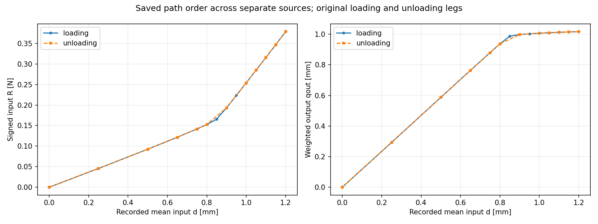
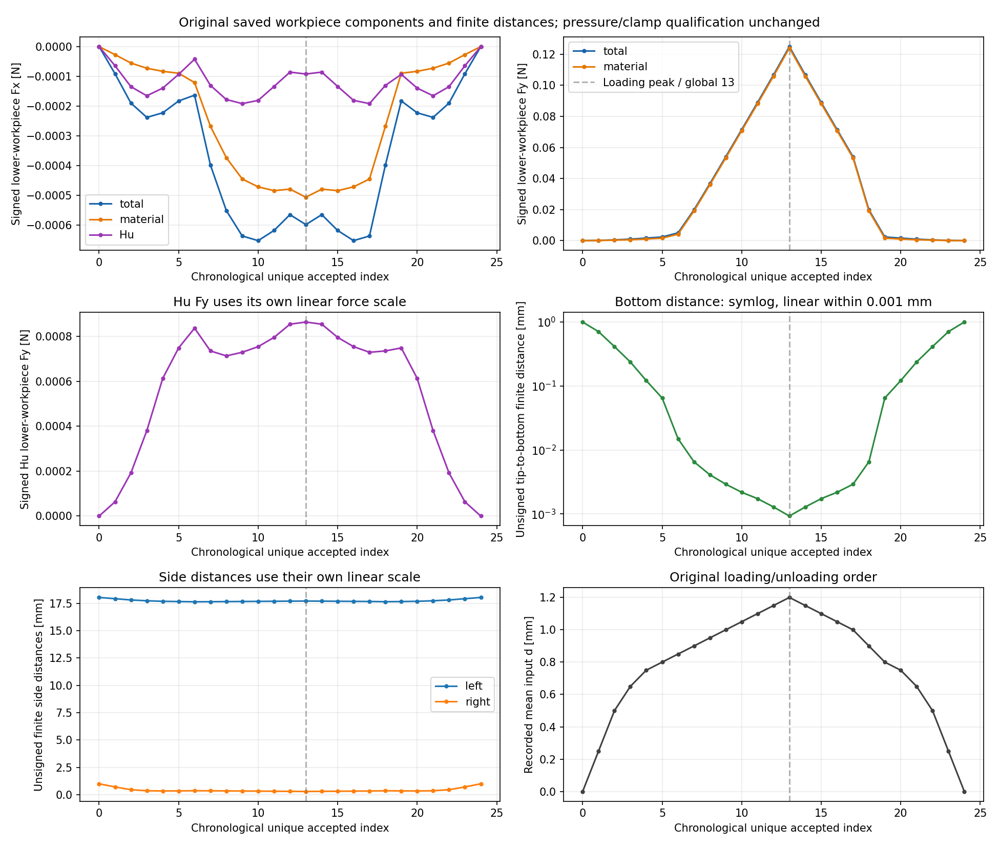

# M-PATH1实际结果：统一保存路径与显示PASS

2026-10-13（Asia/Seoul）。用户“继续”对应的普通JSON汇总与两曲线显示已单次实际完成，源提交`937b2d9f69008adc876e9f2a2def30aa432e6f83`；root观察真实exec_command chunk69de28终止exit0，outer/helper均pass。源准备、实际运行与发布核对分开记录。

整体目标仍是独立HF有限变形／TMC前向分析、实际作用／位移、保存态恢复和可检查变形，服务外部研究层。五段数据此前散落于不同目录，本轮新增可调用的compose_path、build_index、markdown及render_path入口；逐点索引可从同一文件找到result／child／stateSHA及显示别名，便于异地恢复和后续参考比较。源函数实现普通读取与显示，不改变默认力学。

实际一次composer＋一次renderer：22份既存普通JSON汇总为29原行／4严格一致边界锚点／25按实际顺序显示点，覆盖global0..24；原五段result、viewer、参数／设置／task前缀、source版本与祖先状态保留。原加载failed/time_limit仍失败；拼接显示不等于一次25目标求解或全路径独立参考通过。

新产物为三份普通文稿和两PNG，原五GIF仅repository-relative链接／旧声明加stat，不解码、拼接或重绘变形。两图分别显示加载／卸载R和qout，及固定下半工件signed Fx/Fy、材料／Hu贡献、有限边距离和输入顺序。Hu Fy用独立线性尺度；底边距离symlog的0.001mm只是显示阈值，不是接触或验收门。

原保存数值如下，显示舍入没有计算新力／压力／差值或积分：

| global | 原leg | 输入 mm | R N | qout mm | 下半工件total Fy N | Hu Fy N | 有限底边距离 mm |
| --- | --- | --- | --- | --- | --- | --- | --- |
| 0 | origin | 0 | 0 | 0 | 0 | 0 | 1 |
| 1 | loading | 0.25 | 0.0456657111613 | 0.292799309666 | 0.000169965821705 | 6.36222895798e-05 | 0.707304965518 |
| 2 | loading | 0.5 | 0.0925333065081 | 0.587232882891 | 0.000499232281412 | 0.000192258459039 | 0.413231877814 |
| 3 | loading | 0.65 | 0.121625835389 | 0.763624054882 | 0.000960732906758 | 0.00038065735165 | 0.237285840514 |
| 4 | loading | 0.75 | 0.14185485751 | 0.879947805623 | 0.00164286904214 | 0.000613089052383 | 0.121452139593 |
| 5 | loading | 0.8 | 0.152543853536 | 0.936858828374 | 0.0023451588659 | 0.000748865137549 | 0.0648825368502 |
| 6 | loading | 0.85 | 0.165681848185 | 0.98735937686 | 0.00502346404762 | 0.000836791208805 | 0.0149594199528 |
| 7 | loading | 0.9 | 0.193413365531 | 0.998321785104 | 0.0198430044604 | 0.000735365397988 | 0.00653602050668 |
| 8 | loading | 0.95 | 0.22349880903 | 1.00319010393 | 0.0366962326383 | 0.000713308094186 | 0.00409146779814 |
| 9 | loading | 1 | 0.25413673352 | 1.00672186587 | 0.0540156611499 | 0.000729450060533 | 0.00291136518177 |
| 10 | loading | 1.05 | 0.284972092043 | 1.0098299039 | 0.0714869286439 | 0.000754543327609 | 0.00218007304353 |
| 11 | loading | 1.1 | 0.3158860167 | 1.01277637013 | 0.0889784710921 | 0.000795746543472 | 0.00173050460459 |
| 12 | loading | 1.15 | 0.34703768154 | 1.01531742423 | 0.106712875531 | 0.000854454044677 | 0.00128504782427 |
| 13 | loading | 1.2 | 0.37865427196 | 1.0169345343 | 0.1249212163 | 0.000864081612484 | 0.000969660206483 |
| 14 | unloading | 1.15 | 0.34703768154 | 1.01531742423 | 0.106712875531 | 0.000854454044676 | 0.00128504782427 |
| 15 | unloading | 1.1 | 0.3158860167 | 1.01277637013 | 0.0889784710921 | 0.000795746543472 | 0.00173050460459 |
| 16 | unloading | 1.05 | 0.284972092043 | 1.0098299039 | 0.0714869286435 | 0.000754543327609 | 0.00218007304353 |
| 17 | unloading | 1 | 0.25413673352 | 1.00672186587 | 0.0540156611499 | 0.000729450060532 | 0.00291136518177 |
| 18 | unloading | 0.9 | 0.193413365531 | 0.998321785104 | 0.0198430044604 | 0.000735365397988 | 0.00653602050668 |
| 19 | unloading | 0.8 | 0.152543853536 | 0.936858828374 | 0.00234515886586 | 0.000748865137511 | 0.0648825368502 |
| 20 | unloading | 0.75 | 0.14185485751 | 0.879947805623 | 0.00164286904214 | 0.000613089052383 | 0.121452139593 |
| 21 | unloading | 0.65 | 0.121625835389 | 0.763624054882 | 0.000960732906758 | 0.00038065735165 | 0.237285840514 |
| 22 | unloading | 0.5 | 0.0925333065081 | 0.587232882891 | 0.000499232281412 | 0.000192258459039 | 0.413231877814 |
| 23 | unloading | 0.25 | 0.0456657111613 | 0.292799309666 | 0.000169965821705 | 6.36222895798e-05 | 0.707304965518 |
| 24 | unloading | 0 | -1.37324906426e-26 | -9.47999393351e-25 | -3.34467867947e-27 | -3.03541323935e-27 | 1 |

工件力为固定下半工件signed weak-form节点合力，包含材料和Hu；端口位移不是间隙，有限距离不是连续接触压力。0.90→0.80段作用明显衰减且间隙扩大；0.25仍有小合力而底边距离已约0.707mm，不能只按非零Fy判仍在有效夹持。零输入的反力／作用和应变接近零、底边距离1mm，只是此固定模型的实际终态观察。

| 原参考 | 精确原source child | global | 输入 mm | 原参考state状态 |
| --- | --- | --- | --- | --- |
| M-AREF1 | M-RESUME1:0 | 13 | 1.2 | pass |
| M-AREF1 | M-RESUME1:1 | 14 | 1.15 | pass |
| M-EREF1 | M-EXTEND2:1 | 15 | 1.1 | pass |

这三个参考点属于原result/state身份。global13的显示第一来源是ALPHA父段，既存参考实际核RESUME child0的同身份锚点；显示别名不把HP资格转移到父段、别段或整条25点路径。五个原viewer在生成时reference_available=false保持。完整路径参考、连续压力、有效自由工件夹持、稳定性、全部切线列和HF5资格不增加。

实际资源：helper回执1.8085098秒，helper完整wall2.3346414秒，outer2.6404913秒；helper采样峰94494720B、进程树采样峰93536256B，均在新180／240秒、采样8GiB窗口内。原27普通绑定初末保持；GIF5仅声明／stat。无新HF导入、F／T／平衡／HP／测试、默认安装或重试。采样与协作等待不宣称OS硬限制。

root两PNG各一次像素检查，状态pass_display_with_documented_sampling_and_scale_limits；观察如下：

- 两PNG标题、轴和图例可读；按原loading/unloading腿分别连接，global13虚线为保存加载峰。
- 输入反力和输出端口曲线在共同采样位置视觉上重合。loading含0.85/0.95点而unloading未采这两点，局部连线差不能作为物理滞回证据；没有计算曲线差值或回线功。
- 输出端口在较大输入时接近平台约1.017mm，工件Fy继续增长至原峰值约0.124921N；这只是保存观测。
- 工件signed Fx非单调且为负，不能按全部力单调解释；Fy总量与材料贡献接近，Hu Fy用独立尺度显示其较小但非零的贡献。
- 底边有限距离用symlog，0.001mm是显示阈值；它不是接触门、穿透检查或压力定义。侧边距离共轴时左侧约18mm占尺度，小的右侧变化仍应按原值表检查。
- 0.25mm时底边距离约0.707305mm而工件Fy仍小幅非零；工件节点合力含material与Hu，不能仅凭非零Fy认有效夹持。
- 两图汇总的是分段实际保存观测，不改原failed/time_limit、不授单次全路径生产或参考PASS、连续压力、有效夹持、完全释放、稳定性或HF5资格。

下一步应优先为0.90／0.80两态（M-UNLOAD2 child2/3、global18/19）冻结必要的HP80／120四次参考范围与资源，保持原十五门、原result/state身份及力学条件，不重做加载／卸载。该新HP方案本轮未执行或授权，不授压力、有效夹持或稳定性资格。

[完整路径JSON](run_001/composed_path.json) · [逐点索引](run_001/path_index.json) · [完整原值／动画链接表](run_001/OBSERVATIONS.md) · [执行回执](run_001/execution_receipt.json) · [外层回执](path_launch.json) · [像素观察](author/pixel_QA.json) · [具体卡](M-PATH1_CARD.md)。实际出版状态另以真实推送／恢复收据核，不在此预claim。
