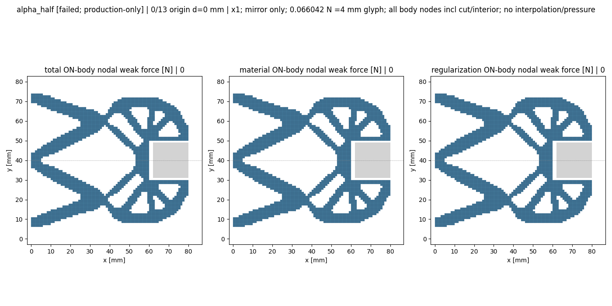
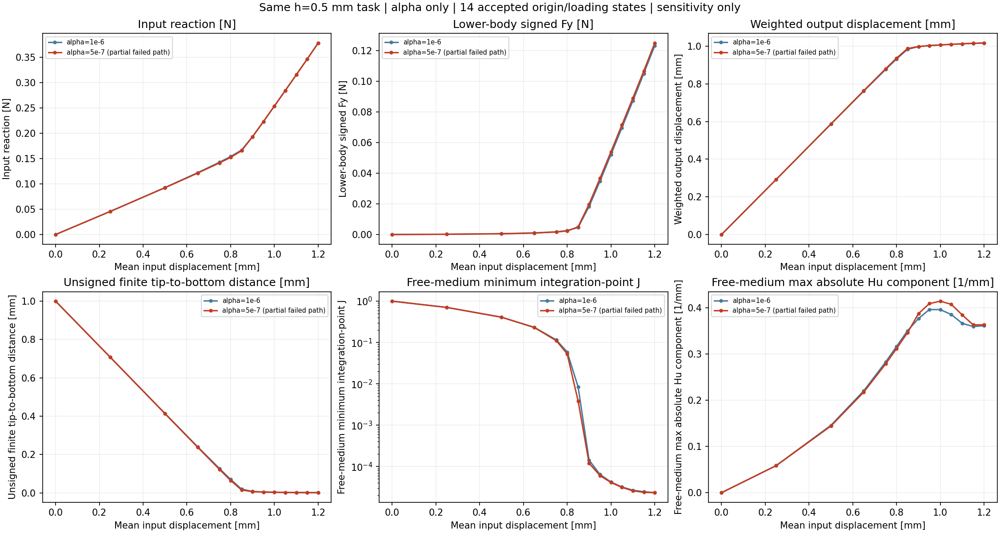

# M-AVIEW1 实际结果：14态显示／alpha对照通过，原卸载未完成

**M-AVIEW1 经直接人类批准，唯一实际执行 PASS，窗口已关闭。** 本通过仅覆盖保存态观察／显示／对照。原 M-ALPHA1 完整15目标仍为 NOT_PASS：14原点／加载态保存至1.20 mm，首次卸载1.15 mm超时，没有卸载接受态。原result、全部NPZ、source/card/protocol及77个准备bindings保持。

整体目标是独立HF有限变形／TMC前向评价：读取LF普通几何，在一致物理任务下计算可检查的变形、反力及工件作用，供外部研究层比较；HF不优化、不调用dmftd。此前新alpha已有接受态，但图件未产生，因此本卡读取已有结果以获得直接可检查的物理效果。没有重新加载或续算。

## 实际工作和证据

- 批准源码main `7887aa1138f8e46a2b15f47a1060aa7d72cfe651`；直接批准、协议与真实准备发布证明见[授权记录](author/authorization.json)、[人类原文](author/direct_human_reply.json)和[来源证明](author/M_AVIEW1_source_publication_receipt.json)。准备卡及false准备标记作为历史保持，实际状态另记于本页。
- h0.5、84×40 mm下半域、固定side18方体center(71,40)、E1 MPa、nu0.3、厚20 mm、gamma1e−6、Lr80 mm；新alpha5e−7，旧baseline1e−6。只有alpha不同，BC／平均输入端口及几何保持。
- 一次launcher、一次wrapper、一次冻结raw viewer；一例alpha_half内14接受态。实际geometry14／nodal14，42逐态JSON、9842节点数据行；按源路径及字段身份门解码29既存NPZ的279字段实例，不读切线／全矩阵或baseline NPZ。
- 14个共同original origin/loading目标逐态身份配对，14指标的新旧值及196个已算candidate−baseline差值见[CSV](run_001/view/alpha_comparison.csv)和[JSON](run_001/view/alpha_comparison.json)。原baseline24行身份核查，未重新观察baseline；没有插值／百分比／归零或数值接近度新门。
- 6PNG／1GIF14帧、56份实际view文件；raw回执49项输出哈希，wrapper回执55项（分别不含自身）。全部文件经[独立终态核查](author/TERMINAL_REVIEW.md)及[物理解读](author/PHYSICAL_RESULTS_REVIEW.md)核对。[root像素记录](author/root_pixel_review.json)实际查看六PNG；没有重新渲染或逐帧人工检查全部GIF。
- 原raw几何／节点门通过，逐态节点结果与缓存三分量合力一致，holding逐节点total向量相反，固定工件split保持零。geometry valid及无strict-overlap记录不授予有效接触、连续压力或稳定性。
- 额外F／T／构模／平衡／HP／JIT／LF调用0；pure源和导入来源为零力学依据，mechanical_hooks_monitored=false，不能称动态hook监测。没有重试、修复重跑、延期或force。

## 真实耗时与资源

| 原记录 | 秒 | 采样峰RSS [B] |
| --- | ---: | ---: |
| raw viewer（保存态显示） | 36.768821500008926 | 365379584 |
| wrapper回执（最终写回执前） | 39.19431579999218 | 365379584 |
| outer（helper/退出全过程） | 39.6406280999945 | 363720704 |

预算helper180／outer240秒，采样8GiB；outer exit0、stop_reason=null、全部bindings unchanged。wrapper最终stdout实际39.195223199989414秒。own与tree采样不同，不作同刻比较，不承诺OS硬内存上限。原[stdout](view_stdout.log)的Matplotlib loc=best绘制图例性能UserWarning保留；不是终端错误或新科学验收门。

## 可人工检查的数值与效果

以下只复制本次已有观察／对照值，显示舍入；完整精度保存在CSV/JSON，没有额外科学计算。

| 平均输入 [mm] | R [N] | 下半total Fy [N] | material Fy [N] | Hu Fy [N] | 有限tip-bottom [mm] | medium minJ | medium max abs Hu [1/mm] |
| ---: | ---: | ---: | ---: | ---: | ---: | ---: | ---: |
| 0.85 | 0.1656818482 | 0.005023464048 | 0.004186672839 | 0.0008367912088 | 0.01495941995 | 0.003827207821 | 0.3464004697 |
| 1.2 | 0.378654272 | 0.1249212163 | 0.1240571347 | 0.0008640816125 | 0.0009696602065 | 2.328300956e-05 | 0.363602238 |

| 1.20 mm指标 | 原alpha1e−6 | 新alpha5e−7 | 已保存新−旧 |
| --- | ---: | ---: | ---: |
| 输入反力R [N] | 0.3787064524 | 0.378654272 | -5.218043534e-05 |
| 下半total Fy [N] | 0.1231794016 | 0.1249212163 | 0.001741814699 |
| 下半material Fy [N] | 0.1219125571 | 0.1240571347 | 0.002144577629 |
| 下半Hu Fy [N] | 0.001266844543 | 0.0008640816125 | -0.0004027629304 |
| 有限tip-bottom距离 [mm] | 0.001144362628 | 0.0009696602065 | -0.0001747024217 |
| free-medium积分点minJ | 2.339669248e-05 | 2.328300956e-05 | -1.136829209e-07 |
| free-medium max abs Hu分量 [1/mm] | 0.361481586 | 0.363602238 | 0.002120651955 |

新alpha峰值反力与原值接近；material Fy增加、Hu Fy减小、total Fy增加。0.85 mm附近free-medium minJ两点差异明显，峰值minJ仍很小。两值及图形只能描述参数敏感性，不能证明alpha或网格收敛。已有证据不足以把原卸载超时归因于Hu核错误、物理不稳定或Newton无法收敛。

红箭头是全部703下半工件节点的弱式力（含physical/cut/interior）；holding反向，镜像上半只显示，不再求解。下半signed Fy、镜像净力和cached双侧幅值和须分别解释。峰值cached双侧法向幅值和0.24984243260064853 N仍不是合格有效夹持力。

钳尖已接近固定方体底面；无符号有限距离0.0009696602064828141 mm不等于穿透判据或合格接触。node-window与finite-surface本态数值相同也不能混同定义。色彩图的cell meanJ／Hu Frobenius范数不同于表内积分点minJ／max abs Hu分量；Green应变是保存F派生的binary64观察，没有新HP。

## 实际图件

[1.20 mm三分量快照](run_001/view/loading_120_forces.png) · [0.85 mm快照](run_001/view/loading_085_forces.png) · [峰值/最后态及有限面zoom](run_001/view/comparison.png) · [距离与signed Fx](run_001/view/distances_forces.png) · [峰值分区场](run_001/view/peak_fields.png)

统一14态力尺度使0.85及Hu箭头很小，视觉缺失不代表力为零；底面小距离在全距离共轴图中也难分辨，应结合zoom与原数值。两快照复制新GIF帧6/13原像素，状态SHA、leg、d有效；PEAK和LAST均为index13，没有卸载帧。原比较图标题笼统称orange distances，各线实际由legend区分，冻结viewer未改。

## 当前进度与下一步

完整NumPy力、全DOF未对称矩阵／组装、平均输入Mean、API／同任务batch、缓存保存、独立读取及实际显示已有实现。新alpha14加载态已可见；本轮补齐的是显示功能，未补齐卸载或物理资格。公共Mean/API没有已验证保存态下降续算入口；底层warm参数及非负阶段变量不能直接用于1.20→1.15 mm。

[下一步取舍](NEXT_STEP_REVIEW.md)优先明确保存峰值的初始mean／split／R／可用缓存、下降目标、回滚和来源合同，再准备最小局部验证。不复做长加载、不扫描新alpha、不修Hu核或放宽原门。一般输入、其它形状完整路径、全部切线列独立验证、连续总压力、可移动工件/摩擦、有效夹持、物理稳定性、正式标签/排名及HF5仍有缺口。原alpha24态／48HP只属原任务；新alpha无HP。
