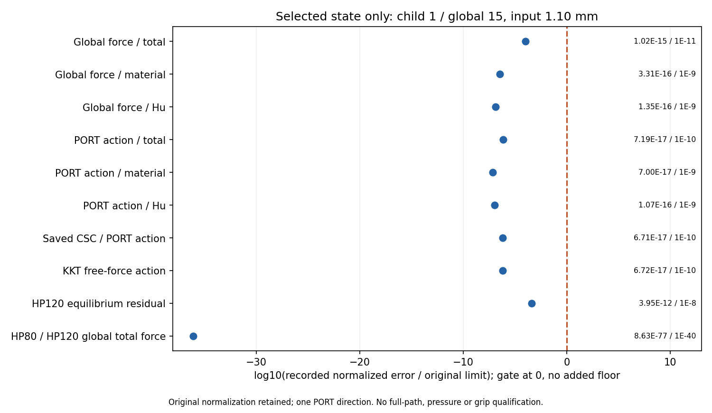

# M-EREF1：新1.10 mm保存态独立参考结果

2026-10-13（Asia/Seoul）。已按真实人类批准单次执行并闭卡，实际 **PASS**；本报告不以静审替代计算。执行源为main `8438c55f267246b91d6b320273ecb10665f3e16f`，协议SHA `ed835ffd724ad82c3a8870fd05326baf784814fcb16e9f938a6559ad1d8e7135`。提交、推送和恢复确认在执行闭卡后独立记录，不计为新科学计算。

## 整体目标、本步作用及已完成能力

本项目独立读取LF普通几何，在一致物理任务下提供非线性TMC正向响应、输入反力、端口位移、固定工件作用、可恢复状态和真实变形，供外部研究层比较；HF不进行优化、不调用dmftd，MPM暂不实现。默认显式保存态延伸接口已安装并有36项兼容测试证据，原1.15→1.10 mm段已成功且有实际三PNG／两帧GIF。

本步先核新1.10态的生产力、同一PORT方向切线、CSC／KKT及工件投影是否与独立高精度计算一致，避免在未经核对的末态上扩大卸载路径。原B850 `CoreAudit.run_state`及aa86 `WorkpieceCycleAudit.workpiece_checks`、原十五门、分母和局部规则保持。未重做生产F／T、平衡求解、测试、API关联或默认安装，也未重复已有1.15参考。

## 实际执行与覆盖

唯一launcher调用一次、同一子进程已正常退出0，无stop信号、重试、修复重跑、延期或force。outer 99.370171100秒、child实际终止墙钟 98.646652900秒；helper lifecycle快照 97.631867500秒。900／960秒批准额度均满足。outer采样进程树峰值 1277128704 B，helper独立采样峰值 1269522432 B，均低于8GiB；这是两种采样口径，不能视为OS硬限制。

新HP80／120各一次，共2次开始／2次完成；1个机械态、1个工件检查、1次原普通JSON误差绘图均完成。程序实际完成 80802 项检查，原十五类验收门均通过；检查计数不是十五个新门。覆盖原13440单元／27378DOF、322560局部力及同一方向局部切线条目、860160保存总CSC系数组装身份。未独立核全部切线列。

保存态为child001／global15／absolute mean input1.10 mm、unloading、非anchor，SHA `3dc492f8aef4751e643ddb1413a797ca39434d349bfed59844d46e4e730015ff`。raw报告保持index15，顶层保持child1及reference_execution_index15。50个原输入／来源绑定在launcher前后保持，六份默认生产入口不变；引用真实成功父段和保留的失败祖先，没有拼接资格。

## 数值效果

下表均为本次原摘要中的归一化误差与原阈值，显示位数仅为阅读方便；完整十进制数、局部极值、原分母及零项保存在[原单态摘要](run_001/reference/accepted_015/summary.json)。它们不是工件Fy的相对百分比。

| 原观察量 | 记录误差 | 原阈值 | 结果 |
| --- | ---: | ---: | --- |
| Global force / total | 1.02259e-15 | 1E-11 | PASS |
| Global force / material | 3.30794e-16 | 1E-9 | PASS |
| Global force / Hu | 1.35036e-16 | 1E-9 | PASS |
| PORT action / total | 7.19048e-17 | 1E-10 | PASS |
| PORT action / material | 6.99837e-17 | 1E-9 | PASS |
| PORT action / Hu | 1.06605e-16 | 1E-9 | PASS |
| Saved CSC / PORT action | 6.70845e-17 | 1E-10 | PASS |
| KKT free-force action | 6.71749e-17 | 1E-10 | PASS |
| HP120 equilibrium residual | 3.95170e-12 | 1e-8 | PASS |
| HP80 / HP120 global total force | 8.62672e-77 | 1E-40 | PASS |

原保存生产平衡残差约3.95170e−12（门1e−9），独立HP120残差约3.95170e−12（门1e−8）；约束和固定误差为原记录零。材料／Hu局部力与方向切线、HP80／120一致性及工件ON-body／holding分组核对通过。rounded F／J／Hu与保存binary64一致仅保原诊断，不新增应力或Hu数组资格。

## 实际可视化与物理对照

图在批准helper内一次生成，横轴为原误差／原阈值的log10显示，红线为原门；全部点在门内。普通JSON含原error／limit、来源字段和显示值。闭卡后root仅进行一次像素检查，十行标签、原值及资格说明可读，未重绘；见[像素记录](author/pixel_QA.json)。图的零新力学调用是固定纯源码／来源合同，不声称动态监控了全部力学hook。

已有生产实际结构／力／距离：[1.15→1.10真实变形GIF](../saved_extension_002/run_001/view/extended_alpha_half/actual_states.gif)、[局部变形图](../saved_extension_002/run_001/view/comparison.png)、[作用力与距离](../saved_extension_002/run_001/view/distances_forces.png)。本步不重新解码旧媒体或生成旧结构图。

| 保存生产物理量 | 1.15 mm | 新1.10 mm |
| --- | ---: | ---: |
| 输入端施加到模型的反力R（N） | 0.347037681540 | 0.315886016700 |
| 输出端口加权位移（mm） | 1.015317424233 | 1.012776370128 |
| 固定工件所受节点合力Fy（N） | 0.106712875531 | 0.088978471092 |
| 其中材料／Hu的Fy（N） | 0.105858421486／0.000854454045 | 0.088182724549／0.000795746543 |
| 尖端至工件底边有限段间隙（mm） | 0.001285047824 | 0.001730504605 |

物理表直接来自已有[M-EXTEND2普通viewer摘要](../saved_extension_002/run_001/view/extended_alpha_half/summary.json)，不是本轮新计算的标量HP夹持力报告。两侧镜像法向幅值之和是保存弱式节点作用的对称解释，不是净合力或连续接触压力。卸载0.05 mm后输入反力和工件Fy下降、尖端间隙增大，支持继续观察更低目标。

## 资格、局限与下一步

本轮已核新1.10保存态及声明方向。现有公开API要求整个两态result与4次新HP，本轮独立单态／2HP归档不能作为该整个result的matched参考；原response和reader保持。原1.15参考仍属于其原result来源，不重新改绑或拼成新4HP。

原M-ALPHA1及M-EXTEND1 NOT_PASS、成功父段、祖先失败、未完成完整原／延伸路径均保留。压力、有效夹持、完全释放、稳定性、全列切线、一般LF与HF5资格保持false。本次一致性通过不能证明介质参数物理准确或整个卸载路径完成。

根据本次PASS与已有作用／间隙趋势，下一步最近阶段拟从已成功的1.10末态显式追加1.05 mm，保持全部原物理字段、原路径前缀和验收门，复用默认入口及原纯viewer，取得新反力、工件作用、距离和实际变形。无需再次安装或重跑已完成36项兼容测试；新平衡路径、资源及绘图范围另成具体卡，经静审、发布／恢复核对和直接批准后执行。若新段失败保真实partial并先排查，不在旧窗口内重试。

## 代码与可恢复证据

执行入口：[唯一launcher](launch_reference.py)、[单态参考包装](execute_extension_reference.py)、[纯摘要图](plot_reference_observation.py)；数学实现来源及原15门见[M-EREF1卡](M-EREF1_CARD.md)。实际闭卡：[launcher](reference_launch.json)、[lifecycle](run_001/reference/lifecycle.json)、[顶层摘要](run_001/reference/summary.json)、[独立终态审阅](author/independent_terminal_review.md)、[真实直接批准](author/direct_human_reply.json)。新科学文件SHA继承批准窗口内producer的原记录，发布期只stat核大小和增量普通文件SHA，不在闭窗外重算数组／gzip／PNG身份或科学结果。
