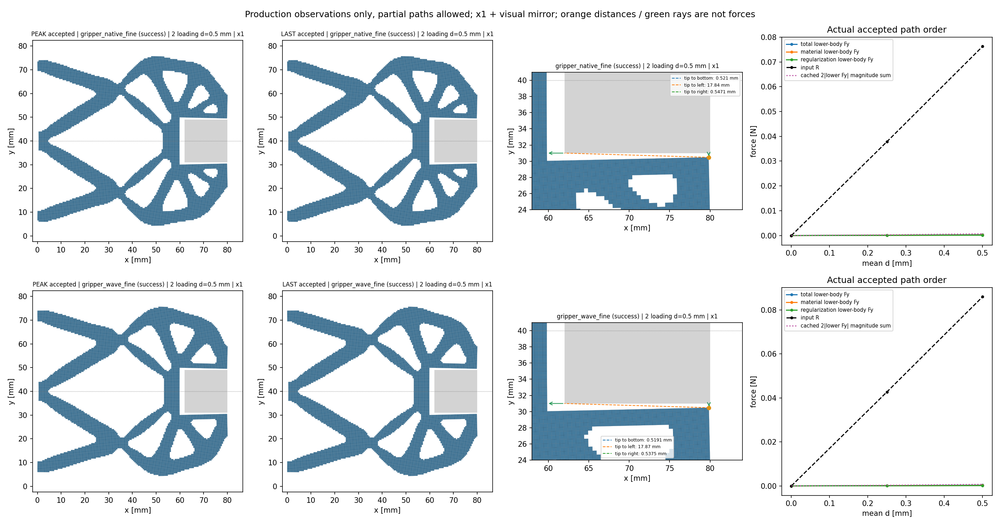
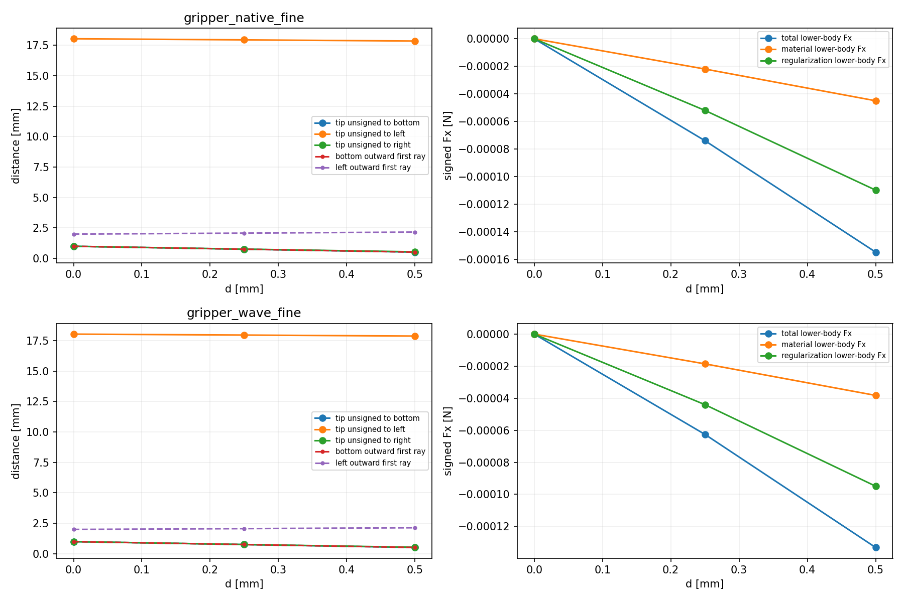
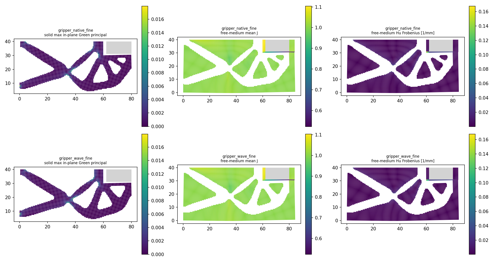

# L-BFWD1：双LF短加载实际结果

两例按清单顺序完成0→0.25→0.50 mm短加载。以下图及动画来自本次保存接受态；没有插值或旧媒体重绘。

R是半模型输入反力；q_out是加权端口位移，不是间隙。下半工件total/material/Hu为有符号弱式作用，不是压力或已认证有效夹持。

制造pending；无新独立参考，不授完整25目标、卸载、释放、稳定性、HF5或正式排名。旧前三目标仅作原值并列，来源/源码epoch各自保留，不据此宣称同源码全路径或资格传递。

[原值状态表](states_table.json) · [批量清单](<../batch_manifest.json>) · [保存态显示记录](view/view.json)

## gripper_native_fine

status=success；实际接受态数=3。peak/last是本短加载的实际最大接受态，非1.20 mm完整循环峰值。

[result](<cases/000/result.json>) · [response](<cases/000/response.json>) · [有限距离/分区场原值](<view/gripper_native_fine/summary.json>) · [实际N帧GIF](<view/gripper_native_fine/actual_states.gif>) · [旧前三目标来源](<../../lf_forward_001/run_001/lf_fine_forward/result.json>)

| 原目标 | leg | d mm | 新R N | 旧R N | 新q_out mm | 旧q_out mm | 新下半工件Fy N | 旧下半工件Fy N |
|---:|---|---:|---:|---:|---:|---:|---:|---:|
| 0 | origin | 0.0 | 0.0 | 0.0 | 0.0 | 0.0 | 0.0 | 0.0 |
| 1 | loading | 0.25 | 0.037854547374020546 | 0.037854547374020546 | 0.23909665892141302 | 0.23909665892141302 | 0.00013344193749676822 | 0.00013344193749676822 |
| 2 | loading | 0.5 | 0.07624835727107876 | 0.07624835727107876 | 0.4792732955273436 | 0.4792732955273436 | 0.00034791873300466907 | 0.00034791873300466907 |

内部二分态保实际接受顺序；旧列缺失保持空，不填零。所有材料/Hu/总量与有限距离、分区J及应变原值保存在状态表。

## gripper_wave_fine

status=success；实际接受态数=3。peak/last是本短加载的实际最大接受态，非1.20 mm完整循环峰值。

[result](<cases/001/result.json>) · [response](<cases/001/response.json>) · [有限距离/分区场原值](<view/gripper_wave_fine/summary.json>) · [实际N帧GIF](<view/gripper_wave_fine/actual_states.gif>) · [旧前三目标来源](<../../lf_third_pilot_001/run_001/lf_third_pilot/result.json>)

| 原目标 | leg | d mm | 新R N | 旧R N | 新q_out mm | 旧q_out mm | 新下半工件Fy N | 旧下半工件Fy N |
|---:|---|---:|---:|---:|---:|---:|---:|---:|
| 0 | origin | 0.0 | 0.0 | 0.0 | 0.0 | 0.0 | 0.0 | 0.0 |
| 1 | loading | 0.25 | 0.04272814528256173 | 0.04272814528256173 | 0.2402148970214889 | 0.2402148970214889 | 0.00013440496489672206 | 0.00013440496489672206 |
| 2 | loading | 0.5 | 0.08593082815865576 | 0.08593082815865576 | 0.4811512138551336 | 0.4811512138551336 | 0.0003512425565784398 | 0.0003512425565784398 |

内部二分态保实际接受顺序；旧列缺失保持空，不填零。所有材料/Hu/总量与有限距离、分区J及应变原值保存在状态表。
