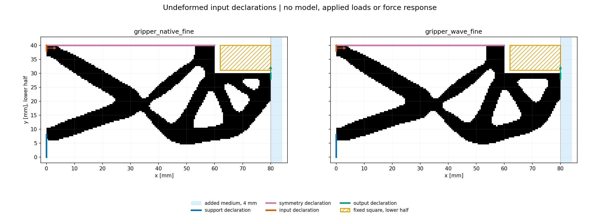

# LF batch input preparation: manual review

Two ordinary LF packages are prepared under one unchanged task. The diagram shows undeformed declarations; no model, force, tangent, equilibrium or HP calculation was run. Arrows show port directions only.

| Case | Status | Native solid cells | Grid | Targets |
| --- | --- | ---: | --- | ---: |
| gripper_native_fine | success | 4358 | 80 x 168, h=0.5 mm | 25 |
| gripper_wave_fine | success | 4349 | 80 x 168, h=0.5 mm | 25 |

[Source list](../source_manifest.json) · [Preparation index](index.json) · [Batch manifest](batch_manifest.json) · [Exact data checks](checks.json)

- gripper_native_fine: [geometry](prepared/000/derived_geometry/geometry.json), [task](prepared/000/task.json), [source and epoch](prepared/000/input_manifest.json).
- gripper_wave_fine: [geometry](prepared/001/derived_geometry/geometry.json), [task](prepared/001/task.json), [source and epoch](prepared/001/input_manifest.json).

Check port/support locations, the fixed square outline and native/added-domain boundary. The square is shown only within the lower-half analysis domain. No future evaluation directory has been created. Future clock/budget must be specified before batch execution. Existing qualification and failed history are unchanged; pressure, effective grip, release, stability, formal labels, ranking and HF5 remain unqualified.
