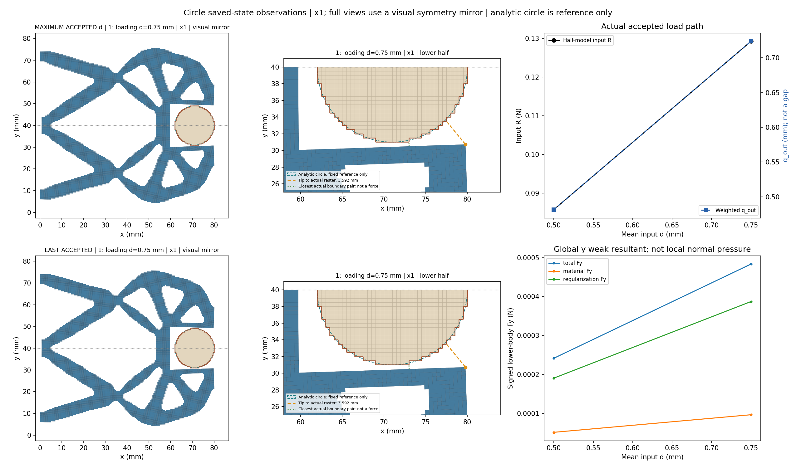
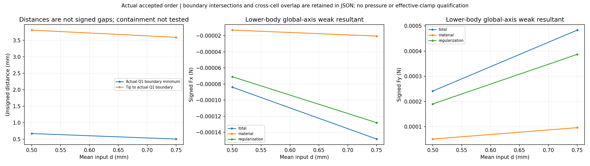
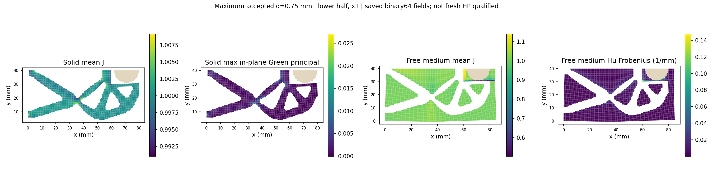
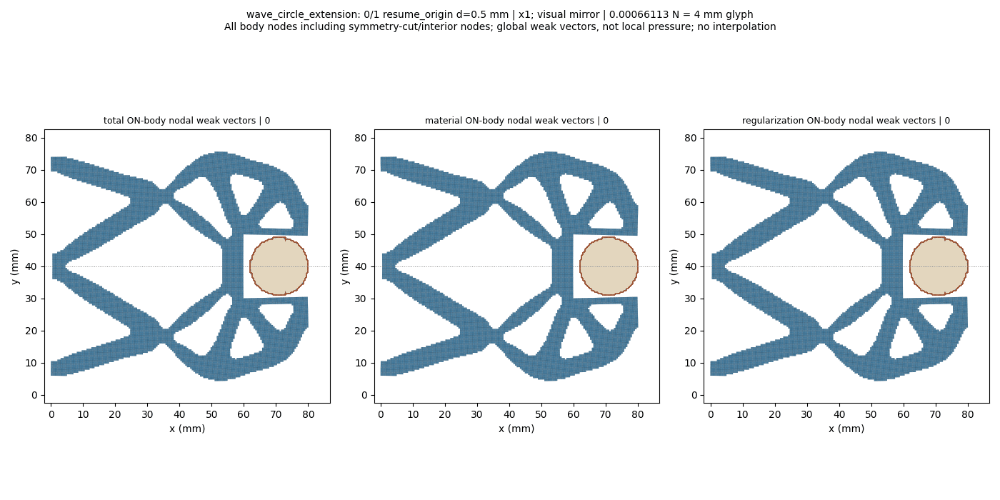
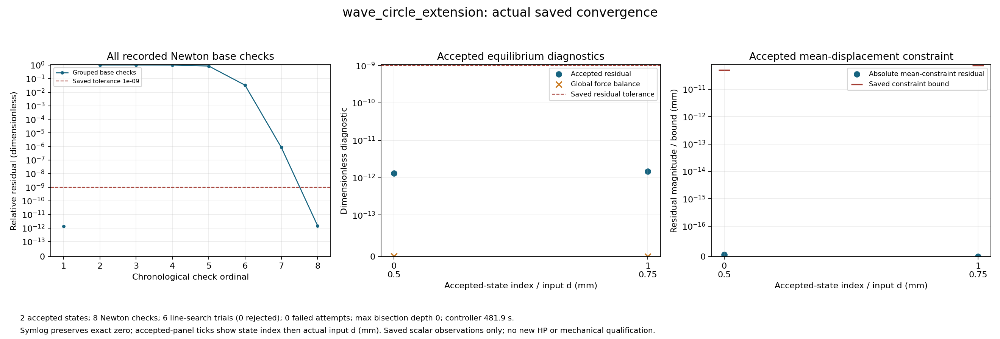

# L-CEXT1：load_only 保存态显式延伸与圆形工件0.50→0.75 mm

执行状态 **PASS**；生产 `success`、helper `pass`、outer `pass`，停止阶段 `final_binding_and_seal`。基线 main `09c3495c1a4dfc30ec58143ae192d851ac7d3283`；science 0.5.0／b1334 基线保持。

整体目标仍是普通LF几何进入独立HF的TMC前向力学，逐步实现可检查的加载、接触与卸载。此步先为load_only补齐保存末态显式追加功能，以小模型验证首次/再次延伸和原cycle兼容，再使用真实圆形0.50 mm接受态推进到0.75 mm，复核anchor并显示实际变形、反力和收敛。

工件半径9 mm、中心(71,40) mm、固定ux/uy；其余E=1 MPa、nu=0.3、plane strain、厚20 mm、h=0.5 mm、84×40 mm下半域、gamma=1e-6、alpha=5e-7、Lr=80 mm及支撑/平均端口/对称保持。新任务保留原[0,0.25,0.50]前缀，仅追加0.75 mm并将input目标更新至新峰值；四说明字段可更新，其余任务精确保持。原父任务、结果及方体25目标历史不改。

三个默认入口的实际状态 `[{'path': 'hf_repo/src/hf_eval/native_resume.py', 'actual_sha256': 'e8162964487df510a608a980feb1a03b3ac36e97a55452fac9e342274cfee2d1', 'actual_bytes': 16819, 'baseline_sha256': '2bd859980e8e7ff09b09db35b61e5c948b524e2fd6724189ca8957c0d3e37e65', 'candidate_sha256': 'e8162964487df510a608a980feb1a03b3ac36e97a55452fac9e342274cfee2d1', 'changed_from_baseline': True, 'matches_candidate': True, 'installation_confirmed_in_helper': True}, {'path': 'hf_repo/src/hf_eval/split_displacement.py', 'actual_sha256': '151cc130f0a75e3b2f201b393541107ccf2feaa3de365db72d1987568dae1bb8', 'actual_bytes': 24156, 'baseline_sha256': '8cdc31e041e7753275e880d69ec3918d87a7f6e582951885d0af288f657e5237', 'candidate_sha256': '151cc130f0a75e3b2f201b393541107ccf2feaa3de365db72d1987568dae1bb8', 'changed_from_baseline': True, 'matches_candidate': True, 'installation_confirmed_in_helper': True}, {'path': 'hf_repo/src/hf_eval/native_mean.py', 'actual_sha256': '76fd9917fe378865f3f359838958e58505afb9ae2e7c7ec257773a76178fd6e4', 'actual_bytes': 22777, 'baseline_sha256': '34aba7347790fafa7f03511a42aa9876649b8ce4f8c98b3efdb5a0e664288401', 'candidate_sha256': '76fd9917fe378865f3f359838958e58505afb9ae2e7c7ec257773a76178fd6e4', 'changed_from_baseline': True, 'matches_candidate': True, 'installation_confirmed_in_helper': True}]`；helper已确认安装转移 `[{'target': 'hf_repo/src/hf_eval/native_resume.py', 'source': 'lf_data_preparation/native_interface_001/lf_circle_extension_001/candidate/hf_repo/src/hf_eval/native_resume.py', 'before_sha256': '2bd859980e8e7ff09b09db35b61e5c948b524e2fd6724189ca8957c0d3e37e65', 'after_sha256': 'e8162964487df510a608a980feb1a03b3ac36e97a55452fac9e342274cfee2d1', 'bytes': 16819}, {'target': 'hf_repo/src/hf_eval/split_displacement.py', 'source': 'lf_data_preparation/native_interface_001/lf_circle_extension_001/candidate/hf_repo/src/hf_eval/split_displacement.py', 'before_sha256': '8cdc31e041e7753275e880d69ec3918d87a7f6e582951885d0af288f657e5237', 'after_sha256': '151cc130f0a75e3b2f201b393541107ccf2feaa3de365db72d1987568dae1bb8', 'bytes': 24156}, {'target': 'hf_repo/src/hf_eval/native_mean.py', 'source': 'lf_data_preparation/native_interface_001/lf_circle_extension_001/candidate/hf_repo/src/hf_eval/native_mean.py', 'before_sha256': '34aba7347790fafa7f03511a42aa9876649b8ce4f8c98b3efdb5a0e664288401', 'after_sha256': '76fd9917fe378865f3f359838958e58505afb9ae2e7c7ec257773a76178fd6e4', 'bytes': 22777}]`。小模型报告 `{'schema_version': 'hf-load-only-extension-tests-1.0', 'methods_run': 8, 'methods_expected': 8, 'failures': 0, 'errors': 0, 'successful': True, 'failfast': True, 'work_directory': 'D:/Coding/Diversity TO/Compliant-Nonlinear-TMC-O/.github_handoff/Compliant-TO-TMC/lf_data_preparation/native_interface_001/lf_circle_extension_001/run_001/t', 'calls': {'real_solver_invocations': 5, 'real_force_calls': 42, 'real_tangent_calls': 27, 'HP_calls': 0, 'JIT_calls': 0, 'linear_controller_paths': 2}, 'elapsed_seconds': 5.798928500000329, 'time_limit_seconds': 180.0, 'clock_scope': 'Shared cooperative import/method/API checks; external owner supervises process', 'artifact_scope': 'New tiny geometry, five real saved solve packages and ordinary API rejection responses; whole-stage seal follows', 'scientific_scope': 'Five real 16-cell/50-DOF solves; two linear controller paths; no gripper or HP'}`。缺失报告或部分安装保持null/实际字节，不写成未修改或全部通过；不自动回滚。原材料力核与切线核保持。

保存接受态数 `2`；helper接受回调数 `2`，两者分别记录，缺失保存结果不写成零。路径原标志：`{'path_kind': 'load_only', 'targets_mm': [0.5, 0.75], 'reached_displacement': 0.75, 'path_completed': True, 'loading_peak_reached': True, 'new_peak_reached': True, 'extended_segment_completed': True, 'task_target_executed': False, 'full_original_path_completed': False, 'full_extended_path_completed': False, 'unload_endpoint_reached': None}`。

|接受行|原目标|路段|d mm|输入R N|q_out mm|下半体Fy N|Q1边界距离 mm|solid minJ|free-medium minJ|relative residual|
|---:|---:|---|---:|---:|---:|---:|---:|---:|---:|---:|
|0|2|resume_origin|0.5|0.08574820985162357|0.4816680041188991|0.0002414251943967071|0.6718881790759587|0.9879384800125154|0.6701213508019432|1.3128892204955163e-12|
|1|3|loading|0.75|0.12926056345118117|0.7237693003769242|0.0004832937699243697|0.5043741865693926|0.9819298732730248|0.5010970321487893|1.468771367188985e-12|

数值保持原保存值；完整材料/Hu/总Fx/Fy、状态SHA、约束残差/原界、整体平衡和观测原值见闭卡JSON及原结果。q_out是加权端口位移，不是表面间隙；输入R和工件力保持下半模型含义。

原生产门 `{'production_residual': '1e-9', 'average_constraint': '1e-10', 'global_force_balance': '1e-6', 'fixed_displacement_mm': '8e-11'}`；缓存门实录 `{'actual_accepted_states': 2, 'minimum_J': 0.5010970321487893, 'maximum_fixed_split_sum_mm': 0.0, 'maximum_relative_residual': 1.468771367188985e-12, 'native_constraint_bound_pass': True, 'maximum_relative_global_force_balance': 1.008091819813054e-15, 'passed': True}`。生产F/T等计数 `{'force_calls': 14, 'force_calls_completed': 14, 'tangent_calls': 8, 'tangent_calls_completed': 8, 'solver_invocations': 1, 'JIT_calls': 0, 'HP_calls': 0}`；wrapper API/solve/view调用 `{'tests_child_started': 1, 'tests_child_completed': 1, 'api_started': 1, 'solve_started': 1, 'solve_completed': 1, 'api_completed': 1, 'view_child_started': 1, 'view_child_completed': 1, 'convergence_plot_started': 1, 'convergence_plot_completed': 1}`。原门未更改。

收敛原记录计数 `{'accepted_states': 2, 'newton_base_checks': 8, 'inferred_check_groups': 2, 'line_search_trials': 6, 'line_search_accepted': 6, 'line_search_rejected': 0, 'failed_attempts': 0, 'linear_solves': 7, 'maximum_bisection_depth': 0, 'zero_newton_residuals': 0}`。回溯或二分若存在，属于原控制器工作，全部实际接受态保留；不会锁定仅两态。测试方法实际数 `8`、helper原计数 `8`、默认安装实际数 `3`、wrapper新HP `0`。

保存延伸来源与资格原值 `{'schema_version': 'hf-native-saved-resume-1.0', 'parent_result': {'path': 'D:/Coding/Diversity TO/Compliant-Nonlinear-TMC-O/.github_handoff/Compliant-TO-TMC/lf_data_preparation/native_interface_001/lf_circle_pilot_001/run_001/wave_circle_pilot/result.json', 'sha256': 'b8e8a0fa4f6a8cd5bc6221a9193aeb243c3f935f43754ac745b79669063772d6'}, 'parent_model': {'path': 'D:/Coding/Diversity TO/Compliant-Nonlinear-TMC-O/.github_handoff/Compliant-TO-TMC/lf_data_preparation/native_interface_001/lf_circle_pilot_001/run_001/wave_circle_pilot/model/model.json', 'sha256': '5654dedd6476e4370d31b55c21d94d64a1f75787adb6969e83734161d6e5b157'}, 'selected_state': {'accepted_index': 2, 'original_target_index': 2, 'path': 'D:/Coding/Diversity TO/Compliant-Nonlinear-TMC-O/.github_handoff/Compliant-TO-TMC/lf_data_preparation/native_interface_001/lf_circle_pilot_001/run_001/wave_circle_pilot/accepted/002/state.json', 'descriptor_file_sha256': '643f4666059ec0ae8bbc8e5dbfce306d9b44b4d4e77cf26ba3493dff1d483451', 'state_sha256': 'a25063fafb996a8367b422aa988d5563b4d6bb259028286e246f73e0f733ed19', 'archive_sha256': '557d0e42c6ca7e34a6be553a6a6003c1cb4664131e26665b28c48fd454287d28', 'R_input_N': 0.08574820985162357, 'd_mm': 0.5, 'q_in_mm': 0.5, 'constraint_residual_mm': -6.938893903907228e-18, 'parent_leg': 'loading'}, 'parent_status': 'success', 'parent_failure': None, 'parent_path_completed': True, 'parent_task_target_executed': True, 'parent_unload_endpoint_reached': None, 'parent_mechanics_source_sha256': {'hf_repo/src/hf_eval/native_mean.py': '34aba7347790fafa7f03511a42aa9876649b8ce4f8c98b3efdb5a0e664288401', 'hf_repo/src/hf_eval/split_displacement.py': '8cdc31e041e7753275e880d69ec3918d87a7f6e582951885d0af288f657e5237', 'hf_repo/src/hf_eval/split_numpy_tangent.py': '547143b14c8626f7420b8d5778cb11d4d5680be1a590428d8d46f01b3549857f', 'hf_repo/src/hf_eval/split_kernel_invariants_hu.py': 'd5f7d20a6ec0c92847d67f8782f4dcc89772fc4ea62797626b0beae7effabd9a'}, 'parent_producer_flags': {'independent_HP_qualified': False, 'equilibrium_qualified': False, 'HF_qualified': False}, 'original_task_targets_mm': [0.0, 0.25, 0.5, 0.75], 'requested_suffix_targets_mm': [0.5, 0.75], 'original_target_indices': [2, 3], 'initial_parameter': 0.5, 'target_origin': 0.0, 'state_transport': 'Original lift/fluctuation and signed R; no rounded display/rebase/translation', 'fresh_anchor_required': True, 'saved_matrix_or_force_or_tangent_read': False, 'full_original_path_executed_by_child': False, 'independent_HP_qualified': False, 'HF5_qualified': False, 'continuation_mode': 'explicit_task_extension', 'source_task_sha256': '3840309675dd07364f8f856f74bdc8969408018f64fd20a53fc86e5f7f03a953', 'source_task_targets_mm': [0.0, 0.25, 0.5], 'extended_task_sha256': '3054384605bdffc0f478cb5c08a990625a348f139cda4989c9e4b57d38e48e2b', 'extended_task_targets_mm': [0.0, 0.25, 0.5, 0.75], 'appended_targets_mm': [0.75], 'parent_continuation': None, 'full_extended_path_executed_by_child': False, 'full_extended_path_completed': False, 'segment_completed': True, 'anchor_revalidated': True, 'full_original_path_completed': False, 'task_target_executed': False, 'anchor_identity_preserved': True, 'new_peak_reached': True, 'extended_segment_completed': True}`。new_peak_reached及extended_segment_completed只描述本子段；task_target_executed、full_original_path_completed、full_extended_path_completed保持False，因为本次没有从零重新执行完整前缀。首态必须使用原绝对lift/fluctuation与带符号R，fresh F/T复核后保持身份；不复用旧力或切线。

实际距离使用所选圆形Q1单元的物理外露阶梯边，排除对称切口；解析圆只作图示参考。无符号距离不等于有符号间隙。通用凸Q1跨区域单元重叠是另一项观察，完整包含关系及机构自重叠仍未检查；False、None与数值不确定状态分别保留。

末态几何与分区场实录：`{'index': 1, 'original_target_index': 3, 'leg': 'loading', 'd_mm': 0.75, 'state_sha256': '699d7edfbe3fac886e368bb818f8f7e473c0915869e5e7fdebf20bebc551d40b', 'R_input_N': 0.12926056345118117, 'q_out_mm': 0.7237693003769242, 'tip_node': 10300, 'tip_x_mm': 79.77863617597522, 'tip_y_mm': 30.723226763086487, 'tip_to_raster_boundary_mm': 3.5920262292614367, 'minimum_boundary_distance_mm': 0.5043741865693926, 'boundary_intersects': False, 'boundary_roundoff_near_touch': False, 'raw_overlap': False, 'strict_overlap': False, 'roundoff_ambiguous': False, 'containment_tested': False, 'solid_min_J': 0.9819298732730248, 'medium_min_J': 0.5010970321487893, 'solid_Green_principal_min': -0.02017566196110307, 'solid_Green_principal_max': 0.02704315240573596, 'medium_max_abs_Hu_per_mm': 0.08250110624748684, 'total_body_Fx_N': -0.00014834089613089172, 'total_body_Fy_N': 0.0004832937699243697, 'material_body_Fx_N': -2.0350868666437064e-05, 'material_body_Fy_N': 9.626058615177775e-05, 'regularization_body_Fx_N': -0.00012799002746445465, 'regularization_body_Fy_N': 0.0003870331837725918}`。若显示未完成或该项未提供，不能据缺失值判断无接触、无重叠或场稳定。

圆周局部法向随位置变化；下半工件全局Fx/Fy是含材料和Hu的有符号弱式合力，不是连续压力或圆周总法向夹持力。坐标×1，完整结构图和GIF仅作对称镜像，数值没有镜像加倍；节点箭头包含切口/内部节点，不能当作表面压力。

实际独立审阅 `pass_finite_actual_readonly_review`；像素检查 `pass_pixel_inspection_with_minor_annotation`，观察 `['Full mirrored x1 mechanism and lower-half local circle/raster/closest witness are legible. Peak and last both label child state1/d0.75 as expected; the page explicitly identifies .5 source-anchor revalidation and inherited prefix.', 'Response and distance/force plots contain only the two child samples .5/.75. Actual Q1 minimum and more distant reference-tip distance are distinct. Signed Fx/Fy total/material/Hu curves are readable and keep the lower-half weak-resultant scope.', 'Four peak field panels separate solid mean J/Green strain and free-medium mean J/Hu Frobenius; summary integration-point extrema differ from displayed element means/norms by definition.', 'Convergence shows one low-residual anchor check plus seven new loading checks, six accepted line searches and no failure/bisection. Accepted residuals are below the1e-9 gate. In the constraint panel the upper-right legend covers the visible location of the .75 bound marker; its exact7.5e-11 mm bound and saved residual remain available in convergence JSON. This minor annotation issue is retained without redraw.']`。没有新增重绘或媒体重解码。

helper `500.8413750999971` s／3000 s，outer `502.36365329999535` s／3060 s；tests 180 s、controller 1800 s、viewer＋收敛＋人工页共享600 s；进程树采样峰值 `827404288` B／8 GiB，清理 `True`。终端 `b912ce/session61339/exit0`。原窗口封存 136 个输出、57932237 B，状态 `complete_inside_original_helper_window`；闭卡继承producer seal＋stat，不重读载荷。

真实错误：helper `未提供`；API `未提供`；outer `未提供`。生产成功与显示阶段失败分别报告，不回写原API或原结果。

本轮不取得整条新路径从零执行、独立HP、压力、有效夹持、原25态完整循环、卸载/自由释放、稳定性或HF5资格；制造仍pending。旧圆形父段成功保持历史事实，独立参考资格不向新态自动转授。

下一步：建议复用已安装load_only延伸接口，从成功child末态0.75 mm显式追加1.00 mm，沿用已两次成功的0.25 mm增量；保持r9/c(71,40)、其余物理和原数值门，复核锚点并显示实际变形、反力、材料/Hu工件合力、距离、分区场和收敛。本轮只记录下一步，不开启新窗口。

审查入口：[原响应](run_001/wave_circle_extension/response.json)、[原结果](run_001/wave_circle_extension/result.json)、[原值人工页](run_001/REVIEW.md)、[显示摘要](run_001/view/wave_circle_extension/summary.json)、[收敛JSON](run_001/convergence/convergence.json)、[helper](run_001/execution_receipt.json)、[outer](extension_launch.json)、[实际审阅](author/ACTUAL_REVIEW.md)、[闭卡JSON](author/closure.json)。

## 审阅后的具体下一步

建议复用已安装load_only延伸接口，从成功child末态0.75 mm显式追加1.00 mm，沿用已两次成功的0.25 mm增量；保持r9/c(71,40)、其余物理和原数值门，复核锚点并显示实际变形、反力、材料/Hu工件合力、距离、分区场和收敛。本轮只记录下一步，不开启新窗口。

当前原步长连续两段均7次Newton检查且无回溯拒绝，最终选择1.00 mm单一新目标，详见[下一步计划](NEXT_STEPS.md)。接口说明见[USAGE](USAGE.md)；它区分新峰值/子段完成与继承前缀，保守旧target_response=None不代表新峰值未达。
