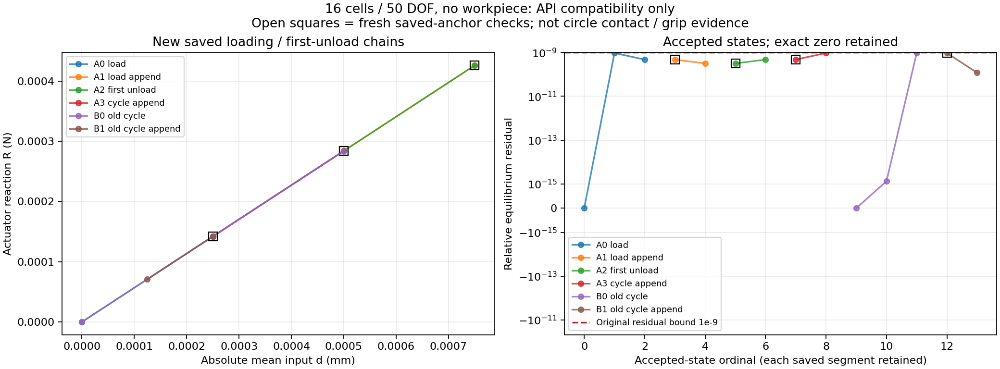

# L-CUNLOAD2：首次卸载入口的有限小模型兼容验证

本卡 **PASS**，helper `pass`／outer `pass`；默认安装 `0`，生产源码相对基线无变化。

整体目标是普通LF几何进入独立HF后完成可检查的非线性加载、工件传力及卸载。本次复用S1已安装reader，修正小模型零起点显式targets的测试调用，并区分native入口与实际平衡控制器计数；原S1 NOT_PASS保留。控制器、API、两CLI、响应、力核、切线、物理和验收门保持原字节。

实际reader身份：`{'path': 'hf_repo/src/hf_eval/native_resume.py', 'baseline_sha256': '68e3122950766f9cecb48a02a0f52a6d5f2efbfc466432bccc2cd48c77e2b798', 'actual_sha256': '68e3122950766f9cecb48a02a0f52a6d5f2efbfc466432bccc2cd48c77e2b798', 'changed_from_baseline': False, 'bytes': 18014, 'actual_role': 'Existing installed reader identity only; zero production modification or installation'}`。本卡无候选生产安装、无自动回滚。

方法实际数 `8`／8；实际入口、controller、F/T/HP及线性计数：`{'native_entry_started': 6, 'native_entry_completed': 6, 'real_solver_invocations': 6, 'real_solver_completed': 6, 'real_force_calls': 48, 'real_force_calls_completed': 48, 'real_tangent_calls': 31, 'real_tangent_calls_completed': 31, 'HP_calls': 0, 'JIT_calls': 0, 'linear_controller_paths': 2, 'linear_assembler_calls': 4, 'rejected_lowlevel_entries': 2, 'forbidden_old_cache_reads': 0}`。缺报告表示None，未运行方法不能当作通过。验证定义见[冻结验证表](TEST_MATRIX.md)。

计数定义：native_entry_started/completed表示native API入口/返回；real_solver_invocations/completed现在只记录原native_mean内部平衡controller的开始/返回。两条synthetic线性路径单列，不是TMC材料验证。completed_methods记录unittest方法结束事件，是否通过仍看errors/failures/successful。

计划是16单元／50DOF、无工件的6次真实controller：load→load append→公共首次卸载→旧cycle再下降共4次，另旧cycle来源及同kind延伸2次；线性冷锚与wrong-R拒绝2条。共享tests120秒、每tiny controller30秒，原数值门保持。实际运行以原报告为准。

合同保留完整旧前缀、input峰值和来源身份，只追加首次下降；可重访旧非相邻加载值。fresh锚点复核状态SHA和R，子段给末态响应且full/tasktarget保持False，缓存保存不重新计算F/T。只有本次验证PASS才能据本卡称其有限小模型兼容已验证。

|series|d mm|R N|relative residual|fresh anchor|
|---|---:|---:|---:|---|
|A0_load|0.0|0.0|0.0|False|
|A0_load|0.00025|0.00014196564343962474|9.563002893791295e-10|False|
|A0_load|0.0005|0.00028394341759967705|4.783000621192142e-10|False|
|A1_load_append|0.0005|0.00028394341759967705|4.783000621192142e-10|True|
|A1_load_append|0.00075|0.0004259333215026563|3.18967332795584e-10|False|
|A2_first_unload|0.00075|0.0004259333215026563|3.18967332795584e-10|True|
|A2_first_unload|0.0005|0.000283943417599676|4.776594086682374e-10|False|
|A3_cycle_append|0.0005|0.000283943417599676|4.776594086682374e-10|True|
|A3_cycle_append|0.00025|0.00014196564343962369|9.550180892688135e-10|False|
|B0_old_cycle|0.0|0.0|0.0|False|
|B0_old_cycle|0.0005|0.0002839434176028183|1.3066749305489284e-15|False|
|B0_old_cycle|0.00025|0.0001419656434396237|9.550179688053108e-10|False|
|B1_old_cycle_append|0.00025|0.0001419656434396237|9.550179688053108e-10|True|
|B1_old_cycle_append|0.000125|7.098130532078332e-05|1.1940016144429802e-10|False|

实际功能效果：小模型从保存峰值0.00075 mm首次下降到0.00050 mm时，输入反力由0.0004259333215026563 N降到0.000283943417599676 N；继续下降到0.00025 mm时为0.00014196564343962369 N。14个接受记录含4个fresh锚点，最大相对残差9.563002893791295e-10，满足原1e-9门。本结果限于无工件小模型，不能外推为圆形夹持器已完成卸载。

outer耗时 `28.540933799988125` s，helper `26.585434000007808` s；进程树采样峰值 `194281472` B，清理 `True`。原窗口封存 `117` 文件／`1215121` B，状态 `complete_inside_original_helper_window`。

一张新图仅使用本窗tiny普通JSON，展示反力与收敛。它不是圆形工件实际变形或接触图；本卡未执行圆形1.40→1.35 mm、未新增HP，既有圆形结果和资格保持。压力、有效夹持、自由释放、稳定性、制造与HF5仍未完成。

独立实际审阅 `pass_actual_finite_review`；像素检查 `pass_one_original_pixel_inspection`。无生产修改、安装、外部重试、修复重跑、延期或force。

下一步：准备真实圆形1.40→1.35 mm单目标回程卡。复用已安装extend_path=True和显式ordered_cycle任务，完整保留原加载前缀与input峰值1.40 mm、r9 mm/c(71,40)、其余物理和原门。先fresh复核原S5末态，再执行首次下降；成功后用原纯viewer记录实际×1变形、反力、工件材料/Hu力、距离、分区场和收敛。真实目标和资源另卡安排，本卡没有执行圆形回程，也没有新增HP。

入口：[原helper](run_001/execution_receipt.json)、[原tests](run_001/t/test_report.json)、[原值人工页](run_001/REVIEW.md)、[实际审阅](author/ACTUAL_REVIEW.md)、[闭卡JSON](author/closure.json)。

具体下一卡：[L-CUNLOAD3 真实圆形首次卸载计划](NEXT_REAL_UNLOAD_CARD.md)。仅为待批准的实施／执行计划，尚未实现、冻结或运行。
