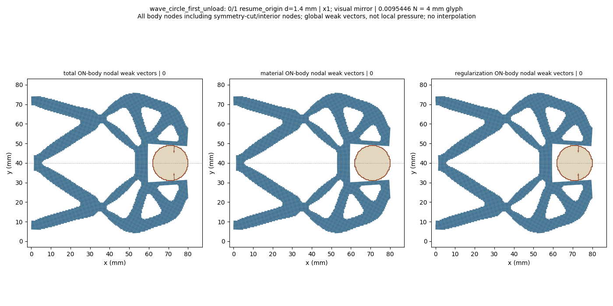
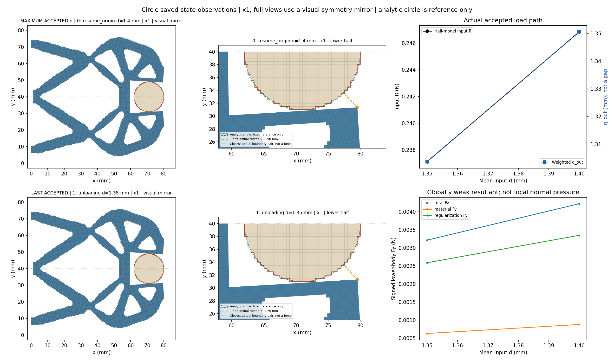
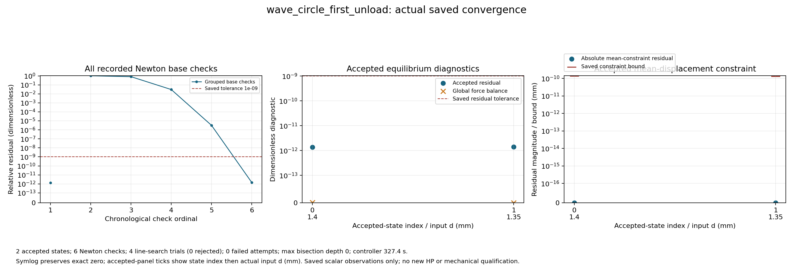

# Circular workpiece first unloading: saved-state review

Fixed raster circle r9 at (71,40) mm, lower-half wave mechanism. The1.40 mm first state is a freshly revalidated S5 source anchor; only the descending1.35 mm target is appended. The loading prefix is inherited, not replayed. Coordinates x1; the maximum accepted d is the1.40 anchor, not new loading. Full-structure views and GIF use a visual symmetry mirror; numerical tables retain original lower-half values. All actual accepted states are shown, including bounded controller bisections.

Boundary distances are unsigned exposed-Q1-edge observations, not signed gaps. Intersection/near-touch and region overlap are separate; containment is not tested. Weak body total includes material and Hu contributions, not contact pressure or effective grip. This is fixed-body actuator unloading, not free-body release. No full-cycle/loading-prefix, independent HP, stability or HF5 qualification is granted; ancestor CREF1 remains1.15 only.

[Response](wave_circle_first_unload/response.json) · [Result](wave_circle_first_unload/result.json) · [Exact rows](state_table.json) · [Viewer summary](view/wave_circle_first_unload/summary.json) · [Load/unload pair](load_unload_pair.json) · [Convergence JSON](convergence/convergence.json)

|index|leg|d (mm)|R input (N)|q out (mm)|body Fy total (N)|minimum Q1 boundary distance (mm)|
|---:|---|---:|---:|---:|---:|---:|
|0|resume_origin|1.4|0.24684302763538246|1.3505951000424836|0.004223912418638585|0.06329727765158799|
|1|unloading|1.35|0.23712864270675904|1.303664995348951|0.0032141348540384897|0.09633236207295634|

## Historical loading versus new unloading at1.35 mm

|role|global index|d (mm)|R (N)|q out (mm)|body Fy total/material/Hu (N)|unsigned nearest (mm)|medium minJ|
|---|---:|---:|---:|---:|---|---:|---:|
|historical loaded1.35; S5 revalidated S4 state|7|1.35|0.2371286427067592|1.303664995348951|0.0032141348540385114/0.0006266263172725522/0.0025875085367659586|0.09633236207295634|0.08623624515762662|
|new unloading1.35|9|1.35|0.23712864270675904|1.303664995348951|0.0032141348540384897/0.0006266263172725523/0.0025875085367659365|0.09633236207295634|0.08623624515762661|

These are separate accepted states/global indices. No exact state equality, monotonic force or hysteresis gate is imposed. The exact JSON pair also retains Fx/Fy material/Hu/total, solid/medium J, Hu and tip distance. J is sampled at the original nine Simpson points; Hu is a cellwise reference-Hessian quantity, not pressure.
