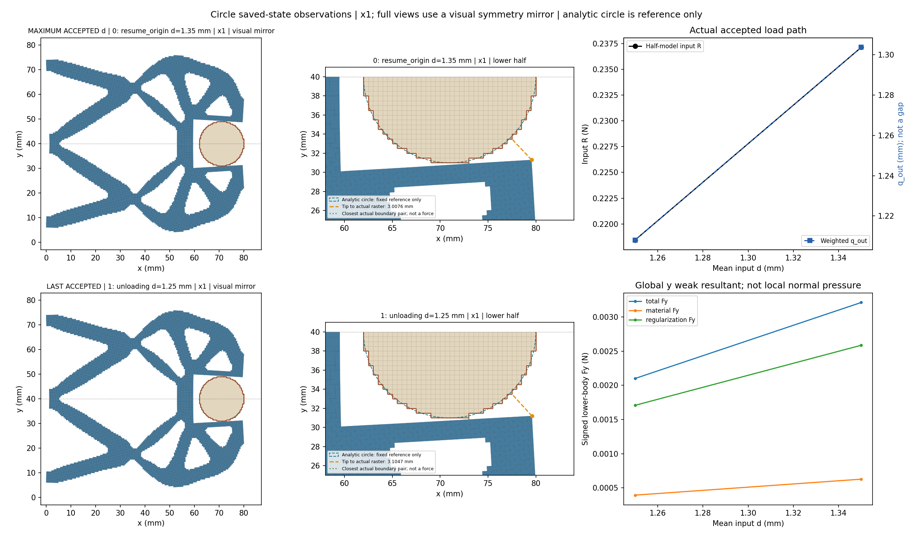
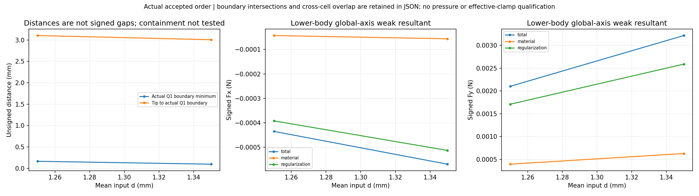
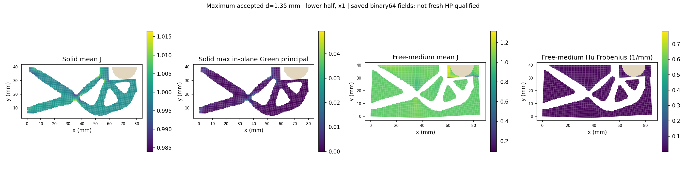
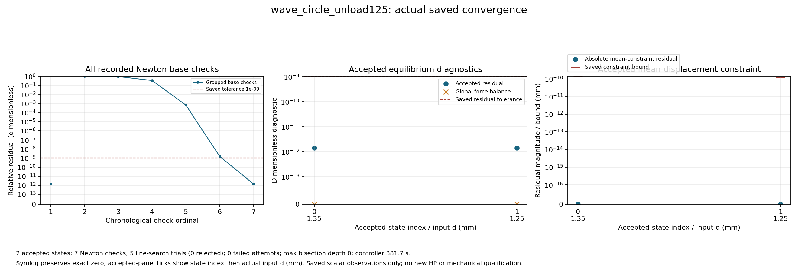
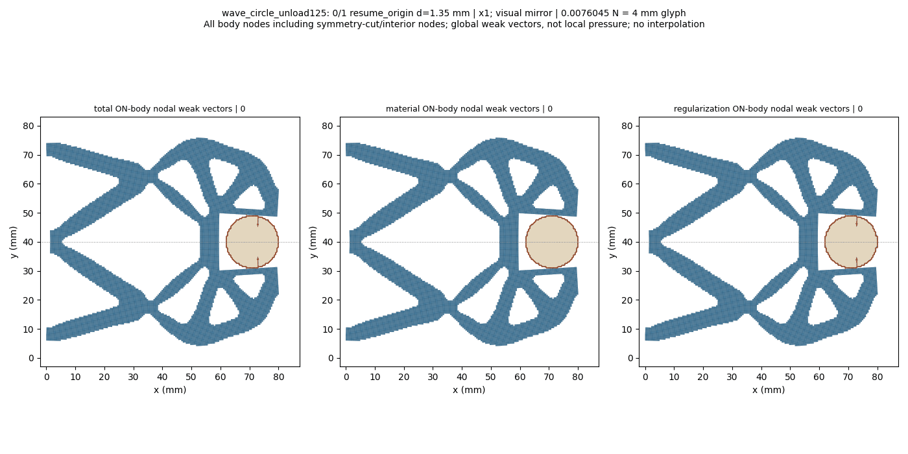

# L-CUNLOAD4：圆形固定工件1.35→1.25 mm保存态回程

执行 **PASS**；生产 `success`、helper `pass`／outer `pass`；停止阶段 `final_binding_and_seal`。

整体目标是普通LF设计进入独立HF后的非线性加载、工件传力与卸载可检查。本轮从C3成功1.35 mm回程末态沿既有ordered_cycle入口推进到1.25 mm，保留原数值状态与任务前缀，避免重新执行已完成加载和首回程；通过实际变形、反力、工件力、距离和收敛与已有同值加载态比较。

r9 mm、圆心(71,40) mm工件固定ux/uy；其余E=1 MPa、nu=0.3、plane strain、厚20 mm、h=0.5 mm、gamma=1e-6、alpha=5e-7、Lr=80 mm及边界/平均端口不变。完整[0,0.25,0.5,0.75,1,1.15,1.25,1.35,1.40,1.35]前缀精确保留，kind维持ordered_cycle，只追加1.25；input峰值保持1.40，四说明字段及其余任务元数据均原值不变。

来源 `lf_data_preparation/native_interface_001/lf_circle_first_unload_003/run_001/wave_circle_first_unload/result.json`，接受行1/global9/d1.35，state SHA `1e53b0a10e8c8f6614c7278d80326e91aded925ceba4c05f9a63376725dedab3`。新子段原目标global9/10、本地0/1；fresh原锚使用原lift/fluctuation和带符号R，以新F/T复核原门，不读旧力/切线。默认生产源码零修改，测试/安装/HP均不新增。

实际保存接受态 `2`，回调计数 `2`。原二分可能产生额外接受态，不锁定N=2；缺结果保持None。路径原标志 `{'path_kind': 'ordered_cycle', 'targets_mm': [1.35, 1.25], 'reached_displacement': 1.25, 'path_completed': True, 'loading_peak_reached': False, 'unload_endpoint_reached': True, 'task_target_executed': False, 'full_original_path_completed': False, 'full_extended_path_completed': False}`。

|接受行|global目标|路段|d mm|输入R N|q_out mm|下半体总Fy N|边界距离 mm|solid minJ|free-medium minJ|relative residual|
|---:|---:|---|---:|---:|---:|---:|---:|---:|---:|---:|
|0|9|resume_origin|1.35|0.23712864270675904|1.303664995348951|0.0032141348540384897|0.09633236207295634|0.9676983779663556|0.08623624515762661|1.3895190972446523e-12|
|1|10|unloading|1.25|0.21844194402663442|1.2080995850065308|0.0021009116737030955|0.16397158636164572|0.9700262167660758|0.15553278909851423|1.4103923021957927e-12|

实际F/T与生产计数 `{'force_calls': 12, 'force_calls_completed': 12, 'tangent_calls': 7, 'tangent_calls_completed': 7, 'solver_invocations': 1, 'JIT_calls': 0, 'HP_calls': 0}`；wrapper `{'api_started': 1, 'solve_started': 1, 'solve_completed': 1, 'api_completed': 1, 'view_child_started': 1, 'view_child_completed': 1, 'convergence_plot_started': 1, 'convergence_plot_completed': 1}`。原门 `{'production_residual': '1e-9', 'average_constraint': '1e-10', 'global_force_balance': '1e-6', 'fixed_displacement_mm': '8e-11'}`；缓存门 `{'actual_accepted_states': 2, 'minimum_J': 0.08623624515762661, 'maximum_fixed_split_sum_mm': 0.0, 'maximum_relative_residual': 1.4103923021957927e-12, 'native_constraint_bound_pass': True, 'maximum_relative_global_force_balance': 9.562928356553378e-16, 'passed': True}`；收敛计数 `{'accepted_states': 2, 'newton_base_checks': 7, 'inferred_check_groups': 2, 'line_search_trials': 5, 'line_search_accepted': 5, 'line_search_rejected': 0, 'failed_attempts': 0, 'linear_solves': 6, 'maximum_bisection_depth': 0, 'zero_newton_residuals': 0}`。

同值加载/卸载普通对照原值 `{'card': 'L-CUNLOAD4', 'loading_source': 'lf_data_preparation/native_interface_001/lf_circle_step_004/run_001/view/wave_circle_step/summary.json', 'loading_source_sha256': '75a8d98312000c0ea9860eee325acb84af3e3bcfd2518ada0ee27ea6cec5d445', 'unloading_source': 'lf_data_preparation\\native_interface_001\\lf_circle_first_unload_004\\run_001\\view\\wave_circle_unload125\\summary.json', 'rows': [{'role': 'historical loaded1.25; S4 revalidated S3 state', 'original_target_index': 6, 'd_mm': 1.25, 'state_sha256': 'd5b74358bf076a7d858efd710e61cf31fa2f9ddb1648a7a488e2cbc299213fc5', 'R_input_N': 0.21844194402663447, 'q_out_mm': 1.2080995850065308, 'total_body_Fx_N': -0.0004350919452089032, 'total_body_Fy_N': 0.0021009116737030946, 'material_body_Fx_N': -4.3064521706866536e-05, 'material_body_Fy_N': 0.00039281921063225516, 'regularization_body_Fx_N': -0.0003920274235020367, 'regularization_body_Fy_N': 0.00170809246307084, 'minimum_boundary_distance_mm': 0.16397158636164572, 'tip_to_raster_boundary_mm': 3.1047077510940984, 'solid_min_J': 0.9700262167660758, 'medium_min_J': 0.15553278909851423, 'medium_max_abs_Hu_per_mm': 0.317697922507422}, {'role': 'new unloading1.25', 'original_target_index': 10, 'd_mm': 1.25, 'state_sha256': '4e3c308bba3e6776abebafb2964542ec4c1efb5224c26f5233d7e11a511adfa2', 'R_input_N': 0.21844194402663442, 'q_out_mm': 1.2080995850065308, 'total_body_Fx_N': -0.0004350919452089008, 'total_body_Fy_N': 0.0021009116737030955, 'material_body_Fx_N': -4.3064521706866536e-05, 'material_body_Fy_N': 0.0003928192106322552, 'regularization_body_Fx_N': -0.00039202742350203426, 'regularization_body_Fy_N': 0.0017080924630708402, 'minimum_boundary_distance_mm': 0.16397158636164572, 'tip_to_raster_boundary_mm': 3.1047077510940984, 'solid_min_J': 0.9700262167660758, 'medium_min_J': 0.15553278909851423, 'medium_max_abs_Hu_per_mm': 0.3176979225074221}], 'scope': 'Exact ordinary saved rows, global6 versus10; no new mechanics, state-equality gate or hysteresis qualification'}`。它比较不同保存态，不把相同位移当作同一个数值解或参考资格。

来源转换和状态身份 `{'schema_version': 'hf-native-saved-resume-1.0', 'parent_result': {'path': 'D:/Coding/Diversity TO/Compliant-Nonlinear-TMC-O/.github_handoff/Compliant-TO-TMC/lf_data_preparation/native_interface_001/lf_circle_first_unload_003/run_001/wave_circle_first_unload/result.json', 'sha256': '960cf4725939319fe58f860910dd4e5e2a391fe83336f24eea14ebaa1ca06bd6'}, 'parent_model': {'path': 'D:/Coding/Diversity TO/Compliant-Nonlinear-TMC-O/.github_handoff/Compliant-TO-TMC/lf_data_preparation/native_interface_001/lf_circle_first_unload_003/run_001/wave_circle_first_unload/model/model.json', 'sha256': 'ff33fe132f6aff535c4a2268a7ea311922f2ee94b52679850c461c89656877fd'}, 'selected_state': {'accepted_index': 1, 'original_target_index': 9, 'path': 'D:/Coding/Diversity TO/Compliant-Nonlinear-TMC-O/.github_handoff/Compliant-TO-TMC/lf_data_preparation/native_interface_001/lf_circle_first_unload_003/run_001/wave_circle_first_unload/accepted/001/state.json', 'descriptor_file_sha256': '01c1fbcb4076e4915c2026c26518a6153c3253a692231cbba791b1df59dbc535', 'state_sha256': '1e53b0a10e8c8f6614c7278d80326e91aded925ceba4c05f9a63376725dedab3', 'archive_sha256': '9fb84200b89ce6c81ded04590e5e70b28a54151cbd902bfccb1979e825c6da79', 'R_input_N': 0.23712864270675904, 'd_mm': 1.35, 'q_in_mm': 1.35, 'constraint_residual_mm': 0.0, 'parent_leg': 'unloading'}, 'parent_status': 'success', 'parent_failure': None, 'parent_path_completed': True, 'parent_task_target_executed': False, 'parent_unload_endpoint_reached': True, 'parent_mechanics_source_sha256': {'hf_repo/src/hf_eval/native_mean.py': '76fd9917fe378865f3f359838958e58505afb9ae2e7c7ec257773a76178fd6e4', 'hf_repo/src/hf_eval/split_displacement.py': '151cc130f0a75e3b2f201b393541107ccf2feaa3de365db72d1987568dae1bb8', 'hf_repo/src/hf_eval/split_numpy_tangent.py': '547143b14c8626f7420b8d5778cb11d4d5680be1a590428d8d46f01b3549857f', 'hf_repo/src/hf_eval/split_kernel_invariants_hu.py': 'd5f7d20a6ec0c92847d67f8782f4dcc89772fc4ea62797626b0beae7effabd9a', 'hf_repo/src/hf_eval/native_resume.py': '68e3122950766f9cecb48a02a0f52a6d5f2efbfc466432bccc2cd48c77e2b798'}, 'parent_producer_flags': {'independent_HP_qualified': False, 'equilibrium_qualified': False, 'HF_qualified': False}, 'original_task_targets_mm': [0.0, 0.25, 0.5, 0.75, 1.0, 1.15, 1.25, 1.35, 1.4, 1.35, 1.25], 'requested_suffix_targets_mm': [1.35, 1.25], 'original_target_indices': [9, 10], 'initial_parameter': 1.35, 'target_origin': 0.0, 'state_transport': 'Original lift/fluctuation and signed R; no rounded display/rebase/translation', 'fresh_anchor_required': True, 'saved_matrix_or_force_or_tangent_read': False, 'full_original_path_executed_by_child': False, 'independent_HP_qualified': False, 'HF5_qualified': False, 'continuation_mode': 'explicit_task_extension', 'source_task_sha256': '107d81b5f204688388557250e6cd65494ef9b72be1f5ae47ad7dd184ef9809d3', 'source_task_targets_mm': [0.0, 0.25, 0.5, 0.75, 1.0, 1.15, 1.25, 1.35, 1.4, 1.35], 'extended_task_sha256': '182d013d38e627aa090ce77ea88d230202a21b64a05470da80ba4f0ff77528c0', 'extended_task_targets_mm': [0.0, 0.25, 0.5, 0.75, 1.0, 1.15, 1.25, 1.35, 1.4, 1.35, 1.25], 'appended_targets_mm': [1.25], 'parent_continuation': {'schema_version': 'hf-native-saved-resume-1.0', 'parent_result': {'path': 'D:/Coding/Diversity TO/Compliant-Nonlinear-TMC-O/.github_handoff/Compliant-TO-TMC/lf_data_preparation/native_interface_001/lf_circle_step_005/run_001/wave_circle_step/result.json', 'sha256': 'e7c5c9435f026bdb11643962d5456fc78e9fdeb5c0e77eb272569c79c748f118'}, 'parent_model': {'path': 'D:/Coding/Diversity TO/Compliant-Nonlinear-TMC-O/.github_handoff/Compliant-TO-TMC/lf_data_preparation/native_interface_001/lf_circle_step_005/run_001/wave_circle_step/model/model.json', 'sha256': 'b0762fc3cb9a7ea647fe3fbe0fee1fee3243963da4acf63cb1c744cd62ec6f68'}, 'selected_state': {'accepted_index': 1, 'original_target_index': 8, 'path': 'D:/Coding/Diversity TO/Compliant-Nonlinear-TMC-O/.github_handoff/Compliant-TO-TMC/lf_data_preparation/native_interface_001/lf_circle_step_005/run_001/wave_circle_step/accepted/001/state.json', 'descriptor_file_sha256': '069a64845c42f83233e0d44b10edb316db7a836fa3cb62af7f8b3346493217ea', 'state_sha256': '17023382213dedbbde48b41590d8fdbc57feefc8401111b8791176426ed547ad', 'archive_sha256': 'f425034b0be25b61f948beb4f0257cb3ab41c6477ff7a8538ad8cad92c7a70c3', 'R_input_N': 0.24684302763538246, 'd_mm': 1.4, 'q_in_mm': 1.4, 'constraint_residual_mm': 0.0, 'parent_leg': 'loading'}, 'parent_status': 'success', 'parent_failure': None, 'parent_path_completed': True, 'parent_task_target_executed': False, 'parent_unload_endpoint_reached': None, 'parent_mechanics_source_sha256': {'hf_repo/src/hf_eval/native_mean.py': '76fd9917fe378865f3f359838958e58505afb9ae2e7c7ec257773a76178fd6e4', 'hf_repo/src/hf_eval/split_displacement.py': '151cc130f0a75e3b2f201b393541107ccf2feaa3de365db72d1987568dae1bb8', 'hf_repo/src/hf_eval/split_numpy_tangent.py': '547143b14c8626f7420b8d5778cb11d4d5680be1a590428d8d46f01b3549857f', 'hf_repo/src/hf_eval/split_kernel_invariants_hu.py': 'd5f7d20a6ec0c92847d67f8782f4dcc89772fc4ea62797626b0beae7effabd9a', 'hf_repo/src/hf_eval/native_resume.py': 'e8162964487df510a608a980feb1a03b3ac36e97a55452fac9e342274cfee2d1'}, 'parent_producer_flags': {'independent_HP_qualified': False, 'equilibrium_qualified': False, 'HF_qualified': False}, 'original_task_targets_mm': [0.0, 0.25, 0.5, 0.75, 1.0, 1.15, 1.25, 1.35, 1.4, 1.35], 'requested_suffix_targets_mm': [1.4, 1.35], 'original_target_indices': [8, 9], 'initial_parameter': 1.4, 'target_origin': 0.0, 'state_transport': 'Original lift/fluctuation and signed R; no rounded display/rebase/translation', 'fresh_anchor_required': True, 'saved_matrix_or_force_or_tangent_read': False, 'full_original_path_executed_by_child': False, 'independent_HP_qualified': False, 'HF5_qualified': False, 'continuation_mode': 'explicit_task_extension', 'source_task_sha256': 'ca180c540c7a2935ae78770693cbce4347c423e11e1a31144a28a6e31d42c99d', 'source_task_targets_mm': [0.0, 0.25, 0.5, 0.75, 1.0, 1.15, 1.25, 1.35, 1.4], 'extended_task_sha256': '107d81b5f204688388557250e6cd65494ef9b72be1f5ae47ad7dd184ef9809d3', 'extended_task_targets_mm': [0.0, 0.25, 0.5, 0.75, 1.0, 1.15, 1.25, 1.35, 1.4, 1.35], 'appended_targets_mm': [1.35], 'parent_continuation': {'schema_version': 'hf-native-saved-resume-1.0', 'parent_result': {'path': 'D:/Coding/Diversity TO/Compliant-Nonlinear-TMC-O/.github_handoff/Compliant-TO-TMC/lf_data_preparation/native_interface_001/lf_circle_step_004/run_001/wave_circle_step/result.json', 'sha256': 'bede740200e6adc8ba0d29c5b0add22ff1c0c0fe60e18c93dd4e9e09742fbd72'}, 'parent_model': {'path': 'D:/Coding/Diversity TO/Compliant-Nonlinear-TMC-O/.github_handoff/Compliant-TO-TMC/lf_data_preparation/native_interface_001/lf_circle_step_004/run_001/wave_circle_step/model/model.json', 'sha256': '2c5c23669c2aa86a46c70a95b122d4de12ceac0cd9a1052a54d3f109e57d6720'}, 'selected_state': {'accepted_index': 1, 'original_target_index': 7, 'path': 'D:/Coding/Diversity TO/Compliant-Nonlinear-TMC-O/.github_handoff/Compliant-TO-TMC/lf_data_preparation/native_interface_001/lf_circle_step_004/run_001/wave_circle_step/accepted/001/state.json', 'descriptor_file_sha256': 'f34728e8688d4d9dd8298934e4a28b962e652b6f8396ddb3a72b417b9fee2e90', 'state_sha256': '0c8c5b07ad3ef5872502dede2f76cee6a152b9f78d3b0b7f831ebc6286a12455', 'archive_sha256': '5b948ae634d6ef463d9de893e4844e28861366b8d19f2027852f27008972f81e', 'R_input_N': 0.2371286427067592, 'd_mm': 1.35, 'q_in_mm': 1.35, 'constraint_residual_mm': 0.0, 'parent_leg': 'loading'}, 'parent_status': 'success', 'parent_failure': None, 'parent_path_completed': True, 'parent_task_target_executed': False, 'parent_unload_endpoint_reached': None, 'parent_mechanics_source_sha256': {'hf_repo/src/hf_eval/native_mean.py': '76fd9917fe378865f3f359838958e58505afb9ae2e7c7ec257773a76178fd6e4', 'hf_repo/src/hf_eval/split_displacement.py': '151cc130f0a75e3b2f201b393541107ccf2feaa3de365db72d1987568dae1bb8', 'hf_repo/src/hf_eval/split_numpy_tangent.py': '547143b14c8626f7420b8d5778cb11d4d5680be1a590428d8d46f01b3549857f', 'hf_repo/src/hf_eval/split_kernel_invariants_hu.py': 'd5f7d20a6ec0c92847d67f8782f4dcc89772fc4ea62797626b0beae7effabd9a', 'hf_repo/src/hf_eval/native_resume.py': 'e8162964487df510a608a980feb1a03b3ac36e97a55452fac9e342274cfee2d1'}, 'parent_producer_flags': {'independent_HP_qualified': False, 'equilibrium_qualified': False, 'HF_qualified': False}, 'original_task_targets_mm': [0.0, 0.25, 0.5, 0.75, 1.0, 1.15, 1.25, 1.35, 1.4], 'requested_suffix_targets_mm': [1.35, 1.4], 'original_target_indices': [7, 8], 'initial_parameter': 1.35, 'target_origin': 0.0, 'state_transport': 'Original lift/fluctuation and signed R; no rounded display/rebase/translation', 'fresh_anchor_required': True, 'saved_matrix_or_force_or_tangent_read': False, 'full_original_path_executed_by_child': False, 'independent_HP_qualified': False, 'HF5_qualified': False, 'continuation_mode': 'explicit_task_extension', 'source_task_sha256': '6bcf990ffaae0fe00a134915d18cad9ad82dd7a516e4db563895ad2c1cf308c7', 'source_task_targets_mm': [0.0, 0.25, 0.5, 0.75, 1.0, 1.15, 1.25, 1.35], 'extended_task_sha256': 'ca180c540c7a2935ae78770693cbce4347c423e11e1a31144a28a6e31d42c99d', 'extended_task_targets_mm': [0.0, 0.25, 0.5, 0.75, 1.0, 1.15, 1.25, 1.35, 1.4], 'appended_targets_mm': [1.4], 'parent_continuation': {'schema_version': 'hf-native-saved-resume-1.0', 'parent_result': {'path': 'D:/Coding/Diversity TO/Compliant-Nonlinear-TMC-O/.github_handoff/Compliant-TO-TMC/lf_data_preparation/native_interface_001/lf_circle_step_003/run_001/wave_circle_step/result.json', 'sha256': '931c1234cce61121d4b93b4936c6b8c0a802bf77fc0a85f71fdeed10a713053a'}, 'parent_model': {'path': 'D:/Coding/Diversity TO/Compliant-Nonlinear-TMC-O/.github_handoff/Compliant-TO-TMC/lf_data_preparation/native_interface_001/lf_circle_step_003/run_001/wave_circle_step/model/model.json', 'sha256': 'e334857c37abbe5b21ffad2fa4ee425b4eba24e2ef26a5014ad7be10ea61eef3'}, 'selected_state': {'accepted_index': 1, 'original_target_index': 6, 'path': 'D:/Coding/Diversity TO/Compliant-Nonlinear-TMC-O/.github_handoff/Compliant-TO-TMC/lf_data_preparation/native_interface_001/lf_circle_step_003/run_001/wave_circle_step/accepted/001/state.json', 'descriptor_file_sha256': '77b74009978dd8a4b696d34a276460dae1cf793940bc3f8066629610d29178c9', 'state_sha256': 'd5b74358bf076a7d858efd710e61cf31fa2f9ddb1648a7a488e2cbc299213fc5', 'archive_sha256': '1be488163c6ff1fc17e0e1712458d5bc193e877b010df7453954e75eb8db72ea', 'R_input_N': 0.21844194402663447, 'd_mm': 1.25, 'q_in_mm': 1.25, 'constraint_residual_mm': 0.0, 'parent_leg': 'loading'}, 'parent_status': 'success', 'parent_failure': None, 'parent_path_completed': True, 'parent_task_target_executed': False, 'parent_unload_endpoint_reached': None, 'parent_mechanics_source_sha256': {'hf_repo/src/hf_eval/native_mean.py': '76fd9917fe378865f3f359838958e58505afb9ae2e7c7ec257773a76178fd6e4', 'hf_repo/src/hf_eval/split_displacement.py': '151cc130f0a75e3b2f201b393541107ccf2feaa3de365db72d1987568dae1bb8', 'hf_repo/src/hf_eval/split_numpy_tangent.py': '547143b14c8626f7420b8d5778cb11d4d5680be1a590428d8d46f01b3549857f', 'hf_repo/src/hf_eval/split_kernel_invariants_hu.py': 'd5f7d20a6ec0c92847d67f8782f4dcc89772fc4ea62797626b0beae7effabd9a', 'hf_repo/src/hf_eval/native_resume.py': 'e8162964487df510a608a980feb1a03b3ac36e97a55452fac9e342274cfee2d1'}, 'parent_producer_flags': {'independent_HP_qualified': False, 'equilibrium_qualified': False, 'HF_qualified': False}, 'original_task_targets_mm': [0.0, 0.25, 0.5, 0.75, 1.0, 1.15, 1.25, 1.35], 'requested_suffix_targets_mm': [1.25, 1.35], 'original_target_indices': [6, 7], 'initial_parameter': 1.25, 'target_origin': 0.0, 'state_transport': 'Original lift/fluctuation and signed R; no rounded display/rebase/translation', 'fresh_anchor_required': True, 'saved_matrix_or_force_or_tangent_read': False, 'full_original_path_executed_by_child': False, 'independent_HP_qualified': False, 'HF5_qualified': False, 'continuation_mode': 'explicit_task_extension', 'source_task_sha256': 'bee029eb2409c7ddcdb0cfd2a57fee21b68f06ee4ef332117750323bed6453a5', 'source_task_targets_mm': [0.0, 0.25, 0.5, 0.75, 1.0, 1.15, 1.25], 'extended_task_sha256': '6bcf990ffaae0fe00a134915d18cad9ad82dd7a516e4db563895ad2c1cf308c7', 'extended_task_targets_mm': [0.0, 0.25, 0.5, 0.75, 1.0, 1.15, 1.25, 1.35], 'appended_targets_mm': [1.35], 'parent_continuation': {'schema_version': 'hf-native-saved-resume-1.0', 'parent_result': {'path': 'D:/Coding/Diversity TO/Compliant-Nonlinear-TMC-O/.github_handoff/Compliant-TO-TMC/lf_data_preparation/native_interface_001/lf_circle_step_002/run_001/wave_circle_step/result.json', 'sha256': '13776924f58f8e90587932a630d65bc89e2b27b5bc9afdbcebad343019a109f1'}, 'parent_model': {'path': 'D:/Coding/Diversity TO/Compliant-Nonlinear-TMC-O/.github_handoff/Compliant-TO-TMC/lf_data_preparation/native_interface_001/lf_circle_step_002/run_001/wave_circle_step/model/model.json', 'sha256': '51b9b19f0f680b298f8ba6eb5db7f3f8e337206127b10f8066cf76a7059ab910'}, 'selected_state': {'accepted_index': 1, 'original_target_index': 5, 'path': 'D:/Coding/Diversity TO/Compliant-Nonlinear-TMC-O/.github_handoff/Compliant-TO-TMC/lf_data_preparation/native_interface_001/lf_circle_step_002/run_001/wave_circle_step/accepted/001/state.json', 'descriptor_file_sha256': '9a2d1afe58ea7e202b8bd1c1758c4d7d534f007f25988b4ebaabae7a41ed58b6', 'state_sha256': '3db267551ea6cb5817c2a1946a80363ecccb0329078d516e90e0106f27e709ef', 'archive_sha256': '8f9d7582f274658e1c85e5aa039869c0ac103574f96d568db2704f49d79629da', 'R_input_N': 0.20022433540813542, 'd_mm': 1.15, 'q_in_mm': 1.15, 'constraint_residual_mm': -2.7755575615628914e-17, 'parent_leg': 'loading'}, 'parent_status': 'success', 'parent_failure': None, 'parent_path_completed': True, 'parent_task_target_executed': False, 'parent_unload_endpoint_reached': None, 'parent_mechanics_source_sha256': {'hf_repo/src/hf_eval/native_mean.py': '76fd9917fe378865f3f359838958e58505afb9ae2e7c7ec257773a76178fd6e4', 'hf_repo/src/hf_eval/split_displacement.py': '151cc130f0a75e3b2f201b393541107ccf2feaa3de365db72d1987568dae1bb8', 'hf_repo/src/hf_eval/split_numpy_tangent.py': '547143b14c8626f7420b8d5778cb11d4d5680be1a590428d8d46f01b3549857f', 'hf_repo/src/hf_eval/split_kernel_invariants_hu.py': 'd5f7d20a6ec0c92847d67f8782f4dcc89772fc4ea62797626b0beae7effabd9a', 'hf_repo/src/hf_eval/native_resume.py': 'e8162964487df510a608a980feb1a03b3ac36e97a55452fac9e342274cfee2d1'}, 'parent_producer_flags': {'independent_HP_qualified': False, 'equilibrium_qualified': False, 'HF_qualified': False}, 'original_task_targets_mm': [0.0, 0.25, 0.5, 0.75, 1.0, 1.15, 1.25], 'requested_suffix_targets_mm': [1.15, 1.25], 'original_target_indices': [5, 6], 'initial_parameter': 1.15, 'target_origin': 0.0, 'state_transport': 'Original lift/fluctuation and signed R; no rounded display/rebase/translation', 'fresh_anchor_required': True, 'saved_matrix_or_force_or_tangent_read': False, 'full_original_path_executed_by_child': False, 'independent_HP_qualified': False, 'HF5_qualified': False, 'continuation_mode': 'explicit_task_extension', 'source_task_sha256': '44bea6cfcb33e850266094fe1f91c887c01d90459934d3e55509290af3a6575a', 'source_task_targets_mm': [0.0, 0.25, 0.5, 0.75, 1.0, 1.15], 'extended_task_sha256': 'bee029eb2409c7ddcdb0cfd2a57fee21b68f06ee4ef332117750323bed6453a5', 'extended_task_targets_mm': [0.0, 0.25, 0.5, 0.75, 1.0, 1.15, 1.25], 'appended_targets_mm': [1.25], 'parent_continuation': {'schema_version': 'hf-native-saved-resume-1.0', 'parent_result': {'path': 'D:/Coding/Diversity TO/Compliant-Nonlinear-TMC-O/.github_handoff/Compliant-TO-TMC/lf_data_preparation/native_interface_001/lf_circle_step_001/run_001/wave_circle_step/result.json', 'sha256': 'b826215be038cb6a308c8a19605009763fd950f314ba2394530cb9b5429bfb75'}, 'parent_model': {'path': 'D:/Coding/Diversity TO/Compliant-Nonlinear-TMC-O/.github_handoff/Compliant-TO-TMC/lf_data_preparation/native_interface_001/lf_circle_step_001/run_001/wave_circle_step/model/model.json', 'sha256': 'a6f69a998637576ed66a6b81f3c4bcc9e3e42f9df6ebda636d161541603d8491'}, 'selected_state': {'accepted_index': 1, 'original_target_index': 4, 'path': 'D:/Coding/Diversity TO/Compliant-Nonlinear-TMC-O/.github_handoff/Compliant-TO-TMC/lf_data_preparation/native_interface_001/lf_circle_step_001/run_001/wave_circle_step/accepted/001/state.json', 'descriptor_file_sha256': '22c325ee4b114f421c572f6e382871ba1127e2b57afcbd3e42035f36615314e2', 'state_sha256': '8eca12177e50cecf8fc47c4668e19c34109a21965b21d62d9e262eb9459b3f06', 'archive_sha256': 'de042cab638bd65c7de6be33a82a59e6c520782db1d8c0da4e8ab6b1d757ed59', 'R_input_N': 0.17334986866494886, 'd_mm': 1.0, 'q_in_mm': 1.0, 'constraint_residual_mm': 0.0, 'parent_leg': 'loading'}, 'parent_status': 'success', 'parent_failure': None, 'parent_path_completed': True, 'parent_task_target_executed': False, 'parent_unload_endpoint_reached': None, 'parent_mechanics_source_sha256': {'hf_repo/src/hf_eval/native_mean.py': '76fd9917fe378865f3f359838958e58505afb9ae2e7c7ec257773a76178fd6e4', 'hf_repo/src/hf_eval/split_displacement.py': '151cc130f0a75e3b2f201b393541107ccf2feaa3de365db72d1987568dae1bb8', 'hf_repo/src/hf_eval/split_numpy_tangent.py': '547143b14c8626f7420b8d5778cb11d4d5680be1a590428d8d46f01b3549857f', 'hf_repo/src/hf_eval/split_kernel_invariants_hu.py': 'd5f7d20a6ec0c92847d67f8782f4dcc89772fc4ea62797626b0beae7effabd9a', 'hf_repo/src/hf_eval/native_resume.py': 'e8162964487df510a608a980feb1a03b3ac36e97a55452fac9e342274cfee2d1'}, 'parent_producer_flags': {'independent_HP_qualified': False, 'equilibrium_qualified': False, 'HF_qualified': False}, 'original_task_targets_mm': [0.0, 0.25, 0.5, 0.75, 1.0, 1.15], 'requested_suffix_targets_mm': [1.0, 1.15], 'original_target_indices': [4, 5], 'initial_parameter': 1.0, 'target_origin': 0.0, 'state_transport': 'Original lift/fluctuation and signed R; no rounded display/rebase/translation', 'fresh_anchor_required': True, 'saved_matrix_or_force_or_tangent_read': False, 'full_original_path_executed_by_child': False, 'independent_HP_qualified': False, 'HF5_qualified': False, 'continuation_mode': 'explicit_task_extension', 'source_task_sha256': '54b666ec07fe5f5d48abda4e3c3bb3af9eb0ac041077a162b00ff9ad0243555f', 'source_task_targets_mm': [0.0, 0.25, 0.5, 0.75, 1.0], 'extended_task_sha256': '44bea6cfcb33e850266094fe1f91c887c01d90459934d3e55509290af3a6575a', 'extended_task_targets_mm': [0.0, 0.25, 0.5, 0.75, 1.0, 1.15], 'appended_targets_mm': [1.15], 'parent_continuation': {'schema_version': 'hf-native-saved-resume-1.0', 'parent_result': {'path': 'D:/Coding/Diversity TO/Compliant-Nonlinear-TMC-O/.github_handoff/Compliant-TO-TMC/lf_data_preparation/native_interface_001/lf_circle_extension_001/run_001/wave_circle_extension/result.json', 'sha256': 'e86e29b9b292aa315e75618710bfff2def273428079d041305cdd842d56278c4'}, 'parent_model': {'path': 'D:/Coding/Diversity TO/Compliant-Nonlinear-TMC-O/.github_handoff/Compliant-TO-TMC/lf_data_preparation/native_interface_001/lf_circle_extension_001/run_001/wave_circle_extension/model/model.json', 'sha256': '2e41a1f6636cd56917c86e4e9128ad7042d79558c051c7e19106a7c7dcb1a49b'}, 'selected_state': {'accepted_index': 1, 'original_target_index': 3, 'path': 'D:/Coding/Diversity TO/Compliant-Nonlinear-TMC-O/.github_handoff/Compliant-TO-TMC/lf_data_preparation/native_interface_001/lf_circle_extension_001/run_001/wave_circle_extension/accepted/001/state.json', 'descriptor_file_sha256': 'e91f3caf2243b512611a6c20abb4f675d6410cc9560cf72d19545eea1bc48f2c', 'state_sha256': '699d7edfbe3fac886e368bb818f8f7e473c0915869e5e7fdebf20bebc551d40b', 'archive_sha256': '7d4e4fe3cc5509497951bce0524c418608e79964db4c23e146120ed65ffe55e9', 'R_input_N': 0.12926056345118117, 'd_mm': 0.75, 'q_in_mm': 0.75, 'constraint_residual_mm': 0.0, 'parent_leg': 'loading'}, 'parent_status': 'success', 'parent_failure': None, 'parent_path_completed': True, 'parent_task_target_executed': False, 'parent_unload_endpoint_reached': None, 'parent_mechanics_source_sha256': {'hf_repo/src/hf_eval/native_mean.py': '76fd9917fe378865f3f359838958e58505afb9ae2e7c7ec257773a76178fd6e4', 'hf_repo/src/hf_eval/split_displacement.py': '151cc130f0a75e3b2f201b393541107ccf2feaa3de365db72d1987568dae1bb8', 'hf_repo/src/hf_eval/split_numpy_tangent.py': '547143b14c8626f7420b8d5778cb11d4d5680be1a590428d8d46f01b3549857f', 'hf_repo/src/hf_eval/split_kernel_invariants_hu.py': 'd5f7d20a6ec0c92847d67f8782f4dcc89772fc4ea62797626b0beae7effabd9a', 'hf_repo/src/hf_eval/native_resume.py': 'e8162964487df510a608a980feb1a03b3ac36e97a55452fac9e342274cfee2d1'}, 'parent_producer_flags': {'independent_HP_qualified': False, 'equilibrium_qualified': False, 'HF_qualified': False}, 'original_task_targets_mm': [0.0, 0.25, 0.5, 0.75, 1.0], 'requested_suffix_targets_mm': [0.75, 1.0], 'original_target_indices': [3, 4], 'initial_parameter': 0.75, 'target_origin': 0.0, 'state_transport': 'Original lift/fluctuation and signed R; no rounded display/rebase/translation', 'fresh_anchor_required': True, 'saved_matrix_or_force_or_tangent_read': False, 'full_original_path_executed_by_child': False, 'independent_HP_qualified': False, 'HF5_qualified': False, 'continuation_mode': 'explicit_task_extension', 'source_task_sha256': '3054384605bdffc0f478cb5c08a990625a348f139cda4989c9e4b57d38e48e2b', 'source_task_targets_mm': [0.0, 0.25, 0.5, 0.75], 'extended_task_sha256': '54b666ec07fe5f5d48abda4e3c3bb3af9eb0ac041077a162b00ff9ad0243555f', 'extended_task_targets_mm': [0.0, 0.25, 0.5, 0.75, 1.0], 'appended_targets_mm': [1.0], 'parent_continuation': {'schema_version': 'hf-native-saved-resume-1.0', 'parent_result': {'path': 'D:/Coding/Diversity TO/Compliant-Nonlinear-TMC-O/.github_handoff/Compliant-TO-TMC/lf_data_preparation/native_interface_001/lf_circle_pilot_001/run_001/wave_circle_pilot/result.json', 'sha256': 'b8e8a0fa4f6a8cd5bc6221a9193aeb243c3f935f43754ac745b79669063772d6'}, 'parent_model': {'path': 'D:/Coding/Diversity TO/Compliant-Nonlinear-TMC-O/.github_handoff/Compliant-TO-TMC/lf_data_preparation/native_interface_001/lf_circle_pilot_001/run_001/wave_circle_pilot/model/model.json', 'sha256': '5654dedd6476e4370d31b55c21d94d64a1f75787adb6969e83734161d6e5b157'}, 'selected_state': {'accepted_index': 2, 'original_target_index': 2, 'path': 'D:/Coding/Diversity TO/Compliant-Nonlinear-TMC-O/.github_handoff/Compliant-TO-TMC/lf_data_preparation/native_interface_001/lf_circle_pilot_001/run_001/wave_circle_pilot/accepted/002/state.json', 'descriptor_file_sha256': '643f4666059ec0ae8bbc8e5dbfce306d9b44b4d4e77cf26ba3493dff1d483451', 'state_sha256': 'a25063fafb996a8367b422aa988d5563b4d6bb259028286e246f73e0f733ed19', 'archive_sha256': '557d0e42c6ca7e34a6be553a6a6003c1cb4664131e26665b28c48fd454287d28', 'R_input_N': 0.08574820985162357, 'd_mm': 0.5, 'q_in_mm': 0.5, 'constraint_residual_mm': -6.938893903907228e-18, 'parent_leg': 'loading'}, 'parent_status': 'success', 'parent_failure': None, 'parent_path_completed': True, 'parent_task_target_executed': True, 'parent_unload_endpoint_reached': None, 'parent_mechanics_source_sha256': {'hf_repo/src/hf_eval/native_mean.py': '34aba7347790fafa7f03511a42aa9876649b8ce4f8c98b3efdb5a0e664288401', 'hf_repo/src/hf_eval/split_displacement.py': '8cdc31e041e7753275e880d69ec3918d87a7f6e582951885d0af288f657e5237', 'hf_repo/src/hf_eval/split_numpy_tangent.py': '547143b14c8626f7420b8d5778cb11d4d5680be1a590428d8d46f01b3549857f', 'hf_repo/src/hf_eval/split_kernel_invariants_hu.py': 'd5f7d20a6ec0c92847d67f8782f4dcc89772fc4ea62797626b0beae7effabd9a'}, 'parent_producer_flags': {'independent_HP_qualified': False, 'equilibrium_qualified': False, 'HF_qualified': False}, 'original_task_targets_mm': [0.0, 0.25, 0.5, 0.75], 'requested_suffix_targets_mm': [0.5, 0.75], 'original_target_indices': [2, 3], 'initial_parameter': 0.5, 'target_origin': 0.0, 'state_transport': 'Original lift/fluctuation and signed R; no rounded display/rebase/translation', 'fresh_anchor_required': True, 'saved_matrix_or_force_or_tangent_read': False, 'full_original_path_executed_by_child': False, 'independent_HP_qualified': False, 'HF5_qualified': False, 'continuation_mode': 'explicit_task_extension', 'source_task_sha256': '3840309675dd07364f8f856f74bdc8969408018f64fd20a53fc86e5f7f03a953', 'source_task_targets_mm': [0.0, 0.25, 0.5], 'extended_task_sha256': '3054384605bdffc0f478cb5c08a990625a348f139cda4989c9e4b57d38e48e2b', 'extended_task_targets_mm': [0.0, 0.25, 0.5, 0.75], 'appended_targets_mm': [0.75], 'parent_continuation': None, 'full_extended_path_executed_by_child': False, 'full_extended_path_completed': False, 'segment_completed': True, 'anchor_revalidated': True, 'full_original_path_completed': False, 'task_target_executed': False, 'anchor_identity_preserved': True, 'new_peak_reached': True, 'extended_segment_completed': True}, 'full_extended_path_executed_by_child': False, 'full_extended_path_completed': False, 'segment_completed': True, 'anchor_revalidated': True, 'full_original_path_completed': False, 'task_target_executed': False, 'anchor_identity_preserved': True, 'new_peak_reached': True, 'extended_segment_completed': True}, 'full_extended_path_executed_by_child': False, 'full_extended_path_completed': False, 'segment_completed': True, 'anchor_revalidated': True, 'full_original_path_completed': False, 'task_target_executed': False, 'anchor_identity_preserved': True, 'new_peak_reached': True, 'extended_segment_completed': True}, 'full_extended_path_executed_by_child': False, 'full_extended_path_completed': False, 'segment_completed': True, 'anchor_revalidated': True, 'full_original_path_completed': False, 'task_target_executed': False, 'anchor_identity_preserved': True, 'new_peak_reached': True, 'extended_segment_completed': True}, 'full_extended_path_executed_by_child': False, 'full_extended_path_completed': False, 'segment_completed': True, 'anchor_revalidated': True, 'full_original_path_completed': False, 'task_target_executed': False, 'anchor_identity_preserved': True, 'new_peak_reached': True, 'extended_segment_completed': True}, 'full_extended_path_executed_by_child': False, 'full_extended_path_completed': False, 'segment_completed': True, 'anchor_revalidated': True, 'full_original_path_completed': False, 'task_target_executed': False, 'anchor_identity_preserved': True, 'new_peak_reached': True, 'extended_segment_completed': True}, 'full_extended_path_executed_by_child': False, 'full_extended_path_completed': False, 'task_transition': {'source_path_kind': 'load_only', 'extended_path_kind': 'ordered_cycle', 'first_unload': True, 'loading_peak_mm': 1.4, 'first_unload_target_mm': 1.35}, 'segment_completed': True, 'anchor_revalidated': True, 'full_original_path_completed': False, 'task_target_executed': False, 'anchor_identity_preserved': True}, 'full_extended_path_executed_by_child': False, 'full_extended_path_completed': False, 'segment_completed': True, 'anchor_revalidated': True, 'full_original_path_completed': False, 'task_target_executed': False, 'anchor_identity_preserved': True}`。本次segment/path完成只表示原锚复核＋本次下降；task_target_executed/full_original_path_completed/full_extended_path_completed仍False。new_peak_reached与extended_segment_completed不新增；本层无task_transition，C3首次转换五键仅保留在parent_continuation。全任务峰值1.40不在本子段，loading_peak_reached为False；maximum_loading_stroke的1.35只表示子段锚点观察，不代表重做加载。

×1实际变形和对称镜像示意保持区分；解析圆与选中Q1工件阶梯边界分别标示。q_out是平均端口位移，不是表面间隙；边界距离为无符号观察，tip距离是另一见证。圆周法向随位置变化，材料/Hu/总Fx/Fy是下半固定体弱式合力，不是连续压力或圆周总法向夹持力。

场图中cell mean J、Hu Frobenius与原九点Simpson min J、最大绝对Hu分量分别解释。包含关系/机构自重叠未完成；几何False、None和不确定观察不互换。固定工件的输入卸载不等于自由释放。

末态已保存几何/分区场 `{'index': 1, 'original_target_index': 10, 'leg': 'unloading', 'd_mm': 1.25, 'state_sha256': '4e3c308bba3e6776abebafb2964542ec4c1efb5224c26f5233d7e11a511adfa2', 'R_input_N': 0.21844194402663442, 'q_out_mm': 1.2080995850065308, 'tip_node': 10300, 'tip_x_mm': 79.59270129001864, 'tip_y_mm': 31.206572100444816, 'tip_to_raster_boundary_mm': 3.1047077510940984, 'minimum_boundary_distance_mm': 0.16397158636164572, 'boundary_intersects': False, 'boundary_roundoff_near_touch': False, 'raw_overlap': False, 'strict_overlap': False, 'roundoff_ambiguous': False, 'containment_tested': False, 'solid_min_J': 0.9700262167660758, 'medium_min_J': 0.15553278909851423, 'solid_Green_principal_min': -0.033082144054215015, 'solid_Green_principal_max': 0.04550305716810704, 'medium_max_abs_Hu_per_mm': 0.3176979225074221, 'total_body_Fx_N': -0.0004350919452089008, 'total_body_Fy_N': 0.0021009116737030955, 'material_body_Fx_N': -4.3064521706866536e-05, 'material_body_Fy_N': 0.0003928192106322552, 'regularization_body_Fx_N': -0.00039202742350203426, 'regularization_body_Fy_N': 0.0017080924630708402}`。缺项不能解释为正间隙、无接触或稳定性。独立实际审阅 `pass_actual_finite_review`；4PNG像素检查 `pass_four_original_pixel_inspections`。

资源：controller1800 s、显示600 s、helper2700 s、outer2760 s；采样内存上限64 GiB，实际树峰值 `828624896` B，helper/outer耗时 `394.2738134000101`／`397.7018693999853` s。原SUP2清理 `True`。

CPU线程环境 `{'OMP_NUM_THREADS': '16', 'OPENBLAS_NUM_THREADS': '16', 'MKL_NUM_THREADS': '16', 'NUMEXPR_NUM_THREADS': '16'}` 是16线程配置上限，不是实测使用16核。无affinity、GPU或数学后端更改；viewer内部内存门实录 `8589934592` B。

原窗口封存 `38` 输出／`57615963` B，状态 `complete_inside_original_helper_window`。真实错误：helper `未提供`；API `未提供`；outer `未提供`。生产成功和显示失败分别保留，不自动重跑。

本卡不授整条前缀从零执行、完整循环、独立HP、压力、有效夹持、自由释放、稳定性或HF5资格。CREF1只覆盖1.15/global5一个PORT方向；来源回程1.35和本次回程1.25均无新HP，旧同值加载态不能转授参考。S1失败、S2有限小模型PASS及C3真实首次回程成功均原样保留。

下一步：下一张独立L-CUNLOAD5建议从成功1.25 mm末态一次延伸六个目标[1.15,1.0,0.75,0.50,0.25,0]，实际请求含原锚共7目标，global10..16；完整17目标task仅append六值，input峰1.40及其余task字段/数值门不变。controller5400/display600/helper6600/outer6660秒(111分钟)、64GiB/各库16线程，原viewer8GiB子限保持。依据两段卸载5/6端点检查、全步trial均接受、无失败/二分和实际恢复趋势提出；新目标与新clock仍待明确授权，尚未实现、冻结或运行。原内部有界回溯/二分允许；首terminal错误保partial停止，无外部重试/新HP/测试/默认源码修改。到0只表示本段输入回零，不升级原完整前缀执行、压力、有效夹持、自由释放或稳定性资格。

审查入口：[原响应](run_001/wave_circle_unload125/response.json)、[原结果](run_001/wave_circle_unload125/result.json)、[人工页](run_001/REVIEW.md)、[显示摘要](run_001/view/wave_circle_unload125/summary.json)、[收敛](run_001/convergence/convergence.json)、[同值对照](run_001/load_unload_pair.json)、[helper](run_001/execution_receipt.json)、[outer](unload_launch.json)、[实际审阅](author/ACTUAL_REVIEW.md)。

补充：[物理与功能解释](PHYSICAL_INTERPRETATION.md)、[资源实际记录](author/RESOURCE_NOTE.md)、[下一张L-CUNLOAD5剩余卸载计划](NEXT_REAL_UNLOAD_CARD.md)。下一卡尚未授权、实现、冻结或运行。
