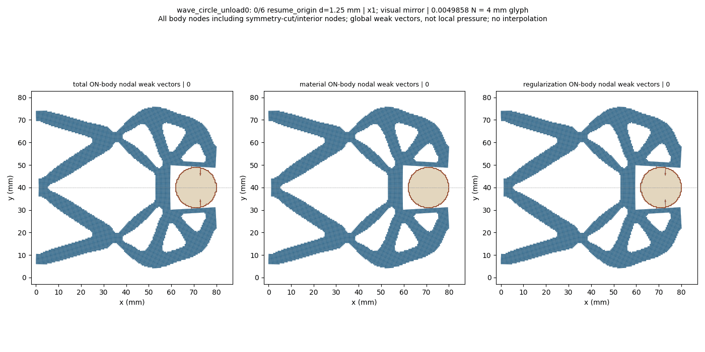
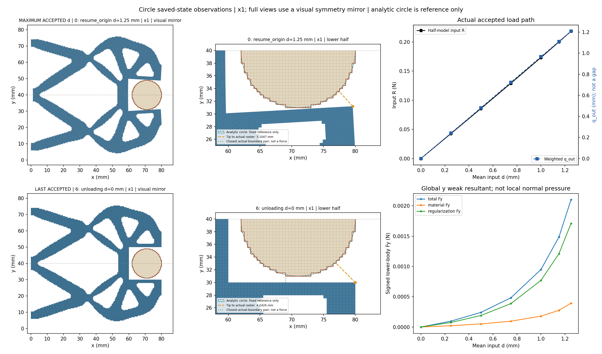
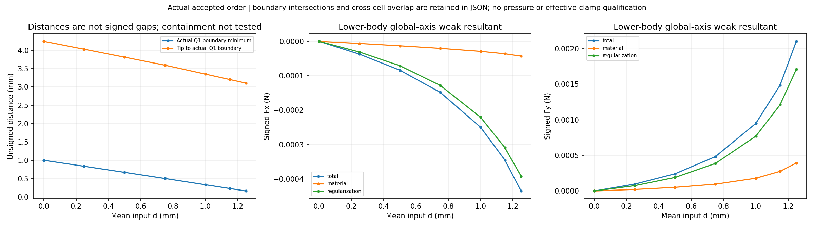
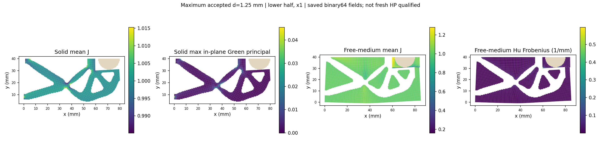
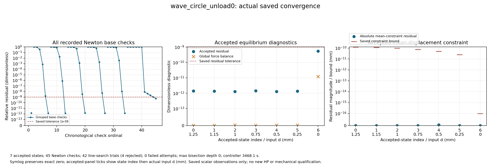

# Circular workpiece remaining input unloading1.25 to0: saved-state review

Fixed raster circle r9 at (71,40) mm, lower-half wave mechanism. The1.25 mm first state is a freshly revalidated C4 unloading anchor; targets1.15,1,.75,.5,.25,0 are appended to the same ordered_cycle. Every other task key, including four historical explanatory metadata values, remains unchanged. Only the newly authorized controller clock changes to5400s. The loading prefix is inherited, not replayed. Coordinates x1; maximum accepted d is1.25, not the historical task peak1.40. Full-structure views and GIF use a visual symmetry mirror; numerical tables retain original lower-half values. Every actual accepted state is shown in original order, including bounded controller bisections; N is not forced to7.

Boundary distances are unsigned exposed-Q1-edge observations, not signed gaps. Intersection/near-touch and region overlap are separate; containment is not tested. Weak body total includes material and Hu contributions, not contact pressure or effective grip. Reaching input0 is not free-workpiece release: body DOFs remain fixed. No freshly executed full loading-prefix/cycle, independent HP, stability or HF5 qualification is granted; ancestor CREF1 remains1.15 only and does not transfer to this suffix. The first cross-kind proof remains historical deeper in parent_continuation; no new task_transition.

[Response](wave_circle_unload0/response.json) · [Result](wave_circle_unload0/result.json) · [Exact rows](state_table.json) · [Viewer summary](view/wave_circle_unload0/summary.json) · [Initial0/input-return0 pair](load_unload_pair.json) · [Convergence JSON](convergence/convergence.json)

|index|leg|d (mm)|R input (N)|q out (mm)|body Fy total (N)|minimum Q1 boundary distance (mm)|
|---:|---|---:|---:|---:|---:|---:|
|0|resume_origin|1.25|0.21844194402663442|1.2080995850065308|0.0021009116737030955|0.16397158636164572|
|1|unloading|1.15|0.2002243354081354|1.1116170945968742|0.0014871883704071116|0.23225772437702175|
|2|unloading|1.0|0.173349868664949|0.9662875046836348|0.0009494406300702421|0.3347370674395198|
|3|unloading|0.75|0.1292605634511812|0.7237693003769242|0.00048329376992436817|0.5043741865693926|
|4|unloading|0.5|0.08574820985162358|0.48166800411889904|0.00024142519439670696|0.6718881790759587|
|5|unloading|0.25|0.042679189522059596|0.2403558309841326|9.65827351840501e-05|0.8370876961759988|
|6|unloading|0.0|4.038967834295913e-26|-7.940137446503689e-25|-2.7745116903123907e-28|1.0|

## Historical initial0 versus new input-return0

|role|global index|d (mm)|R (N)|q out (mm)|body Fy total/material/Hu (N)|unsigned nearest (mm)|medium minJ|
|---|---:|---:|---:|---:|---|---:|---:|
|historical CPILOT undeformed0|0|0.0|0.0|0.0|0.0/0.0/0.0|1.0|1.0|
|new input return0; raw tiny values retained|16|0.0|4.038967834295913e-26|-7.940137446503689e-25|-2.7745116903123907e-28/-6.153481262287929e-29/-2.1591635640835973e-28|1.0|1.0|

These are distinct accepted states/global indices0 and16. Original signed reactions, residuals and weak components are retained including tiny nonzero values; no clipping or forced exact0. No exact state equality, monotonic force or hysteresis gate is imposed. The JSON pair also retains Fx/Fy material/Hu/total, solid/medium J, Hu and tip distance. J uses the original nine Simpson points; Hu is a cellwise reference-Hessian quantity, not pressure.
