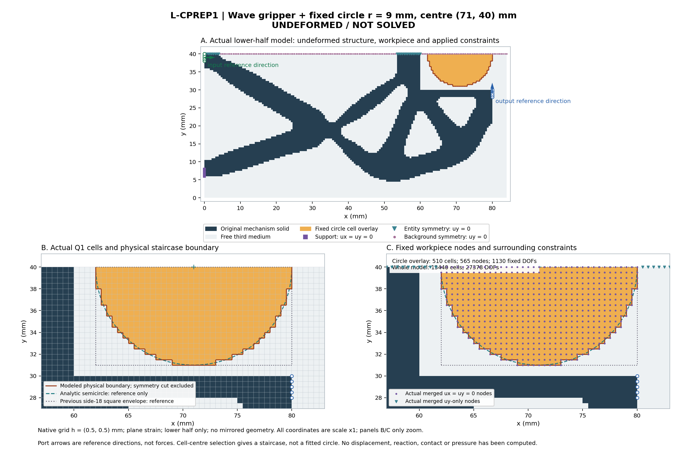

# 圆形固定工件：未变形输入与模型准备

本次只构建并保存一次原生模型；新0/.25/.5 mm任务只保存，未施加载荷或求解。
wave原四掩码、grid、坐标与连接保持；固定圆r9 mm、center(71,40) mm，只有下半域。
圆形覆盖由单元中心选取，实际边界为网格阶梯；解析圆线仅参考，不是拟合接触面。

单元13440，DOF27378；圆覆盖510单元/565节点/1130固定DOF。
相同内存方体参考覆盖648单元；实体外露边72条，y40对称切口36条。

端口箭头仅声明方向；没有变形、反力或应力结果。初始node-window距离不等于表面间隙或接触开始。
几何/约束兼容不授平衡、压力、有效夹持、释放、稳定性、独参或HF5资格；制造阈值pending按原资格声明保留。

[完整检查、边与固定DOF](diagnostics.json) · [新短任务](task.json) · [保存模型](model/model.json)
[原wave geometry](<../../lf_batch_input_preparation_001/run_001/prepared/001/derived_geometry/geometry.json>) · [原25目标task](<../../lf_batch_input_preparation_001/run_001/prepared/001/task.json>)

| 检查 | 通过 |
|---|---|
| bound_task_exact | True |
| source_grid_exact | True |
| source_geometry_identity_exact | True |
| all_four_source_masks_exact | True |
| model_solid_preserves_source | True |
| coordinates_preserve_source_grid | True |
| connectivity_preserves_source_grid | True |
| native_counts | True |
| circle_selection_matches_cell_centres | True |
| circle_cells_subset_old_square | True |
| circle_nodes_subset_old_square | True |
| circle_cells_original_passive_void | True |
| circle_nodes_disjoint_source_solid | True |
| circle_nodes_disjoint_support_and_ports | True |
| circle_nodes_and_both_fixed_components_exact | True |
| circle_centred_on_symmetry | True |
| circle_symmetry_cut_covered | True |
| circle_background_overlap_exact | True |
| all_constraint_dofs_exact | True |
| all_free_dofs_exact | True |
| port_vectors_avoid_fixed_dofs | True |
| workpiece_edges_have_manifold_incidence | True |
| nonempty_surface_and_symmetry_cut_edges | True |
| saved_task_and_grid_exact | True |
| saved_coordinate_connectivity_body_fixed_fields_exact | True |
