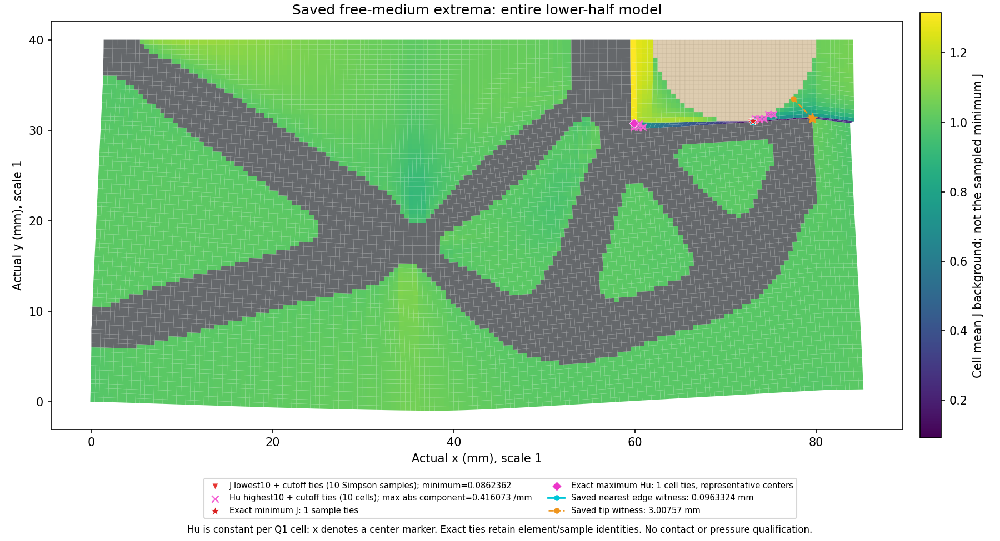
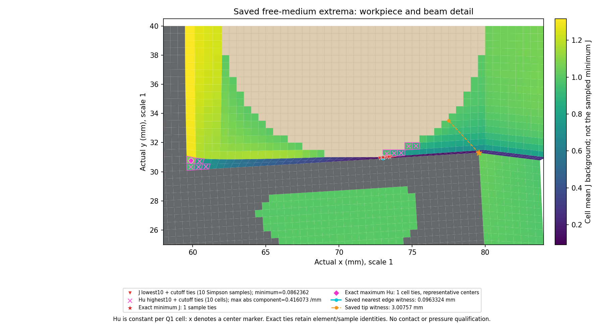

# L-CLOCAL1：圆形1.35 mm保存场空间定位

accepted1/global7，state SHA `0c8c5b07ad3ef5872502dede2f76cee6a152b9f78d3b0b7f831ebc6286a12455`。仅读三NPZ的八个原字段，不重做F/T、HP、求解或边界搜索。

自由第三介质8581单元／77229个原九点Simpson样本。最小J=0.08623624515762662；最大Hu绝对分量=0.41607250505717375 /mm。原保存标量均精确一致。

J保留最低十个样本及边界exact ties，共10行。Hu按单元max(abs8components)保留最高十单元及边界exact ties，共10单元、20个最大分量并列行。

J九点按xi慢、eta快的(-1,0,1)原Simpson顺序。Hu无九点轴，Q1参考Hessian在单元内常值；中心只作代表标记，不是唯一极值空间点，也不是Frobenius范数。跨单元重合采样点保留原身份。

颜色底图是单元meanJ，红三角是独立的低J采样位置，粉色叉是Hu高值单元中心；轮廓显示相关单元。最近边界与尖端两类见证来自原普通JSON，未经新搜索，不能混作一条间隙或接触证明。

[原值与精确并列JSON](summary.json) · [低J位置CSV](j_locations.csv) · [Hu单元及最大分量并列CSV](hu_locations.csv)

保持半径9 mm、中心(71,40) mm及原物理任务和资格；本步骤只有保存场定位，无新压力、有效夹持或稳定性资格。
