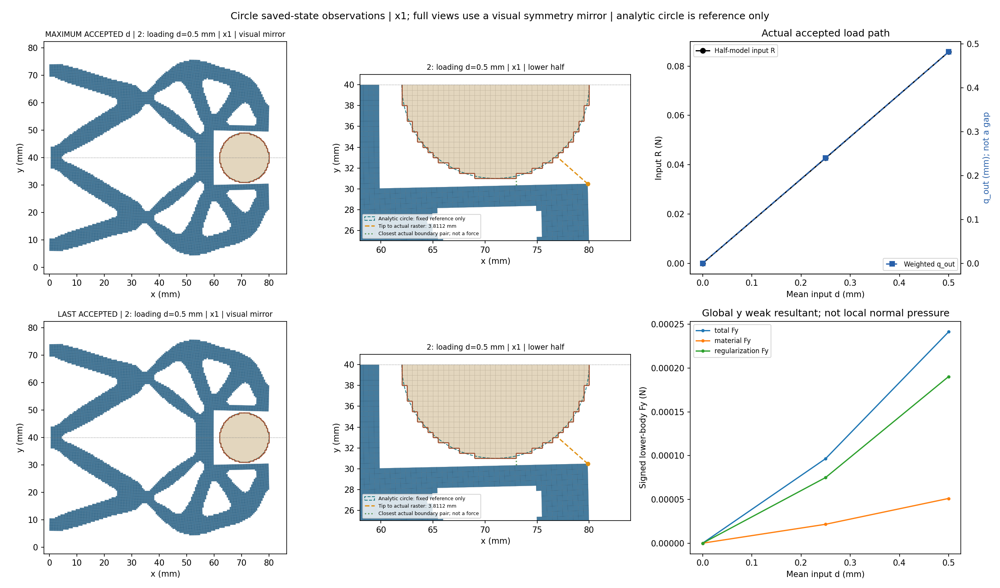
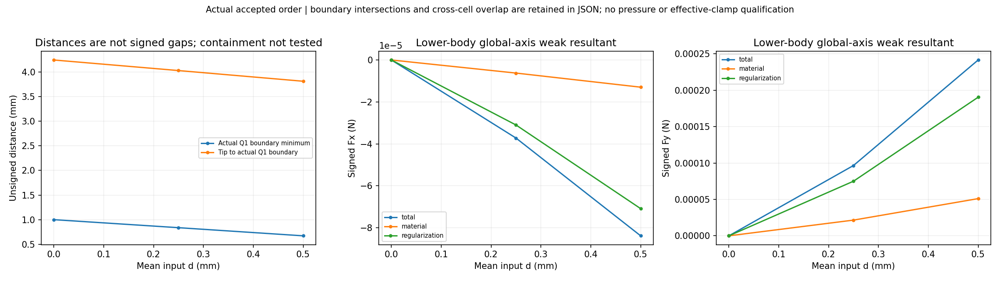
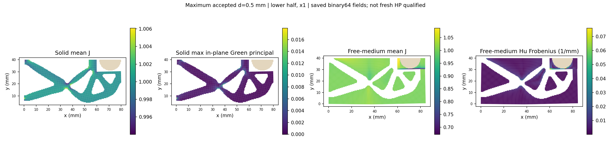
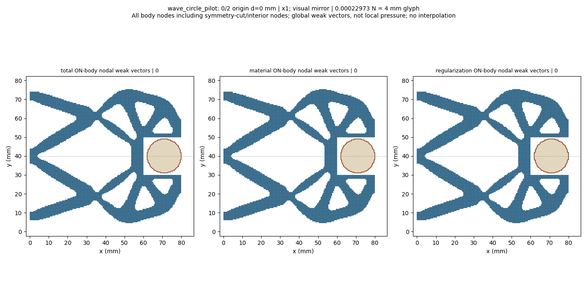
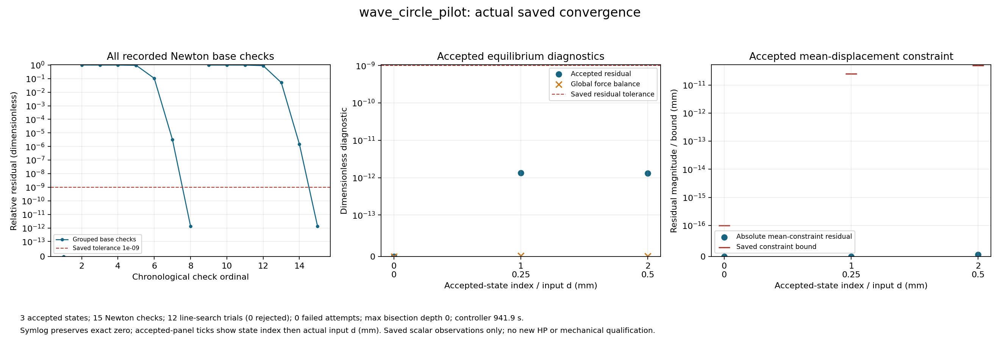

# L-CPILOT1：圆形固定工件实际短加载

执行状态 **PASS**；生产 `success`、helper `pass`、outer `pass`，停止阶段 `final_binding_and_seal`。基线 main `f4a681c8acbae9f91637b052f793109c45af3dcc`；science 0.5.0／b1334 基线保持。

目标是让已准备的 wave LF 结构，在固定圆形工件下从零完成0→0.25→0.50 mm并显示实际变形、反力和收敛。该步检验圆形构模进入真实非线性/TMC工作流的能力。

工件半径9 mm、中心(71,40) mm、固定ux/uy；其余E=1 MPa、nu=0.3、plane strain、厚20 mm、h=0.5 mm、84×40 mm下半域、gamma=1e-6、alpha=5e-7、Lr=80 mm及支撑/平均端口/对称保持。只更新四个任务说明字段，原圆形物理任务及原方体25目标历史不改。

保存接受态数 `3`；helper接受回调数 `3`，两者分别记录，缺失保存结果不写成零。路径原标志：`{'path_kind': 'load_only', 'targets_mm': [0.0, 0.25, 0.5], 'reached_displacement': 0.5, 'path_completed': True, 'loading_peak_reached': True, 'task_target_executed': True, 'unload_endpoint_reached': None}`。

|接受行|原目标|路段|d mm|输入R N|q_out mm|下半体Fy N|Q1边界距离 mm|solid minJ|free-medium minJ|relative residual|
|---:|---:|---|---:|---:|---:|---:|---:|---:|---:|---:|
|0|0|origin|0.0|0.0|0.0|0.0|1.0|1.0|1.0|0.0|
|1|1|loading|0.25|0.042679189522059596|0.2403558309841326|9.658273518405014e-05|0.8370876961759988|0.9939637114126015|0.8362973580902575|1.3420981472275413e-12|
|2|2|loading|0.5|0.08574820985162357|0.4816680041188991|0.0002414251943967071|0.6718881790759587|0.9879384800125154|0.6701213508019432|1.3128892204955163e-12|

数值保持原保存值；完整材料/Hu/总Fx/Fy、状态SHA、约束残差/原界、整体平衡和观测原值见闭卡JSON及原结果。q_out是加权端口位移，不是表面间隙；输入R和工件力保持下半模型含义。

原生产门 `{'production_residual': '1e-9', 'average_constraint': '1e-10', 'global_force_balance': '1e-6', 'fixed_displacement_mm': '8e-11'}`；缓存门实录 `{'actual_accepted_states': 3, 'minimum_J': 0.6701213508019432, 'maximum_fixed_split_sum_mm': 0.0, 'maximum_relative_residual': 1.3420981472275413e-12, 'native_constraint_bound_pass': True, 'maximum_relative_global_force_balance': 2.069366695321657e-15, 'passed': True}`。生产F/T等计数 `{'force_calls': 27, 'force_calls_completed': 27, 'tangent_calls': 15, 'tangent_calls_completed': 15, 'solver_invocations': 1, 'JIT_calls': 0, 'HP_calls': 0}`；wrapper API/solve/view调用 `{'api_started': 1, 'solve_started': 1, 'solve_completed': 1, 'api_completed': 1, 'view_child_started': 1, 'view_child_completed': 1, 'convergence_plot_started': 1, 'convergence_plot_completed': 1}`。原门未更改。

收敛原记录计数 `{'accepted_states': 3, 'newton_base_checks': 15, 'inferred_check_groups': 3, 'line_search_trials': 12, 'line_search_accepted': 12, 'line_search_rejected': 0, 'failed_attempts': 0, 'linear_solves': 14, 'maximum_bisection_depth': 0, 'zero_newton_residuals': 1}`。回溯或二分若存在，属于原控制器工作，全部实际接受态保留；不会锁定仅三态。新测试 `0`、默认安装 `0`、wrapper新HP `0`。

实际距离使用所选圆形Q1单元的物理外露阶梯边，排除对称切口；解析圆只作图示参考。无符号距离不等于有符号间隙。通用凸Q1跨区域单元重叠是另一项观察，完整包含关系及机构自重叠仍未检查；False、None与数值不确定状态分别保留。

末态几何与分区场实录：`{'index': 2, 'original_target_index': 2, 'leg': 'loading', 'd_mm': 0.5, 'state_sha256': 'a25063fafb996a8367b422aa988d5563b4d6bb259028286e246f73e0f733ed19', 'R_input_N': 0.08574820985162357, 'q_out_mm': 0.4816680041188991, 'tip_node': 10300, 'tip_x_mm': 79.86038953354719, 'tip_y_mm': 30.481429415678004, 'tip_to_raster_boundary_mm': 3.8111712204830632, 'minimum_boundary_distance_mm': 0.6718881790759587, 'boundary_intersects': False, 'boundary_roundoff_near_touch': False, 'raw_overlap': False, 'strict_overlap': False, 'roundoff_ambiguous': False, 'containment_tested': False, 'solid_min_J': 0.9879384800125154, 'medium_min_J': 0.6701213508019432, 'solid_Green_principal_min': -0.013545161623698483, 'solid_Green_principal_max': 0.017949565877062007, 'medium_max_abs_Hu_per_mm': 0.05372967716960025, 'total_body_Fx_N': -8.383678423700733e-05, 'total_body_Fy_N': 0.0002414251943967071, 'material_body_Fx_N': -1.2962979418444066e-05, 'material_body_Fy_N': 5.108735919622841e-05, 'regularization_body_Fx_N': -7.087380481856326e-05, 'regularization_body_Fy_N': 0.0001903378352004787}`。若显示未完成或该项未提供，不能据缺失值判断无接触、无重叠或场稳定。

圆周局部法向随位置变化；下半工件全局Fx/Fy是含材料和Hu的有符号弱式合力，不是连续压力或圆周总法向夹持力。坐标×1，完整结构图和GIF仅作对称镜像，数值没有镜像加倍；节点箭头包含切口/内部节点，不能当作表面压力。

实际独立审阅 `pass_finite_actual_readonly_review`；像素检查 `pass_pixel_inspection`，观察 `['Actual x1 full/mirrored and lower-half local geometry are legible. Raster edges and analytic reference are distinct; mechanism remains visibly separated below the circle. Maximum and last panels both identify state2/d0.5, correctly identical for this load-only pilot.', 'Input R/q_out and signed total/material/Hu global Fy curves show three original accepted samples. Distance/Fx/Fy figure separates boundary minimum from the more distant reference tip; no square-face ray or circular local-normal-force claim.', 'Peak field panels separate solid mean J/Green principal strain from free-medium mean J/Hu Frobenius; body is separately colored. Color means/norms and summary integration-point extrema are different declared observations.', 'Convergence figure displays the exact zero origin, two nonzero seven-check groups, original1e-9 gate,15 base checks,12 accepted line-search trials,0 rejects/failed attempts/bisections; accepted constraints lie below saved bounds. Labels and legends are readable at displayed size.']`。没有新增重绘或媒体重解码。

helper `954.4787875000038` s／2700 s，outer `955.4168830999988` s／2760 s；controller 1800 s，viewer＋收敛＋人工页共享600 s；进程树采样峰值 `877686784` B／8 GiB，清理 `True`。终端 `9ab48b/session38139/exit0`。原窗口封存 45 个输出、57457508 B，状态 `complete_inside_original_helper_window`；闭卡继承producer seal＋stat，不重读载荷。

真实错误：helper `未提供`；API `未提供`；outer `未提供`。生产成功与显示阶段失败分别报告，不回写原API或原结果。

本轮不取得独立HP、压力、有效夹持、原25态完整循环、卸载/自由释放、稳定性或HF5资格；制造仍pending。

下一步：依据本次末态真实距离、接近位置、分区J及收敛成本，提出只增加一个加载目标的后续方案；具体目标、零起点前缀或受支持续算方式及预算另行明确。不得把load_only改作完整cycle续算，也不自动移植方体1.20 mm上限。

审查入口：[原响应](run_001/wave_circle_pilot/response.json)、[原结果](run_001/wave_circle_pilot/result.json)、[原值人工页](run_001/REVIEW.md)、[显示摘要](run_001/view/wave_circle_pilot/summary.json)、[收敛JSON](run_001/convergence/convergence.json)、[helper](run_001/execution_receipt.json)、[outer](pilot_launch.json)、[实际审阅](author/ACTUAL_REVIEW.md)、[闭卡JSON](author/closure.json)。

## 结果驱动的具体后续取舍

先补齐显式load_only保存态延伸合同与有限小模型兼容验证，再从本次成功0.50 mm末态只推进0.75 mm；保留原物理其余条件、数值门和ordered_cycle合同。本轮仅提出方案，不启动后续窗口。

当前最接近位置在圆形下部与夹持梁之间；右侧参考尖端并非最近点。接口限制涉及native_resume、split_displacement、native_mean与task峰值定义，不能只改一个kind条件。具体物理依据、最小实施、兼容验证及拟议预算见[下一步计划](NEXT_STEPS.md)。
