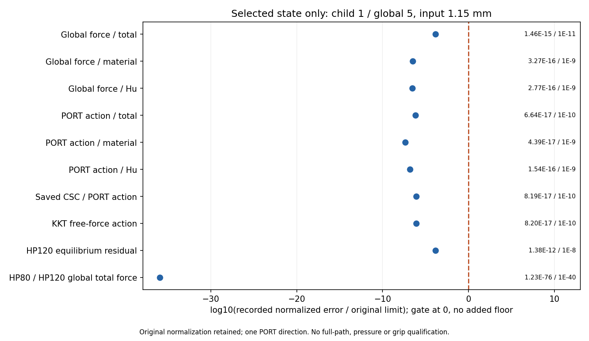

# L-CREF1：圆形工件1.15 mm保存峰值独立参考

实际执行 **PASS**：outer `pass`、helper `pass`、summary `pass`、lifecycle `pass`。main基线 `11a8b49ebef7d18fef17ffe6c9e365ce574de074`，science 0.5.0／b1334保持。

实际结论摘要：1.15 mm圆形峰值的独立参考通过，2次HP80/120、80785项实际检查，原十五类门不变。全局total/material/Hu力归一化误差分别约1.45953e-15/3.27486e-16/2.77125e-16；总PORT作用约6.63787e-17，CSC作用约8.19275e-17，KKT force作用约8.19550e-17，HP120相对平衡残差约1.38383e-12，均低于相应原门。HP80/120总力一致误差约1.22783e-76（原门1e-40）。这些使用原分母/floor，不是工件Fy误差百分比。

这支持当前保存圆形模型中力和所检方向切线的数值一致性，不能据此认定圆周压力或有效夹持。原1.15态最小边距0.232258 mm、尖端距离3.202515 mm、自由介质minJ0.225154和Hu占约81.4%弱Fy的观察保持；它们没有因参考通过而变成接触证明。

实际outer123.8793秒（约2分4秒），采样树峰值1281785856 B（约1.19 GiB），真实child exit0且无stop。一张误差PNG完成一次像素检查，十项标签/数值/阈值清楚，无遮挡；原结构媒体只链接，未重读或重绘。

整体目标是普通LF几何进入独立HF的TMC前向力学。本步针对圆形峰值压缩及Hu贡献已明显增大的实际结果，复用B850逐状态数学审计与aa86工件投影，对唯一1.15 mm保存峰值做全单元HP80/120参考，检查已有力、方向切线、平衡与工件合力的数值可靠性。它不重做生产求解。

对象为L-CSTEP2接受行1／全局目标5／loading1.15 mm，state SHA `3db267551ea6cb5817c2a1946a80363ecccb0329078d516e90e0106f27e709ef`。工件半径9 mm、圆心(71,40) mm、固定ux/uy及原材料、第三介质、正则化、网格、边界、端口和验收门保持。完整13440单元／27378DOF；圆形overlay继承L-CPREP1保存模型证据，仅核已保存模型一致性，未新增独立圆mask或边界资格。

HP启动/完成 `2`／`2`；完成材料态 `1`、工件投影态 `1`，检查计数 `80785`，绘图启动/完成 `1`／`1`。不存在的普通记录保留未提供，不按零或通过处理。

原十五门：`{'production_residual': '1e-9', 'independent_residual': '1e-8', 'force_evaluation': '1e-9', 'average_constraint': '1e-10', 'global_force_balance': '1e-6', 'fixed_displacement_mm': '8e-11', 'hp80_hp120': '1e-40', 'total_force': '1e-11', 'material_force': '1e-9', 'regularization_force': '1e-9', 'total_tangent': '1e-10', 'material_tangent': '1e-9', 'regularization_tangent': '1e-9', 'augmented_force_tangent': '1e-10', 'augmented_constraint_tangent': '1e-10'}`。覆盖材料/Hu/总局部力和全局力、实际固定兼容PORT方向切线、完整CSC系数组装身份及其方向作用、KKT力/均值作用、约束/残差/整体平衡和有符号工件/holding分区投影。只检查这一方向，不是所有切线列；独立解析能量仅归档，不比较候选能量，不授应力或能量资格。

|观察项|原归一化误差|原门|通过|
|---|---:|---:|---|
|Global force / total|1.45953394712996302772493440072373864016493020313711644892875194166659703111542001968277109517032048039606253343695982263E-15|1E-11|True|
|Global force / material|3.27486062005377820130877182768083167616112444185242656672467002869130601000350435875815396136884228519642877886375014827E-16|1E-9|True|
|Global force / Hu|2.77124602479076397239969417577107933978457384268885744814476316747721455051551307970204881813624364575735715530547803307E-16|1E-9|True|
|PORT action / total|6.63787146058688161891712425773040014357745109700311234043925813053532915437196738466443086580254283798453661521115371247E-17|1E-10|True|
|PORT action / material|4.38527172262636376018745194542565500275930011055544957504493193613490388890364966782385438252488502385746462408872047768E-17|1E-9|True|
|PORT action / Hu|1.54415931640110042153399592357072218775875303694566655252913326412781553394736295774180119702124913776911513727222681646E-16|1E-9|True|
|Saved CSC / PORT action|8.19275409028040417275294993539911864461989381549939182421921896706287894138592397772790756570963301895418251819102625639E-17|1E-10|True|
|KKT free-force action|8.19549633752200102693375032869486714255445417248580286448593631370898021105524300388870092002664416274509382322992298881E-17|1E-10|True|
|HP120 equilibrium residual|1.38383349221541077271600718170587427616296623907245922846428852005204792656823128916043618473980393666032793351138516791E-12|1e-8|True|
|HP80 / HP120 global total force|1.22783255619717656584141320340909290168048167612356235743346731366787782467348158865726672530136226811193793183215839962E-76|1E-40|True|

图中十项是已计算参考记录的显示投影；零误差明确显示，不加地板、不修改原分母或阈值。完整逐元素/全局差值和工件核查保存在原封存gzip中，闭卡不重新打开或解码。

工件Fx/Fy仍是含材料和Hu的有符号弱式合力。legacy normal_force_on_lower_body_N是全局Fy，2absFy也不等于圆周局部法向压力或合格夹持力。原L-CSTEP2生产响应、路径标志和成功历史保持；本参考通过不自动授完整子段或完整前缀资格。

实际审阅 `pass_actual_finite_review`；新PNG像素检查 `pass_pixel_inspection`，观察 `['One new1500x870 PNG viewed once with view_image(original); no resize notice, no redraw or old-media inspection.', 'Title correctly identifies child1/global5/input1.15 mm. Ten labels and original error/limit annotations are legible; no clipping or overlap was observed.', 'All plotted log10(error/limit) values lie to the left of the zero gate. HP80/120 agreement is near -35.91; this visual statement is not an added gate.', 'Figure preserves original normalization and one PORT direction; it does not report pressure or grip qualification.']`。

helper `122.89920949999942` s／900 s，outer `123.879265999989` s／960 s；采样进程树峰值 `1281785856` B／8589934592 B；实际child wall `123.58312450000085` s、exit `0`、stop `未提供`。资源是合作停止和采样观察，不增加SUP2清理或硬抢占资格。

原窗口封存 `30` 份输出／`84875169` B，状态 `complete_inside_original_helper_window`。后续科学gzip/NPZ/PNG只继承原seal并核大小，缺seal则停止发布。helper错误 `未提供`；outer错误 `未提供`。

本轮无新生产F/T、平衡求解、测试、默认安装、API关联或旧媒体重绘；不升级接触、压力、有效夹持、释放、稳定性或HF5资格。

下一步：建议下一阶段L-CSTEP3复用已安装load_only保存态延伸，从成功且已选定态独立参考通过的1.15 mm末态，仅追加1.25 mm绝对目标（增量0.10 mm）。保持r9/c(71,40)及其余物理、原数值设置和验收门，用实际变形、输入反力、材料/Hu/总工件力、边界/尖端距离、分区J及收敛继续观察更强压缩区间。当前minJ0.225154、最小无符号边距0.232258 mm，故比上次0.15 mm请求再缩小一步；该选择不新增门，也不预言接触或稳定性。本次不执行新加载，需另行明确新阶段授权。 具体来源与资源见[NEXT_STEPS.md](NEXT_STEPS.md)。

审查入口：[参考summary](run_001/reference/summary.json)、[逐态summary](run_001/reference/accepted_005/summary.json)、[误差普通JSON](run_001/reference/reference_observations.json)、[lifecycle](run_001/reference/lifecycle.json)、[封存回执](run_001/reference/execution_receipt.json)、[outer](reference_launch.json)、[实际审阅](author/ACTUAL_REVIEW.md)、[闭卡JSON](author/closure.json)。

既有实际变形与力：[L-CSTEP2人工页](../lf_circle_step_002/run_001/REVIEW.md)。此处仅链接旧媒体，不读取、重绘或重核旧像素。
