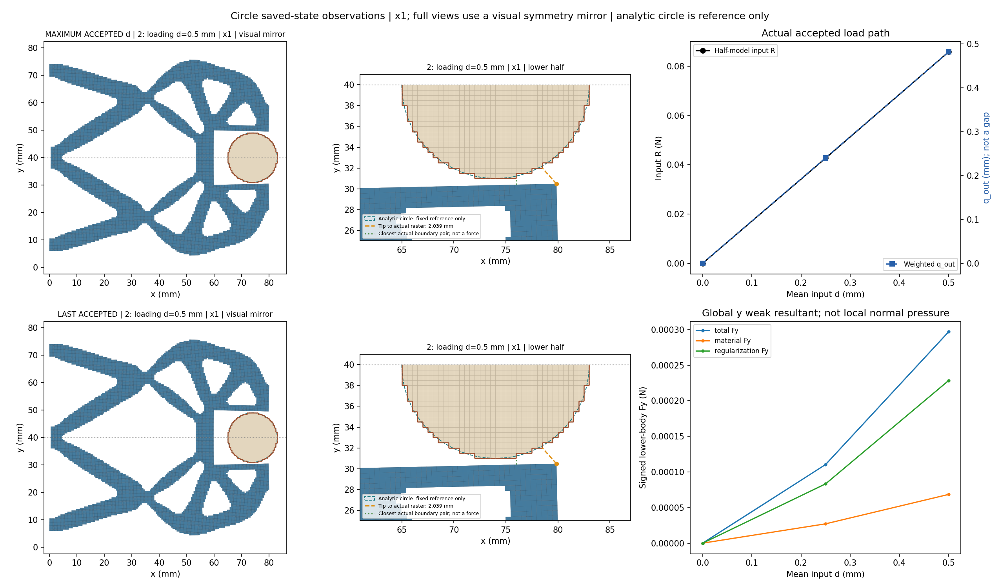
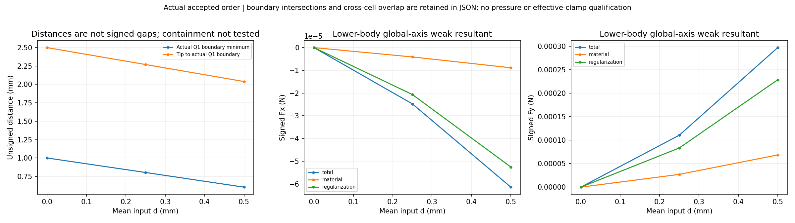
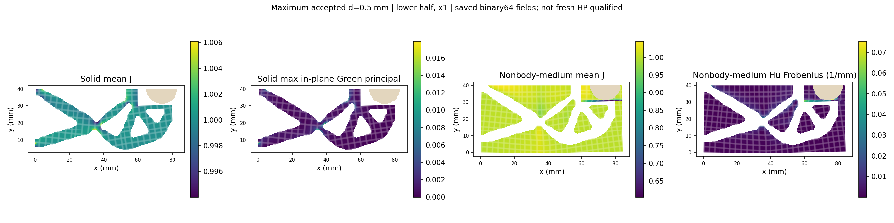
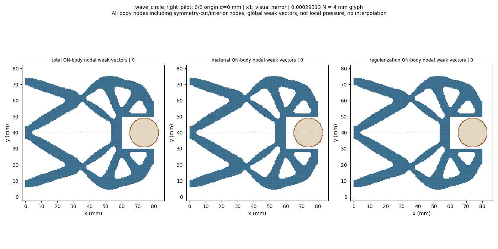
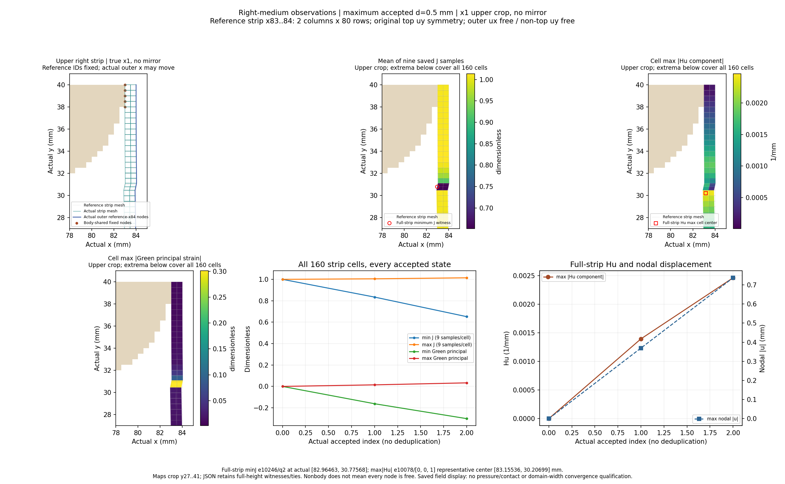
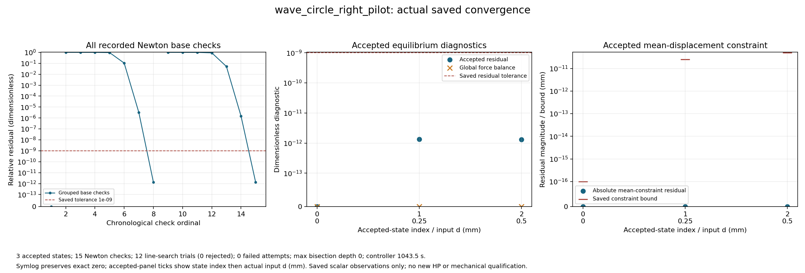

# L-CRPILOT1：圆形固定工件实际短加载

执行状态 **PASS**；生产 `success`、helper `pass`、outer `pass`，停止阶段 `final_binding_and_seal`。基线 main `0f1ba68bdf815b3818dc7711e419dfd9e0761555`；science 0.5.0／b1334 基线保持。

目标是让已准备的 wave LF 结构，在固定圆形工件下从零完成0→0.25→0.50 mm并显示实际变形、反力和收敛。该步检验圆形构模进入真实非线性/TMC工作流的能力。

工件半径9 mm、中心(74,40) mm、固定ux/uy；其余E=1 MPa、nu=0.3、plane strain、厚20 mm、h=0.5 mm、84×40 mm下半域、gamma=1e-6、alpha=5e-7、Lr=80 mm及支撑/平均端口/对称保持。只更新四个任务说明字段及新input.target0.50/load_only三目标；父17目标任务和旧结果不改。

保存接受态数 `3`；helper接受回调数 `3`，两者分别记录，缺失保存结果不写成零。路径原标志：`{'path_kind': 'load_only', 'targets_mm': [0.0, 0.25, 0.5], 'reached_displacement': 0.5, 'path_completed': True, 'loading_peak_reached': True, 'task_target_executed': True, 'unload_endpoint_reached': None}`。

|接受行|原目标|路段|d mm|输入R N|q_out mm|下半体Fy N|Q1边界距离 mm|solid minJ|free-medium minJ|relative residual|
|---:|---:|---|---:|---:|---:|---:|---:|---:|---:|---:|
|0|0|origin|0.0|0.0|0.0|0.0|1.0|1.0|1.0|0.0|
|1|1|loading|0.25|0.04269546311171801|0.24031839122737025|0.00011049166133440032|0.8030433616870802|0.9939641138593828|0.8025450485970896|1.3475243584083574e-12|
|2|2|loading|0.5|0.08581310622787962|0.481511363651934|0.00029683638167977717|0.6038158762254856|0.9879413513845947|0.6024624040787303|1.3127338955066513e-12|

数值保持原保存值；完整材料/Hu/总Fx/Fy、状态SHA、约束残差/原界、整体平衡和观测原值见闭卡JSON及原结果。q_out是加权端口位移，不是表面间隙；输入R和工件力保持下半模型含义。

原生产门 `{'production_residual': '1e-9', 'average_constraint': '1e-10', 'global_force_balance': '1e-6', 'fixed_displacement_mm': '8e-11'}`；缓存门实录 `{'actual_accepted_states': 3, 'minimum_J': 0.6024624040787303, 'maximum_fixed_split_sum_mm': 0.0, 'maximum_relative_residual': 1.3475243584083574e-12, 'native_constraint_bound_pass': True, 'maximum_relative_global_force_balance': 6.843386871833377e-16, 'passed': True}`。生产F/T等计数 `{'force_calls': 27, 'force_calls_completed': 27, 'tangent_calls': 15, 'tangent_calls_completed': 15, 'solver_invocations': 1, 'JIT_calls': 0, 'HP_calls': 0}`；wrapper API/solve/view调用 `{'api_started': 1, 'solve_started': 1, 'solve_completed': 1, 'api_completed': 1, 'view_child_started': 1, 'view_child_completed': 1, 'convergence_plot_started': 1, 'convergence_plot_completed': 1}`。原门未更改。

收敛原记录计数 `{'accepted_states': 3, 'newton_base_checks': 15, 'inferred_check_groups': 3, 'line_search_trials': 12, 'line_search_accepted': 12, 'line_search_rejected': 0, 'failed_attempts': 0, 'linear_solves': 14, 'maximum_bisection_depth': 0, 'zero_newton_residuals': 1}`。回溯或二分若存在，属于原控制器工作，全部实际接受态保留；不会锁定仅三态。新测试 `0`、默认安装 `0`、wrapper新HP `0`。

实际距离使用所选圆形Q1单元的物理外露阶梯边，排除对称切口；解析圆只作图示参考。无符号距离不等于有符号间隙。通用凸Q1跨区域单元重叠是另一项观察，完整包含关系及机构自重叠仍未检查；False、None与数值不确定状态分别保留。

最右尖端node10300跟随实际位移；初始tip2.5mm与整体最近1mm分开。右侧介质完整逐态极值、位置与约束如已完成显示，见末尾对应摘要入口。条带按reference x83..84固定160cell IDs定义；相接body节点仍固定，原顶uy对称保持。条带实际坐标/J/Hu只为保存态观察，不是域宽收敛。末态几何与分区场原值见闭卡JSON的last_saved_state/view_observation。若显示未完成或该项未提供，不能据缺失值判断无接触、无重叠或场稳定。

圆周局部法向随位置变化；下半工件全局Fx/Fy是含材料和Hu的有符号弱式合力，不是连续压力或圆周总法向夹持力。坐标×1，完整结构图和GIF仅作对称镜像，数值没有镜像加倍；节点箭头包含切口/内部节点，不能当作表面压力。

实际独立审阅 `pass_actual_finite_review`；像素检查 `pass_pixel_inspection_with_nonblocking_layout_notes`；逐图观察见[像素记录](author/pixel_QA.json)，若未完成则按缺失记录保留。没有新增重绘或媒体重解码。

| d mm | 同tip距离 mm | 最近距离 mm | 右介质minJ | 右介质maxabsHu 1/mm | 右条带max节点位移 mm |
|---:|---:|---:|---:|---:|---:|
|0.0|2.5|1.0|1.0|0.0|0.0|
|0.25|2.2701723613413005|0.8030433616870802|0.8342200576364419|0.0013956556053597302|0.36915284717486646|
|0.5|2.0389747275151535|0.6038158762254856|0.6514854160327986|0.002464251253275762|0.7367851593657934|

## 本轮物理判断与取舍

本轮实现了新布置零起点短程前向分析和保存态右侧介质可视化，默认力核、切线及控制器没有修改。3态通过原门，无失败、回溯拒绝或二分；这回答了当前任务能否计算。

同一最右tip节点10300从(80,30)移动至(79.86047,30.48127)mm，tip距2.5→2.27017→2.03897mm。全机构最近距离1→.803043→.603816mm；末态最近见证是(76.01342,30.39633)→(76,31)mm，仍为横梁内侧与工件阶梯底部。三态未观测到边界交叉、近触或跨区域单元内部重叠；完整包含关系未测试。当前仍未证实尖端接触或夹紧。

末态下半工件Fy=0.000296836N，其中材料0.0000684625N、Hu项0.000228374N。它是包含原介质/正则化作用的弱式合力；几何仍分离时出现非零值，不能单凭该值认定已接触、有效夹持或连续表面压力。

右条带在.5时minJ=.651485，见证e10246/q2参考(83,30.5)mm，实际(82.96463,30.77568)mm；Green最小主值−.300930、最大|Hu分量|.00246425/mm。全条带最大节点|u|=.736785mm位于底右角node168，实际(84.49875,.542308)mm，不是工件附近间隙闭合量。参考x84节点允许移动；实际坐标越过初始x84不是新增固定壁或域门违规。已观察到介质参与变形，尚未证明域污染、域过窄或域宽收敛。

据此优先准备更面向tip的新布局：圆心候选(80,40)、r9，明确将HF参考域右界扩至92mm，并保持Lr=80mm。新候选解析圆最右89，理论留3mm；实际Q1覆盖、端口/支撑冲突、原机构和全部新增介质、全域顶部uy、外界自由DOF及是否进入tip最近区域都须下一轮实际准备后核验。此计划会同时改变工件位置与分析域，比较时须注明两项变化。不预先保证tip先接触或域宽足够。

当前(74,40)/x84的全部通过结果保留；本轮不继续.75、不新增HP或改任何物理/门。更高载的当前布局仍可作为另一个明确物理问题，但对当前‘最右tip接触’目标，先核新布局更直接。独立判断见[物理草稿](author/PHYSICAL_DECISION_DRAFT.md)。

helper `1062.5555229000165` s／2700 s，outer `1068.286130099994` s／2760 s；controller 1800 s，viewer＋收敛＋人工页共享600 s；进程树采样峰值 `873644032` B／64 GiB，清理 `True`。终端 `{'chunk_id': '11ba1d', 'exit_code': 0, 'session_id': 99905, 'session_closed': True}`。原窗口封存 46 个输出、57822655 B，状态 `complete_inside_original_helper_window`；闭卡继承producer seal＋stat，不重读载荷。

真实错误：helper `未提供`；API `未提供`；outer `未提供`。生产成功与显示阶段失败分别报告，不回写原API或原结果。

本轮不取得独立HP、压力、有效夹持、父17目标完整循环、卸载/自由释放、稳定性或HF5资格；制造仍pending。

下一步：优先提出L-CTIPPREP1：将圆形候选置于(80,40)mm、r9保持，并将参考分析域右界从84显式扩至92mm，先做输入/未变形兼容性与tip对向检查；本轮不实施。当前.5时最近位置仍是x76横梁，tip仍距2.039mm，右介质参与压缩，继续.75不优先于核清布局。

审查入口：[原响应](run_001/wave_circle_right_pilot/response.json) · [原结果](run_001/wave_circle_right_pilot/result.json) · [人工页](run_001/REVIEW.md) · [显示摘要](run_001/view/wave_circle_right_pilot/summary.json) · [收敛JSON](run_001/convergence/convergence.json) · [helper](run_001/execution_receipt.json) · [outer](pilot_launch.json) · [实际审阅](author/ACTUAL_REVIEW.md) · [闭卡JSON](author/closure.json)
