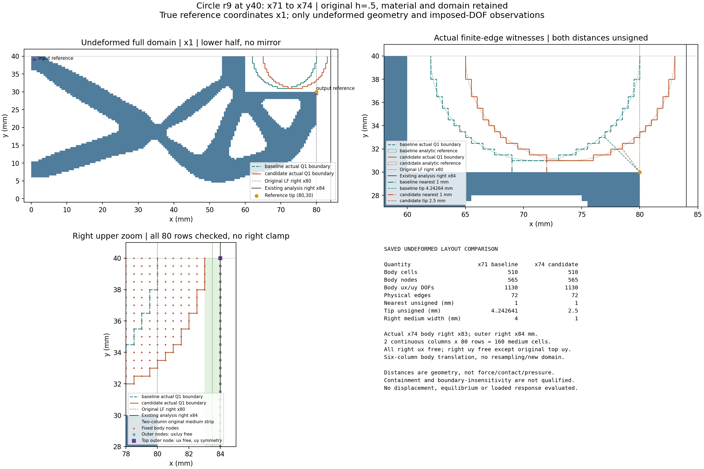

# L-CRIGHT1：圆形工件右移与未变形兼容性

实际执行 **PASS**，几何/约束检查 53/53；一次模型构建、保存和一张未变形图的实际计数见运行回执。科学窗口已关闭。本轮没有加载、变形或反力结果。

## 整体目标与本轮目的

整体目标是建立与LF求解断开的独立HF第三介质接触分析器：接收LF结构，求大变形加载/卸载，报告位移、反力和工件作用，并以独立参考和可视化验证。此前完成原wave圆形工件r9/(71,40)的分段加载至1.40mm及输入回零，记录历史收敛和变形；这不授压力、有效夹持、自由释放、稳定性或HF5资格。

本轮针对“工件应面向最右尖端”的物理需求，将圆心x从71移到74mm，检查该变化是否在原分析域内、与原机构/端口/支撑分离，且保有右侧第三介质。其余条件逐值保持，未尝试用更大行程弥补布置。原17目标ordered_cycle/input1.4在新task中只作未执行指令，旧结果原样保留。

## 实现与检查

复用现有build_native_project/write_native_project，各一次；不改默认HF源码。不读取旧模型/保存态，只在新唯一窗口读取原wave geometry.npz。对照圆由同一驻留网格、连接及原选择规则重建，不构建第二模型。检查四掩码、坐标/连接、工件原passive_void覆盖、固定与自由DOF、端口/权重、原背景对称和源身份。

保持h0.5mm、84×40mm下半HF域、厚20mm、E1MPa、nu0.3、plane strain、gamma1e-6、alpha5e-7、Lr80mm、输入+x/输出+y、原支撑与顶部uy背景对称、固定圆形工件ux/uy。80mm是原LF右界及参考尖端x；HF右界实际为84mm。半径9mm、y40保持。

| 同一定义的未变形量 | 原圆心(71,40) | 新圆心(74,40) |
|---|---:|---:|
| 整个机构到实际Q1边的最近距离 mm | 1.0 | 1.0 |
| 同一参考尖端(80,30)到实际Q1边距离 mm | 4.242640687119285 | 2.5 |
| 工件实际右端到HF右界的介质宽 mm | 4.0 | 1.0 |
| 工件单元/节点 | 510/565 | 510/565 |

距离采用真实Q1阶梯有限边，不拟合解析圆；最近距离与固定尖端距离均为无符号几何量，不是接触起点、压力或夹持力。见证端点、边号、全部body索引和固定参考tip节点在layout.json。解析圆仅作为虚线参考。

本轮右移缩短了尖端距离，但全机构最近距离没有缩短：原最近见证[69.0, 30.0]→[69.0, 31.0]mm，新见证[72.0, 30.0]→[72.0, 31.0]mm。因此“更面向最右尖端”有几何依据，仍不能预设尖端将先接触；应在短试算中追踪实际最近位置及同一尖端。

候选右端实际x=83.0mm，HF右界x=84.0mm，保留2个完整0.5mm列×80行，共160个原passive_void非实体、非工件介质单元，连续到域右界。x84各节点ux自由；除原y40顶角uy对称外，右边界uy自由。没有新增右侧夹固。介质条带存在不代表1mm域余量已足够或域宽收敛，后续需观察其变形与受力影响。

“自由介质”在这里仅指非实体、未被工件单元覆盖的原介质；与工件相接的x83节点仍承受原工件固定约束，不能理解为条带所有节点DOF都自由。外边界x84的逐节点约束检查已单独列出。

模型实际计数：{'cells': 13440, 'nodes': 13689, 'dofs': 27378, 'solid_cells': 4349, 'medium_cells': 9091, 'solid_incident_nodes': 4847, 'fixed_dofs': 1272, 'free_dofs': 26106}。工件只是原介质上的固定运动学覆盖，不改源材料掩码。制造资格与机械资格遵循原声明。

## 实际执行、记录与效果

helper 19.878441799985012秒，outer 22.051522900001146秒，进程树采样峰值230387712B，清理确认true；上限180/240秒、64GiB、四库各16线程。调用记录{'tests': 0, 'force_calls': 0, 'tangent_calls': 0, 'HP_calls': 0, 'solver_calls': 0, 'default_installations': 0}；依赖可导入或注册JAX，零力学结论依据冻结调用路径，不声称全局动态hook。原窗口封存9输出/975296B；此后科学/媒体身份只继承seal并核stat。

本轮效果是把右移布置变成明确、可恢复的HF输入，并核清84mm域和右侧介质，给短试算提供几何依据；不预报接触后夹持效果。独立源审、实际普通记录审阅及一次新PNG像素检查均记录在author目录。一次PNG人工检查通过；局部图例覆盖少量结构背景，关键边界、距离和数表可读，未重绘。

## 下一步与审查入口

Prepare a separately authorized zero-start load_only [0,.25,.5] mm pilot and circle-aware resident saved-state views; preserve r9/(74,40), all other physics, settings and original production gates.

后续若开展短试算，应使用显式新load_only任务，不执行本轮保存的1.40mm长路径；重点显示真实×1变形、同一tip/最近距离、输入反力及工件总/材料/Hu有符号力、J/Hu位置、右侧介质及实际solver history。保持原生产门，首个终端错误停止，依据真实结果决定继续或排查。本轮不新增HP，也不自动继承旧布置的参考资格。

[人工检查页](run_001/REVIEW.md) · [布局与距离见证](run_001/layout.json) · [全部检查](run_001/diagnostics.json) · [新任务](run_001/task.json) · [模型描述](run_001/model/model.json) · [执行回执](run_001/execution_receipt.json) · [外层记录](preparation_launch.json) · [闭卡](author/closure.json) · [后续计划](NEXT_STEPS.md)
