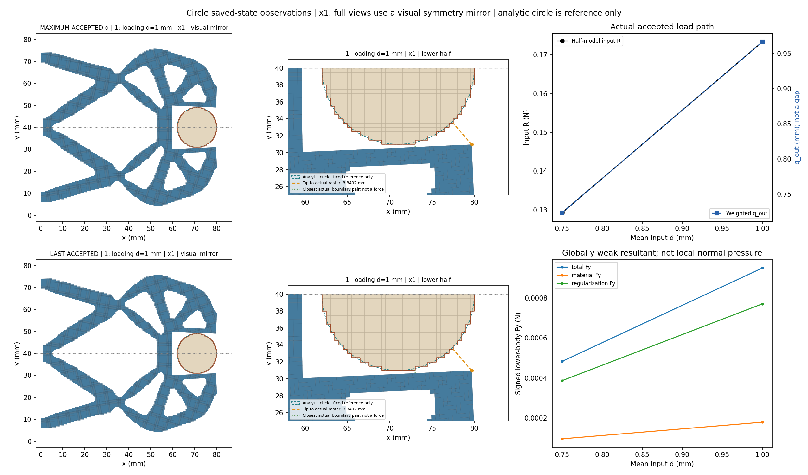
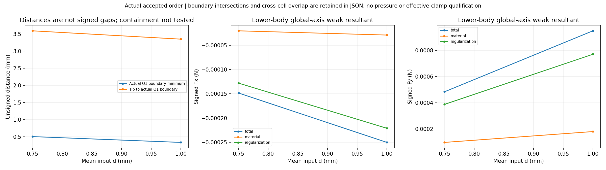
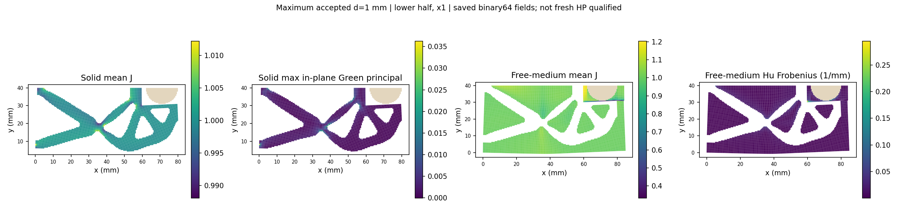
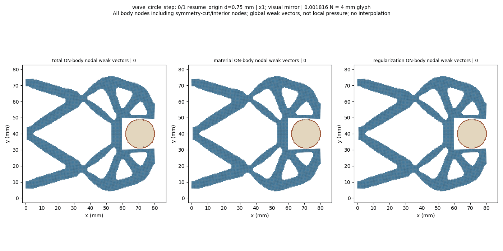
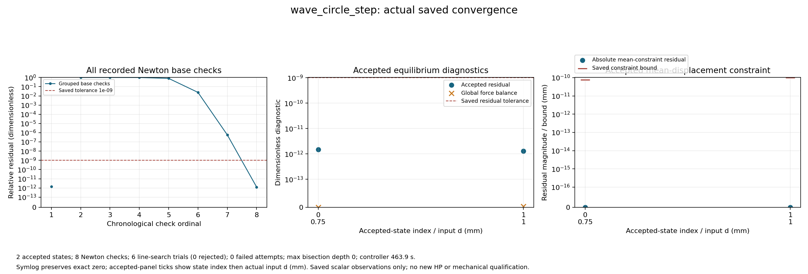

# L-CSTEP1：圆形固定工件0.75→1.00 mm保存态加载

执行状态 **PASS**；生产 `success`、helper `pass`、outer `pass`，停止阶段 `final_binding_and_seal`。基线 main `ec0d958f81db06777457aeaadd0a29b971da8457`；science 0.5.0／b1334 基线保持。

实际效果摘要：输入由0.75增至1.00 mm，R由0.129261增至0.173350 N，q_out由0.723769增至0.966288 mm；所选物理Q1边界最小无符号距离由0.504374降至0.334737 mm。最近边界位置与最右尖端不是同一点，1.00 mm时尖端距离仍为3.349195 mm。因此图中不能声称尖端已贴合圆面。自由介质minJ为0.329300、solid minJ为0.975949，均通过原J>0门。下半工件Fy=0.000949441 N，其中Hu=0.000770303 N（约81.1%）；这是弱式力分解，不能当作有效夹持力或连续压力。正的无符号距离下也可出现第三介质弱式传力，不以等待边界相交作为接触判据。

收敛：复核锚点1次检查、新目标7次检查；6次线搜索试算全部接受，0失败、0二分。总计F14/T8；本轮含显示约494.2秒，采样进程树峰值约0.777 GiB，清理通过。输出4PNG与2帧实际变形GIF。收敛图外侧图例遮挡了右面板标题的一部分，两条约束界及数据仍可见；保留原图，不重绘。

整体目标仍是普通LF几何进入独立HF的TMC前向力学，逐步实现可检查的加载、接触与卸载。本次复用已安装并验证的load_only保存态显式延伸，从L-CEXT1成功0.75 mm末态推进到1.00 mm；借助实际变形、反力、工件合力、距离、分区场与收敛记录判断下一步。

工件半径9 mm、中心(71,40) mm、固定ux/uy；其余E=1 MPa、nu=0.3、plane strain、厚20 mm、h=0.5 mm、84×40 mm下半域、gamma=1e-6、alpha=5e-7、Lr=80 mm及支撑/平均端口/对称保持。新任务完整保留[0,0.25,0.50,0.75]前缀，只追加1.00 mm并将input目标更新至新峰值；四说明字段可更新，其余物理任务、数值设置及原门保持。原父任务、结果与方体25目标历史不改。

来源父段 `lf_data_preparation/native_interface_001/lf_circle_extension_001/run_001/wave_circle_extension/result.json` 状态 `success`；选中接受行 `1`，全局目标索引 `3`，d=`0.75` mm，state SHA `699d7edfbe3fac886e368bb818f8f7e473c0915869e5e7fdebf20bebc551d40b`。本子段使用全局索引3/4和本地索引0/1；原数值设置与父段精确保持。默认HF源码保持，未新增测试、HP或安装。

保存接受态数 `2`；helper接受回调数 `2`，两者分别记录，缺失保存结果不写成零。路径原标志：`{'path_kind': 'load_only', 'targets_mm': [0.75, 1.0], 'reached_displacement': 1.0, 'path_completed': True, 'loading_peak_reached': True, 'new_peak_reached': True, 'extended_segment_completed': True, 'task_target_executed': False, 'full_original_path_completed': False, 'full_extended_path_completed': False, 'unload_endpoint_reached': None}`。

|接受行|原目标|路段|d mm|输入R N|q_out mm|下半体Fy N|Q1边界距离 mm|solid minJ|free-medium minJ|relative residual|
|---:|---:|---|---:|---:|---:|---:|---:|---:|---:|---:|
|0|3|resume_origin|0.75|0.12926056345118117|0.7237693003769242|0.0004832937699243697|0.5043741865693926|0.9819298732730248|0.5010970321487893|1.468771367188985e-12|
|1|4|loading|1.0|0.17334986866494886|0.9662875046836349|0.000949440630070241|0.3347370674395198|0.9759489610231509|0.32929980923321917|1.2757679937748875e-12|

数值保持原保存值；完整材料/Hu/总Fx/Fy、状态SHA、约束残差/原界、整体平衡和观测原值见闭卡JSON及原结果。q_out是加权端口位移，不是表面间隙；输入R和工件力保持下半模型含义。

原生产门 `{'production_residual': '1e-9', 'average_constraint': '1e-10', 'global_force_balance': '1e-6', 'fixed_displacement_mm': '8e-11'}`；缓存门实录 `{'actual_accepted_states': 2, 'minimum_J': 0.32929980923321917, 'maximum_fixed_split_sum_mm': 0.0, 'maximum_relative_residual': 1.468771367188985e-12, 'native_constraint_bound_pass': True, 'maximum_relative_global_force_balance': 3.165079675824219e-15, 'passed': True}`。生产F/T等计数 `{'force_calls': 14, 'force_calls_completed': 14, 'tangent_calls': 8, 'tangent_calls_completed': 8, 'solver_invocations': 1, 'JIT_calls': 0, 'HP_calls': 0}`；wrapper API/solve/view调用 `{'api_started': 1, 'solve_started': 1, 'solve_completed': 1, 'api_completed': 1, 'view_child_started': 1, 'view_child_completed': 1, 'convergence_plot_started': 1, 'convergence_plot_completed': 1}`。原门未更改。

收敛原记录计数 `{'accepted_states': 2, 'newton_base_checks': 8, 'inferred_check_groups': 2, 'line_search_trials': 6, 'line_search_accepted': 6, 'line_search_rejected': 0, 'failed_attempts': 0, 'linear_solves': 7, 'maximum_bisection_depth': 0, 'zero_newton_residuals': 0}`。回溯或二分若存在，属于原控制器工作，全部实际接受态保留；不会锁定仅两态。新测试 `0`、默认安装 `0`、wrapper新HP `0`。

保存延伸来源和资格原值 `{'schema_version': 'hf-native-saved-resume-1.0', 'parent_result': {'path': 'D:/Coding/Diversity TO/Compliant-Nonlinear-TMC-O/.github_handoff/Compliant-TO-TMC/lf_data_preparation/native_interface_001/lf_circle_extension_001/run_001/wave_circle_extension/result.json', 'sha256': 'e86e29b9b292aa315e75618710bfff2def273428079d041305cdd842d56278c4'}, 'parent_model': {'path': 'D:/Coding/Diversity TO/Compliant-Nonlinear-TMC-O/.github_handoff/Compliant-TO-TMC/lf_data_preparation/native_interface_001/lf_circle_extension_001/run_001/wave_circle_extension/model/model.json', 'sha256': '2e41a1f6636cd56917c86e4e9128ad7042d79558c051c7e19106a7c7dcb1a49b'}, 'selected_state': {'accepted_index': 1, 'original_target_index': 3, 'path': 'D:/Coding/Diversity TO/Compliant-Nonlinear-TMC-O/.github_handoff/Compliant-TO-TMC/lf_data_preparation/native_interface_001/lf_circle_extension_001/run_001/wave_circle_extension/accepted/001/state.json', 'descriptor_file_sha256': 'e91f3caf2243b512611a6c20abb4f675d6410cc9560cf72d19545eea1bc48f2c', 'state_sha256': '699d7edfbe3fac886e368bb818f8f7e473c0915869e5e7fdebf20bebc551d40b', 'archive_sha256': '7d4e4fe3cc5509497951bce0524c418608e79964db4c23e146120ed65ffe55e9', 'R_input_N': 0.12926056345118117, 'd_mm': 0.75, 'q_in_mm': 0.75, 'constraint_residual_mm': 0.0, 'parent_leg': 'loading'}, 'parent_status': 'success', 'parent_failure': None, 'parent_path_completed': True, 'parent_task_target_executed': False, 'parent_unload_endpoint_reached': None, 'parent_mechanics_source_sha256': {'hf_repo/src/hf_eval/native_mean.py': '76fd9917fe378865f3f359838958e58505afb9ae2e7c7ec257773a76178fd6e4', 'hf_repo/src/hf_eval/split_displacement.py': '151cc130f0a75e3b2f201b393541107ccf2feaa3de365db72d1987568dae1bb8', 'hf_repo/src/hf_eval/split_numpy_tangent.py': '547143b14c8626f7420b8d5778cb11d4d5680be1a590428d8d46f01b3549857f', 'hf_repo/src/hf_eval/split_kernel_invariants_hu.py': 'd5f7d20a6ec0c92847d67f8782f4dcc89772fc4ea62797626b0beae7effabd9a', 'hf_repo/src/hf_eval/native_resume.py': 'e8162964487df510a608a980feb1a03b3ac36e97a55452fac9e342274cfee2d1'}, 'parent_producer_flags': {'independent_HP_qualified': False, 'equilibrium_qualified': False, 'HF_qualified': False}, 'original_task_targets_mm': [0.0, 0.25, 0.5, 0.75, 1.0], 'requested_suffix_targets_mm': [0.75, 1.0], 'original_target_indices': [3, 4], 'initial_parameter': 0.75, 'target_origin': 0.0, 'state_transport': 'Original lift/fluctuation and signed R; no rounded display/rebase/translation', 'fresh_anchor_required': True, 'saved_matrix_or_force_or_tangent_read': False, 'full_original_path_executed_by_child': False, 'independent_HP_qualified': False, 'HF5_qualified': False, 'continuation_mode': 'explicit_task_extension', 'source_task_sha256': '3054384605bdffc0f478cb5c08a990625a348f139cda4989c9e4b57d38e48e2b', 'source_task_targets_mm': [0.0, 0.25, 0.5, 0.75], 'extended_task_sha256': '54b666ec07fe5f5d48abda4e3c3bb3af9eb0ac041077a162b00ff9ad0243555f', 'extended_task_targets_mm': [0.0, 0.25, 0.5, 0.75, 1.0], 'appended_targets_mm': [1.0], 'parent_continuation': {'schema_version': 'hf-native-saved-resume-1.0', 'parent_result': {'path': 'D:/Coding/Diversity TO/Compliant-Nonlinear-TMC-O/.github_handoff/Compliant-TO-TMC/lf_data_preparation/native_interface_001/lf_circle_pilot_001/run_001/wave_circle_pilot/result.json', 'sha256': 'b8e8a0fa4f6a8cd5bc6221a9193aeb243c3f935f43754ac745b79669063772d6'}, 'parent_model': {'path': 'D:/Coding/Diversity TO/Compliant-Nonlinear-TMC-O/.github_handoff/Compliant-TO-TMC/lf_data_preparation/native_interface_001/lf_circle_pilot_001/run_001/wave_circle_pilot/model/model.json', 'sha256': '5654dedd6476e4370d31b55c21d94d64a1f75787adb6969e83734161d6e5b157'}, 'selected_state': {'accepted_index': 2, 'original_target_index': 2, 'path': 'D:/Coding/Diversity TO/Compliant-Nonlinear-TMC-O/.github_handoff/Compliant-TO-TMC/lf_data_preparation/native_interface_001/lf_circle_pilot_001/run_001/wave_circle_pilot/accepted/002/state.json', 'descriptor_file_sha256': '643f4666059ec0ae8bbc8e5dbfce306d9b44b4d4e77cf26ba3493dff1d483451', 'state_sha256': 'a25063fafb996a8367b422aa988d5563b4d6bb259028286e246f73e0f733ed19', 'archive_sha256': '557d0e42c6ca7e34a6be553a6a6003c1cb4664131e26665b28c48fd454287d28', 'R_input_N': 0.08574820985162357, 'd_mm': 0.5, 'q_in_mm': 0.5, 'constraint_residual_mm': -6.938893903907228e-18, 'parent_leg': 'loading'}, 'parent_status': 'success', 'parent_failure': None, 'parent_path_completed': True, 'parent_task_target_executed': True, 'parent_unload_endpoint_reached': None, 'parent_mechanics_source_sha256': {'hf_repo/src/hf_eval/native_mean.py': '34aba7347790fafa7f03511a42aa9876649b8ce4f8c98b3efdb5a0e664288401', 'hf_repo/src/hf_eval/split_displacement.py': '8cdc31e041e7753275e880d69ec3918d87a7f6e582951885d0af288f657e5237', 'hf_repo/src/hf_eval/split_numpy_tangent.py': '547143b14c8626f7420b8d5778cb11d4d5680be1a590428d8d46f01b3549857f', 'hf_repo/src/hf_eval/split_kernel_invariants_hu.py': 'd5f7d20a6ec0c92847d67f8782f4dcc89772fc4ea62797626b0beae7effabd9a'}, 'parent_producer_flags': {'independent_HP_qualified': False, 'equilibrium_qualified': False, 'HF_qualified': False}, 'original_task_targets_mm': [0.0, 0.25, 0.5, 0.75], 'requested_suffix_targets_mm': [0.5, 0.75], 'original_target_indices': [2, 3], 'initial_parameter': 0.5, 'target_origin': 0.0, 'state_transport': 'Original lift/fluctuation and signed R; no rounded display/rebase/translation', 'fresh_anchor_required': True, 'saved_matrix_or_force_or_tangent_read': False, 'full_original_path_executed_by_child': False, 'independent_HP_qualified': False, 'HF5_qualified': False, 'continuation_mode': 'explicit_task_extension', 'source_task_sha256': '3840309675dd07364f8f856f74bdc8969408018f64fd20a53fc86e5f7f03a953', 'source_task_targets_mm': [0.0, 0.25, 0.5], 'extended_task_sha256': '3054384605bdffc0f478cb5c08a990625a348f139cda4989c9e4b57d38e48e2b', 'extended_task_targets_mm': [0.0, 0.25, 0.5, 0.75], 'appended_targets_mm': [0.75], 'parent_continuation': None, 'full_extended_path_executed_by_child': False, 'full_extended_path_completed': False, 'segment_completed': True, 'anchor_revalidated': True, 'full_original_path_completed': False, 'task_target_executed': False, 'anchor_identity_preserved': True, 'new_peak_reached': True, 'extended_segment_completed': True}, 'full_extended_path_executed_by_child': False, 'full_extended_path_completed': False, 'segment_completed': True, 'anchor_revalidated': True, 'full_original_path_completed': False, 'task_target_executed': False, 'anchor_identity_preserved': True, 'new_peak_reached': True, 'extended_segment_completed': True}`。new_peak_reached与extended_segment_completed仅描述本次子段；task_target_executed、full_original_path_completed、full_extended_path_completed保持False，因为本次没有从零执行完整前缀。首态使用原绝对lift/fluctuation及带符号R，以fresh F/T复核原门并保持状态身份，不复用旧力或切线。

实际距离使用所选圆形Q1单元的物理外露阶梯边，排除对称切口；解析圆只作图示参考。无符号距离不等于有符号间隙。通用凸Q1跨区域单元重叠是另一项观察，完整包含关系及机构自重叠仍未检查；False、None与数值不确定状态分别保留。

末态几何与分区场实录：`{'index': 1, 'original_target_index': 4, 'leg': 'loading', 'd_mm': 1.0, 'state_sha256': '8eca12177e50cecf8fc47c4668e19c34109a21965b21d62d9e262eb9459b3f06', 'R_input_N': 0.17334986866494886, 'q_out_mm': 0.9662875046836349, 'tip_node': 10300, 'tip_x_mm': 79.6891737315086, 'tip_y_mm': 30.96531598369455, 'tip_to_raster_boundary_mm': 3.3491946329291817, 'minimum_boundary_distance_mm': 0.3347370674395198, 'boundary_intersects': False, 'boundary_roundoff_near_touch': False, 'raw_overlap': False, 'strict_overlap': False, 'roundoff_ambiguous': False, 'containment_tested': False, 'solid_min_J': 0.9759489610231509, 'medium_min_J': 0.32929980923321917, 'solid_Green_principal_min': -0.026698807332403953, 'solid_Green_principal_max': 0.0362217073794423, 'medium_max_abs_Hu_per_mm': 0.15477885994739782, 'total_body_Fx_N': -0.0002500362086989184, 'total_body_Fy_N': 0.000949440630070241, 'material_body_Fx_N': -2.904990757523995e-05, 'material_body_Fy_N': 0.000179137948970445, 'regularization_body_Fx_N': -0.0002209863011236785, 'regularization_body_Fy_N': 0.000770302681099796}`。若显示未完成或该项未提供，不能据缺失值判断无接触、无重叠或场稳定。

圆周局部法向随位置变化；下半工件全局Fx/Fy是含材料和Hu的有符号弱式合力，不是连续压力或圆周总法向夹持力。坐标×1，完整结构图和GIF仅作对称镜像，数值没有镜像加倍；节点箭头包含切口/内部节点，不能当作表面压力。

实际独立审阅 `pass_actual_finite_review`；像素检查 `pass_pixel_inspection_with_minor_annotation`，观察 `['Four new PNGs were each viewed once using view_image(original). The renderer resized previews; this is visual QA, not an exhaustive full-resolution pixel audit.', 'Comparison: actual x1 lower-half and mirrored full structure, fixed circular stair boundary, analytic reference and closest/tip witnesses are legible. Peak and last both identify child1 at 1.00 mm, as expected for load_only.', 'Distances/forces: two saved states .75 and 1.00 mm, input reaction and q_out, unsigned boundary/tip distances and signed total/material/Hu body forces are visible.', 'Peak fields: plotted solid/medium element means and Hu Frobenius norm are distinct from the reported quadrature extrema and signed forces.', 'Convergence: eight base checks, six accepted line trials, no failed trials or bisections. Residual and both constraint bounds are visible.', 'Minor annotation issue retained: the outside legend overlaps part of the right convergence-panel title. Data and both bound markers remain visible; no redraw or additional inspection was performed.', 'No old media were opened and no additional GIF decode was performed. Positive unsigned distance and weak body resultant do not establish effective clamping pressure.']`。没有新增重绘或媒体重解码。

helper `492.7553346000059` s／2700 s，outer `494.1615754000086` s／2760 s；controller 1800 s，viewer＋收敛＋人工页共享600 s；进程树采样峰值 `834396160` B／8589934592 B，清理 `True`。终端 `{'terminal': 'f5f61c', 'session': 12719, 'exit_code': 0}`。原窗口封存 37 个输出、57291912 B，状态 `complete_inside_original_helper_window`；闭卡继承producer seal＋stat，不重读载荷。

真实错误：helper `未提供`；API `未提供`；outer `未提供`。生产成功与显示阶段失败分别报告，不回写原API或原结果。

本轮不取得整条新路径从零执行、独立HP、压力、有效夹持、原25态完整循环、卸载/自由释放、稳定性或HF5资格；制造仍pending。既有父段成功保留历史，不把原参考资格自动转授新态。

下一步：建议下一阶段 L-CSTEP2 复用已安装接口，从本次成功1.00 mm末态只追加1.15 mm，增量0.15 mm。新增加载态7次检查（含锚点共8次）、无失败回溯或二分，支持继续；但自由第三介质minJ由0.5011降至0.3293，且Hu分量增长，故缩小请求步长以观察更强压缩区间。此选择不改变原门，也不证明稳定性。保持半径9 mm、圆心(71,40) mm、固定工件及其余物理条件和非clock设置；仅规划，不在本轮运行。 具体来源、资源和输出见[NEXT_STEPS.md](NEXT_STEPS.md)。

审查入口：[原响应](run_001/wave_circle_step/response.json)、[原结果](run_001/wave_circle_step/result.json)、[原值人工页](run_001/REVIEW.md)、[显示摘要](run_001/view/wave_circle_step/summary.json)、[收敛JSON](run_001/convergence/convergence.json)、[helper](run_001/execution_receipt.json)、[outer](step_launch.json)、[实际审阅](author/ACTUAL_REVIEW.md)、[闭卡JSON](author/closure.json)。
