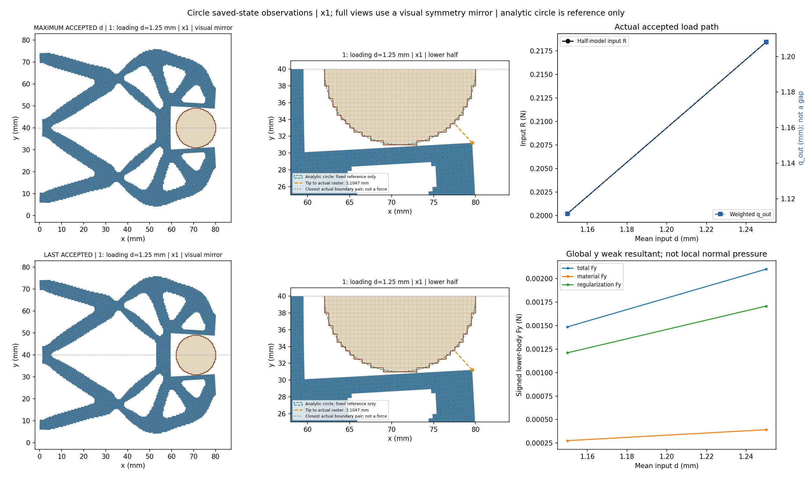
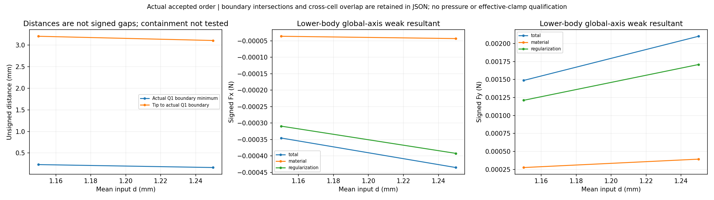
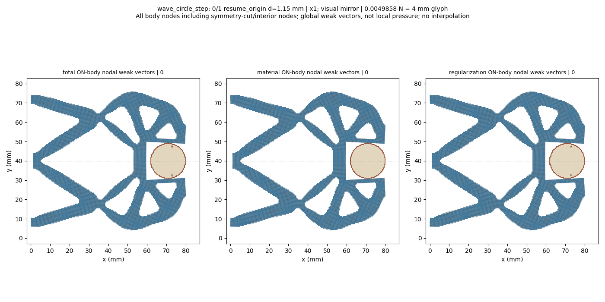
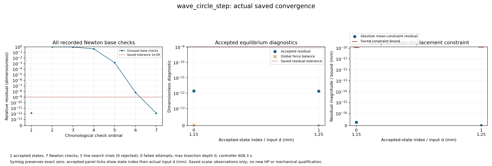

# L-CSTEP3：圆形固定工件1.15→1.25 mm保存态加载

执行状态 **PASS**；生产 `success`、helper `pass`、outer `pass`，停止阶段 `final_binding_and_seal`。基线 main `260d4b86ee87ab3dd12c04dbcccef7ffa4c31eac`；science 0.5.0／b1334 基线保持。

本段原1.15 mm锚点复核后，新1.25 mm目标用了6次Newton基点检查和5次全部接受的线搜索，无失败、拒绝或二分；F12/T7包括锚点复核。outer耗时623.98 s，高于上一段449.90 s，但新目标检查数及线搜索计数相同，不能据此归因于Newton收敛变差；耗时差原因尚未诊断。

Q1外露阶梯边最小无符号距离由0.232258降至0.163972 mm，自由第三介质最小J由0.225154降至0.155533，说明观察到的局部介质压缩增强。最右尖端距工件仍3.104708 mm，最近见证点位于工件下方的梁段；不能把最近梁段距离或q_out当成最右尖端已接触。

下半工件全局Fy由0.001487188增至0.002100912 N，新态材料项0.000392819 N、Hu项0.001708092 N（约81.3%）；这仍是弱式合力分解，不是圆周法向压力或有效夹持力。已显示的边界相交、近接触与跨区域重叠标志均为False，完整包含和机构自重叠未检查。上一阶段独立HP只核原1.15 mm，不能转授本次1.25 mm。

整体目标仍是普通LF几何进入独立HF的TMC前向力学，逐步实现可检查的加载、接触与卸载。本次复用已安装并验证的load_only保存态显式延伸，从L-CSTEP2成功1.15 mm末态推进到1.25 mm；借助实际变形、反力、工件合力、距离、分区场与收敛记录判断下一步。

工件半径9 mm、中心(71,40) mm、固定ux/uy；其余E=1 MPa、nu=0.3、plane strain、厚20 mm、h=0.5 mm、84×40 mm下半域、gamma=1e-6、alpha=5e-7、Lr=80 mm及支撑/平均端口/对称保持。新任务完整保留[0,0.25,0.50,0.75,1.00,1.15]前缀，只追加1.25 mm并将input目标更新至新峰值；四说明字段可更新，其余物理任务、数值设置及原门保持。原父任务、结果与方体25目标历史不改。

来源父段 `lf_data_preparation/native_interface_001/lf_circle_step_002/run_001/wave_circle_step/result.json` 状态 `success`；选中接受行 `1`，全局目标索引 `5`，d=`1.15` mm，state SHA `3db267551ea6cb5817c2a1946a80363ecccb0329078d516e90e0106f27e709ef`。本子段使用全局索引5/6和本地索引0/1；原数值设置与父段精确保持。默认HF源码保持，未新增测试、HP或安装。

保存接受态数 `2`；helper接受回调数 `2`，两者分别记录，缺失保存结果不写成零。路径原标志：`{'path_kind': 'load_only', 'targets_mm': [1.15, 1.25], 'reached_displacement': 1.25, 'path_completed': True, 'loading_peak_reached': True, 'new_peak_reached': True, 'extended_segment_completed': True, 'task_target_executed': False, 'full_original_path_completed': False, 'full_extended_path_completed': False, 'unload_endpoint_reached': None}`。

|接受行|原目标|路段|d mm|输入R N|q_out mm|下半体Fy N|Q1边界距离 mm|solid minJ|free-medium minJ|relative residual|
|---:|---:|---|---:|---:|---:|---:|---:|---:|---:|---:|
|0|5|resume_origin|1.15|0.20022433540813542|1.1116170945968742|0.0014871883704071114|0.23225772437702175|0.9723841968530681|0.2251542195792114|1.3838545798229994e-12|
|1|6|loading|1.25|0.21844194402663447|1.2080995850065308|0.0021009116737030946|0.16397158636164572|0.9700262167660758|0.15553278909851423|1.3606272917487975e-12|

数值保持原保存值；完整材料/Hu/总Fx/Fy、状态SHA、约束残差/原界、整体平衡和观测原值见闭卡JSON及原结果。q_out是加权端口位移，不是表面间隙；输入R和工件力保持下半模型含义。

原生产门 `{'production_residual': '1e-9', 'average_constraint': '1e-10', 'global_force_balance': '1e-6', 'fixed_displacement_mm': '8e-11'}`；缓存门实录 `{'actual_accepted_states': 2, 'minimum_J': 0.15553278909851423, 'maximum_fixed_split_sum_mm': 0.0, 'maximum_relative_residual': 1.3838545798229994e-12, 'native_constraint_bound_pass': True, 'maximum_relative_global_force_balance': 1.669202793970425e-15, 'passed': True}`。生产F/T等计数 `{'force_calls': 12, 'force_calls_completed': 12, 'tangent_calls': 7, 'tangent_calls_completed': 7, 'solver_invocations': 1, 'JIT_calls': 0, 'HP_calls': 0}`；wrapper API/solve/view调用 `{'api_started': 1, 'solve_started': 1, 'solve_completed': 1, 'api_completed': 1, 'view_child_started': 1, 'view_child_completed': 1, 'convergence_plot_started': 1, 'convergence_plot_completed': 1}`。原门未更改。

收敛原记录计数 `{'accepted_states': 2, 'newton_base_checks': 7, 'inferred_check_groups': 2, 'line_search_trials': 5, 'line_search_accepted': 5, 'line_search_rejected': 0, 'failed_attempts': 0, 'linear_solves': 6, 'maximum_bisection_depth': 0, 'zero_newton_residuals': 0}`。回溯或二分若存在，属于原控制器工作，全部实际接受态保留；不会锁定仅两态。新测试 `0`、默认安装 `0`、wrapper新HP `0`。

保存延伸来源和资格原值 `{'schema_version': 'hf-native-saved-resume-1.0', 'parent_result': {'path': 'D:/Coding/Diversity TO/Compliant-Nonlinear-TMC-O/.github_handoff/Compliant-TO-TMC/lf_data_preparation/native_interface_001/lf_circle_step_002/run_001/wave_circle_step/result.json', 'sha256': '13776924f58f8e90587932a630d65bc89e2b27b5bc9afdbcebad343019a109f1'}, 'parent_model': {'path': 'D:/Coding/Diversity TO/Compliant-Nonlinear-TMC-O/.github_handoff/Compliant-TO-TMC/lf_data_preparation/native_interface_001/lf_circle_step_002/run_001/wave_circle_step/model/model.json', 'sha256': '51b9b19f0f680b298f8ba6eb5db7f3f8e337206127b10f8066cf76a7059ab910'}, 'selected_state': {'accepted_index': 1, 'original_target_index': 5, 'path': 'D:/Coding/Diversity TO/Compliant-Nonlinear-TMC-O/.github_handoff/Compliant-TO-TMC/lf_data_preparation/native_interface_001/lf_circle_step_002/run_001/wave_circle_step/accepted/001/state.json', 'descriptor_file_sha256': '9a2d1afe58ea7e202b8bd1c1758c4d7d534f007f25988b4ebaabae7a41ed58b6', 'state_sha256': '3db267551ea6cb5817c2a1946a80363ecccb0329078d516e90e0106f27e709ef', 'archive_sha256': '8f9d7582f274658e1c85e5aa039869c0ac103574f96d568db2704f49d79629da', 'R_input_N': 0.20022433540813542, 'd_mm': 1.15, 'q_in_mm': 1.15, 'constraint_residual_mm': -2.7755575615628914e-17, 'parent_leg': 'loading'}, 'parent_status': 'success', 'parent_failure': None, 'parent_path_completed': True, 'parent_task_target_executed': False, 'parent_unload_endpoint_reached': None, 'parent_mechanics_source_sha256': {'hf_repo/src/hf_eval/native_mean.py': '76fd9917fe378865f3f359838958e58505afb9ae2e7c7ec257773a76178fd6e4', 'hf_repo/src/hf_eval/split_displacement.py': '151cc130f0a75e3b2f201b393541107ccf2feaa3de365db72d1987568dae1bb8', 'hf_repo/src/hf_eval/split_numpy_tangent.py': '547143b14c8626f7420b8d5778cb11d4d5680be1a590428d8d46f01b3549857f', 'hf_repo/src/hf_eval/split_kernel_invariants_hu.py': 'd5f7d20a6ec0c92847d67f8782f4dcc89772fc4ea62797626b0beae7effabd9a', 'hf_repo/src/hf_eval/native_resume.py': 'e8162964487df510a608a980feb1a03b3ac36e97a55452fac9e342274cfee2d1'}, 'parent_producer_flags': {'independent_HP_qualified': False, 'equilibrium_qualified': False, 'HF_qualified': False}, 'original_task_targets_mm': [0.0, 0.25, 0.5, 0.75, 1.0, 1.15, 1.25], 'requested_suffix_targets_mm': [1.15, 1.25], 'original_target_indices': [5, 6], 'initial_parameter': 1.15, 'target_origin': 0.0, 'state_transport': 'Original lift/fluctuation and signed R; no rounded display/rebase/translation', 'fresh_anchor_required': True, 'saved_matrix_or_force_or_tangent_read': False, 'full_original_path_executed_by_child': False, 'independent_HP_qualified': False, 'HF5_qualified': False, 'continuation_mode': 'explicit_task_extension', 'source_task_sha256': '44bea6cfcb33e850266094fe1f91c887c01d90459934d3e55509290af3a6575a', 'source_task_targets_mm': [0.0, 0.25, 0.5, 0.75, 1.0, 1.15], 'extended_task_sha256': 'bee029eb2409c7ddcdb0cfd2a57fee21b68f06ee4ef332117750323bed6453a5', 'extended_task_targets_mm': [0.0, 0.25, 0.5, 0.75, 1.0, 1.15, 1.25], 'appended_targets_mm': [1.25], 'parent_continuation': {'schema_version': 'hf-native-saved-resume-1.0', 'parent_result': {'path': 'D:/Coding/Diversity TO/Compliant-Nonlinear-TMC-O/.github_handoff/Compliant-TO-TMC/lf_data_preparation/native_interface_001/lf_circle_step_001/run_001/wave_circle_step/result.json', 'sha256': 'b826215be038cb6a308c8a19605009763fd950f314ba2394530cb9b5429bfb75'}, 'parent_model': {'path': 'D:/Coding/Diversity TO/Compliant-Nonlinear-TMC-O/.github_handoff/Compliant-TO-TMC/lf_data_preparation/native_interface_001/lf_circle_step_001/run_001/wave_circle_step/model/model.json', 'sha256': 'a6f69a998637576ed66a6b81f3c4bcc9e3e42f9df6ebda636d161541603d8491'}, 'selected_state': {'accepted_index': 1, 'original_target_index': 4, 'path': 'D:/Coding/Diversity TO/Compliant-Nonlinear-TMC-O/.github_handoff/Compliant-TO-TMC/lf_data_preparation/native_interface_001/lf_circle_step_001/run_001/wave_circle_step/accepted/001/state.json', 'descriptor_file_sha256': '22c325ee4b114f421c572f6e382871ba1127e2b57afcbd3e42035f36615314e2', 'state_sha256': '8eca12177e50cecf8fc47c4668e19c34109a21965b21d62d9e262eb9459b3f06', 'archive_sha256': 'de042cab638bd65c7de6be33a82a59e6c520782db1d8c0da4e8ab6b1d757ed59', 'R_input_N': 0.17334986866494886, 'd_mm': 1.0, 'q_in_mm': 1.0, 'constraint_residual_mm': 0.0, 'parent_leg': 'loading'}, 'parent_status': 'success', 'parent_failure': None, 'parent_path_completed': True, 'parent_task_target_executed': False, 'parent_unload_endpoint_reached': None, 'parent_mechanics_source_sha256': {'hf_repo/src/hf_eval/native_mean.py': '76fd9917fe378865f3f359838958e58505afb9ae2e7c7ec257773a76178fd6e4', 'hf_repo/src/hf_eval/split_displacement.py': '151cc130f0a75e3b2f201b393541107ccf2feaa3de365db72d1987568dae1bb8', 'hf_repo/src/hf_eval/split_numpy_tangent.py': '547143b14c8626f7420b8d5778cb11d4d5680be1a590428d8d46f01b3549857f', 'hf_repo/src/hf_eval/split_kernel_invariants_hu.py': 'd5f7d20a6ec0c92847d67f8782f4dcc89772fc4ea62797626b0beae7effabd9a', 'hf_repo/src/hf_eval/native_resume.py': 'e8162964487df510a608a980feb1a03b3ac36e97a55452fac9e342274cfee2d1'}, 'parent_producer_flags': {'independent_HP_qualified': False, 'equilibrium_qualified': False, 'HF_qualified': False}, 'original_task_targets_mm': [0.0, 0.25, 0.5, 0.75, 1.0, 1.15], 'requested_suffix_targets_mm': [1.0, 1.15], 'original_target_indices': [4, 5], 'initial_parameter': 1.0, 'target_origin': 0.0, 'state_transport': 'Original lift/fluctuation and signed R; no rounded display/rebase/translation', 'fresh_anchor_required': True, 'saved_matrix_or_force_or_tangent_read': False, 'full_original_path_executed_by_child': False, 'independent_HP_qualified': False, 'HF5_qualified': False, 'continuation_mode': 'explicit_task_extension', 'source_task_sha256': '54b666ec07fe5f5d48abda4e3c3bb3af9eb0ac041077a162b00ff9ad0243555f', 'source_task_targets_mm': [0.0, 0.25, 0.5, 0.75, 1.0], 'extended_task_sha256': '44bea6cfcb33e850266094fe1f91c887c01d90459934d3e55509290af3a6575a', 'extended_task_targets_mm': [0.0, 0.25, 0.5, 0.75, 1.0, 1.15], 'appended_targets_mm': [1.15], 'parent_continuation': {'schema_version': 'hf-native-saved-resume-1.0', 'parent_result': {'path': 'D:/Coding/Diversity TO/Compliant-Nonlinear-TMC-O/.github_handoff/Compliant-TO-TMC/lf_data_preparation/native_interface_001/lf_circle_extension_001/run_001/wave_circle_extension/result.json', 'sha256': 'e86e29b9b292aa315e75618710bfff2def273428079d041305cdd842d56278c4'}, 'parent_model': {'path': 'D:/Coding/Diversity TO/Compliant-Nonlinear-TMC-O/.github_handoff/Compliant-TO-TMC/lf_data_preparation/native_interface_001/lf_circle_extension_001/run_001/wave_circle_extension/model/model.json', 'sha256': '2e41a1f6636cd56917c86e4e9128ad7042d79558c051c7e19106a7c7dcb1a49b'}, 'selected_state': {'accepted_index': 1, 'original_target_index': 3, 'path': 'D:/Coding/Diversity TO/Compliant-Nonlinear-TMC-O/.github_handoff/Compliant-TO-TMC/lf_data_preparation/native_interface_001/lf_circle_extension_001/run_001/wave_circle_extension/accepted/001/state.json', 'descriptor_file_sha256': 'e91f3caf2243b512611a6c20abb4f675d6410cc9560cf72d19545eea1bc48f2c', 'state_sha256': '699d7edfbe3fac886e368bb818f8f7e473c0915869e5e7fdebf20bebc551d40b', 'archive_sha256': '7d4e4fe3cc5509497951bce0524c418608e79964db4c23e146120ed65ffe55e9', 'R_input_N': 0.12926056345118117, 'd_mm': 0.75, 'q_in_mm': 0.75, 'constraint_residual_mm': 0.0, 'parent_leg': 'loading'}, 'parent_status': 'success', 'parent_failure': None, 'parent_path_completed': True, 'parent_task_target_executed': False, 'parent_unload_endpoint_reached': None, 'parent_mechanics_source_sha256': {'hf_repo/src/hf_eval/native_mean.py': '76fd9917fe378865f3f359838958e58505afb9ae2e7c7ec257773a76178fd6e4', 'hf_repo/src/hf_eval/split_displacement.py': '151cc130f0a75e3b2f201b393541107ccf2feaa3de365db72d1987568dae1bb8', 'hf_repo/src/hf_eval/split_numpy_tangent.py': '547143b14c8626f7420b8d5778cb11d4d5680be1a590428d8d46f01b3549857f', 'hf_repo/src/hf_eval/split_kernel_invariants_hu.py': 'd5f7d20a6ec0c92847d67f8782f4dcc89772fc4ea62797626b0beae7effabd9a', 'hf_repo/src/hf_eval/native_resume.py': 'e8162964487df510a608a980feb1a03b3ac36e97a55452fac9e342274cfee2d1'}, 'parent_producer_flags': {'independent_HP_qualified': False, 'equilibrium_qualified': False, 'HF_qualified': False}, 'original_task_targets_mm': [0.0, 0.25, 0.5, 0.75, 1.0], 'requested_suffix_targets_mm': [0.75, 1.0], 'original_target_indices': [3, 4], 'initial_parameter': 0.75, 'target_origin': 0.0, 'state_transport': 'Original lift/fluctuation and signed R; no rounded display/rebase/translation', 'fresh_anchor_required': True, 'saved_matrix_or_force_or_tangent_read': False, 'full_original_path_executed_by_child': False, 'independent_HP_qualified': False, 'HF5_qualified': False, 'continuation_mode': 'explicit_task_extension', 'source_task_sha256': '3054384605bdffc0f478cb5c08a990625a348f139cda4989c9e4b57d38e48e2b', 'source_task_targets_mm': [0.0, 0.25, 0.5, 0.75], 'extended_task_sha256': '54b666ec07fe5f5d48abda4e3c3bb3af9eb0ac041077a162b00ff9ad0243555f', 'extended_task_targets_mm': [0.0, 0.25, 0.5, 0.75, 1.0], 'appended_targets_mm': [1.0], 'parent_continuation': {'schema_version': 'hf-native-saved-resume-1.0', 'parent_result': {'path': 'D:/Coding/Diversity TO/Compliant-Nonlinear-TMC-O/.github_handoff/Compliant-TO-TMC/lf_data_preparation/native_interface_001/lf_circle_pilot_001/run_001/wave_circle_pilot/result.json', 'sha256': 'b8e8a0fa4f6a8cd5bc6221a9193aeb243c3f935f43754ac745b79669063772d6'}, 'parent_model': {'path': 'D:/Coding/Diversity TO/Compliant-Nonlinear-TMC-O/.github_handoff/Compliant-TO-TMC/lf_data_preparation/native_interface_001/lf_circle_pilot_001/run_001/wave_circle_pilot/model/model.json', 'sha256': '5654dedd6476e4370d31b55c21d94d64a1f75787adb6969e83734161d6e5b157'}, 'selected_state': {'accepted_index': 2, 'original_target_index': 2, 'path': 'D:/Coding/Diversity TO/Compliant-Nonlinear-TMC-O/.github_handoff/Compliant-TO-TMC/lf_data_preparation/native_interface_001/lf_circle_pilot_001/run_001/wave_circle_pilot/accepted/002/state.json', 'descriptor_file_sha256': '643f4666059ec0ae8bbc8e5dbfce306d9b44b4d4e77cf26ba3493dff1d483451', 'state_sha256': 'a25063fafb996a8367b422aa988d5563b4d6bb259028286e246f73e0f733ed19', 'archive_sha256': '557d0e42c6ca7e34a6be553a6a6003c1cb4664131e26665b28c48fd454287d28', 'R_input_N': 0.08574820985162357, 'd_mm': 0.5, 'q_in_mm': 0.5, 'constraint_residual_mm': -6.938893903907228e-18, 'parent_leg': 'loading'}, 'parent_status': 'success', 'parent_failure': None, 'parent_path_completed': True, 'parent_task_target_executed': True, 'parent_unload_endpoint_reached': None, 'parent_mechanics_source_sha256': {'hf_repo/src/hf_eval/native_mean.py': '34aba7347790fafa7f03511a42aa9876649b8ce4f8c98b3efdb5a0e664288401', 'hf_repo/src/hf_eval/split_displacement.py': '8cdc31e041e7753275e880d69ec3918d87a7f6e582951885d0af288f657e5237', 'hf_repo/src/hf_eval/split_numpy_tangent.py': '547143b14c8626f7420b8d5778cb11d4d5680be1a590428d8d46f01b3549857f', 'hf_repo/src/hf_eval/split_kernel_invariants_hu.py': 'd5f7d20a6ec0c92847d67f8782f4dcc89772fc4ea62797626b0beae7effabd9a'}, 'parent_producer_flags': {'independent_HP_qualified': False, 'equilibrium_qualified': False, 'HF_qualified': False}, 'original_task_targets_mm': [0.0, 0.25, 0.5, 0.75], 'requested_suffix_targets_mm': [0.5, 0.75], 'original_target_indices': [2, 3], 'initial_parameter': 0.5, 'target_origin': 0.0, 'state_transport': 'Original lift/fluctuation and signed R; no rounded display/rebase/translation', 'fresh_anchor_required': True, 'saved_matrix_or_force_or_tangent_read': False, 'full_original_path_executed_by_child': False, 'independent_HP_qualified': False, 'HF5_qualified': False, 'continuation_mode': 'explicit_task_extension', 'source_task_sha256': '3840309675dd07364f8f856f74bdc8969408018f64fd20a53fc86e5f7f03a953', 'source_task_targets_mm': [0.0, 0.25, 0.5], 'extended_task_sha256': '3054384605bdffc0f478cb5c08a990625a348f139cda4989c9e4b57d38e48e2b', 'extended_task_targets_mm': [0.0, 0.25, 0.5, 0.75], 'appended_targets_mm': [0.75], 'parent_continuation': None, 'full_extended_path_executed_by_child': False, 'full_extended_path_completed': False, 'segment_completed': True, 'anchor_revalidated': True, 'full_original_path_completed': False, 'task_target_executed': False, 'anchor_identity_preserved': True, 'new_peak_reached': True, 'extended_segment_completed': True}, 'full_extended_path_executed_by_child': False, 'full_extended_path_completed': False, 'segment_completed': True, 'anchor_revalidated': True, 'full_original_path_completed': False, 'task_target_executed': False, 'anchor_identity_preserved': True, 'new_peak_reached': True, 'extended_segment_completed': True}, 'full_extended_path_executed_by_child': False, 'full_extended_path_completed': False, 'segment_completed': True, 'anchor_revalidated': True, 'full_original_path_completed': False, 'task_target_executed': False, 'anchor_identity_preserved': True, 'new_peak_reached': True, 'extended_segment_completed': True}, 'full_extended_path_executed_by_child': False, 'full_extended_path_completed': False, 'segment_completed': True, 'anchor_revalidated': True, 'full_original_path_completed': False, 'task_target_executed': False, 'anchor_identity_preserved': True, 'new_peak_reached': True, 'extended_segment_completed': True}`。new_peak_reached与extended_segment_completed仅描述本次子段；task_target_executed、full_original_path_completed、full_extended_path_completed保持False，因为本次没有从零执行完整前缀。首态使用原绝对lift/fluctuation及带符号R，以fresh F/T复核原门并保持状态身份，不复用旧力或切线。

实际距离使用所选圆形Q1单元的物理外露阶梯边，排除对称切口；解析圆只作图示参考。无符号距离不等于有符号间隙。通用凸Q1跨区域单元重叠是另一项观察，完整包含关系及机构自重叠仍未检查；False、None与数值不确定状态分别保留。

末态几何与分区场实录：`{'index': 1, 'original_target_index': 6, 'leg': 'loading', 'd_mm': 1.25, 'state_sha256': 'd5b74358bf076a7d858efd710e61cf31fa2f9ddb1648a7a488e2cbc299213fc5', 'R_input_N': 0.21844194402663447, 'q_out_mm': 1.2080995850065308, 'tip_node': 10300, 'tip_x_mm': 79.59270129001864, 'tip_y_mm': 31.206572100444816, 'tip_to_raster_boundary_mm': 3.1047077510940984, 'minimum_boundary_distance_mm': 0.16397158636164572, 'boundary_intersects': False, 'boundary_roundoff_near_touch': False, 'raw_overlap': False, 'strict_overlap': False, 'roundoff_ambiguous': False, 'containment_tested': False, 'solid_min_J': 0.9700262167660758, 'medium_min_J': 0.15553278909851423, 'solid_Green_principal_min': -0.033082144054215015, 'solid_Green_principal_max': 0.045503057168107035, 'medium_max_abs_Hu_per_mm': 0.317697922507422, 'total_body_Fx_N': -0.0004350919452089032, 'total_body_Fy_N': 0.0021009116737030946, 'material_body_Fx_N': -4.3064521706866536e-05, 'material_body_Fy_N': 0.00039281921063225516, 'regularization_body_Fx_N': -0.0003920274235020367, 'regularization_body_Fy_N': 0.00170809246307084}`。若显示未完成或该项未提供，不能据缺失值判断无接触、无重叠或场稳定。

圆周局部法向随位置变化；下半工件全局Fx/Fy是含材料和Hu的有符号弱式合力，不是连续压力或圆周总法向夹持力。坐标×1，完整结构图和GIF仅作对称镜像，数值没有镜像加倍；节点箭头包含切口/内部节点，不能当作表面压力。

实际独立审阅 `pass_actual_finite_review`；像素检查 `pass_pixel_inspection_with_minor_annotation`，观察 `['Each newPNG viewed once with view_image(original); displayed previews were resized by the renderer, not an exhaustive full-resolution audit.', 'Comparison shows actual x1 lower-half/full visual mirror and fixed raster/analytic circle reference; peak and last both child1 at1.25. Closest boundary witness remains beneath the circle, distinct from the far-right tip.', 'Two-state distance/force panels retain signed total/material/Hu Fx/Fy and unsigned minimum/tip distances; no pressure qualification.', 'Peak plots show solid/medium element means and Hu Frobenius norm, distinct from reported quadrature extrema and maximum component.', 'Convergence shows seven base checks including one anchor, five accepted line trials, zero failures/rejections/bisections. Residuals and both saved constraint bounds are visible; symlog preserves exact zero.', 'Existing minor legend overlap with part of the right-panel title remains; data and both bound markers are visible. No redraw or repeated inspection.', 'No old media were opened; no extra GIF decode.']`。没有新增重绘或媒体重解码。

helper `622.9177154999925` s／2700 s，outer `623.9803385999985` s／2760 s；controller 1800 s，viewer＋收敛＋人工页共享600 s；进程树采样峰值 `836096000` B／8589934592 B，清理 `True`。终端 `{'terminal': '32224a', 'session': 99047, 'exit_code': 0}`。原窗口封存 37 个输出、57523923 B，状态 `complete_inside_original_helper_window`；闭卡继承producer seal＋stat，不重读载荷。

真实错误：helper `未提供`；API `未提供`；outer `未提供`。生产成功与显示阶段失败分别报告，不回写原API或原结果。

本轮不取得整条新路径从零执行、独立HP、压力、有效夹持、原25态完整循环、卸载/自由释放、稳定性或HF5资格；制造仍pending。既有父段成功保留历史，不把原参考资格自动转授新态。

下一步：建议下一阶段L-CSTEP4复用已安装load_only入口，从本次成功1.25 mm末态仅延伸至1.35 mm，保持0.10 mm增量、原圆形工件和原数值门；先fresh复核原1.25 mm锚点，再求新目标。本建议尚未执行，需要下一阶段授权，不自动新增HP或改变资格。

审查入口：[原响应](run_001/wave_circle_step/response.json)、[原结果](run_001/wave_circle_step/result.json)、[原值人工页](run_001/REVIEW.md)、[显示摘要](run_001/view/wave_circle_step/summary.json)、[收敛JSON](run_001/convergence/convergence.json)、[helper](run_001/execution_receipt.json)、[outer](step_launch.json)、[实际审阅](author/ACTUAL_REVIEW.md)、[闭卡JSON](author/closure.json)。
