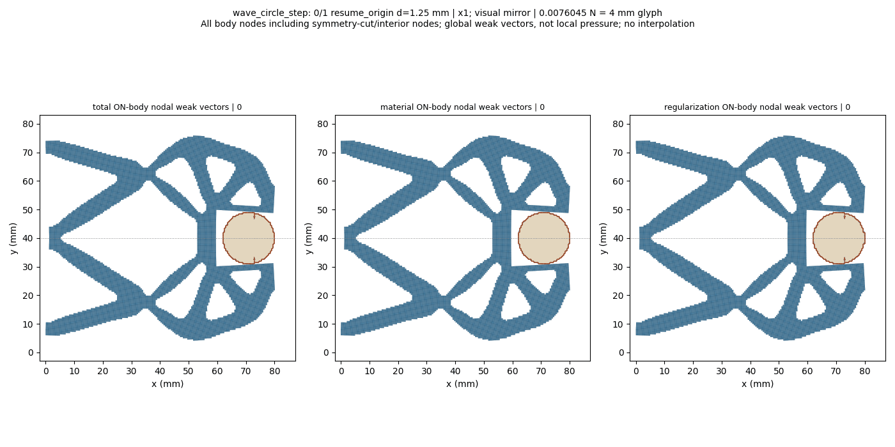
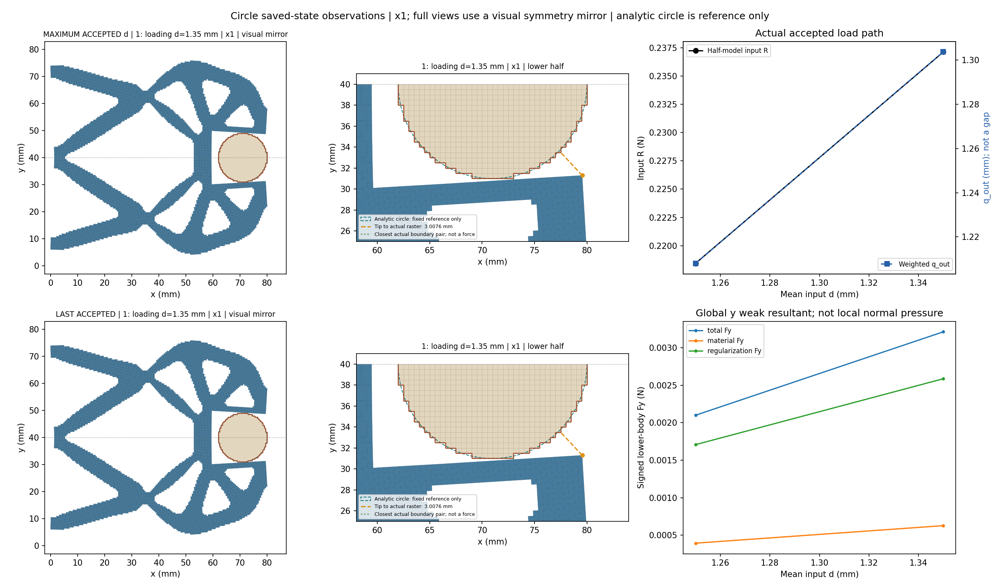
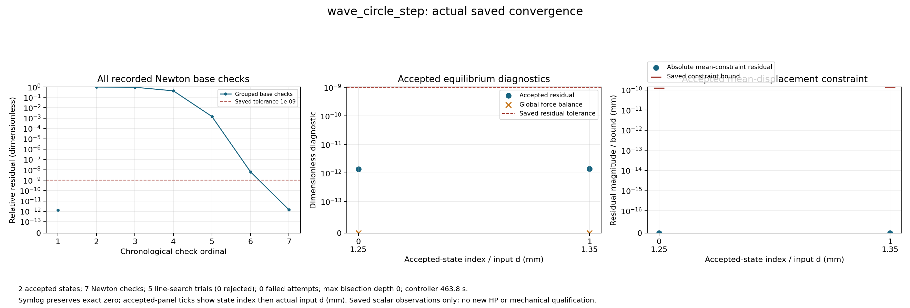

# Circular workpiece explicit extension: saved-state review

Saved-terminal extension of lower-half wave mechanism: fixed raster circle r9 at (71,40) mm. The 1.25 mm first state is a freshly revalidated source anchor from the prior extension; only 1.35 mm is appended. Old zero-start prefix is inherited, not re-executed. Coordinates x1; full-structure views and GIF use a visual symmetry mirror, while numerical tables retain the original lower-half values. All actual accepted states are shown, including controller bisections.

The boundary distance is unsigned between exposed Q1 edges; boundary intersection/near-touch and region overlap are separate observations. Containment is not tested. Weak-form body total includes material and Hu contributions; it is not qualified contact pressure or effective grip. This 1.25/1.35 mm child segment does not newly execute the complete 0/.25/.5/.75/1.00/1.15/1.25/1.35 prefix or original25 cycle, unloading, release, stability, independent HP or HF5 qualification.

[Response](wave_circle_step/response.json) · [Result](wave_circle_step/result.json) · [Exact rows](state_table.json) · [Viewer summary](view/wave_circle_step/summary.json) · [Convergence JSON](convergence/convergence.json)

|index|leg|d (mm)|R input (N)|q out (mm)|body Fy total (N)|minimum Q1 boundary distance (mm)|
|---:|---|---:|---:|---:|---:|---:|
|0|resume_origin|1.25|0.21844194402663447|1.2080995850065308|0.0021009116737030946|0.16397158636164572|
|1|loading|1.35|0.2371286427067592|1.303664995348951|0.0032141348540385114|0.09633236207295634|
