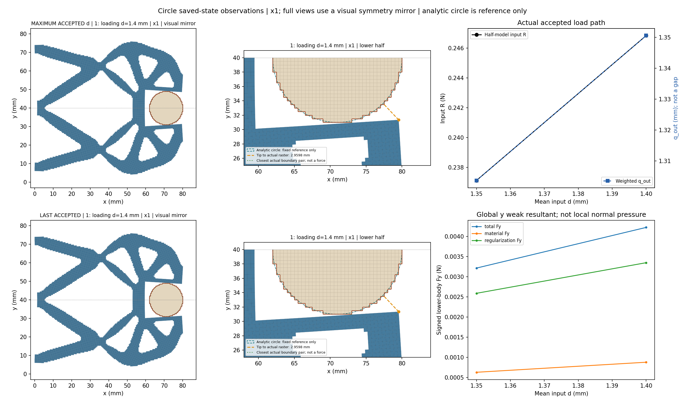
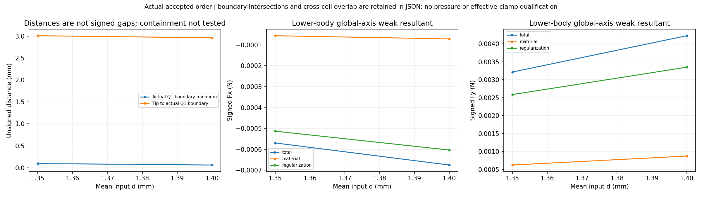
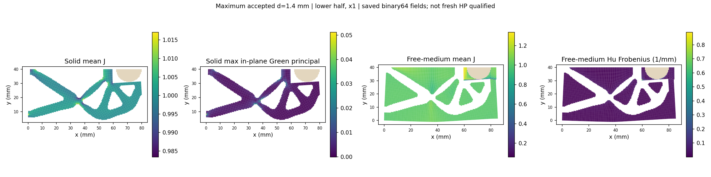
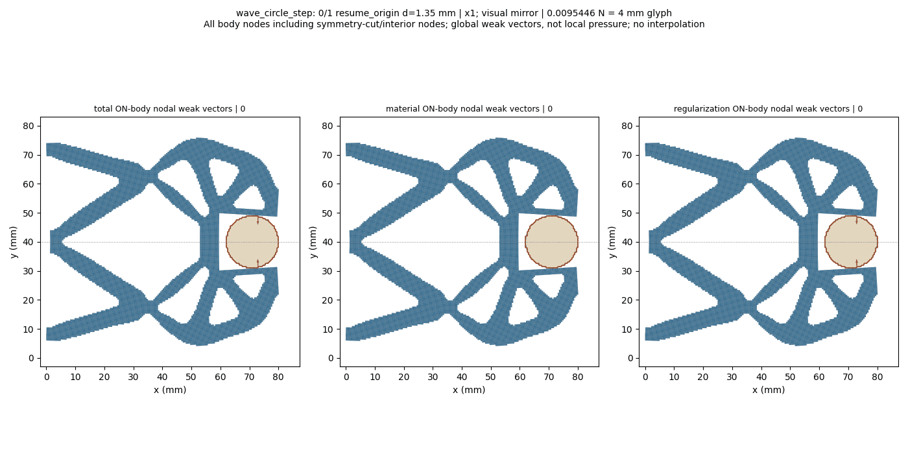
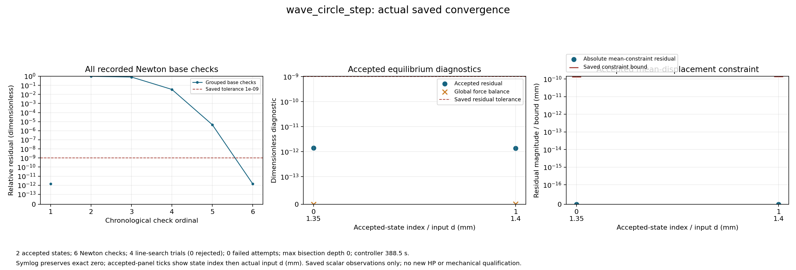

# L-CSTEP5：圆形固定工件1.35→1.40 mm保存态加载

执行状态 **PASS**；生产 `success`、helper `pass`、outer `pass`，停止阶段 `final_binding_and_seal`。基线 main `8ac36c0f3ce4b0609c592522cb70f810635a7a9d`；science 0.5.0／b1334 基线保持。

本次新目标已通过原生产门。唯一启动耗时409.588 s，进程树采样峰值826130432 B，清理已核；保存1.35 mm锚点与1.40 mm新态，共2态。锚点fresh检查1次，新目标5次；4次线搜索均接受、零失败尝试、零二分。生产10F/6T/1solve，新测试/HP/默认安装均为零。

|观察量|1.35 mm锚点|1.40 mm新态|
|---|---:|---:|
|输入反力 R / N|0.237128643|0.246843028|
|下半工件总 Fy / N|0.00321413485|0.00422391242|
|材料 Fy / N|0.000626626317|0.000876117183|
|Hu Fy / N|0.00258750854|0.00334779524|
|Q1表面最小无符号距离 / mm|0.0963323621|0.0632972777|
|最右尖端无符号距离 / mm|3.00757216|2.95983984|
|solid min J|0.967698378|0.966558843|
|free-medium min J|0.0862362452|0.0521382307|

梁段与工件继续贴近，但最右侧尖端仍距工件约2.96 mm；接近处不能笼统说成“尖端已夹住”。新态边界相交、跨区域原始/严格重叠及roundoff不确定标记均为False；完整包含和机构自重叠未检查。距离为Q1外露阶梯边的无符号距离，不是接触压力或有符号间隙。

下半工件Fy增加，其中Hu项占新态有符号总Fy的79.26%。这是弱式工件合力分解，不是表面压力或圆周总法向夹持力。自由第三介质min J从0.08624降至0.05214，solid min J仍约0.96656。该变化支持先观察卸载恢复的研究选择，不构成新验收阈值、有效夹持或稳定性证明。1.40 mm极值空间坐标本卡未重新定位；L-CLOCAL1的1.35 mm极值位置不能转授到新态。

当前公共接口的缺项是load_only已完成末态显式转入首次卸载，底层ordered_cycle求解能力已有。下一步集中补这个功能。L-CREF1仍只覆盖1.15 mm/global5的独立参考及一个PORT方向，1.40 mm没有新HP。

整体目标仍是普通LF几何进入独立HF的TMC前向力学，逐步实现可检查的加载、接触与卸载。本次复用已安装并验证的load_only保存态显式延伸，从L-CSTEP4成功1.35 mm末态推进到1.40 mm；借助实际变形、反力、工件合力、距离、分区场与收敛记录判断下一步。

工件半径9 mm、中心(71,40) mm、固定ux/uy；其余E=1 MPa、nu=0.3、plane strain、厚20 mm、h=0.5 mm、84×40 mm下半域、gamma=1e-6、alpha=5e-7、Lr=80 mm及支撑/平均端口/对称保持。新任务完整保留[0,0.25,0.50,0.75,1.00,1.15,1.25,1.35]前缀，只追加1.40 mm并将input目标更新至新峰值；四说明字段可更新，其余物理任务、数值设置及原门保持。原父任务、结果与方体25目标历史不改。

来源父段 `lf_data_preparation/native_interface_001/lf_circle_step_004/run_001/wave_circle_step/result.json` 状态 `success`；选中接受行 `1`，全局目标索引 `7`，d=`1.35` mm，state SHA `0c8c5b07ad3ef5872502dede2f76cee6a152b9f78d3b0b7f831ebc6286a12455`。本子段使用全局索引7/8和本地索引0/1；原数值设置与父段精确保持。默认HF源码保持，未新增测试、HP或安装。

保存接受态数 `2`；helper接受回调数 `2`，两者分别记录，缺失保存结果不写成零。路径原标志：`{'path_kind': 'load_only', 'targets_mm': [1.35, 1.4], 'reached_displacement': 1.4, 'path_completed': True, 'loading_peak_reached': True, 'new_peak_reached': True, 'extended_segment_completed': True, 'task_target_executed': False, 'full_original_path_completed': False, 'full_extended_path_completed': False, 'unload_endpoint_reached': None}`。

|接受行|原目标|路段|d mm|输入R N|q_out mm|下半体Fy N|Q1边界距离 mm|solid minJ|free-medium minJ|relative residual|
|---:|---:|---|---:|---:|---:|---:|---:|---:|---:|---:|
|0|7|resume_origin|1.35|0.2371286427067592|1.303664995348951|0.0032141348540385114|0.09633236207295634|0.9676983779663557|0.08623624515762662|1.3902250995050677e-12|
|1|8|loading|1.4|0.24684302763538246|1.3505951000424836|0.004223912418638585|0.06329727765158799|0.9665588431115746|0.052138230727749965|1.3809323527223219e-12|

数值保持原保存值；完整材料/Hu/总Fx/Fy、状态SHA、约束残差/原界、整体平衡和观测原值见闭卡JSON及原结果。q_out是加权端口位移，不是表面间隙；输入R和工件力保持下半模型含义。

原生产门 `{'production_residual': '1e-9', 'average_constraint': '1e-10', 'global_force_balance': '1e-6', 'fixed_displacement_mm': '8e-11'}`；缓存门实录 `{'actual_accepted_states': 2, 'minimum_J': 0.052138230727749965, 'maximum_fixed_split_sum_mm': 0.0, 'maximum_relative_residual': 1.3902250995050677e-12, 'native_constraint_bound_pass': True, 'maximum_relative_global_force_balance': 1.5182942489222747e-15, 'passed': True}`。生产F/T等计数 `{'force_calls': 10, 'force_calls_completed': 10, 'tangent_calls': 6, 'tangent_calls_completed': 6, 'solver_invocations': 1, 'JIT_calls': 0, 'HP_calls': 0}`；wrapper API/solve/view调用 `{'api_started': 1, 'solve_started': 1, 'solve_completed': 1, 'api_completed': 1, 'view_child_started': 1, 'view_child_completed': 1, 'convergence_plot_started': 1, 'convergence_plot_completed': 1}`。原门未更改。

收敛原记录计数 `{'accepted_states': 2, 'newton_base_checks': 6, 'inferred_check_groups': 2, 'line_search_trials': 4, 'line_search_accepted': 4, 'line_search_rejected': 0, 'failed_attempts': 0, 'linear_solves': 5, 'maximum_bisection_depth': 0, 'zero_newton_residuals': 0}`。回溯或二分若存在，属于原控制器工作，全部实际接受态保留；不会锁定仅两态。新测试 `0`、默认安装 `0`、wrapper新HP `0`。

保存延伸来源和资格原值 `{'schema_version': 'hf-native-saved-resume-1.0', 'parent_result': {'path': 'D:/Coding/Diversity TO/Compliant-Nonlinear-TMC-O/.github_handoff/Compliant-TO-TMC/lf_data_preparation/native_interface_001/lf_circle_step_004/run_001/wave_circle_step/result.json', 'sha256': 'bede740200e6adc8ba0d29c5b0add22ff1c0c0fe60e18c93dd4e9e09742fbd72'}, 'parent_model': {'path': 'D:/Coding/Diversity TO/Compliant-Nonlinear-TMC-O/.github_handoff/Compliant-TO-TMC/lf_data_preparation/native_interface_001/lf_circle_step_004/run_001/wave_circle_step/model/model.json', 'sha256': '2c5c23669c2aa86a46c70a95b122d4de12ceac0cd9a1052a54d3f109e57d6720'}, 'selected_state': {'accepted_index': 1, 'original_target_index': 7, 'path': 'D:/Coding/Diversity TO/Compliant-Nonlinear-TMC-O/.github_handoff/Compliant-TO-TMC/lf_data_preparation/native_interface_001/lf_circle_step_004/run_001/wave_circle_step/accepted/001/state.json', 'descriptor_file_sha256': 'f34728e8688d4d9dd8298934e4a28b962e652b6f8396ddb3a72b417b9fee2e90', 'state_sha256': '0c8c5b07ad3ef5872502dede2f76cee6a152b9f78d3b0b7f831ebc6286a12455', 'archive_sha256': '5b948ae634d6ef463d9de893e4844e28861366b8d19f2027852f27008972f81e', 'R_input_N': 0.2371286427067592, 'd_mm': 1.35, 'q_in_mm': 1.35, 'constraint_residual_mm': 0.0, 'parent_leg': 'loading'}, 'parent_status': 'success', 'parent_failure': None, 'parent_path_completed': True, 'parent_task_target_executed': False, 'parent_unload_endpoint_reached': None, 'parent_mechanics_source_sha256': {'hf_repo/src/hf_eval/native_mean.py': '76fd9917fe378865f3f359838958e58505afb9ae2e7c7ec257773a76178fd6e4', 'hf_repo/src/hf_eval/split_displacement.py': '151cc130f0a75e3b2f201b393541107ccf2feaa3de365db72d1987568dae1bb8', 'hf_repo/src/hf_eval/split_numpy_tangent.py': '547143b14c8626f7420b8d5778cb11d4d5680be1a590428d8d46f01b3549857f', 'hf_repo/src/hf_eval/split_kernel_invariants_hu.py': 'd5f7d20a6ec0c92847d67f8782f4dcc89772fc4ea62797626b0beae7effabd9a', 'hf_repo/src/hf_eval/native_resume.py': 'e8162964487df510a608a980feb1a03b3ac36e97a55452fac9e342274cfee2d1'}, 'parent_producer_flags': {'independent_HP_qualified': False, 'equilibrium_qualified': False, 'HF_qualified': False}, 'original_task_targets_mm': [0.0, 0.25, 0.5, 0.75, 1.0, 1.15, 1.25, 1.35, 1.4], 'requested_suffix_targets_mm': [1.35, 1.4], 'original_target_indices': [7, 8], 'initial_parameter': 1.35, 'target_origin': 0.0, 'state_transport': 'Original lift/fluctuation and signed R; no rounded display/rebase/translation', 'fresh_anchor_required': True, 'saved_matrix_or_force_or_tangent_read': False, 'full_original_path_executed_by_child': False, 'independent_HP_qualified': False, 'HF5_qualified': False, 'continuation_mode': 'explicit_task_extension', 'source_task_sha256': '6bcf990ffaae0fe00a134915d18cad9ad82dd7a516e4db563895ad2c1cf308c7', 'source_task_targets_mm': [0.0, 0.25, 0.5, 0.75, 1.0, 1.15, 1.25, 1.35], 'extended_task_sha256': 'ca180c540c7a2935ae78770693cbce4347c423e11e1a31144a28a6e31d42c99d', 'extended_task_targets_mm': [0.0, 0.25, 0.5, 0.75, 1.0, 1.15, 1.25, 1.35, 1.4], 'appended_targets_mm': [1.4], 'parent_continuation': {'schema_version': 'hf-native-saved-resume-1.0', 'parent_result': {'path': 'D:/Coding/Diversity TO/Compliant-Nonlinear-TMC-O/.github_handoff/Compliant-TO-TMC/lf_data_preparation/native_interface_001/lf_circle_step_003/run_001/wave_circle_step/result.json', 'sha256': '931c1234cce61121d4b93b4936c6b8c0a802bf77fc0a85f71fdeed10a713053a'}, 'parent_model': {'path': 'D:/Coding/Diversity TO/Compliant-Nonlinear-TMC-O/.github_handoff/Compliant-TO-TMC/lf_data_preparation/native_interface_001/lf_circle_step_003/run_001/wave_circle_step/model/model.json', 'sha256': 'e334857c37abbe5b21ffad2fa4ee425b4eba24e2ef26a5014ad7be10ea61eef3'}, 'selected_state': {'accepted_index': 1, 'original_target_index': 6, 'path': 'D:/Coding/Diversity TO/Compliant-Nonlinear-TMC-O/.github_handoff/Compliant-TO-TMC/lf_data_preparation/native_interface_001/lf_circle_step_003/run_001/wave_circle_step/accepted/001/state.json', 'descriptor_file_sha256': '77b74009978dd8a4b696d34a276460dae1cf793940bc3f8066629610d29178c9', 'state_sha256': 'd5b74358bf076a7d858efd710e61cf31fa2f9ddb1648a7a488e2cbc299213fc5', 'archive_sha256': '1be488163c6ff1fc17e0e1712458d5bc193e877b010df7453954e75eb8db72ea', 'R_input_N': 0.21844194402663447, 'd_mm': 1.25, 'q_in_mm': 1.25, 'constraint_residual_mm': 0.0, 'parent_leg': 'loading'}, 'parent_status': 'success', 'parent_failure': None, 'parent_path_completed': True, 'parent_task_target_executed': False, 'parent_unload_endpoint_reached': None, 'parent_mechanics_source_sha256': {'hf_repo/src/hf_eval/native_mean.py': '76fd9917fe378865f3f359838958e58505afb9ae2e7c7ec257773a76178fd6e4', 'hf_repo/src/hf_eval/split_displacement.py': '151cc130f0a75e3b2f201b393541107ccf2feaa3de365db72d1987568dae1bb8', 'hf_repo/src/hf_eval/split_numpy_tangent.py': '547143b14c8626f7420b8d5778cb11d4d5680be1a590428d8d46f01b3549857f', 'hf_repo/src/hf_eval/split_kernel_invariants_hu.py': 'd5f7d20a6ec0c92847d67f8782f4dcc89772fc4ea62797626b0beae7effabd9a', 'hf_repo/src/hf_eval/native_resume.py': 'e8162964487df510a608a980feb1a03b3ac36e97a55452fac9e342274cfee2d1'}, 'parent_producer_flags': {'independent_HP_qualified': False, 'equilibrium_qualified': False, 'HF_qualified': False}, 'original_task_targets_mm': [0.0, 0.25, 0.5, 0.75, 1.0, 1.15, 1.25, 1.35], 'requested_suffix_targets_mm': [1.25, 1.35], 'original_target_indices': [6, 7], 'initial_parameter': 1.25, 'target_origin': 0.0, 'state_transport': 'Original lift/fluctuation and signed R; no rounded display/rebase/translation', 'fresh_anchor_required': True, 'saved_matrix_or_force_or_tangent_read': False, 'full_original_path_executed_by_child': False, 'independent_HP_qualified': False, 'HF5_qualified': False, 'continuation_mode': 'explicit_task_extension', 'source_task_sha256': 'bee029eb2409c7ddcdb0cfd2a57fee21b68f06ee4ef332117750323bed6453a5', 'source_task_targets_mm': [0.0, 0.25, 0.5, 0.75, 1.0, 1.15, 1.25], 'extended_task_sha256': '6bcf990ffaae0fe00a134915d18cad9ad82dd7a516e4db563895ad2c1cf308c7', 'extended_task_targets_mm': [0.0, 0.25, 0.5, 0.75, 1.0, 1.15, 1.25, 1.35], 'appended_targets_mm': [1.35], 'parent_continuation': {'schema_version': 'hf-native-saved-resume-1.0', 'parent_result': {'path': 'D:/Coding/Diversity TO/Compliant-Nonlinear-TMC-O/.github_handoff/Compliant-TO-TMC/lf_data_preparation/native_interface_001/lf_circle_step_002/run_001/wave_circle_step/result.json', 'sha256': '13776924f58f8e90587932a630d65bc89e2b27b5bc9afdbcebad343019a109f1'}, 'parent_model': {'path': 'D:/Coding/Diversity TO/Compliant-Nonlinear-TMC-O/.github_handoff/Compliant-TO-TMC/lf_data_preparation/native_interface_001/lf_circle_step_002/run_001/wave_circle_step/model/model.json', 'sha256': '51b9b19f0f680b298f8ba6eb5db7f3f8e337206127b10f8066cf76a7059ab910'}, 'selected_state': {'accepted_index': 1, 'original_target_index': 5, 'path': 'D:/Coding/Diversity TO/Compliant-Nonlinear-TMC-O/.github_handoff/Compliant-TO-TMC/lf_data_preparation/native_interface_001/lf_circle_step_002/run_001/wave_circle_step/accepted/001/state.json', 'descriptor_file_sha256': '9a2d1afe58ea7e202b8bd1c1758c4d7d534f007f25988b4ebaabae7a41ed58b6', 'state_sha256': '3db267551ea6cb5817c2a1946a80363ecccb0329078d516e90e0106f27e709ef', 'archive_sha256': '8f9d7582f274658e1c85e5aa039869c0ac103574f96d568db2704f49d79629da', 'R_input_N': 0.20022433540813542, 'd_mm': 1.15, 'q_in_mm': 1.15, 'constraint_residual_mm': -2.7755575615628914e-17, 'parent_leg': 'loading'}, 'parent_status': 'success', 'parent_failure': None, 'parent_path_completed': True, 'parent_task_target_executed': False, 'parent_unload_endpoint_reached': None, 'parent_mechanics_source_sha256': {'hf_repo/src/hf_eval/native_mean.py': '76fd9917fe378865f3f359838958e58505afb9ae2e7c7ec257773a76178fd6e4', 'hf_repo/src/hf_eval/split_displacement.py': '151cc130f0a75e3b2f201b393541107ccf2feaa3de365db72d1987568dae1bb8', 'hf_repo/src/hf_eval/split_numpy_tangent.py': '547143b14c8626f7420b8d5778cb11d4d5680be1a590428d8d46f01b3549857f', 'hf_repo/src/hf_eval/split_kernel_invariants_hu.py': 'd5f7d20a6ec0c92847d67f8782f4dcc89772fc4ea62797626b0beae7effabd9a', 'hf_repo/src/hf_eval/native_resume.py': 'e8162964487df510a608a980feb1a03b3ac36e97a55452fac9e342274cfee2d1'}, 'parent_producer_flags': {'independent_HP_qualified': False, 'equilibrium_qualified': False, 'HF_qualified': False}, 'original_task_targets_mm': [0.0, 0.25, 0.5, 0.75, 1.0, 1.15, 1.25], 'requested_suffix_targets_mm': [1.15, 1.25], 'original_target_indices': [5, 6], 'initial_parameter': 1.15, 'target_origin': 0.0, 'state_transport': 'Original lift/fluctuation and signed R; no rounded display/rebase/translation', 'fresh_anchor_required': True, 'saved_matrix_or_force_or_tangent_read': False, 'full_original_path_executed_by_child': False, 'independent_HP_qualified': False, 'HF5_qualified': False, 'continuation_mode': 'explicit_task_extension', 'source_task_sha256': '44bea6cfcb33e850266094fe1f91c887c01d90459934d3e55509290af3a6575a', 'source_task_targets_mm': [0.0, 0.25, 0.5, 0.75, 1.0, 1.15], 'extended_task_sha256': 'bee029eb2409c7ddcdb0cfd2a57fee21b68f06ee4ef332117750323bed6453a5', 'extended_task_targets_mm': [0.0, 0.25, 0.5, 0.75, 1.0, 1.15, 1.25], 'appended_targets_mm': [1.25], 'parent_continuation': {'schema_version': 'hf-native-saved-resume-1.0', 'parent_result': {'path': 'D:/Coding/Diversity TO/Compliant-Nonlinear-TMC-O/.github_handoff/Compliant-TO-TMC/lf_data_preparation/native_interface_001/lf_circle_step_001/run_001/wave_circle_step/result.json', 'sha256': 'b826215be038cb6a308c8a19605009763fd950f314ba2394530cb9b5429bfb75'}, 'parent_model': {'path': 'D:/Coding/Diversity TO/Compliant-Nonlinear-TMC-O/.github_handoff/Compliant-TO-TMC/lf_data_preparation/native_interface_001/lf_circle_step_001/run_001/wave_circle_step/model/model.json', 'sha256': 'a6f69a998637576ed66a6b81f3c4bcc9e3e42f9df6ebda636d161541603d8491'}, 'selected_state': {'accepted_index': 1, 'original_target_index': 4, 'path': 'D:/Coding/Diversity TO/Compliant-Nonlinear-TMC-O/.github_handoff/Compliant-TO-TMC/lf_data_preparation/native_interface_001/lf_circle_step_001/run_001/wave_circle_step/accepted/001/state.json', 'descriptor_file_sha256': '22c325ee4b114f421c572f6e382871ba1127e2b57afcbd3e42035f36615314e2', 'state_sha256': '8eca12177e50cecf8fc47c4668e19c34109a21965b21d62d9e262eb9459b3f06', 'archive_sha256': 'de042cab638bd65c7de6be33a82a59e6c520782db1d8c0da4e8ab6b1d757ed59', 'R_input_N': 0.17334986866494886, 'd_mm': 1.0, 'q_in_mm': 1.0, 'constraint_residual_mm': 0.0, 'parent_leg': 'loading'}, 'parent_status': 'success', 'parent_failure': None, 'parent_path_completed': True, 'parent_task_target_executed': False, 'parent_unload_endpoint_reached': None, 'parent_mechanics_source_sha256': {'hf_repo/src/hf_eval/native_mean.py': '76fd9917fe378865f3f359838958e58505afb9ae2e7c7ec257773a76178fd6e4', 'hf_repo/src/hf_eval/split_displacement.py': '151cc130f0a75e3b2f201b393541107ccf2feaa3de365db72d1987568dae1bb8', 'hf_repo/src/hf_eval/split_numpy_tangent.py': '547143b14c8626f7420b8d5778cb11d4d5680be1a590428d8d46f01b3549857f', 'hf_repo/src/hf_eval/split_kernel_invariants_hu.py': 'd5f7d20a6ec0c92847d67f8782f4dcc89772fc4ea62797626b0beae7effabd9a', 'hf_repo/src/hf_eval/native_resume.py': 'e8162964487df510a608a980feb1a03b3ac36e97a55452fac9e342274cfee2d1'}, 'parent_producer_flags': {'independent_HP_qualified': False, 'equilibrium_qualified': False, 'HF_qualified': False}, 'original_task_targets_mm': [0.0, 0.25, 0.5, 0.75, 1.0, 1.15], 'requested_suffix_targets_mm': [1.0, 1.15], 'original_target_indices': [4, 5], 'initial_parameter': 1.0, 'target_origin': 0.0, 'state_transport': 'Original lift/fluctuation and signed R; no rounded display/rebase/translation', 'fresh_anchor_required': True, 'saved_matrix_or_force_or_tangent_read': False, 'full_original_path_executed_by_child': False, 'independent_HP_qualified': False, 'HF5_qualified': False, 'continuation_mode': 'explicit_task_extension', 'source_task_sha256': '54b666ec07fe5f5d48abda4e3c3bb3af9eb0ac041077a162b00ff9ad0243555f', 'source_task_targets_mm': [0.0, 0.25, 0.5, 0.75, 1.0], 'extended_task_sha256': '44bea6cfcb33e850266094fe1f91c887c01d90459934d3e55509290af3a6575a', 'extended_task_targets_mm': [0.0, 0.25, 0.5, 0.75, 1.0, 1.15], 'appended_targets_mm': [1.15], 'parent_continuation': {'schema_version': 'hf-native-saved-resume-1.0', 'parent_result': {'path': 'D:/Coding/Diversity TO/Compliant-Nonlinear-TMC-O/.github_handoff/Compliant-TO-TMC/lf_data_preparation/native_interface_001/lf_circle_extension_001/run_001/wave_circle_extension/result.json', 'sha256': 'e86e29b9b292aa315e75618710bfff2def273428079d041305cdd842d56278c4'}, 'parent_model': {'path': 'D:/Coding/Diversity TO/Compliant-Nonlinear-TMC-O/.github_handoff/Compliant-TO-TMC/lf_data_preparation/native_interface_001/lf_circle_extension_001/run_001/wave_circle_extension/model/model.json', 'sha256': '2e41a1f6636cd56917c86e4e9128ad7042d79558c051c7e19106a7c7dcb1a49b'}, 'selected_state': {'accepted_index': 1, 'original_target_index': 3, 'path': 'D:/Coding/Diversity TO/Compliant-Nonlinear-TMC-O/.github_handoff/Compliant-TO-TMC/lf_data_preparation/native_interface_001/lf_circle_extension_001/run_001/wave_circle_extension/accepted/001/state.json', 'descriptor_file_sha256': 'e91f3caf2243b512611a6c20abb4f675d6410cc9560cf72d19545eea1bc48f2c', 'state_sha256': '699d7edfbe3fac886e368bb818f8f7e473c0915869e5e7fdebf20bebc551d40b', 'archive_sha256': '7d4e4fe3cc5509497951bce0524c418608e79964db4c23e146120ed65ffe55e9', 'R_input_N': 0.12926056345118117, 'd_mm': 0.75, 'q_in_mm': 0.75, 'constraint_residual_mm': 0.0, 'parent_leg': 'loading'}, 'parent_status': 'success', 'parent_failure': None, 'parent_path_completed': True, 'parent_task_target_executed': False, 'parent_unload_endpoint_reached': None, 'parent_mechanics_source_sha256': {'hf_repo/src/hf_eval/native_mean.py': '76fd9917fe378865f3f359838958e58505afb9ae2e7c7ec257773a76178fd6e4', 'hf_repo/src/hf_eval/split_displacement.py': '151cc130f0a75e3b2f201b393541107ccf2feaa3de365db72d1987568dae1bb8', 'hf_repo/src/hf_eval/split_numpy_tangent.py': '547143b14c8626f7420b8d5778cb11d4d5680be1a590428d8d46f01b3549857f', 'hf_repo/src/hf_eval/split_kernel_invariants_hu.py': 'd5f7d20a6ec0c92847d67f8782f4dcc89772fc4ea62797626b0beae7effabd9a', 'hf_repo/src/hf_eval/native_resume.py': 'e8162964487df510a608a980feb1a03b3ac36e97a55452fac9e342274cfee2d1'}, 'parent_producer_flags': {'independent_HP_qualified': False, 'equilibrium_qualified': False, 'HF_qualified': False}, 'original_task_targets_mm': [0.0, 0.25, 0.5, 0.75, 1.0], 'requested_suffix_targets_mm': [0.75, 1.0], 'original_target_indices': [3, 4], 'initial_parameter': 0.75, 'target_origin': 0.0, 'state_transport': 'Original lift/fluctuation and signed R; no rounded display/rebase/translation', 'fresh_anchor_required': True, 'saved_matrix_or_force_or_tangent_read': False, 'full_original_path_executed_by_child': False, 'independent_HP_qualified': False, 'HF5_qualified': False, 'continuation_mode': 'explicit_task_extension', 'source_task_sha256': '3054384605bdffc0f478cb5c08a990625a348f139cda4989c9e4b57d38e48e2b', 'source_task_targets_mm': [0.0, 0.25, 0.5, 0.75], 'extended_task_sha256': '54b666ec07fe5f5d48abda4e3c3bb3af9eb0ac041077a162b00ff9ad0243555f', 'extended_task_targets_mm': [0.0, 0.25, 0.5, 0.75, 1.0], 'appended_targets_mm': [1.0], 'parent_continuation': {'schema_version': 'hf-native-saved-resume-1.0', 'parent_result': {'path': 'D:/Coding/Diversity TO/Compliant-Nonlinear-TMC-O/.github_handoff/Compliant-TO-TMC/lf_data_preparation/native_interface_001/lf_circle_pilot_001/run_001/wave_circle_pilot/result.json', 'sha256': 'b8e8a0fa4f6a8cd5bc6221a9193aeb243c3f935f43754ac745b79669063772d6'}, 'parent_model': {'path': 'D:/Coding/Diversity TO/Compliant-Nonlinear-TMC-O/.github_handoff/Compliant-TO-TMC/lf_data_preparation/native_interface_001/lf_circle_pilot_001/run_001/wave_circle_pilot/model/model.json', 'sha256': '5654dedd6476e4370d31b55c21d94d64a1f75787adb6969e83734161d6e5b157'}, 'selected_state': {'accepted_index': 2, 'original_target_index': 2, 'path': 'D:/Coding/Diversity TO/Compliant-Nonlinear-TMC-O/.github_handoff/Compliant-TO-TMC/lf_data_preparation/native_interface_001/lf_circle_pilot_001/run_001/wave_circle_pilot/accepted/002/state.json', 'descriptor_file_sha256': '643f4666059ec0ae8bbc8e5dbfce306d9b44b4d4e77cf26ba3493dff1d483451', 'state_sha256': 'a25063fafb996a8367b422aa988d5563b4d6bb259028286e246f73e0f733ed19', 'archive_sha256': '557d0e42c6ca7e34a6be553a6a6003c1cb4664131e26665b28c48fd454287d28', 'R_input_N': 0.08574820985162357, 'd_mm': 0.5, 'q_in_mm': 0.5, 'constraint_residual_mm': -6.938893903907228e-18, 'parent_leg': 'loading'}, 'parent_status': 'success', 'parent_failure': None, 'parent_path_completed': True, 'parent_task_target_executed': True, 'parent_unload_endpoint_reached': None, 'parent_mechanics_source_sha256': {'hf_repo/src/hf_eval/native_mean.py': '34aba7347790fafa7f03511a42aa9876649b8ce4f8c98b3efdb5a0e664288401', 'hf_repo/src/hf_eval/split_displacement.py': '8cdc31e041e7753275e880d69ec3918d87a7f6e582951885d0af288f657e5237', 'hf_repo/src/hf_eval/split_numpy_tangent.py': '547143b14c8626f7420b8d5778cb11d4d5680be1a590428d8d46f01b3549857f', 'hf_repo/src/hf_eval/split_kernel_invariants_hu.py': 'd5f7d20a6ec0c92847d67f8782f4dcc89772fc4ea62797626b0beae7effabd9a'}, 'parent_producer_flags': {'independent_HP_qualified': False, 'equilibrium_qualified': False, 'HF_qualified': False}, 'original_task_targets_mm': [0.0, 0.25, 0.5, 0.75], 'requested_suffix_targets_mm': [0.5, 0.75], 'original_target_indices': [2, 3], 'initial_parameter': 0.5, 'target_origin': 0.0, 'state_transport': 'Original lift/fluctuation and signed R; no rounded display/rebase/translation', 'fresh_anchor_required': True, 'saved_matrix_or_force_or_tangent_read': False, 'full_original_path_executed_by_child': False, 'independent_HP_qualified': False, 'HF5_qualified': False, 'continuation_mode': 'explicit_task_extension', 'source_task_sha256': '3840309675dd07364f8f856f74bdc8969408018f64fd20a53fc86e5f7f03a953', 'source_task_targets_mm': [0.0, 0.25, 0.5], 'extended_task_sha256': '3054384605bdffc0f478cb5c08a990625a348f139cda4989c9e4b57d38e48e2b', 'extended_task_targets_mm': [0.0, 0.25, 0.5, 0.75], 'appended_targets_mm': [0.75], 'parent_continuation': None, 'full_extended_path_executed_by_child': False, 'full_extended_path_completed': False, 'segment_completed': True, 'anchor_revalidated': True, 'full_original_path_completed': False, 'task_target_executed': False, 'anchor_identity_preserved': True, 'new_peak_reached': True, 'extended_segment_completed': True}, 'full_extended_path_executed_by_child': False, 'full_extended_path_completed': False, 'segment_completed': True, 'anchor_revalidated': True, 'full_original_path_completed': False, 'task_target_executed': False, 'anchor_identity_preserved': True, 'new_peak_reached': True, 'extended_segment_completed': True}, 'full_extended_path_executed_by_child': False, 'full_extended_path_completed': False, 'segment_completed': True, 'anchor_revalidated': True, 'full_original_path_completed': False, 'task_target_executed': False, 'anchor_identity_preserved': True, 'new_peak_reached': True, 'extended_segment_completed': True}, 'full_extended_path_executed_by_child': False, 'full_extended_path_completed': False, 'segment_completed': True, 'anchor_revalidated': True, 'full_original_path_completed': False, 'task_target_executed': False, 'anchor_identity_preserved': True, 'new_peak_reached': True, 'extended_segment_completed': True}, 'full_extended_path_executed_by_child': False, 'full_extended_path_completed': False, 'segment_completed': True, 'anchor_revalidated': True, 'full_original_path_completed': False, 'task_target_executed': False, 'anchor_identity_preserved': True, 'new_peak_reached': True, 'extended_segment_completed': True}, 'full_extended_path_executed_by_child': False, 'full_extended_path_completed': False, 'segment_completed': True, 'anchor_revalidated': True, 'full_original_path_completed': False, 'task_target_executed': False, 'anchor_identity_preserved': True, 'new_peak_reached': True, 'extended_segment_completed': True}`。new_peak_reached与extended_segment_completed仅描述本次子段；task_target_executed、full_original_path_completed、full_extended_path_completed保持False，因为本次没有从零执行完整前缀。首态使用原绝对lift/fluctuation及带符号R，以fresh F/T复核原门并保持状态身份，不复用旧力或切线。

实际距离使用所选圆形Q1单元的物理外露阶梯边，排除对称切口；解析圆只作图示参考。无符号距离不等于有符号间隙。通用凸Q1跨区域单元重叠是另一项观察，完整包含关系及机构自重叠仍未检查；False、None与数值不确定状态分别保留。

末态几何与分区场实录：`{'index': 1, 'original_target_index': 8, 'leg': 'loading', 'd_mm': 1.4, 'state_sha256': '17023382213dedbbde48b41590d8fdbc57feefc8401111b8791176426ed547ad', 'R_input_N': 0.24684302763538246, 'q_out_mm': 1.3505951000424836, 'tip_node': 10300, 'tip_x_mm': 79.53284032087649, 'tip_y_mm': 31.34867201360477, 'tip_to_raster_boundary_mm': 2.959839839455605, 'minimum_boundary_distance_mm': 0.06329727765158799, 'boundary_intersects': False, 'boundary_roundoff_near_touch': False, 'raw_overlap': False, 'strict_overlap': False, 'roundoff_ambiguous': False, 'containment_tested': False, 'solid_min_J': 0.9665588431115746, 'medium_min_J': 0.052138230727749965, 'solid_Green_principal_min': -0.036780706971117544, 'solid_Green_principal_max': 0.05115818645167929, 'medium_max_abs_Hu_per_mm': 0.4713002824262612, 'total_body_Fx_N': -0.0006748154563769226, 'total_body_Fy_N': 0.004223912418638585, 'material_body_Fx_N': -7.16314083955329e-05, 'material_body_Fy_N': 0.0008761171827550221, 'regularization_body_Fx_N': -0.0006031840479813897, 'regularization_body_Fy_N': 0.0033477952358835616}`。若显示未完成或该项未提供，不能据缺失值判断无接触、无重叠或场稳定。

圆周局部法向随位置变化；下半工件全局Fx/Fy是含材料和Hu的有符号弱式合力，不是连续压力或圆周总法向夹持力。坐标×1，完整结构图和GIF仅作对称镜像，数值没有镜像加倍；节点箭头包含切口/内部节点，不能当作表面压力。

实际独立审阅 `pass_actual_finite_review`；像素检查 `pass_with_minor_layout_note`，观察 `['Actual deformation x1 and symmetry mirror are labelled; analytic circle and raster boundary are distinguished.', 'Minimum boundary distance and far-right tip distance remain distinct; signed Fx/Fy total/material/Hu components retain lower-half model meaning.', 'Field panels label cell mean J and Hu Frobenius; these are not the nine-sample minimum J or maximum absolute Hu component.', 'Convergence curve, exact-zero residuals and original bounds are readable; inherited legend partly overlaps right-panel title. No redraw.', 'No GIF re-decoding, no pressure or effective gripping qualification.']`。没有新增重绘或媒体重解码。

helper `406.46173759998055` s／2700 s，outer `409.58753239997895` s／2760 s；controller 1800 s，viewer＋收敛＋人工页共享600 s；进程树采样峰值 `826130432` B／8589934592 B，清理 `True`。终端 `{'terminal': '3db78f', 'session': 76441, 'exit_code': 0}`。原窗口封存 37 个输出、57616410 B，状态 `complete_inside_original_helper_window`；闭卡继承producer seal＋stat，不重读载荷。

真实错误：helper `未提供`；API `未提供`；outer `未提供`。生产成功与显示阶段失败分别报告，不回写原API或原结果。

本轮不取得整条新路径从零执行、独立HP、压力、有效夹持、原25态完整循环、卸载/自由释放、稳定性或HF5资格；制造仍pending。既有父段成功保留历史；L-CREF1只核1.15 mm/global5一个PORT方向，父1.35 mm/global7尚无HP，本次1.40 mm/global8也不自动取得参考资格。

下一步：暂以1.40 mm作为本轮探索峰值，不默认继续增载。优先准备明确的load_only保存末态→ordered_cycle首次卸载入口，先做有限小模型兼容验证，再另卡从成功1.40 mm态只回程至1.35 mm。保留整个原加载前缀、峰值、几何/材料/边界、原数值门、状态身份和父子索引；锚点仍须fresh F/T复核。当前公共load_only延伸要求严格增载，不能直接传入下降目标或暗换任务kind；底层ordered_cycle控制器已有非零保存态下降能力，计划不改力核、切线或Newton。本页仅记录方案，未实现、测试或执行新卸载。固定工件回程也不等于自由释放或有效夹持资格。

审查入口：[原响应](run_001/wave_circle_step/response.json)、[原结果](run_001/wave_circle_step/result.json)、[原值人工页](run_001/REVIEW.md)、[显示摘要](run_001/view/wave_circle_step/summary.json)、[收敛JSON](run_001/convergence/convergence.json)、[helper](run_001/execution_receipt.json)、[outer](step_launch.json)、[实际审阅](author/ACTUAL_REVIEW.md)、[闭卡JSON](author/closure.json)。

执行授权由实际human批准后的author/authorization.json确定；template、READY及静审中的pending/false只保留授权前快照，未回写。闭卡脚本仅运行一次，之后根据实际审阅编辑本说明与后续方案；冻结close.py、原生产结果、原响应和七份历史原字节保持。
