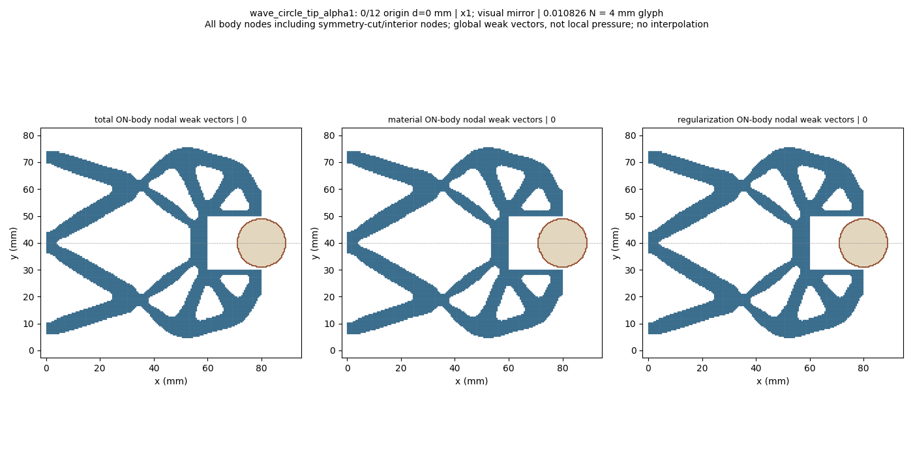
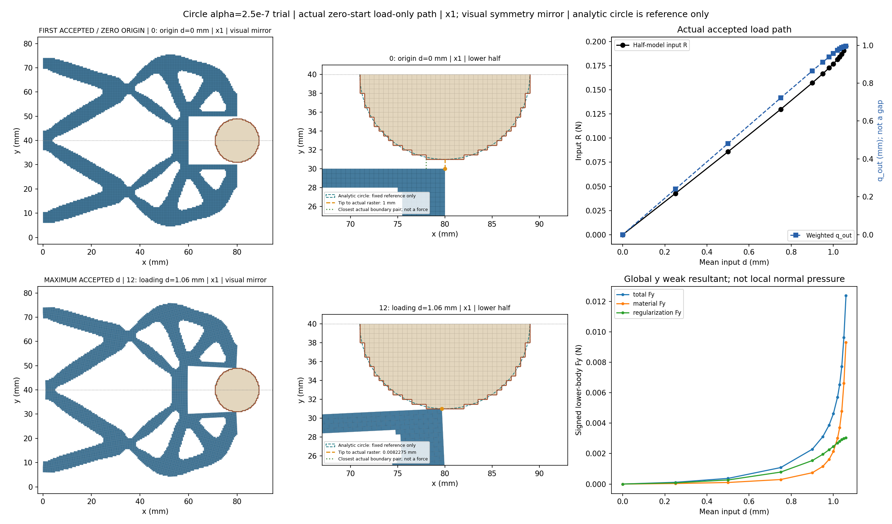
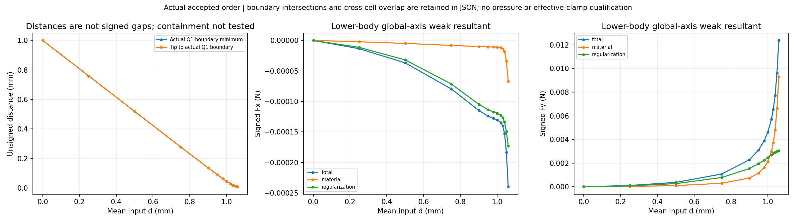
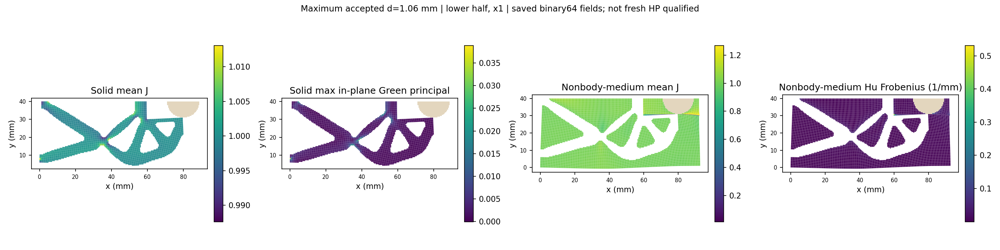
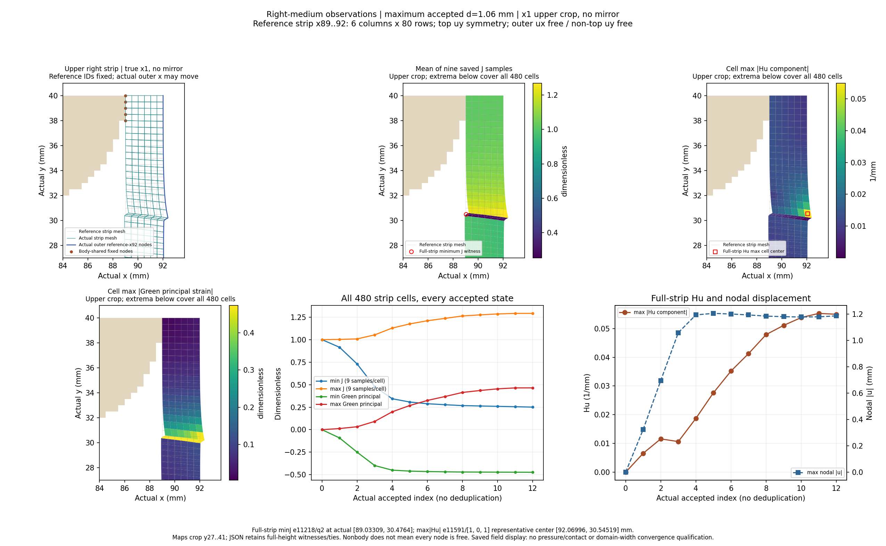
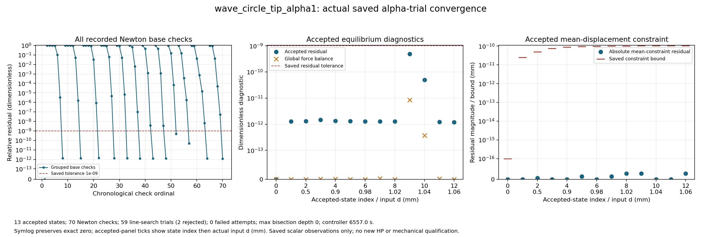
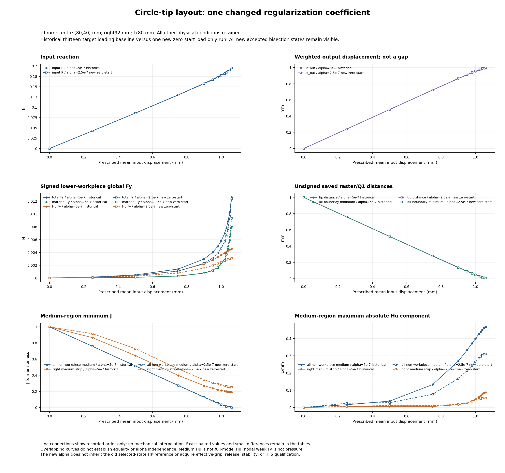

# Alpha2.5e-7 circular workpiece: saved-state review

Zero-start alpha2.5e-7 experiment relative to the original alpha5e-7 STEP10 physical task: lower-half wave mechanism, fixed raster circle r9 at (80,40) mm, on the92x40mm reference domain with Lr80mm. Only alpha, four experiment metadata fields and the separate14400s controller clock change. Coordinates x1; full-structure views and GIF use a visual symmetry mirror, while numerical tables retain the original lower-half values. All actual accepted states are shown, including controller bisections.

The boundary distance is unsigned between exposed Q1 edges; boundary intersection/near-touch and region overlap are separate observations. Containment is not tested. Weak-form body total includes material and Hu contributions; it is not qualified contact pressure or effective grip. Right-medium observations use the dynamically selected resident reference cells x89..92 (six columns,480cells) and the actual displaced x92 boundary; the tip is selected by reference(80,30), not an old node ID. No new archive reads or domain-width convergence claim. Input zero-start loading0->1.06mm at alpha2.5e-7 is a new case and does not qualify unloading, release, stability, independent HP, alpha convergence or HF5 qualification. The original13 absolute targets and original residual/mean/fixed/J/global-balance gates remain. The alpha5e-7 baseline is the13 origin/loading target rows from PATH1; new controller bisections remain in the new history and do not create interpolated pairs. Values and differences are descriptive, signed lower-half weak resultants, not contact pressure.

[Response](wave_circle_tip_alpha1/response.json) · [Result](wave_circle_tip_alpha1/result.json) · [Exact rows](state_table.json) · [Viewer summary](view/wave_circle_tip_alpha1/summary.json) · [Convergence JSON](convergence/convergence.json) · [Alpha raw values and differences](alpha_comparison/comparison.json) · [Alpha comparison review](alpha_comparison/REVIEW.md)

|index|leg|d (mm)|R input (N)|q out (mm)|body Fy total (N)|minimum Q1 boundary distance (mm)|
|---:|---|---:|---:|---:|---:|---:|
|0|origin|0.0|0.0|0.0|0.0|1.0|
|1|loading|0.25|0.04270302951454887|0.24028403137527443|0.00011443652383110057|0.7597841898075757|
|2|loading|0.5|0.08589635225389337|0.4812489495228394|0.00037155484472476796|0.5190339177997849|
|3|loading|0.75|0.1299041229266539|0.7219888733048393|0.0010823036691811453|0.2787223044199756|
|4|loading|0.9|0.157265799522021|0.8647997840390196|0.0022864089259866764|0.13637032635930524|
|5|loading|0.95|0.16683582325440785|0.9113664787418693|0.0031140971773339185|0.09002701964140769|
|6|loading|0.98|0.1728472461726058|0.9386345262584596|0.0038805754756943405|0.06292596345136303|
|7|loading|1.0|0.17707577676018202|0.9562482374143294|0.004616547361173827|0.04544781488989713|
|8|loading|1.02|0.18165963031746177|0.9729398072998078|0.005716447774447539|0.028930271344115965|
|9|loading|1.03|0.184213035657242|0.9806006364891905|0.006534067672852591|0.021386935424818176|
|10|loading|1.04|0.1871262217517461|0.9873110886748481|0.007718195064379846|0.014843091886785231|
|11|loading|1.05|0.19075825359469525|0.9921056957589891|0.009628058928900415|0.010336706011031538|
|12|loading|1.06|0.19522304147728387|0.9946672298032242|0.012372524610902783|0.008227522522737729|
