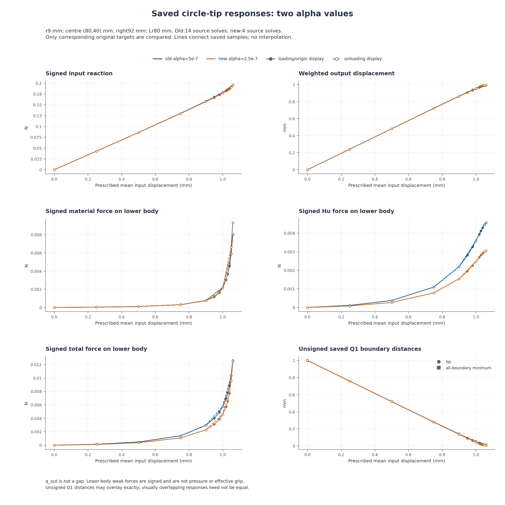
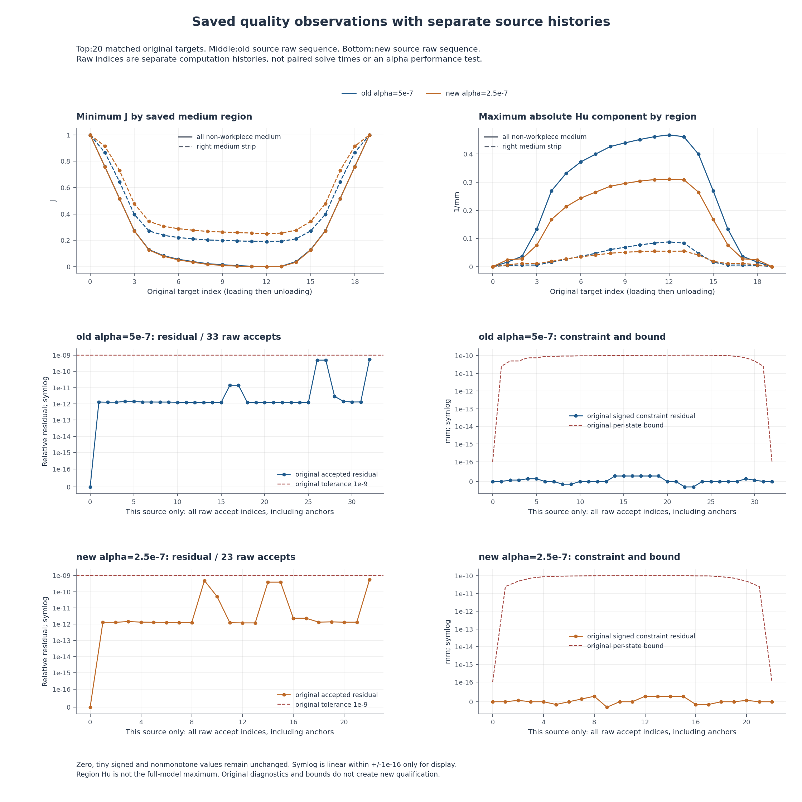

# 两种alpha的已有圆形工件响应：人工检查页

本页只比较两份既存普通统一JSON。旧alpha=5e-7来自14段原求解，新alpha=2.5e-7来自4段；不是两次本轮新求解，原来源时钟、锚复核和计算计数不能作为纯alpha性能。



颜色区分alpha，实线/实心点为loading或origin显示分支，虚线/空心点为卸载。转折连接复用真实峰值点，不新增状态或配对；不插值。各Fy分面避免堆叠图例；距离用圆/方点区分，重合时仍保原值。
q_out为加权端口位移；工件力是固定下半模型有符号material/Hu/total弱式合力，未镜像加倍，不是压力或合格夹持力。unsigned Q1距离不是解析圆间隙或接触/释放证明。



上排为同20原目标的原介质/右域J和Hu。中排只用旧来源全部raw接受序号；下排只用新来源全部raw接受序号，保留所有fresh anchor诊断，不能按横坐标把33/23行当成同一次计算或计算时间。
残差原门1e-9及原逐态constraint bound保持；有符号constraint与零值完整保留。symlog的±1e-16只是显示线性区，不是数值地板或新门；介质区Hu与全模型最大值不同。

## 来源、原资格与可比性

| 来源 | 普通统一JSON | 原人工页/变形入口 | 原页stat bytes | 原计数 |
|---|---|---|---:|---|
| old alpha=5e-7 | [原统一记录](<../../lf_circle_tip_path_001/run_001/unified_response.json>) | [原人工页](<../../lf_circle_tip_path_001/run_001/REVIEW.md>) | 34424 | `{"raw_rows": 33, "timeline_rows": 20, "merged_boundary_anchors": 13, "same_input_pairs": 7, "segments": 14, "requested_targets": 20}` |
| new alpha=2.5e-7 | [原统一记录](<../../lf_circle_tip_alpha_path_001/run_001/unified_response.json>) | [原人工页](<../../lf_circle_tip_alpha_path_001/run_001/REVIEW.md>) | 22763 | `{"raw_rows": 23, "timeline_rows": 20, "merged_boundary_anchors": 3, "same_input_pairs": 7, "segments": 4, "requested_targets": 20}` |

这里只stat/链接两份原人工页；原页已有14段/4段实际变形入口，本程序没有打开、读取、解码、复制、重哈希或拼接旧媒体，也不新绘结构。

原task、37字段、raw锚/二分诊断、计数、异常和来源完整保留在comparison.json的sources.original中。40条原值在raw_values，20组原目标配对及260差量在pairs。

可比性与声明的参数/元数据差异：

```json
{
  "comparable": true,
  "allowed_differing_paths": [
    "description",
    "parameter_origin",
    "purpose",
    "regularization.alpha",
    "task_id"
  ],
  "observed_task_differences": [
    {
      "path": "description",
      "baseline_value": "Freshly revalidate true1.06 mm peak, then unload to1.05 using the installed API. Observe actual LAST state and descriptively compare prior revalidated loading1.05 scalars without new equality gates.",
      "new_value": "Single-parameter exploratory alpha sensitivity. Fresh zero-start loading, no old-alpha state/force/tangent transplant; compare same-input original13 origin/loading observations without claiming alpha independence or grip qualification."
    },
    {
      "path": "parameter_origin",
      "baseline_value": "L-CTIPUNLOAD1 explicit user approval: retain the complete loading prefix through 1.06 mm, change only path kind to ordered_cycle and append first unload1.05 mm; input peak1.06 and all original physics/settings/gates unchanged.",
      "new_value": "L-CTIPALPHA1 explicit user approval: only physical change alpha5e-7 to2.5e-7; zero-start original13 load_only targets through1.06mm; geometry, all other physics and original production gates unchanged."
    },
    {
      "path": "purpose",
      "baseline_value": "tip_facing_circle_LF_saved_first_unload",
      "new_value": "tip_facing_circle_alpha_sensitivity_zero_start_loading"
    },
    {
      "path": "regularization.alpha",
      "baseline_value": 5e-07,
      "new_value": 2.5e-07
    },
    {
      "path": "task_id",
      "baseline_value": "EXPLORATORY_wave_fixed_circle_r9_c80_domain92_Lr80_h05_alpha5em7_unload106_105__L_CTIPUNLOAD1",
      "new_value": "EXPLORATORY_wave_fixed_circle_r9_c80_domain92_Lr80_h05_alpha25em8_load106__L_CTIPALPHA1"
    }
  ],
  "unexpected_task_differences": [],
  "alpha_contract_matches": true,
  "rule": "Every task field except alpha and four descriptive metadata fields must remain exact; original tasks are preserved, never normalized."
}
```

初始零态即使同SHA也不跨alpha合并或迁移HP。AREF1仅覆盖新alpha原加载1.06/global12单态及原PORT方向；旧/新任何选定态参考都不授本次全路径或卸载资格。

## 原目标逐项原值与描述性差量

仅按原global target index、display branch及原d匹配；origin原leg保持origin，加载/卸载同d不混配。每组同原13项，差量=new−baseline。下表17位有效数字；图中重叠不等于绝对相等，不新增归零、可逆、恢复率、耗散或alpha独立性门。

### 原目标 0 · origin · d=0 mm

原leg：`origin` → `origin`；SHA：`950ee55405b86a22e9343997432d398600e1904b7f3046a72f8de53a72229fc9` / `950ee55405b86a22e9343997432d398600e1904b7f3046a72f8de53a72229fc9`。

| 原指标 | 旧alpha原值 | 新alpha原值 | 新减旧 |
|---|---:|---:|---:|
| `R_input_N` | 0 | 0 | 0 |
| `q_out_mm` | 0 | 0 | 0 |
| `total_body_Fx_N` | 0 | 0 | 0 |
| `total_body_Fy_N` | 0 | 0 | 0 |
| `material_body_Fx_N` | 0 | 0 | 0 |
| `material_body_Fy_N` | 0 | 0 | 0 |
| `regularization_body_Fx_N` | 0 | 0 | 0 |
| `regularization_body_Fy_N` | 0 | 0 | 0 |
| `tip_to_raster_boundary_mm` | 1 | 1 | 0 |
| `minimum_boundary_distance_mm` | 1 | 1 | 0 |
| `solid_min_J` | 1 | 1 | 0 |
| `medium_min_J` | 1 | 1 | 0 |
| `medium_max_abs_Hu_per_mm` | 0 | 0 | 0 |

### 原目标 1 · loading · d=0.25 mm

原leg：`loading` → `loading`；SHA：`8ca6a4fb3463ad125e50a1315e68033ca1cede9158fc61476050888bee4a77e3` / `9e5cecdb3b314803d0d8b1ab7acf50eb36758746bfd8da019f885101a7bf2f87`。

| 原指标 | 旧alpha原值 | 新alpha原值 | 新减旧 |
|---|---:|---:|---:|
| `R_input_N` | 0.042743534147102635 | 0.042703029514548872 | -4.0504632553763076e-05 |
| `q_out_mm` | 0.24018802342288847 | 0.24028403137527443 | 9.6007952385956941e-05 |
| `total_body_Fx_N` | -1.900371381149789e-05 | -1.3542534375582008e-05 | 5.4611794359158827e-06 |
| `total_body_Fy_N` | 0.00014591711519481185 | 0.00011443652383110057 | -3.1480591363711286e-05 |
| `material_body_Fx_N` | -2.3811938740884575e-06 | -2.1739597087172347e-06 | 2.0723416537122283e-07 |
| `material_body_Fy_N` | 3.5442083296001272e-05 | 3.52269806505838e-05 | -2.1510264541747207e-07 |
| `regularization_body_Fx_N` | -1.6622519937409429e-05 | -1.1368574666864771e-05 | 5.2539452705446582e-06 |
| `regularization_body_Fy_N` | 0.00011047503189881059 | 7.9209543180516767e-05 | -3.1265488718293827e-05 |
| `tip_to_raster_boundary_mm` | 0.75988546943387192 | 0.75978418980757567 | -0.00010127962629624676 |
| `minimum_boundary_distance_mm` | 0.75988546943387192 | 0.75978418980757567 | -0.00010127962629624676 |
| `solid_min_J` | 0.99396670295104961 | 0.9939635081208108 | -3.1948302388062899e-06 |
| `medium_min_J` | 0.75912526611876563 | 0.75885553908850401 | -0.00026972703026162392 |
| `medium_max_abs_Hu_per_mm` | 0.016109379378075217 | 0.024391444893737291 | 0.0082820655156620737 |

### 原目标 2 · loading · d=0.5 mm

原leg：`loading` → `loading`；SHA：`c8f41107026000f09d395eb7a091ce6501b532b0a8d69210b22a94d55e8c8392` / `48fd7c621a8b1a060a5bec81307f2c8fe524569c6a4052da75884a8053e45bd8`。

| 原指标 | 旧alpha原值 | 新alpha原值 | 新减旧 |
|---|---:|---:|---:|
| `R_input_N` | 0.086027903335421887 | 0.085896352253893374 | -0.00013155108152851369 |
| `q_out_mm` | 0.48091445412449801 | 0.48124894952283942 | 0.00033449539834140563 |
| `total_body_Fx_N` | -5.4617501322577725e-05 | -3.6864211336580219e-05 | 1.7753289985997506e-05 |
| `total_body_Fy_N` | 0.00047828066183543393 | 0.00037155484472476796 | -0.00010672581711066597 |
| `material_body_Fx_N` | -5.3083627667794343e-06 | -4.8714551250185208e-06 | 4.369076417609135e-07 |
| `material_body_Fy_N` | 0.0001040097253926478 | 0.00010261532023809275 | -1.3944051545550543e-06 |
| `regularization_body_Fx_N` | -4.9309138555798289e-05 | -3.1992756211561687e-05 | 1.7316382344236602e-05 |
| `regularization_body_Fy_N` | 0.00037427093644278611 | 0.00026893952448667522 | -0.00010533141195611089 |
| `tip_to_raster_boundary_mm` | 0.51939406398757626 | 0.51903391779978492 | -0.00036014618779134366 |
| `minimum_boundary_distance_mm` | 0.51939406398757626 | 0.51903391779978492 | -0.00036014618779134366 |
| `solid_min_J` | 0.98795387631299869 | 0.98794408497095443 | -9.7913420442630184e-06 |
| `medium_min_J` | 0.51656869282155016 | 0.51592090426301418 | -0.00064778855853597772 |
| `medium_max_abs_Hu_per_mm` | 0.036830038296925716 | 0.02802167414492851 | -0.0088083641519972056 |

### 原目标 3 · loading · d=0.75 mm

原leg：`loading` → `loading`；SHA：`998ebca7375050a870e4466139732524206b151c0e7b16418f90ecc0a8d856a4` / `3730ff00bb455d8e96abc1aa42b28d6e65165f6de43da3551e56d5b661a69e0e`。

| 原指标 | 旧alpha原值 | 新alpha原值 | 新减旧 |
|---|---:|---:|---:|
| `R_input_N` | 0.13029373126695096 | 0.1299041229266539 | -0.00038960834029705405 |
| `q_out_mm` | 0.72093454737651819 | 0.7219888733048393 | 0.0010543259283211093 |
| `total_body_Fx_N` | -0.0001334043184808744 | -7.9373966417362545e-05 | 5.4030352063511857e-05 |
| `total_body_Fy_N` | 0.0014019374851138165 | 0.0010823036691811453 | -0.00031963381593267119 |
| `material_body_Fx_N` | -8.8668775825371823e-06 | -8.0820528292172309e-06 | 7.8482475331995144e-07 |
| `material_body_Fy_N` | 0.00030384286962516932 | 0.00029657737189436222 | -7.2654977308070964e-06 |
| `regularization_body_Fx_N` | -0.00012453744089833721 | -7.1291913588145326e-05 | 5.3245527310191886e-05 |
| `regularization_body_Fy_N` | 0.0010980946154886474 | 0.00078572629728678269 | -0.00031236831820186475 |
| `tip_to_raster_boundary_mm` | 0.27988491530854631 | 0.27872230441997559 | -0.0011626108885707254 |
| `minimum_boundary_distance_mm` | 0.27988491530854631 | 0.27872230441997559 | -0.0011626108885707254 |
| `solid_min_J` | 0.9819914053937876 | 0.98196374259453767 | -2.7662799249927872e-05 |
| `medium_min_J` | 0.27350038751453853 | 0.27190851732428606 | -0.0015918701902524757 |
| `medium_max_abs_Hu_per_mm` | 0.13298764084709486 | 0.076488824675017081 | -0.056498816172077776 |

### 原目标 4 · loading · d=0.90000000000000002 mm

原leg：`loading` → `loading`；SHA：`7dde449c7c36ed3963c2ee97616d706f08dff553426565b0c91007f4f4410ccf` / `04d0e1152af76711da3102fedc3768673f20b3847cce83de4461373abf6e0711`。

| 原指标 | 旧alpha原值 | 新alpha原值 | 新减旧 |
|---|---:|---:|---:|
| `R_input_N` | 0.1580782308108174 | 0.15726579952202099 | -0.0008124312887964058 |
| `q_out_mm` | 0.86255313347114326 | 0.86479978403901958 | 0.0022466505678763182 |
| `total_body_Fx_N` | -0.00021339262677573249 | -0.00011474668072675752 | 9.8645946048974973e-05 |
| `total_body_Fy_N` | 0.0029634728136016912 | 0.0022864089259866764 | -0.00067706388761501479 |
| `material_body_Fx_N` | -1.1522881206422037e-05 | -1.008637962736555e-05 | 1.4365015790564866e-06 |
| `material_body_Fy_N` | 0.00076764918501195803 | 0.00074327387672729875 | -2.4375308284659285e-05 |
| `regularization_body_Fx_N` | -0.00020186974556931045 | -0.00010466030109939196 | 9.7209444469918482e-05 |
| `regularization_body_Fy_N` | 0.002195823628589734 | 0.001543135049259378 | -0.00065268857933035605 |
| `tip_to_raster_boundary_mm` | 0.13886658198055457 | 0.13637032635930524 | -0.0024962556212493325 |
| `minimum_boundary_distance_mm` | 0.13886658198055457 | 0.13637032635930524 | -0.0024962556212493325 |
| `solid_min_J` | 0.97848534236739093 | 0.97842958300418115 | -5.5759363209784141e-05 |
| `medium_min_J` | 0.12974460877888705 | 0.12668338289325537 | -0.0030612258856316799 |
| `medium_max_abs_Hu_per_mm` | 0.26949724374504364 | 0.16791027506116954 | -0.1015869686838741 |

### 原目标 5 · loading · d=0.94999999999999996 mm

原leg：`loading` → `loading`；SHA：`694d5074568c94ffa531028ed9e345ecc7af047613e6bce1fd4c3110c22442ed` / `ab07e7219fa38cebda0d3d8b7c0dec16264f81b98d902bf5344e4a6794e1c5e1`。

| 原指标 | 旧alpha原值 | 新alpha原值 | 新减旧 |
|---|---:|---:|---:|
| `R_input_N` | 0.16789587547053317 | 0.16683582325440785 | -0.0010600522161253179 |
| `q_out_mm` | 0.9084279574933386 | 0.91136647874186927 | 0.0029385212485306678 |
| `total_body_Fx_N` | -0.00023881541338535215 | -0.00012404446435534998 | 0.00011477094903000217 |
| `total_body_Fy_N` | 0.0040079186480336841 | 0.0031140971773339185 | -0.00089382147069976556 |
| `material_body_Fx_N` | -1.2476868272184529e-05 | -1.0536954878181259e-05 | 1.9399133940032695e-06 |
| `material_body_Fy_N` | 0.0011995642378020521 | 0.0011592058405901814 | -4.0358397211870704e-05 |
| `regularization_body_Fx_N` | -0.00022633854511316763 | -0.00011350750947716874 | 0.00011283103563599889 |
| `regularization_body_Fy_N` | 0.0028083544102316307 | 0.0019548913367437369 | -0.00085346307348789377 |
| `tip_to_raster_boundary_mm` | 0.093292075787562823 | 0.090027019641407691 | -0.003265056146155132 |
| `minimum_boundary_distance_mm` | 0.093292075787562823 | 0.090027019641407691 | -0.003265056146155132 |
| `solid_min_J` | 0.97734976677048346 | 0.97727808503642022 | -7.168173406324474e-05 |
| `medium_min_J` | 0.083236346459556132 | 0.079361801560012074 | -0.0038745448995440579 |
| `medium_max_abs_Hu_per_mm` | 0.33199731410164551 | 0.21331958659767047 | -0.11867772750397504 |

### 原目标 6 · loading · d=0.97999999999999998 mm

原leg：`loading` → `loading`；SHA：`fed26a07e2ffd794cae57f09a2cdd94b07bee5571a3a2e05e8a25f9a33457d5d` / `2a9aa039a9399d8f3ef33d0bb1d49d8b1df011fd5b6638fedfd2342259e16d13`。

| 原指标 | 旧alpha原值 | 新alpha原值 | 新减旧 |
|---|---:|---:|---:|
| `R_input_N` | 0.17409261443201149 | 0.1728472461726058 | -0.0012453682594056881 |
| `q_out_mm` | 0.93518151128466709 | 0.93863452625845956 | 0.0034530149737924676 |
| `total_body_Fx_N` | -0.00025042648622304489 | -0.00012786615819978227 | 0.00012256032802326262 |
| `total_body_Fy_N` | 0.0049396057329399931 | 0.0038805754756943405 | -0.0010590302572456526 |
| `material_body_Fx_N` | -1.2977135911716829e-05 | -1.0689211220692375e-05 | 2.2879246910244535e-06 |
| `material_body_Fy_N` | 0.0016798211438800034 | 0.0016260246638493193 | -5.3796480030684091e-05 |
| `regularization_body_Fx_N` | -0.00023744935031132808 | -0.00011717694697908993 | 0.00012027240333223815 |
| `regularization_body_Fy_N` | 0.0032597845890599887 | 0.0022545508118450206 | -0.0010052337772149681 |
| `tip_to_raster_boundary_mm` | 0.066760549839159467 | 0.062925963451363032 | -0.0038345863877964348 |
| `minimum_boundary_distance_mm` | 0.066760549839159467 | 0.062925963451363032 | -0.0038345863877964348 |
| `solid_min_J` | 0.97668672818938407 | 0.97660334010310068 | -8.3388086283386897e-05 |
| `medium_min_J` | 0.056181447228027828 | 0.051736445230952964 | -0.0044450019970748642 |
| `medium_max_abs_Hu_per_mm` | 0.37246173781411934 | 0.24378875473636619 | -0.12867298307775316 |

### 原目标 7 · loading · d=1 mm

原leg：`loading` → `loading`；SHA：`af69ca8598c4ca18fcf756b16e509696ea6a0f8dfbbad8429f804e402d682b95` / `77d9c615291d5856c0761f49a0e8686f7f71fbd81005d689631affc78ac81840`。

| 原指标 | 旧alpha原值 | 新alpha原值 | 新减旧 |
|---|---:|---:|---:|
| `R_input_N` | 0.17845354459795351 | 0.17707577676018202 | -0.001377767837771493 |
| `q_out_mm` | 0.95242842557753238 | 0.95624823741432941 | 0.0038198118367970268 |
| `total_body_Fx_N` | -0.00025622127133659403 | -0.00013020603155553556 | 0.00012601523978105847 |
| `total_body_Fy_N` | 0.0057942001574207685 | 0.0046165473611738273 | -0.0011776527962469412 |
| `material_body_Fx_N` | -1.3298507356617854e-05 | -1.0902818474871831e-05 | 2.395688881746023e-06 |
| `material_body_Fy_N` | 0.0021994508988488338 | 0.0021412390748060364 | -5.8211824042797393e-05 |
| `regularization_body_Fx_N` | -0.00024292276397997619 | -0.00011930321308066369 | 0.00012361955089931249 |
| `regularization_body_Fy_N` | 0.0035947492585719338 | 0.0024753082863677909 | -0.0011194409722041429 |
| `tip_to_raster_boundary_mm` | 0.049688541622781912 | 0.045447814889897131 | -0.0042407267328847809 |
| `minimum_boundary_distance_mm` | 0.049688541622781912 | 0.045447814889897131 | -0.0042407267328847809 |
| `solid_min_J` | 0.97625852627783549 | 0.97616687151805714 | -9.1654759778347916e-05 |
| `medium_min_J` | 0.038809956885495892 | 0.034002852813944766 | -0.0048071040715511257 |
| `medium_max_abs_Hu_per_mm` | 0.39994040596535468 | 0.2649079814832529 | -0.13503242448210179 |

### 原目标 8 · loading · d=1.02 mm

原leg：`loading` → `loading`；SHA：`b96e0475af5e5e83b2ef8d1ca97436ff6be8468581068748c91606b8b646c5f2` / `5c8759fd9cc464f306fb4aa1e75aeba083dfee6625a730200c4536a663aeb23f`。

| 原指标 | 旧alpha原值 | 新alpha原值 | 新减旧 |
|---|---:|---:|---:|
| `R_input_N` | 0.1831436048338394 | 0.18165963031746177 | -0.0014839745163776341 |
| `q_out_mm` | 0.96882287660798083 | 0.97293980729980778 | 0.0041169306918269477 |
| `total_body_Fx_N` | -0.00026161617512184633 | -0.00013469394153696284 | 0.00012692223358488349 |
| `total_body_Fy_N` | 0.0069861213136471886 | 0.0057164477744475386 | -0.00126967353919965 |
| `material_body_Fx_N` | -1.3903471817278278e-05 | -1.1949114278337311e-05 | 1.9543575389409674e-06 |
| `material_body_Fy_N` | 0.003038442313787471 | 0.0030098689578344231 | -2.8573355953047906e-05 |
| `regularization_body_Fx_N` | -0.00024771270330456804 | -0.00012274482725862555 | 0.00012496787604594249 |
| `regularization_body_Fy_N` | 0.0039476789998597181 | 0.0027065788166131155 | -0.0012411001832466025 |
| `tip_to_raster_boundary_mm` | 0.033504644149946472 | 0.028930271344115965 | -0.0045743728058305066 |
| `minimum_boundary_distance_mm` | 0.033504644149946472 | 0.028930271344115965 | -0.0045743728058305066 |
| `solid_min_J` | 0.97585027074100994 | 0.97575205245380803 | -9.8218287201912169e-05 |
| `medium_min_J` | 0.022440419066892089 | 0.017472407767421386 | -0.0049680112994707031 |
| `medium_max_abs_Hu_per_mm` | 0.42695737023581104 | 0.28584629241761172 | -0.14111107781819932 |

### 原目标 9 · loading · d=1.03 mm

原leg：`loading` → `loading`；SHA：`9b3bce7ae5f2b25b0065fba05dac1f12d4764595b5a431cee876982363f7fc60` / `a7391107e04922f5e54918d130eaf6dbbdc954365aa94ccb6515212d44304adb`。

| 原指标 | 旧alpha原值 | 新alpha原值 | 新减旧 |
|---|---:|---:|---:|
| `R_input_N` | 0.18569957544156859 | 0.18421303565724201 | -0.0014865397843265848 |
| `q_out_mm` | 0.97646980500714786 | 0.98060063648919049 | 0.0041308314820426295 |
| `total_body_Fx_N` | -0.00026554689107274361 | -0.00014013045272697581 | 0.0001254164383457678 |
| `total_body_Fy_N` | 0.0077987359074976632 | 0.0065340676728525907 | -0.0012646682346450725 |
| `material_body_Fx_N` | -1.4687837476076189e-05 | -1.3705836447636845e-05 | 9.8200102843934413e-07 |
| `material_body_Fy_N` | 0.0036742086717474272 | 0.0037128956033506931 | 3.86869316032659e-05 |
| `regularization_body_Fx_N` | -0.00025085905359666739 | -0.00012642461627933893 | 0.00012443443731732846 |
| `regularization_body_Fy_N` | 0.0041245272357502364 | 0.0028211720695018976 | -0.0013033551662483388 |
| `tip_to_raster_boundary_mm` | 0.025985908706346095 | 0.021386935424818176 | -0.0045989732815279183 |
| `minimum_boundary_distance_mm` | 0.025985908706346095 | 0.021386935424818176 | -0.0045989732815279183 |
| `solid_min_J` | 0.97565900642888259 | 0.97556066384694295 | -9.8342581939636631e-05 |
| `medium_min_J` | 0.014938189525383425 | 0.010179980694943766 | -0.0047582088304396596 |
| `medium_max_abs_Hu_per_mm` | 0.43983781629247992 | 0.29566452084567313 | -0.14417329544680679 |

### 原目标 10 · loading · d=1.04 mm

原leg：`loading` → `loading`；SHA：`db691d50d019c76f9abc5555e19347c44dac2145c3bcf1de508c4cc994e59f7e` / `9e47bea2e9be545786740e0c01cf0c2edfb89c1e6da15c57691b24f6a8b51483`。

| 原指标 | 旧alpha原值 | 新alpha原值 | 新减旧 |
|---|---:|---:|---:|
| `R_input_N` | 0.18849743751609724 | 0.18712622175174609 | -0.0013712157643511469 |
| `q_out_mm` | 0.98348165954800693 | 0.98731108867484807 | 0.003829429126841144 |
| `total_body_Fx_N` | -0.00027253882144887475 | -0.00015228226319136389 | 0.00012025655825751087 |
| `total_body_Fy_N` | 0.0088593699886909492 | 0.0077181950643798458 | -0.0011411749243111034 |
| `material_body_Fx_N` | -1.6523602516565192e-05 | -1.8437879235739516e-05 | -1.914276719174324e-06 |
| `material_body_Fy_N` | 0.004564338477098198 | 0.0047905116893941172 | 0.00022617321229591921 |
| `regularization_body_Fx_N` | -0.00025601521893230957 | -0.00013384438395562439 | 0.00012217083497668518 |
| `regularization_body_Fy_N` | 0.0042950315115927503 | 0.0029276833749857286 | -0.0013673481366070217 |
| `tip_to_raster_boundary_mm` | 0.01913067004654323 | 0.014843091886785231 | -0.0042875781597579987 |
| `minimum_boundary_distance_mm` | 0.01913067004654323 | 0.014843091886785231 | -0.0042875781597579987 |
| `solid_min_J` | 0.97548257642728131 | 0.97539143778929516 | -9.1138637986154514e-05 |
| `medium_min_J` | 0.0082841704029417255 | 0.0043528015671832005 | -0.0039313688357585251 |
| `medium_max_abs_Hu_per_mm` | 0.45180288661612938 | 0.30414015576101605 | -0.14766273085511333 |

### 原目标 11 · loading · d=1.05 mm

原leg：`loading` → `loading`；SHA：`0cef15db4eb7d5537ce1047b1a8625013ab131edcaa3a88c15a7dfacbdf9bbe8` / `0f2605abda45ff6a96d90b7c97d5dc26e430e2fb80ef1427c275f04e39a4385e`。

| 原指标 | 旧alpha原值 | 新alpha原值 | 新减旧 |
|---|---:|---:|---:|
| `R_input_N` | 0.19171197760526851 | 0.19075825359469525 | -0.00095372401057325362 |
| `q_out_mm` | 0.98939181406960008 | 0.9921056957589891 | 0.0027138816893890194 |
| `total_body_Fx_N` | -0.00028786695721812243 | -0.00018352043949440545 | 0.00010434651772371699 |
| `total_body_Fy_N` | 0.010344906240341959 | 0.009628058928900415 | -0.00071684731144154405 |
| `material_body_Fx_N` | -2.1551476123748349e-05 | -3.4085461534452708e-05 | -1.253398541070436e-05 |
| `material_body_Fy_N` | 0.0058958732360770158 | 0.0066200047470112728 | 0.00072413151093425696 |
| `regularization_body_Fx_N` | -0.00026631548109437412 | -0.00014943497795995276 | 0.00011688050313442137 |
| `regularization_body_Fy_N` | 0.0044490330042649432 | 0.0030080541818891435 | -0.0014409788223757997 |
| `tip_to_raster_boundary_mm` | 0.013434644879975366 | 0.010336706011031538 | -0.0030979388689438281 |
| `minimum_boundary_distance_mm` | 0.013434644879975366 | 0.010336706011031538 | -0.0030979388689438281 |
| `solid_min_J` | 0.9753318497649357 | 0.97526677347295354 | -6.5076291982157919e-05 |
| `medium_min_J` | 0.0032268105740065082 | 0.0012518161407227715 | -0.0019749944332837369 |
| `medium_max_abs_Hu_per_mm` | 0.46195690592022765 | 0.30936747070236725 | -0.15258943521786039 |

### 原目标 12 · loading · d=1.0600000000000001 mm

原leg：`loading` → `loading`；SHA：`dd9288140ae51ff3cfcc7f7f6d6811b2242a55054454002bd7c06ff88a4b6bc6` / `e71c06973b7dc7aff7e5ee4a801b595cb3f054e907cc6e1ad52188e858500a68`。

| 原指标 | 旧alpha原值 | 新alpha原值 | 新减旧 |
|---|---:|---:|---:|
| `R_input_N` | 0.19568183324206792 | 0.19522304147728387 | -0.00045879176478405559 |
| `q_out_mm` | 0.99328540641021312 | 0.9946672298032242 | 0.0013818233930110724 |
| `total_body_Fx_N` | -0.000326215286673644 | -0.0002399800950672949 | 8.6235191606349104e-05 |
| `total_body_Fy_N` | 0.01259251473277105 | 0.012372524610902783 | -0.00021999012186826698 |
| `material_body_Fx_N` | -3.8945182147391937e-05 | -6.691682951023186e-05 | -2.7971647362839923e-05 |
| `material_body_Fy_N` | 0.008033412258785861 | 0.0093181520272172785 | 0.0012847397684314175 |
| `regularization_body_Fx_N` | -0.00028727010452625203 | -0.00017306326555706304 | 0.00011420683896918899 |
| `regularization_body_Fy_N` | 0.0045591024739851868 | 0.0030543725836855054 | -0.0015047298902996814 |
| `tip_to_raster_boundary_mm` | 0.0098875247102654384 | 0.0082275225227377291 | -0.0016600021875277093 |
| `minimum_boundary_distance_mm` | 0.0098875247102654384 | 0.0082275225227377291 | -0.0016600021875277093 |
| `solid_min_J` | 0.97522810225231016 | 0.97519391635967245 | -3.4185892637705884e-05 |
| `medium_min_J` | 0.00090158391797441921 | 0.00046587891715793817 | -0.00043570500081648104 |
| `medium_max_abs_Hu_per_mm` | 0.4682404604988441 | 0.31108200242696615 | -0.15715845807187795 |

### 原目标 13 · unloading · d=1.05 mm

原leg：`unloading` → `unloading`；SHA：`64b9301899b2599203140b634ffc5340e5d0a7c31ce75d0931203a6b72d58d1d` / `e21cdc845dc3721bc32d9275f889f53e9b1560dcd7ca126a28ea8efa2254e2ee`。

| 原指标 | 旧alpha原值 | 新alpha原值 | 新减旧 |
|---|---:|---:|---:|
| `R_input_N` | 0.1917119776052677 | 0.19075825359298318 | -0.00095372401228452364 |
| `q_out_mm` | 0.98939181406960264 | 0.99210569576363417 | 0.002713881694031528 |
| `total_body_Fx_N` | -0.00028786695721808535 | -0.00018352043940309299 | 0.00010434651781499236 |
| `total_body_Fy_N` | 0.010344906240341151 | 0.0096280589272314532 | -0.00071684731310969751 |
| `material_body_Fx_N` | -2.1551476123742779e-05 | -3.408546150011013e-05 | -1.2533985376367351e-05 |
| `material_body_Fy_N` | 0.0058958732360762838 | 0.0066200047453297342 | 0.00072413150925345043 |
| `regularization_body_Fx_N` | -0.00026631548109434257 | -0.00014943497790298284 | 0.00011688050319135973 |
| `regularization_body_Fy_N` | 0.0044490330042648669 | 0.003008054181901719 | -0.0014409788223631479 |
| `tip_to_raster_boundary_mm` | 0.013434644879971813 | 0.010336706005979579 | -0.0030979388739922342 |
| `minimum_boundary_distance_mm` | 0.013434644879971813 | 0.010336706005979579 | -0.0030979388739922342 |
| `solid_min_J` | 0.97533184976493559 | 0.97526677347284518 | -6.5076292090404664e-05 |
| `medium_min_J` | 0.0032268105739974096 | 0.0012518161249492532 | -0.0019749944490481562 |
| `medium_max_abs_Hu_per_mm` | 0.46195690592022859 | 0.30936747071244913 | -0.15258943520777946 |

### 原目标 14 · unloading · d=1 mm

原leg：`unloading` → `unloading`；SHA：`0be638c03daaa369d3a740493f6e99bd6978e839709cf83029642fdf8abd2c0b` / `0a7602917a1c49bc0950b67b604beedefc1fb8acad4c831e2fcbc46e388ea37d`。

| 原指标 | 旧alpha原值 | 新alpha原值 | 新减旧 |
|---|---:|---:|---:|
| `R_input_N` | 0.17845354455643678 | 0.17707577676004574 | -0.0013777677963910384 |
| `q_out_mm` | 0.95242842568580555 | 0.9562482374146859 | 0.0038198117288803513 |
| `total_body_Fx_N` | -0.00025622127106209155 | -0.00013020603155367824 | 0.00012601523950841331 |
| `total_body_Fy_N` | 0.0057942001404693499 | 0.0046165473610842583 | -0.0011776527793850916 |
| `material_body_Fx_N` | -1.3298507391046522e-05 | -1.0902818474842109e-05 | 2.3956889162044126e-06 |
| `material_body_Fy_N` | 0.0021994508888164535 | 0.0021412390747421639 | -5.8211814074289603e-05 |
| `regularization_body_Fx_N` | -0.00024292276367104504 | -0.00011930321307883612 | 0.00012361955059220892 |
| `regularization_body_Fy_N` | 0.0035947492516528955 | 0.0024753082863420953 | -0.0011194409653108002 |
| `tip_to_raster_boundary_mm` | 0.04968854151114499 | 0.045447814889531202 | -0.0042407266216137884 |
| `minimum_boundary_distance_mm` | 0.04968854151114499 | 0.045447814889531202 | -0.0042407266216137884 |
| `solid_min_J` | 0.97625852627530552 | 0.97616687151804882 | -9.165475725669836e-05 |
| `medium_min_J` | 0.03880995637928876 | 0.034002852811436862 | -0.0048071035678518975 |
| `medium_max_abs_Hu_per_mm` | 0.39994040542071757 | 0.26490798148014116 | -0.13503242394057641 |

### 原目标 15 · unloading · d=0.90000000000000002 mm

原leg：`unloading` → `unloading`；SHA：`9714d4ab7f2fab276f2d98b7e11682cdd91e24fe02d87707cd213e7896acfbea` / `48c4f8278a4de6e6e0c257a40c86afcfd6a5800c0aa773d22c217a01582a9fe7`。

| 原指标 | 旧alpha原值 | 新alpha原值 | 新减旧 |
|---|---:|---:|---:|
| `R_input_N` | 0.15807823081081884 | 0.15726579952202097 | -0.00081243128879787685 |
| `q_out_mm` | 0.86255313347113882 | 0.86479978403901947 | 0.0022466505678806481 |
| `total_body_Fx_N` | -0.00021339262677680637 | -0.00011474668072675177 | 9.8645946050054595e-05 |
| `total_body_Fy_N` | 0.0029634728136028283 | 0.0022864089259866795 | -0.00067706388761614887 |
| `material_body_Fx_N` | -1.1522881206424851e-05 | -1.0086379627365552e-05 | 1.4365015790592987e-06 |
| `material_body_Fy_N` | 0.00076764918501185048 | 0.00074327387672729821 | -2.4375308284552274e-05 |
| `regularization_body_Fx_N` | -0.00020186974557038153 | -0.00010466030109938621 | 9.7209444470995325e-05 |
| `regularization_body_Fy_N` | 0.0021958236285909778 | 0.0015431350492593817 | -0.00065268857933159616 |
| `tip_to_raster_boundary_mm` | 0.13886658198055812 | 0.13637032635930524 | -0.0024962556212528852 |
| `minimum_boundary_distance_mm` | 0.13886658198055812 | 0.13637032635930524 | -0.0024962556212528852 |
| `solid_min_J` | 0.97848534236739104 | 0.97842958300418115 | -5.5759363209895163e-05 |
| `medium_min_J` | 0.1297446087788906 | 0.12668338289325551 | -0.0030612258856350938 |
| `medium_max_abs_Hu_per_mm` | 0.26949724374503542 | 0.16791027506116951 | -0.10158696868386591 |

### 原目标 16 · unloading · d=0.75 mm

原leg：`unloading` → `unloading`；SHA：`c22bdd8f74d63e86a7035d1922f63d4aa7e9f5541c7c6ce9f51e9a4c7cb8ec9a` / `5dcdfb048821ce8f0ab50a498f711004878217322eef14996802f069a75a939b`。

| 原指标 | 旧alpha原值 | 新alpha原值 | 新减旧 |
|---|---:|---:|---:|
| `R_input_N` | 0.13029373126695099 | 0.12990412292665401 | -0.00038960834029697078 |
| `q_out_mm` | 0.72093454737651808 | 0.72198887330483918 | 0.0010543259283211093 |
| `total_body_Fx_N` | -0.00013340431848089601 | -7.9373966417361935e-05 | 5.403035206353407e-05 |
| `total_body_Fy_N` | 0.0014019374851138356 | 0.0010823036691811443 | -0.00031963381593269136 |
| `material_body_Fx_N` | -8.8668775825373992e-06 | -8.082052829217219e-06 | 7.8482475332018014e-07 |
| `material_body_Fy_N` | 0.00030384286962516872 | 0.000296577371894362 | -7.2654977308067169e-06 |
| `regularization_body_Fx_N` | -0.00012453744089835862 | -7.1291913588144716e-05 | 5.3245527310213909e-05 |
| `regularization_body_Fy_N` | 0.0010980946154886672 | 0.00078572629728678226 | -0.00031236831820188491 |
| `tip_to_raster_boundary_mm` | 0.27988491530854986 | 0.27872230441997559 | -0.0011626108885742781 |
| `minimum_boundary_distance_mm` | 0.27988491530854986 | 0.27872230441997559 | -0.0011626108885742781 |
| `solid_min_J` | 0.98199140539378749 | 0.98196374259453767 | -2.766279924981685e-05 |
| `medium_min_J` | 0.27350038751453865 | 0.27190851732428617 | -0.0015918701902524757 |
| `medium_max_abs_Hu_per_mm` | 0.13298764084709469 | 0.076488824675017025 | -0.056498816172077665 |

### 原目标 17 · unloading · d=0.5 mm

原leg：`unloading` → `unloading`；SHA：`b77aa5e075b988cd3fced5c1637e97b939baedec9e084d81b32389a5f4055a47` / `32ab3cbb08cc249eb3f492f865248dc45c4ad0b2daf6b2eb9d999c049edf960a`。

| 原指标 | 旧alpha原值 | 新alpha原值 | 新减旧 |
|---|---:|---:|---:|
| `R_input_N` | 0.08602790333542186 | 0.085896352253893415 | -0.0001315510815284443 |
| `q_out_mm` | 0.48091445412449807 | 0.48124894952283948 | 0.00033449539834140563 |
| `total_body_Fx_N` | -5.4617501322577264e-05 | -3.6864211336580212e-05 | 1.7753289985997052e-05 |
| `total_body_Fy_N` | 0.00047828066183543317 | 0.00037155484472476828 | -0.00010672581711066489 |
| `material_body_Fx_N` | -5.308362766779436e-06 | -4.8714551250185242e-06 | 4.369076417609118e-07 |
| `material_body_Fy_N` | 0.00010400972539264782 | 0.00010261532023809276 | -1.3944051545550543e-06 |
| `regularization_body_Fx_N` | -4.9309138555797835e-05 | -3.1992756211561687e-05 | 1.7316382344236148e-05 |
| `regularization_body_Fy_N` | 0.00037427093644278541 | 0.00026893952448667555 | -0.00010533141195610986 |
| `tip_to_raster_boundary_mm` | 0.51939406398757626 | 0.51903391779978492 | -0.00036014618779134366 |
| `minimum_boundary_distance_mm` | 0.51939406398757626 | 0.51903391779978492 | -0.00036014618779134366 |
| `solid_min_J` | 0.98795387631299869 | 0.98794408497095443 | -9.7913420442630184e-06 |
| `medium_min_J` | 0.51656869282155016 | 0.51592090426301407 | -0.00064778855853608874 |
| `medium_max_abs_Hu_per_mm` | 0.036830038296925716 | 0.028021674144928732 | -0.0088083641519969835 |

### 原目标 18 · unloading · d=0.25 mm

原leg：`unloading` → `unloading`；SHA：`3cc59fadc696cb42f1195831c2e582f8e66c668b713692724127f71771c6abf1` / `1b7cb0f28a27a6d96cff4e647cb296147b5e0cf584f649ce8c15ca65eeb23105`。

| 原指标 | 旧alpha原值 | 新alpha原值 | 新减旧 |
|---|---:|---:|---:|
| `R_input_N` | 0.042743534147102642 | 0.042703029514548865 | -4.0504632553776954e-05 |
| `q_out_mm` | 0.24018802342288847 | 0.24028403137527438 | 9.6007952385901429e-05 |
| `total_body_Fx_N` | -1.9003713811497887e-05 | -1.3542534375581986e-05 | 5.4611794359159013e-06 |
| `total_body_Fy_N` | 0.00014591711519481153 | 0.00011443652383110066 | -3.1480591363710866e-05 |
| `material_body_Fx_N` | -2.3811938740884571e-06 | -2.1739597087172343e-06 | 2.0723416537122283e-07 |
| `material_body_Fy_N` | 3.5442083296001265e-05 | 3.52269806505838e-05 | -2.151026454174653e-07 |
| `regularization_body_Fx_N` | -1.6622519937409429e-05 | -1.1368574666864749e-05 | 5.2539452705446802e-06 |
| `regularization_body_Fy_N` | 0.00011047503189881024 | 7.9209543180516848e-05 | -3.1265488718293393e-05 |
| `tip_to_raster_boundary_mm` | 0.75988546943387192 | 0.75978418980757567 | -0.00010127962629624676 |
| `minimum_boundary_distance_mm` | 0.75988546943387192 | 0.75978418980757567 | -0.00010127962629624676 |
| `solid_min_J` | 0.99396670295104961 | 0.99396350812081091 | -3.1948302386952676e-06 |
| `medium_min_J` | 0.75912526611876574 | 0.75885553908850412 | -0.00026972703026162392 |
| `medium_max_abs_Hu_per_mm` | 0.016109379378075162 | 0.024391444893737291 | 0.0082820655156621292 |

### 原目标 19 · unloading · d=0 mm

原leg：`unloading` → `unloading`；SHA：`4d5f400e1373b8d24b0d6e08b4745769f5084d1e55690a077814c533395f7289` / `b983fccfbc069aa9a15fa95d8e1fb1b3ac423c6ced88dbe73fab7921e9725204`。

| 原指标 | 旧alpha原值 | 新alpha原值 | 新减旧 |
|---|---:|---:|---:|
| `R_input_N` | 1.6317430051868603e-25 | 1.0582095724475673e-25 | -5.7353343273929305e-26 |
| `q_out_mm` | -8.903399720651071e-25 | -8.7295978857848199e-25 | 1.7380183486625106e-26 |
| `total_body_Fx_N` | 2.7437604080152348e-30 | 1.0561453539371488e-29 | 7.817693131356254e-30 |
| `total_body_Fy_N` | -1.0014711119833229e-28 | -1.4125530006499791e-28 | -4.1108188866665616e-29 |
| `material_body_Fx_N` | 5.2555845124385524e-30 | 7.0377674779068975e-30 | 1.7821829654683452e-30 |
| `material_body_Fy_N` | -7.6356534723887098e-29 | -7.8179041316438821e-29 | -1.8225065925517233e-30 |
| `regularization_body_Fx_N` | -2.511824104423321e-30 | 3.5236860614645793e-30 | 6.0355101658879004e-30 |
| `regularization_body_Fy_N` | -2.3790576474445087e-29 | -6.3076258748559097e-29 | -3.928568227411401e-29 |
| `tip_to_raster_boundary_mm` | 1 | 1 | 0 |
| `minimum_boundary_distance_mm` | 1 | 1 | 0 |
| `solid_min_J` | 1 | 1 | 0 |
| `medium_min_J` | 1 | 1 | 0 |
| `medium_max_abs_Hu_per_mm` | 9.4617870238948377e-25 | 1.0265541622900635e-24 | 8.0375459900579736e-26 |

## 范围与后续

本轮仅普通记录和两张标量图，无新构模/F/T/HP/平衡求解/测试、默认HF改动或API关联。原完整字段和微小有符号量不裁零，不据两条已回零路径授释放、稳定、有效夹持、网格/域收敛、alpha独立性、完整路径独立参考或HF5资格。
按实际差量决定后续，不预判参数影响大小；原科学结果、失败/拒绝记录、参考和QA历史均保持。

### 原范围说明

"Two existing ordinary paths only: alpha5e-7 from fourteen segments and alpha2.5e-7 from four. Compare original target identity, display branch and exact input d, never d or SHA alone. Retain forty original rows, all37 observations and everything already embedded in the two inputs: raw anchors/bisections, diagnostics, exceptions, segments and counts. No source_history or additional Newton-history file is opened. Thirteen original scalar definitions give260 descriptive new-minus-baseline differences only. No interpolation, normalization of incompatible tasks, new mechanics/HP/tests/API/default changes, equality/zero-return/recovery/energy/stability gate or qualification. Whole CPU/count differences are not pure-alpha performance. An identical zero-state SHA never merges physical tasks or transfers HP; signed lower-body weak force is not pressure or effective grip."
