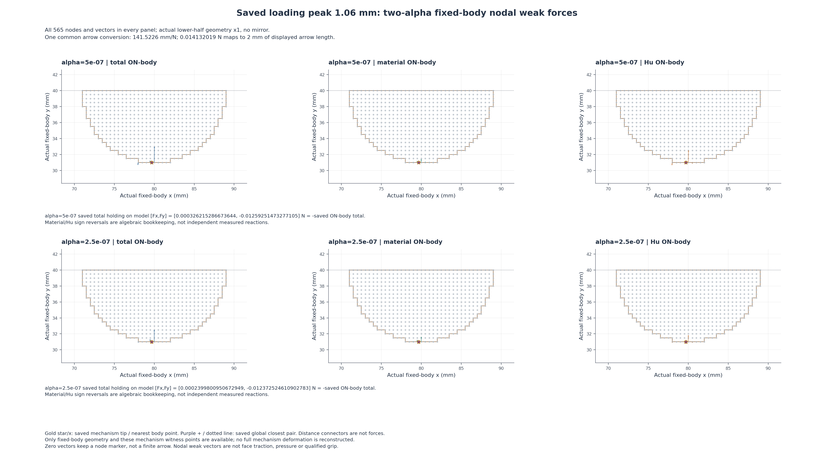
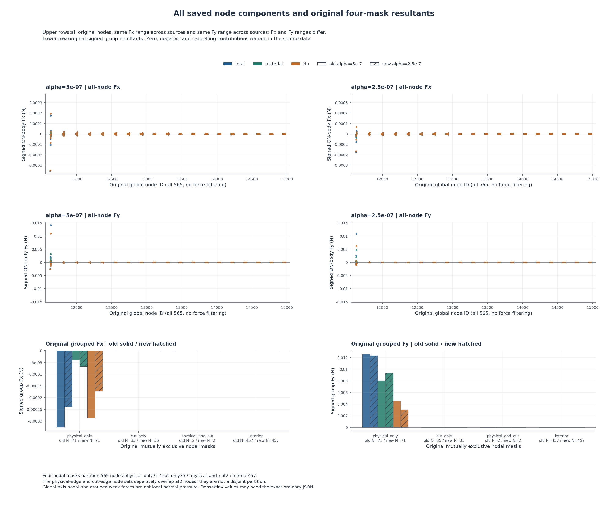

# L-CTIPAFORCE1：两种alpha同峰固定工件节点弱力空间对照

2026-10-21（Asia/Seoul，由实际UTC+09派生）；执行 **PASS**；图像QA `pass_root_visual_inspection_with_visibility_limits`／完整 `True`；阶段完成 `True`。原来源日期与资格保持。

准备期PLAN、preapproval卡及proposed_plan中的pending/false是原历史快照，原字节保留；当前整卡已由用户明确批准，以[当前授权](author/authorization.json)、[批准卡](L-CTIPAFORCE1_CARD.md)和[SOURCE审查](author/SOURCE_REVIEW.md)为准，不将旧pending误作当前授权状态。

整体目标：将LF几何接入独立、可恢复的大变形/TMC评估，明确结构变形、工件作用力与加载卸载响应。本轮在既有标量比较之后解释material/Hu节点贡献的空间来源，帮助决定后续研究；不改生产alpha，不继续加载或例行新增HP。

本轮只读两alpha各nodal/derived/geometry共6份已绑定普通JSON，共449948 B；按相同原global12、loading1.06及原SHA核身份，按原node ID配对。原两source全部节点坐标/mask/边、三种ON-body向量、原summary/holding/矩及37项row保持在comparison.json的sources.original；未另开科学数组、task、summary、convergence或旧媒体。

实际输出计数 `{'sources': 2, 'node_raw_rows': 1130, 'matched_node_pairs': 565, 'descriptive_node_differences': 3390, 'mask_group_original_rows': 8, 'mask_group_matched_pairs': 4, 'mask_group_component_differences': 24, 'whole_resultant_component_differences': 6}`。完整1130条原值、565组原节点配对与3390项三分量Fx/Fy描述差，4组/24分量差及整体6分量差可由比较JSON审查；人工页不重复3390行。alpha=5e-7与2.5e-7，r9/圆心(80,40)/right92/Lr80及原物理门保持。原兼容性记录：`{'comparable': True, 'exact_fields': {'node_ids': True, 'coordinates_mm': True, 'masks': True, 'edges': True, 'moment_origin_mm': True}, 'rule': 'Use exact original global IDs/fixed coordinates/masks/edges and moment origin; mismatch stops without renumbering or reclassification.'}`。

图1为2alpha行×total/material/Hu三列，共6空间面板，每面板全部565点/向量。共同轴/aspect和跨两alpha三分量的maxnorm→2mm显示标尺；quiver minlength=0，零向量保节点点位，不筛小力。只画固定下半工件×1及原tip/距离见证，不伪造全机构变形；箭头mm/N不是位移放大。holding原total向量逐source列在图内，方向为−ON-body total，material/Hu反号只是代数分量，不是独立测量。

图2保留全部节点Fx/Fy，旧/新同分量共用量程，Fx与Fy分别定范围；原组贡献直接使用summary.groups，分量三色/alpha柱纹。四mask为互斥完整分区71/35/2/457；physical/cut两个边节点集合另有2个共有节点，不能混为重复组。显式科学刻度无offset，原负号、零、极小量与抵消均保持。

原fsum全体/原mask重组减summary、total−(material+Hu)尾差与原holding+ON-body total仅描述，不新增容差或吸零，不新增矩积分或移动原点。节点弱力不是局部面牵引，不做径向投影成压力，不镜像倍增，不授有效夹持。unsigned Q1距离不是解析圆间隙或接触/释放证明。

本轮只解释1.06峰的material/Hu重分配，不冒充覆盖全程最大R/q/距离/总Fy差，1.02/1.03仍只是后续候选。两source原峰HP各保原态和原方向，不相互转移、不授全卸载/全路径或alpha独立性；也不比较不同来源的总CPU性能。

本轮已完成双alpha原加载1.06 mm峰的565组原节点配对：1130条原值、3390项三分量Fx/Fy差、4组/24分量差和整体6分量差保存在现成比较JSON。两张新力图各一次原尺寸QA通过，原值与符号可审查；未新增机械求解或改变生产alpha。

原physical_only的total Fy由0.01257238289721829降至0.012363642548824626 N，material Fy由0.008033567881061432升至0.009318308400011348 N，Hu Fy由0.004538815016156855降至0.0030453341488132796 N；此前总量较接近所掩盖的material/Hu反向变化，主要发生于这一原节点组。physical_and_cut两个节点的total Fy由2.013183555276017e-5降至8.88206207815696e-6 N，material Fy仍保留原微小负值。cut_only与interior的三分量原组向量均为零；这里说的是组结果，不能仅凭零组和/图像推断每一节点或任意位置的物理接触状态。

全体和四mask的fsum重组减原summary均为原记录的零；节点total−(material+Hu)最大绝对尾差分别1.3010426069826053e-18和1.734723475976807e-18 N。它们说明此次普通节点账本忠实关联原汇总，只作描述，不新增容差门、压力或有效夹持资格。四节点mask是互斥71/35/2/457；physical/cut边节点集另交2，不混为重叠分组。

原尺寸QA仍有明确限制：全工件尺度的约8–10微米距离、密集零/小节点贡献与小physical_and_cut柱不易分辨；原JSON与表保留实际值，图中清楚不等于有效夹持已经认证。当前空间结果已回答峰值分量主要由哪些原节点组承担，最近应让现成全周期、参数对照和峰节点结果可被外部研究层统一读取，而非自动重开1.02/1.03、HP、加载或再降低alpha。

资源配置 `{'helper_seconds': 180, 'outer_seconds': 240, 'sampled_RSS_bytes': 1073741824, 'cpu_thread_limit': 16, 'cpu_thread_environment': {'OMP_NUM_THREADS': '16', 'OPENBLAS_NUM_THREADS': '16', 'MKL_NUM_THREADS': '16', 'NUMEXPR_NUM_THREADS': '16'}}`；helper实际 `6.288796100008767` s，outer `8.794301400019322` s；峰值采样RSS `173408256` B；清理 `True`。四库16线程为上限配置，不是实测核利用率。本卡新增构模/F/T/HP/平衡求解/测试/默认安装和API关联均为0。

本轮封存 `4` 份输出／`2602008` B，闭卡继承helper seal并核stat大小，不重开科学/媒体载荷。helper错误 `未提供`；outer错误 `未提供`。执行、图像QA与阶段完成分开；真实partial保留，无外部重试、修复重跑、延期、force、回滚或删除。

|来源|alpha|原人工页|原页stat bytes|原节点计数|
|---|---|---|---:|---|
|baseline|5e-07|[原人工页与既有变形入口](../lf_circle_tip_step_010/run_001/REVIEW.md)|2111|`{'node_count': 565, 'group_counts': {'physical_only': 71, 'cut_only': 35, 'physical_and_cut': 2, 'interior': 457}, 'mask_membership_counts': {'1': 565}, 'mask_partition_observed': True}`|
|new|2.5e-07|[原人工页与既有变形入口](../lf_circle_tip_alpha_001/run_001/REVIEW.md)|3669|`{'node_count': 565, 'group_counts': {'physical_only': 71, 'cut_only': 35, 'physical_and_cut': 2, 'interior': 457}, 'mask_membership_counts': {'1': 565}, 'mask_partition_observed': True}`|

以上只stat链接两份原人工页及其既有变形入口；没有打开、复制、解码、抽帧、重哈希或拼接旧图/动画，不生成全机构结构图。固定坐标=实际坐标沿producer的工件lift/fluctuation为零合同，本轮不另读数组重验。

后续：建议L-CTIPAREPORT1：先绑定两份既存ACOMP/AFORCE普通comparison JSON，新增独立研究层可导入读取函数与CLI，关联现成全周期、260标量差与565对3390节点差及原图页，输出轻report.json和人工索引；不新绘图或改默认HF摘要，待新整卡明确授权。

原参考和结果资格不升级：无压力、有效夹持、自由释放、稳定性、alpha独立性、网格/域收敛、完整路径独立参考或HF5资格。到零只代表原输入回程完成。

入口：[人工页与3390差量入口](run_001/REVIEW.md) · [原值/比较JSON](run_001/comparison.json) · [outer](step_launch.json) · [helper](run_001/execution_receipt.json) · [当前授权](author/authorization.json) · [SOURCE审查](author/SOURCE_REVIEW.md) · [实际审查](author/ACTUAL_REVIEW.md) · [两图QA](author/pixel_QA.json) · [闭卡JSON](author/closure.json) · [后续](NEXT_STEPS.md)

交接：origin保持https://github.com/dudaxing/Compliant-TO-TMC.git，main继续开发。异目录恢复采用同机local-Git fetch/ff-only，远程main单独核对，不称异机科学复算；不要重跑已关闭launcher。
