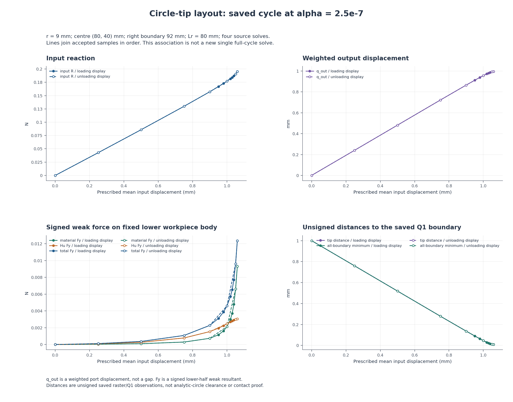
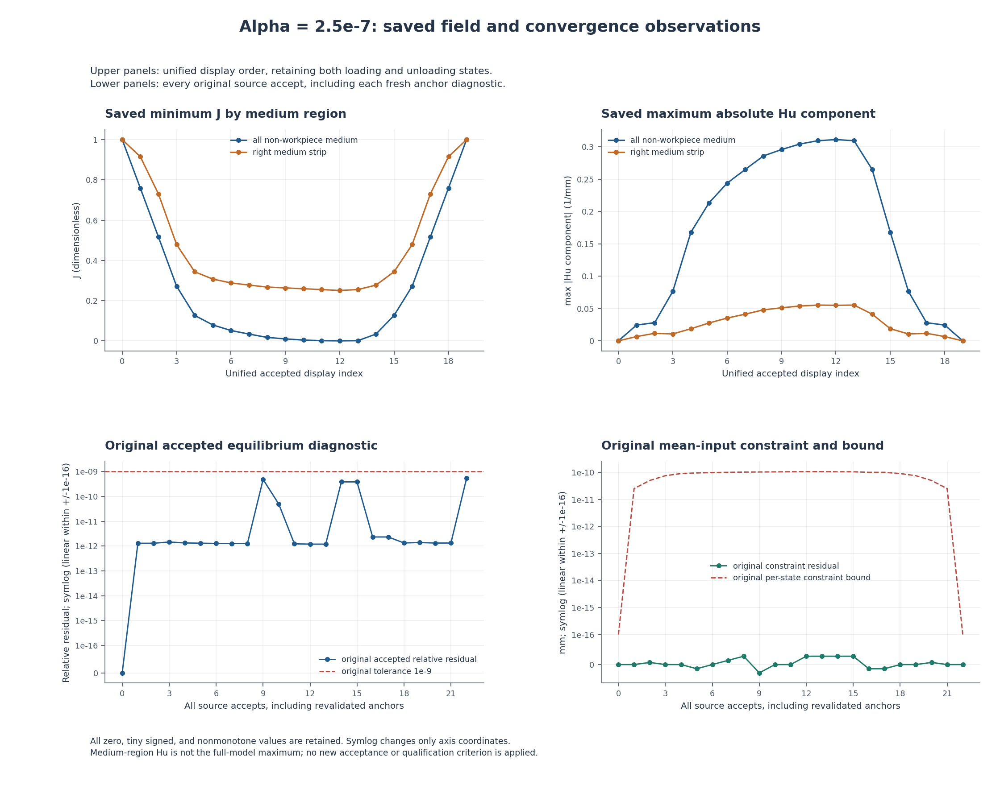

# alpha=2.5e-7 尖端对向圆形工件：已有加载与卸载路径人工检查页

本页关联ALPHA1与AUNLOAD1–3共4段普通标量记录；各段来自原独立窗口，不构成一次新的从零完整周期求解。
布置保持半径9 mm、圆心(80,40) mm、右域界92 mm、正则化长度80 mm、alpha=2.5e-7；原物理条件、数值门和来源资格保持。

原来源接受行 **23**，统一展示行 **20**，合并相邻重复锚 **3**，同位移对照 **7**。

仅相邻子段边界锚的原状态标量和SHA逐位一致时合并展示；不一致则保留两行并记录差异，不新增科学相等门。每份原始行、fresh anchor收敛诊断、来源及计算计数均保留；不按输入位移去重。
display branch仅用于绘图；raw leg保留原origin、loading、resume_origin或unloading，不能用显示分支改写原来源。

## 加载与卸载的实际保存标量



实线为加载显示分支，虚线为卸载显示分支。虚线为显示连续性复用原转折点；该操作不新增状态或同位移对照。连线只连接原采样点，不插值。
q_out为加权输出端口位移，不是间隙。工件material／Hu／total Fx/Fy均为固定工件下半部的有符号弱式合力，不作镜像倍增，不等同局部压力或合格夹持力。
tip与全Q1边界距离均无符号，基于保存的离散边界；不能当作解析圆间隙或接触／释放证明。

| 展示行 | 显示分支 | 原leg（按来源） | d mm | R N | q_out mm | 工件总Fy N | 尖端距离 mm | 全Q1最小距 mm | 来源 |
|---:|---|---|---:|---:|---:|---:|---:|---:|---|
| 0 | origin | origin | 0 | 0 | 0 | 0 | 1 | 1 | ALPHA1:0 |
| 1 | loading | loading | 0.25 | 0.04270302951 | 0.2402840314 | 0.0001144365238 | 0.7597841898 | 0.7597841898 | ALPHA1:1 |
| 2 | loading | loading | 0.5 | 0.08589635225 | 0.4812489495 | 0.0003715548447 | 0.5190339178 | 0.5190339178 | ALPHA1:2 |
| 3 | loading | loading | 0.75 | 0.1299041229 | 0.7219888733 | 0.001082303669 | 0.2787223044 | 0.2787223044 | ALPHA1:3 |
| 4 | loading | loading | 0.9 | 0.1572657995 | 0.864799784 | 0.002286408926 | 0.1363703264 | 0.1363703264 | ALPHA1:4 |
| 5 | loading | loading | 0.95 | 0.1668358233 | 0.9113664787 | 0.003114097177 | 0.09002701964 | 0.09002701964 | ALPHA1:5 |
| 6 | loading | loading | 0.98 | 0.1728472462 | 0.9386345263 | 0.003880575476 | 0.06292596345 | 0.06292596345 | ALPHA1:6 |
| 7 | loading | loading | 1 | 0.1770757768 | 0.9562482374 | 0.004616547361 | 0.04544781489 | 0.04544781489 | ALPHA1:7 |
| 8 | loading | loading | 1.02 | 0.1816596303 | 0.9729398073 | 0.005716447774 | 0.02893027134 | 0.02893027134 | ALPHA1:8 |
| 9 | loading | loading | 1.03 | 0.1842130357 | 0.9806006365 | 0.006534067673 | 0.02138693542 | 0.02138693542 | ALPHA1:9 |
| 10 | loading | loading | 1.04 | 0.1871262218 | 0.9873110887 | 0.007718195064 | 0.01484309189 | 0.01484309189 | ALPHA1:10 |
| 11 | loading | loading | 1.05 | 0.1907582536 | 0.9921056958 | 0.009628058929 | 0.01033670601 | 0.01033670601 | ALPHA1:11 |
| 12 | loading | loading; resume_origin | 1.06 | 0.1952230415 | 0.9946672298 | 0.01237252461 | 0.008227522523 | 0.008227522523 | ALPHA1:12; AUNLOAD1:0 |
| 13 | unloading | unloading; resume_origin | 1.05 | 0.1907582536 | 0.9921056958 | 0.009628058927 | 0.01033670601 | 0.01033670601 | AUNLOAD1:1; AUNLOAD2:0 |
| 14 | unloading | unloading; resume_origin | 1 | 0.1770757768 | 0.9562482374 | 0.004616547361 | 0.04544781489 | 0.04544781489 | AUNLOAD2:1; AUNLOAD3:0 |
| 15 | unloading | unloading | 0.9 | 0.1572657995 | 0.864799784 | 0.002286408926 | 0.1363703264 | 0.1363703264 | AUNLOAD3:1 |
| 16 | unloading | unloading | 0.75 | 0.1299041229 | 0.7219888733 | 0.001082303669 | 0.2787223044 | 0.2787223044 | AUNLOAD3:2 |
| 17 | unloading | unloading | 0.5 | 0.08589635225 | 0.4812489495 | 0.0003715548447 | 0.5190339178 | 0.5190339178 | AUNLOAD3:3 |
| 18 | unloading | unloading | 0.25 | 0.04270302951 | 0.2402840314 | 0.0001144365238 | 0.7597841898 | 0.7597841898 | AUNLOAD3:4 |
| 19 | unloading | unloading | 0 | 1.058209572e-25 | -8.729597886e-25 | -1.412553001e-28 | 1 | 1 | AUNLOAD3:5 |

## 原场与收敛观察



上排横轴为统一展示序号；下排横轴为全部来源接受行号，包含每次续算重新核对的锚。两种序号不能互换。
上排分别展示全非工件介质与右条带原minimum J和max|Hu component|；不把介质区Hu与全模型最大Hu混列，也不要求其相等。
下排保留各来源原relative residual、constraint residual及原逐态constraint bound；原残差门为1e-9。symlog的±1e-16仅为坐标显示的线性区，不是截断、数值地板或新门。零值、微小负值及非单调值保持原值。
下表保留每段原计数与原异常／拒绝历史的完整JSON链接；统一展示不扣除重复锚的实际计算工作。

| 原段 | 原计数（不扣重复锚） | 原summary | 原收敛记录 | 原人工页 |
|---|---|---|---|---|
| ALPHA1 | accepted_states=13; newton_base_checks=70; inferred_check_groups=13; line_search_trials=59; line_search_accepted=57; line_search_rejected=2; failed_attempts=0; linear_solves=69; maximum_bisection_depth=0; zero_newton_residuals=1 | [summary](<../../lf_circle_tip_alpha_001/run_001/view/wave_circle_tip_alpha1/summary.json>) | [convergence](<../../lf_circle_tip_alpha_001/run_001/convergence/convergence.json>) | [人工页](<../../lf_circle_tip_alpha_001/run_001/REVIEW.md>) |
| AUNLOAD1 | accepted_states=2; newton_base_checks=7; inferred_check_groups=2; line_search_trials=5; line_search_accepted=5; line_search_rejected=0; failed_attempts=0; linear_solves=6; maximum_bisection_depth=0; zero_newton_residuals=0 | [summary](<../../lf_circle_tip_alpha_unload_001/run_001/view/wave_circle_tip_alpha_unload1/summary.json>) | [convergence](<../../lf_circle_tip_alpha_unload_001/run_001/convergence/convergence.json>) | [人工页](<../../lf_circle_tip_alpha_unload_001/run_001/REVIEW.md>) |
| AUNLOAD2 | accepted_states=2; newton_base_checks=7; inferred_check_groups=2; line_search_trials=5; line_search_accepted=5; line_search_rejected=0; failed_attempts=0; linear_solves=6; maximum_bisection_depth=0; zero_newton_residuals=0 | [summary](<../../lf_circle_tip_alpha_unload_002/run_001/view/wave_circle_tip_alpha_unload2/summary.json>) | [convergence](<../../lf_circle_tip_alpha_unload_002/run_001/convergence/convergence.json>) | [人工页](<../../lf_circle_tip_alpha_unload_002/run_001/REVIEW.md>) |
| AUNLOAD3 | accepted_states=6; newton_base_checks=38; inferred_check_groups=6; line_search_trials=36; line_search_accepted=32; line_search_rejected=4; failed_attempts=0; linear_solves=37; maximum_bisection_depth=0; zero_newton_residuals=0 | [summary](<../../lf_circle_tip_alpha_unload_003/run_001/view/wave_circle_tip_alpha_unload3/summary.json>) | [convergence](<../../lf_circle_tip_alpha_unload_003/run_001/convergence/convergence.json>) | [人工页](<../../lf_circle_tip_alpha_unload_003/run_001/REVIEW.md>) |

原4段计数汇总（计数求和、最大深度取原最大值，不扣重复锚）：

```json
{
  "accepted_states": 23,
  "newton_base_checks": 122,
  "inferred_check_groups": 23,
  "line_search_trials": 105,
  "line_search_accepted": 99,
  "line_search_rejected": 6,
  "failed_attempts": 0,
  "linear_solves": 118,
  "maximum_bisection_depth": 0,
  "zero_newton_residuals": 1
}
```

原拒绝／失败历史摘录（保留原值及来源；不改变原判定）：

```json
[
  {
    "segment": "ALPHA1",
    "kind": "rejected_internal_trial",
    "source_index": 46,
    "record": {
      "target_displacement": 1.05,
      "stage_parameter": 1.05,
      "newton_check": 1,
      "factor": 1.0,
      "fixed_residual_scale": 0.8496531184188164,
      "base_phi": 0.42593501504171366,
      "accepted": false,
      "reason": "invalid_J"
    }
  },
  {
    "segment": "ALPHA1",
    "kind": "rejected_internal_trial",
    "source_index": 53,
    "record": {
      "target_displacement": 1.06,
      "stage_parameter": 1.06,
      "newton_check": 1,
      "factor": 1.0,
      "fixed_residual_scale": 0.8510026407541244,
      "base_phi": 0.4243110675991266,
      "accepted": false,
      "reason": "invalid_J"
    }
  },
  {
    "segment": "AUNLOAD3",
    "kind": "rejected_internal_trial",
    "source_index": 28,
    "record": {
      "target_displacement": 0.0,
      "stage_parameter": 0.0,
      "newton_check": 7,
      "factor": 1.0,
      "fixed_residual_scale": 1.9999999999999998e-13,
      "base_phi": 3.7356995666178444e-17,
      "accepted": false,
      "reason": "unsupported_arithmetic_range"
    }
  },
  {
    "segment": "AUNLOAD3",
    "kind": "rejected_internal_trial",
    "source_index": 30,
    "record": {
      "target_displacement": 0.0,
      "stage_parameter": 0.0,
      "newton_check": 8,
      "factor": 1.0,
      "fixed_residual_scale": 1.9999999999999998e-13,
      "base_phi": 9.33924891654457e-18,
      "accepted": false,
      "reason": "unsupported_arithmetic_range"
    }
  },
  {
    "segment": "AUNLOAD3",
    "kind": "rejected_internal_trial",
    "source_index": 32,
    "record": {
      "target_displacement": 0.0,
      "stage_parameter": 0.0,
      "newton_check": 9,
      "factor": 1.0,
      "fixed_residual_scale": 1.9999999999999998e-13,
      "base_phi": 2.334812229136135e-18,
      "accepted": false,
      "reason": "unsupported_arithmetic_range"
    }
  },
  {
    "segment": "AUNLOAD3",
    "kind": "rejected_internal_trial",
    "source_index": 34,
    "record": {
      "target_displacement": 0.0,
      "stage_parameter": 0.0,
      "newton_check": 10,
      "factor": 1.0,
      "fixed_residual_scale": 1.9999999999999998e-13,
      "base_phi": 5.837030572840342e-19,
      "accepted": false,
      "reason": "unsupported_arithmetic_range"
    }
  }
]
```

## 同输入的原值与差值

仅对已有原目标进行同输入配对，每对保留原13项标量；其余原37项观察仍完整保存在统一响应。二分态和重新核验的锚不新增配对；不插值，不引入相等性、恢复率、零残力、滞回能量或稳定性门。
下表差值定义为unloading − loading/origin参考。初始零态的对照来源若为origin，其raw leg仍为origin，不伪造loading。配对表用17位有效数字显示原值与差值，曲线重叠不代表绝对相等或无滞回。

### d = 1.05 mm

展示行 11 → 13；raw leg：loading → unloading。

原对照角色：`loading`。

| 原指标 | loading/origin参考原值 | unloading原值 | unloading−参考 |
|---|---:|---:|---:|
| `R_input_N` | 0.19075825359469525 | 0.19075825359298318 | -1.7120749262744539e-12 |
| `q_out_mm` | 0.9921056957589891 | 0.99210569576363417 | 4.6450621127291924e-12 |
| `total_body_Fx_N` | -0.00018352043949440545 | -0.00018352043940309299 | 9.1312455643630108e-14 |
| `total_body_Fy_N` | 0.009628058928900415 | 0.0096280589272314532 | -1.6689618437260023e-12 |
| `material_body_Fx_N` | -3.4085461534452708e-05 | -3.408546150011013e-05 | 3.4342578151928815e-14 |
| `material_body_Fy_N` | 0.0066200047470112728 | 0.0066200047453297342 | -1.6815385889268342e-12 |
| `regularization_body_Fx_N` | -0.00014943497795995276 | -0.00014943497790298284 | 5.6969918149282761e-14 |
| `regularization_body_Fy_N` | 0.0030080541818891435 | 0.003008054181901719 | 1.2575444158224869e-14 |
| `tip_to_raster_boundary_mm` | 0.010336706011031538 | 0.010336706005979579 | -5.0519588512543123e-12 |
| `minimum_boundary_distance_mm` | 0.010336706011031538 | 0.010336706005979579 | -5.0519588512543123e-12 |
| `solid_min_J` | 0.97526677347295354 | 0.97526677347284518 | -1.0835776720341528e-13 |
| `medium_min_J` | 0.0012518161407227715 | 0.0012518161249492532 | -1.5773518342171444e-11 |
| `medium_max_abs_Hu_per_mm` | 0.30936747070236725 | 0.30936747071244913 | 1.0081879775469815e-11 |

### d = 1 mm

展示行 7 → 14；raw leg：loading → unloading。

原对照角色：`loading`。

| 原指标 | loading/origin参考原值 | unloading原值 | unloading−参考 |
|---|---:|---:|---:|
| `R_input_N` | 0.17707577676018202 | 0.17707577676004574 | -1.3627987627273797e-13 |
| `q_out_mm` | 0.95624823741432941 | 0.9562482374146859 | 3.5649261320713777e-13 |
| `total_body_Fx_N` | -0.00013020603155553556 | -0.00013020603155367824 | 1.8573196366306055e-15 |
| `total_body_Fy_N` | 0.0046165473611738273 | 0.0046165473610842583 | -8.9568977235110481e-14 |
| `material_body_Fx_N` | -1.0902818474871831e-05 | -1.0902818474842109e-05 | 2.9722386119153399e-17 |
| `material_body_Fy_N` | 0.0021412390748060364 | 0.0021412390747421639 | -6.3872518385466037e-14 |
| `regularization_body_Fx_N` | -0.00011930321308066369 | -0.00011930321307883612 | 1.8275718395230345e-15 |
| `regularization_body_Fy_N` | 0.0024753082863677909 | 0.0024753082863420953 | -2.5695591487906455e-14 |
| `tip_to_raster_boundary_mm` | 0.045447814889897131 | 0.045447814889531202 | -3.659295089164516e-13 |
| `minimum_boundary_distance_mm` | 0.045447814889897131 | 0.045447814889531202 | -3.659295089164516e-13 |
| `solid_min_J` | 0.97616687151805714 | 0.97616687151804882 | -8.3266726846886741e-15 |
| `medium_min_J` | 0.034002852813944766 | 0.034002852811436862 | -2.5079036070074778e-12 |
| `medium_max_abs_Hu_per_mm` | 0.2649079814832529 | 0.26490798148014116 | -3.1117330934193888e-12 |

### d = 0.9 mm

展示行 4 → 15；raw leg：loading → unloading。

原对照角色：`loading`。

| 原指标 | loading/origin参考原值 | unloading原值 | unloading−参考 |
|---|---:|---:|---:|
| `R_input_N` | 0.15726579952202099 | 0.15726579952202097 | -2.7755575615628914e-17 |
| `q_out_mm` | 0.86479978403901958 | 0.86479978403901947 | -1.1102230246251565e-16 |
| `total_body_Fx_N` | -0.00011474668072675752 | -0.00011474668072675177 | 5.7462715141731735e-18 |
| `total_body_Fy_N` | 0.0022864089259866764 | 0.0022864089259866795 | 3.0357660829594124e-18 |
| `material_body_Fx_N` | -1.008637962736555e-05 | -1.0086379627365552e-05 | -1.6940658945086007e-21 |
| `material_body_Fy_N` | 0.00074327387672729875 | 0.00074327387672729821 | -5.4210108624275222e-19 |
| `regularization_body_Fx_N` | -0.00010466030109939196 | -0.00010466030109938621 | 5.7598240413292423e-18 |
| `regularization_body_Fy_N` | 0.001543135049259378 | 0.0015431350492593817 | 3.6862873864507151e-18 |
| `tip_to_raster_boundary_mm` | 0.13637032635930524 | 0.13637032635930524 | 0 |
| `minimum_boundary_distance_mm` | 0.13637032635930524 | 0.13637032635930524 | 0 |
| `solid_min_J` | 0.97842958300418115 | 0.97842958300418115 | 0 |
| `medium_min_J` | 0.12668338289325537 | 0.12668338289325551 | 1.3877787807814457e-16 |
| `medium_max_abs_Hu_per_mm` | 0.16791027506116954 | 0.16791027506116951 | -2.7755575615628914e-17 |

### d = 0.75 mm

展示行 3 → 16；raw leg：loading → unloading。

原对照角色：`loading`。

| 原指标 | loading/origin参考原值 | unloading原值 | unloading−参考 |
|---|---:|---:|---:|
| `R_input_N` | 0.1299041229266539 | 0.12990412292665401 | 1.1102230246251565e-16 |
| `q_out_mm` | 0.7219888733048393 | 0.72198887330483918 | -1.1102230246251565e-16 |
| `total_body_Fx_N` | -7.9373966417362545e-05 | -7.9373966417361935e-05 | 6.0986372202309624e-19 |
| `total_body_Fy_N` | 0.0010823036691811453 | 0.0010823036691811443 | -1.0842021724855044e-18 |
| `material_body_Fx_N` | -8.0820528292172309e-06 | -8.082052829217219e-06 | 1.1858461261560205e-20 |
| `material_body_Fy_N` | 0.00029657737189436222 | 0.000296577371894362 | -2.1684043449710089e-19 |
| `regularization_body_Fx_N` | -7.1291913588145326e-05 | -7.1291913588144716e-05 | 6.0986372202309624e-19 |
| `regularization_body_Fy_N` | 0.00078572629728678269 | 0.00078572629728678226 | -4.3368086899420177e-19 |
| `tip_to_raster_boundary_mm` | 0.27872230441997559 | 0.27872230441997559 | 0 |
| `minimum_boundary_distance_mm` | 0.27872230441997559 | 0.27872230441997559 | 0 |
| `solid_min_J` | 0.98196374259453767 | 0.98196374259453767 | 0 |
| `medium_min_J` | 0.27190851732428606 | 0.27190851732428617 | 1.1102230246251565e-16 |
| `medium_max_abs_Hu_per_mm` | 0.076488824675017081 | 0.076488824675017025 | -5.5511151231257827e-17 |

### d = 0.5 mm

展示行 2 → 17；raw leg：loading → unloading。

原对照角色：`loading`。

| 原指标 | loading/origin参考原值 | unloading原值 | unloading−参考 |
|---|---:|---:|---:|
| `R_input_N` | 0.085896352253893374 | 0.085896352253893415 | 4.163336342344337e-17 |
| `q_out_mm` | 0.48124894952283942 | 0.48124894952283948 | 5.5511151231257827e-17 |
| `total_body_Fx_N` | -3.6864211336580219e-05 | -3.6864211336580212e-05 | 6.7762635780344027e-21 |
| `total_body_Fy_N` | 0.00037155484472476796 | 0.00037155484472476828 | 3.2526065174565133e-19 |
| `material_body_Fx_N` | -4.8714551250185208e-06 | -4.8714551250185242e-06 | -3.3881317890172014e-21 |
| `material_body_Fy_N` | 0.00010261532023809275 | 0.00010261532023809276 | 1.3552527156068805e-20 |
| `regularization_body_Fx_N` | -3.1992756211561687e-05 | -3.1992756211561687e-05 | 0 |
| `regularization_body_Fy_N` | 0.00026893952448667522 | 0.00026893952448667555 | 3.2526065174565133e-19 |
| `tip_to_raster_boundary_mm` | 0.51903391779978492 | 0.51903391779978492 | 0 |
| `minimum_boundary_distance_mm` | 0.51903391779978492 | 0.51903391779978492 | 0 |
| `solid_min_J` | 0.98794408497095443 | 0.98794408497095443 | 0 |
| `medium_min_J` | 0.51592090426301418 | 0.51592090426301407 | -1.1102230246251565e-16 |
| `medium_max_abs_Hu_per_mm` | 0.02802167414492851 | 0.028021674144928732 | 2.2204460492503131e-16 |

### d = 0.25 mm

展示行 1 → 18；raw leg：loading → unloading。

原对照角色：`loading`。

| 原指标 | loading/origin参考原值 | unloading原值 | unloading−参考 |
|---|---:|---:|---:|
| `R_input_N` | 0.042703029514548872 | 0.042703029514548865 | -6.9388939039072284e-18 |
| `q_out_mm` | 0.24028403137527443 | 0.24028403137527438 | -5.5511151231257827e-17 |
| `total_body_Fx_N` | -1.3542534375582008e-05 | -1.3542534375581986e-05 | 2.2022856628611809e-20 |
| `total_body_Fy_N` | 0.00011443652383110057 | 0.00011443652383110066 | 9.4867690092481638e-20 |
| `material_body_Fx_N` | -2.1739597087172347e-06 | -2.1739597087172343e-06 | 4.2351647362715017e-22 |
| `material_body_Fy_N` | 3.52269806505838e-05 | 3.52269806505838e-05 | 0 |
| `regularization_body_Fx_N` | -1.1368574666864771e-05 | -1.1368574666864749e-05 | 2.2022856628611809e-20 |
| `regularization_body_Fy_N` | 7.9209543180516767e-05 | 7.9209543180516848e-05 | 8.1315162936412833e-20 |
| `tip_to_raster_boundary_mm` | 0.75978418980757567 | 0.75978418980757567 | 0 |
| `minimum_boundary_distance_mm` | 0.75978418980757567 | 0.75978418980757567 | 0 |
| `solid_min_J` | 0.9939635081208108 | 0.99396350812081091 | 1.1102230246251565e-16 |
| `medium_min_J` | 0.75885553908850401 | 0.75885553908850412 | 1.1102230246251565e-16 |
| `medium_max_abs_Hu_per_mm` | 0.024391444893737291 | 0.024391444893737291 | 0 |

### d = 0 mm

展示行 0 → 19；raw leg：origin → unloading。

原对照角色：`original_origin`。

| 原指标 | loading/origin参考原值 | unloading原值 | unloading−参考 |
|---|---:|---:|---:|
| `R_input_N` | 0 | 1.0582095724475673e-25 | 1.0582095724475673e-25 |
| `q_out_mm` | 0 | -8.7295978857848199e-25 | -8.7295978857848199e-25 |
| `total_body_Fx_N` | 0 | 1.0561453539371488e-29 | 1.0561453539371488e-29 |
| `total_body_Fy_N` | 0 | -1.4125530006499791e-28 | -1.4125530006499791e-28 |
| `material_body_Fx_N` | 0 | 7.0377674779068975e-30 | 7.0377674779068975e-30 |
| `material_body_Fy_N` | 0 | -7.8179041316438821e-29 | -7.8179041316438821e-29 |
| `regularization_body_Fx_N` | 0 | 3.5236860614645793e-30 | 3.5236860614645793e-30 |
| `regularization_body_Fy_N` | 0 | -6.3076258748559097e-29 | -6.3076258748559097e-29 |
| `tip_to_raster_boundary_mm` | 1 | 1 | 0 |
| `minimum_boundary_distance_mm` | 1 | 1 | 0 |
| `solid_min_J` | 1 | 1 | 0 |
| `medium_min_J` | 1 | 1 | 0 |
| `medium_max_abs_Hu_per_mm` | 0 | 1.0265541622900635e-24 | 1.0265541622900635e-24 |

## 4段既有实际变形动画

以下仅提供已有GIF链接。程序只依据既有声明核对文件大小，不打开、解码、抽帧、复制、重哈希或拼接旧媒体。动画仍属于各自原段，不伪装成一次完整新路径动画。
原图／动画的×1实际变形及其原箭头尺度保持。原图的可见性限制与QA记录保留，本轮不修补已关闭窗口的旧图。

| 原段 | 既有动画 | stat大小 bytes |
|---|---|---:|
| ALPHA1 | [原实际变形GIF](<../../lf_circle_tip_alpha_001/run_001/view/wave_circle_tip_alpha1/actual_states.gif>) | 1872263 |
| AUNLOAD1 | [原实际变形GIF](<../../lf_circle_tip_alpha_unload_001/run_001/view/wave_circle_tip_alpha_unload1/actual_states.gif>) | 306232 |
| AUNLOAD2 | [原实际变形GIF](<../../lf_circle_tip_alpha_unload_002/run_001/view/wave_circle_tip_alpha_unload2/actual_states.gif>) | 304982 |
| AUNLOAD3 | [原实际变形GIF](<../../lf_circle_tip_alpha_unload_003/run_001/view/wave_circle_tip_alpha_unload3/actual_states.gif>) | 809609 |

## 原单峰独立参考

[AREF1原独立参考记录](<../../lf_circle_tip_alpha_reference_001/RESULTS.md>)仅覆盖当前alpha的原加载1.06 mm／global12单态及原PORT方向；本页不读取其科学输出，也不迁移为卸载或全路径资格。

## 本轮边界与后续判断

只新增两张普通标量图及关联记录，不新增构模、F/T、HP、平衡求解、测试、物理目标、默认HF源码或API关联。
输入回程到零和跨子段统一展示，不授整条路径独立参考、压力、有效夹持、自由释放、稳定性、网格／域宽或HF5资格。原成功、失败、视觉QA和参考历史均保持。
原记录保留的极小残余值不会截为零；图中接近零或曲线重合不新增归零／恢复结论。本轮不进行旧alpha与新alpha的跨参数比较；下一步应依据实际汇总结果单独记录和规划。

### 原数据范围说明

Existing alpha2.5e-7 saved ordinary observations only. Chronological display across four separately solved segments is not one complete solve or full-path independent reference. Original origin/resume_origin/loading/unloading legs and all source accepts/diagnostics are retained. Signed lower-body weak forces are not circular local pressure or qualified effective grip; q_out is a weighted port displacement, not a gap; Q1 distances are unsigned raster-boundary diagnostics, not analytic-circle signed gaps. No new force/tangent/HP/equilibrium/tests/default changes/API association, zero/recovery/energy/stability criterion or qualification. Whole-model Hu is not available in these inputs and is not inferred from medium Hu.
