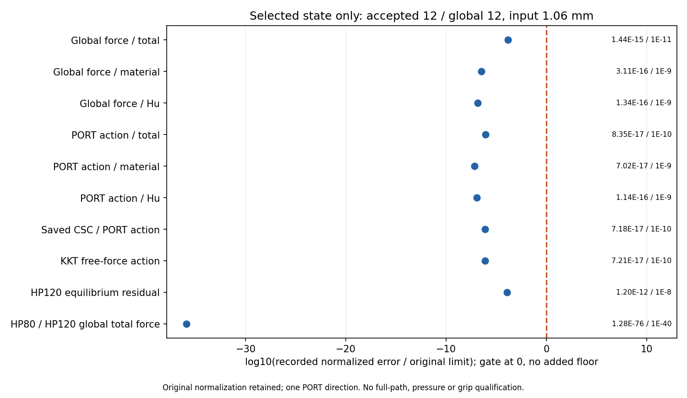

# L-CTIPAREF1：新α=2.5e-7圆形尖端布置1.06 mm保存态独立参考

2026-10-20准备（Asia/Seoul）；唯一执行 **PASS**；图像QA **pass_root_visual_inspection**；阶段完成 `True`。实际UTC时间保留在原执行凭证及闭卡JSON。

outer `pass`、helper `pass`、summary `pass`、lifecycle `pass`。main基线 `9bed9811a34befdda01bd37a49796e89a5bd0255`；science 0.5.0／b1334保持。执行、数值检查与实际像素检查分别记录，不由生成意图或旧QA代替本卡图像效果。

整体目标是普通LF几何进入独立HF的TMC前向分析，逐步形成可比较的非线性响应和工件作用指标。前序ALPHA1仅将α由5e-7降至2.5e-7，从零完成13个加载目标，保存实际变形、力、距离、介质与收敛，并与原α作同输入描述性对照。本轮为新α峰值取得其自身独立参考；旧α的HP不能迁移给新α，也不重做生产平衡。

批准对象为ALPHA1接受行12／全局目标12／loading1.06 mm，state SHA `e71c06973b7dc7aff7e5ee4a801b595cb3f054e907cc6e1ad52188e858500a68`。源生产共有13态，本卡仅选峰值1态、HP80/120各一次。保持r9 mm、圆心(80,40) mm、right92 mm、Lr80 mm及α=2.5e-7；完整14720单元／29970DOF（固定1288、自由28682），材料、第三介质、网格、边界、端口、设置及原验收门保持。实际完成范围由回执给出，缺失记录不视作已完成。

HP启动/完成 `2`／`2`；完成力学态 `1`、工件投影态 `1`、检查 `88464`，绘图启动/完成 `1`／`1`。

原十五门：`{'production_residual': '1e-9', 'independent_residual': '1e-8', 'force_evaluation': '1e-9', 'average_constraint': '1e-10', 'global_force_balance': '1e-6', 'fixed_displacement_mm': '8e-11', 'hp80_hp120': '1e-40', 'total_force': '1e-11', 'material_force': '1e-9', 'regularization_force': '1e-9', 'total_tangent': '1e-10', 'material_tangent': '1e-9', 'regularization_tangent': '1e-9', 'augmented_force_tangent': '1e-10', 'augmented_constraint_tangent': '1e-10'}`。比较材料/Hu/总局部力与全局力、同一固定兼容PORT方向切线、完整CSC系数组装身份及方向作用、KKT力/均值作用、约束/残差/整体平衡和有符号工件/holding投影。只检查这一方向；独立解析能量仅归档，不授候选应力或能量资格。

|观察项|原归一化误差|原门|通过|
|---|---:|---:|---|
|Global force / total|1.43732709875309290230084157981751078101562876488764731841165841672604577162741465674340569952614639768818780491147187545E-15|1E-11|True|
|Global force / material|3.11213624370864820098575699991554661915028242751872534399038945859361186754803453470778005095501533064080147853807090192E-16|1E-9|True|
|Global force / Hu|1.34074616721658889786745282332830714217542547906933286668807775253135204508886867986414633271156491645680811473960902668E-16|1E-9|True|
|PORT action / total|8.34932880385786882445269480710106648756393564946546184764977552228628320873014844592799685411778319855790410905382666040E-17|1E-10|True|
|PORT action / material|7.01763999525273765817006193645065648075754065880708104409124093242040020521625918229996060445928033589521686970566724431E-17|1E-9|True|
|PORT action / Hu|1.14315392647402445921322700090398327084280617488480184819721085241432330970295541625835080709455421372465550741208098810E-16|1E-9|True|
|Saved CSC / PORT action|7.18223786442401655110487719120765954566270233939818216900925462499274263404149572472049410602894552470345714841889040013E-17|1E-10|True|
|KKT free-force action|7.21378465724839340522630143522251156684620870014283806862371831299472203169063231618942647218191955637347915915037207939E-17|1E-10|True|
|HP120 equilibrium residual|1.19748307482185911147916646945774297138396344630642796111456086206457234596005222139869882803988083167166982165666381174E-12|1e-8|True|
|HP80 / HP120 global total force|1.27834530469670871021771993902934060905618041591562746079833466955129310244086348418623521701942716605626152387647678263E-76|1E-40|True|

新alpha2.5e-7的真实1.06 mm峰值现已完成自身HP80/120参考，原15门全部通过；总力归一化误差1.4373270987530929e-15、总PORT方向作用误差8.349328803857869e-17、HP120独立平衡残差1.197483074821859e-12，原J/F/Hu舍入诊断精确一致。没有修复力核或放宽原门的依据。下一功能应检验该参数下首次卸载，而非继续加位移、降低alpha或重复同态HP。仍只具有这一态和原PORT方向的参考资格；参数独立性、压力、有效夹持、自由释放和稳定性均未因此获得。

仅在全部原门PASS后允许生成十项误差图，实际生成与否见回执；零误差不加地板、不改变原分母或阈值。十一份原独立参考依赖保持字节；误差绘图只薄改两处新α／accepted12身份，原条目、数学、分母、门、坐标和布局保持。逐元素/全局差值及工件核查若已产生，保持在原窗口封存gzip；闭卡不重开载荷、切线、矩阵、科学gzip或媒体。工件Fx/Fy是含材料与Hu的有符号弱式合力；legacy normal_force为全局Fy，2absFy也不是圆周局部压力或有效夹持力。

实际审阅 `pass_finite_actual_review`；像素记录 `{'card': 'L-CTIPAREF1', 'status': 'pass_root_visual_inspection', 'inspections': 1, 'created_utc': '2026-10-20T11:31:51.327998+00:00', 'media': [{'path': 'lf_data_preparation/native_interface_001/lf_circle_tip_alpha_reference_001/run_001/reference/reference_observations.png', 'inspections': 1, 'detail': 'original'}], 'observations': {'reference_observations.png': 'Root inspected the one new PNG once at original resolution after terminal success. Title truthfully shows accepted12/global12/input1.06. All10 original error/limit entries, markers, numerical annotations and axis/footer are readable and separate; all markers lie left of original gate at0. HP80/120 log ratio near-35.89 is visible without clipping or added floor. One PORT direction and no full-path/pressure/grip qualification are explicit; this QA does not validate every matrix column or physical pressure.'}, 'image_regenerations': 0, 'old_media_opened': 0, 'old_media_hashed': 0, 'GIF_decodes': 0, 'new_scientific_payload_reads': 0, 'inspection_scope': 'Exactly one original-resolution view_image of the new error PNG. Original producer seal inherited; no new scientific arrays, CSV, gzip or other media opened, decoded or hashed.'}`。原生产成功、失败历史及全部未完成资格保持；本卡通过只覆盖此保存态与同一PORT方向。

资源：helper `149.08341679998557` /900 s，outer `150.0207400000072` /960 s；采样进程树峰值 `1390661632` /8589934592 B；四库线程上限16。实际child wall `149.69830419999198` s、exit `0`、stop `未提供`。合作停止和采样记录不增加SUP2或硬抢占清理资格。

原窗口封存 30 份输出／93245033 B，状态 `complete_inside_original_helper_window`。helper错误 `未提供`；outer错误 `未提供`。首错后的实际partial如实保留；本卡未自动重试、修复重跑、延期或force。

本轮无新生产F/T、平衡求解、测试、默认安装或API关联。旧实际变形、力、收敛和局部定位只链接，不解码或重绘；不升级完整路径参考、接触压力、有效夹持、自由释放、稳定性、网格/域宽收敛或HF5资格。

审查入口：[参考summary](run_001/reference/summary.json) · [选定态summary](run_001/reference/accepted_012/summary.json) · [误差普通JSON](run_001/reference/reference_observations.json) · [lifecycle](run_001/reference/lifecycle.json) · [封存回执](run_001/reference/execution_receipt.json) · [outer](reference_launch.json) · [实际审阅](author/ACTUAL_REVIEW.md) · [闭卡JSON](author/closure.json)

既有新α实际效果：[ALPHA1实际变形、作用力与介质](../lf_circle_tip_alpha_001/RESULTS.md) · [原α／新α同输入对照](../lf_circle_tip_alpha_001/run_001/alpha_comparison/REVIEW.md)。上述旧六图及动画只通过原页面链接，不打开、重绘、重哈希或解码。

下一步：建议 L-CTIPAUNLOAD1：复用已安装load_only→ordered_cycle保存态接口，从新alpha=2.5e-7、已独立核验的1.06 mm峰值首次回程至1.05 mm，保原13目标前缀和其余task/metadata，仅改kind并追加1.05；保持原物理与验收门。controller1800/display600/helper2700/outer2760秒、64GiB16cap，原viewer8GiB；成功显示真实卸载末态的5PNG/实际N帧GIF及同新alpha加载1.05普通原值对照。先包装/有限静审，另获明确批准后唯一运行，本卡不执行。

恢复开发：origin保持https://github.com/dudaxing/Compliant-TO-TMC.git，后续在main。先读README、docs/CURRENT_STATUS.md和docs/RESUME_DEVELOPMENT.md，再读本卡RESULTS/NEXT_STEPS、protocol及授权。异路径恢复使用同机local Git对象fetch/ff-only，不是独立机器或远端对象下载验证。已关闭launcher不再执行。
