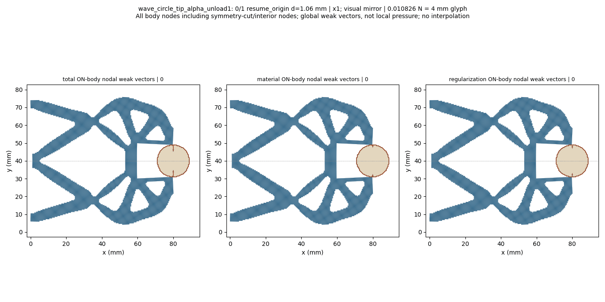
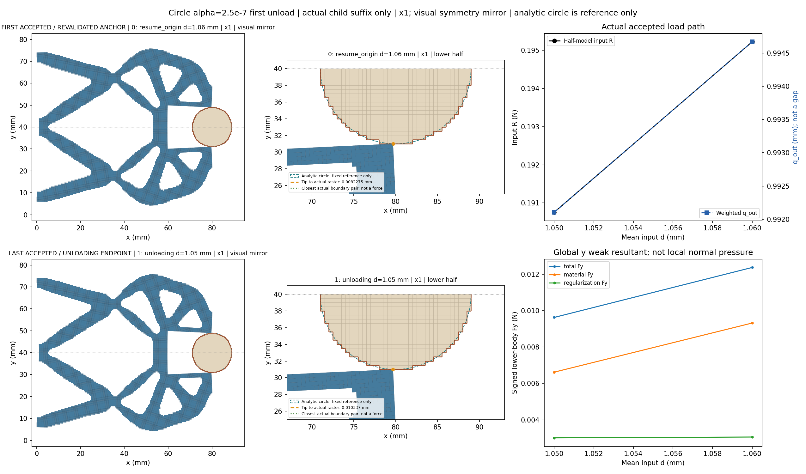
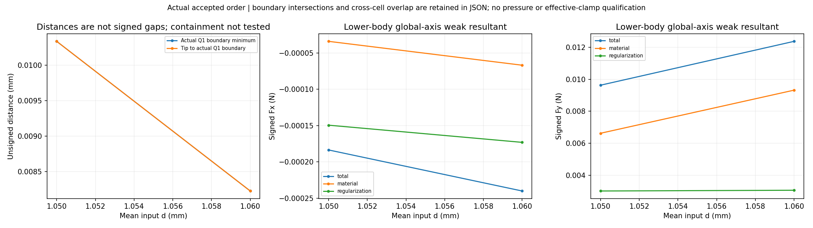
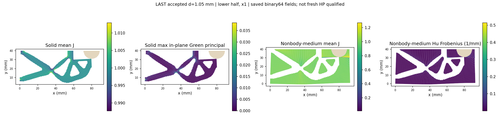
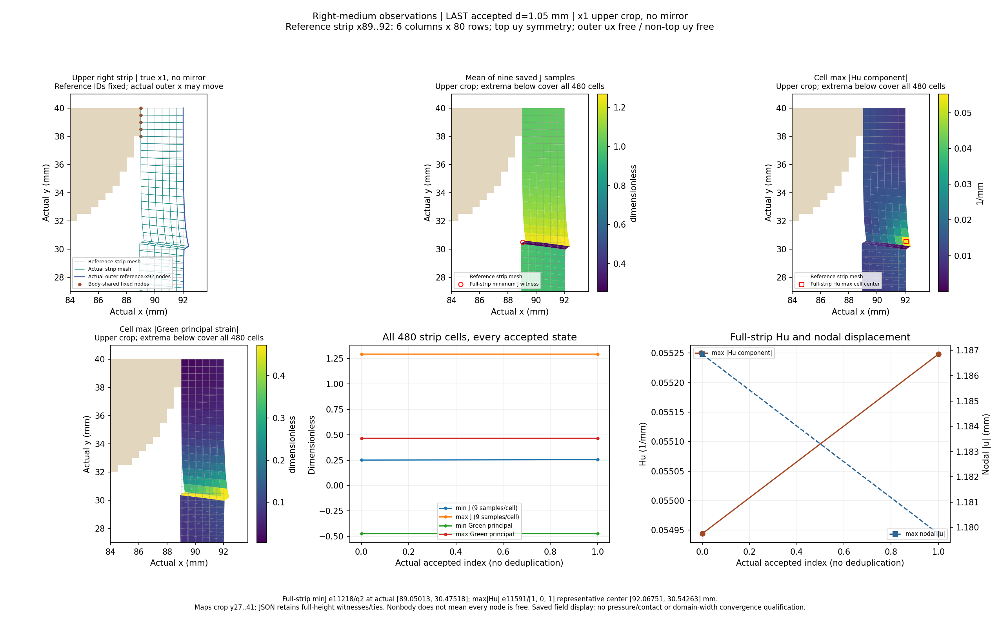
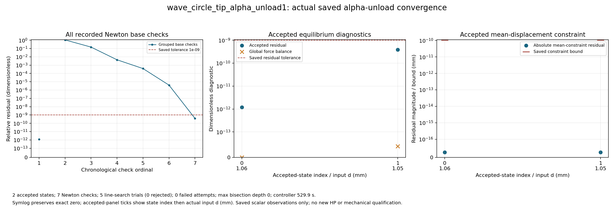

# Alpha2.5e-7 tip-facing circular workpiece first unload: review

At unchanged alpha2.5e-7, solved lower-half wave mechanism, fixed raster circle r9 at (80,40) mm, on the92x40mm reference domain with Lr80mm. Coordinates x1; full-structure views and GIF use a visual symmetry mirror, while numerical tables retain the original lower-half values. All actual accepted states are shown, including controller bisections.

The boundary distance is unsigned between exposed Q1 edges; boundary intersection/near-touch and region overlap are separate observations. Containment is not tested. Weak-form body total includes material and Hu contributions; it is not qualified contact pressure or effective grip. Right-medium observations use the dynamically selected resident reference cells x89..92 (six columns,480cells) and the actual displaced x92 boundary; the tip is selected by reference(80,30), not an old node ID. Observations reuse the resident saved arrays; no additional physics arrays or domain-width convergence claim. Only the inherited 1.06mm anchor is freshly revalidated before the first unloading target1.05mm; the complete0/.25/.5/.75/.9/.95/.98/1.00/1.02/1.03/1.04/1.05/1.06 loading prefix is not replayed. This child segment does not qualify a complete unload/cycle, release, stability, independent HP for this new unloading state or HF5 qualification. The prior new-alpha peak reference remains limited to its original selected peak; it does not transfer to the unloading state.

[Response](wave_circle_tip_alpha_unload1/response.json) · [Result](wave_circle_tip_alpha_unload1/result.json) · [Exact rows](state_table.json) · [Viewer summary](view/wave_circle_tip_alpha_unload1/summary.json) · [Convergence JSON](convergence/convergence.json)

|index|leg|d (mm)|R input (N)|q out (mm)|body Fy total (N)|minimum Q1 boundary distance (mm)|
|---:|---|---:|---:|---:|---:|---:|
|0|resume_origin|1.06|0.19522304147728387|0.9946672298032242|0.012372524610902783|0.008227522522737729|
|1|unloading|1.05|0.19075825359298318|0.9921056957636342|0.009628058927231453|0.010336706005979579|

Same-input1.05 mm: ALPHA1 row11/global11 is the original zero-start loading target, recorded leg loading; the new global13 row is unloading. The reference is not the old-alpha STEP10 revalidated anchor. Differences are descriptive only, with no equality gate or reversibility claim.

|metric|unit|loading source1.05|unloading1.05|unloading minus loading|
|---|---|---:|---:|---:|
|R_input_N|N|0.19075825359469525|0.19075825359298318|-1.712074926274454e-12|
|q_out_mm|mm|0.9921056957589891|0.9921056957636342|4.6450621127291924e-12|
|total_body_Fx_N|N|-0.00018352043949440545|-0.000183520439403093|9.131245564363011e-14|
|total_body_Fy_N|N|0.009628058928900415|0.009628058927231453|-1.6689618437260023e-12|
|material_body_Fx_N|N|-3.408546153445271e-05|-3.408546150011013e-05|3.4342578151928815e-14|
|material_body_Fy_N|N|0.006620004747011273|0.006620004745329734|-1.6815385889268342e-12|
|regularization_body_Fx_N|N|-0.00014943497795995276|-0.00014943497790298284|5.696991814928276e-14|
|regularization_body_Fy_N|N|0.0030080541818891435|0.003008054181901719|1.2575444158224869e-14|
|tip_to_raster_boundary_mm|mm|0.010336706011031538|0.010336706005979579|-5.051958851254312e-12|
|minimum_boundary_distance_mm|mm|0.010336706011031538|0.010336706005979579|-5.051958851254312e-12|
|solid_min_J|1|0.9752667734729535|0.9752667734728452|-1.0835776720341528e-13|
|medium_min_J|1|0.0012518161407227715|0.0012518161249492532|-1.5773518342171444e-11|
|medium_max_abs_Hu_per_mm|1/mm|0.30936747070236725|0.30936747071244913|1.0081879775469815e-11|
