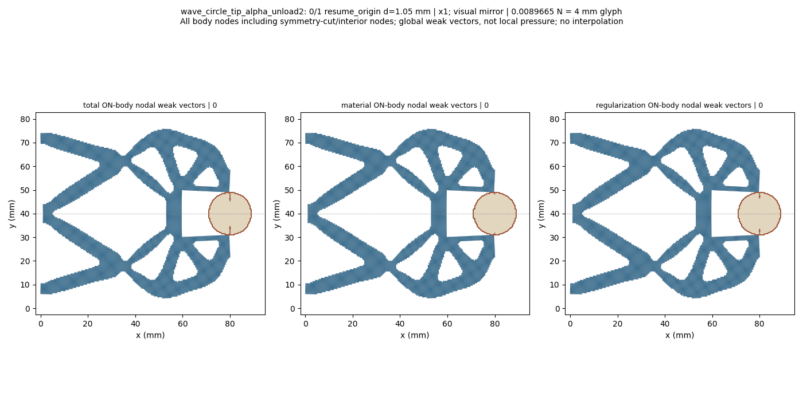
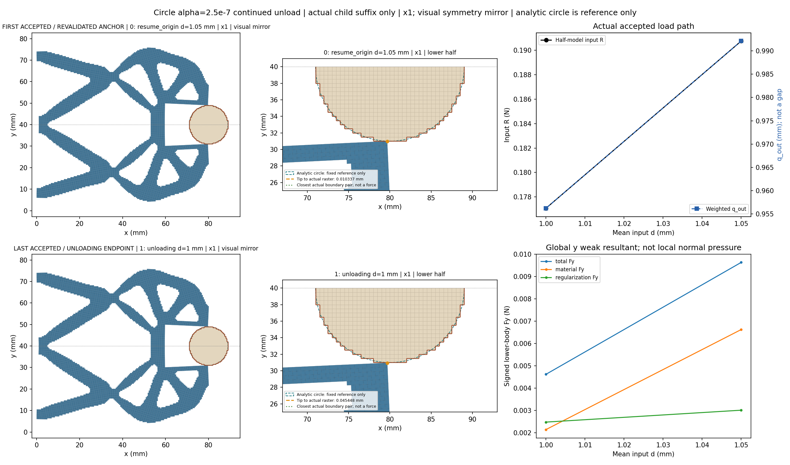
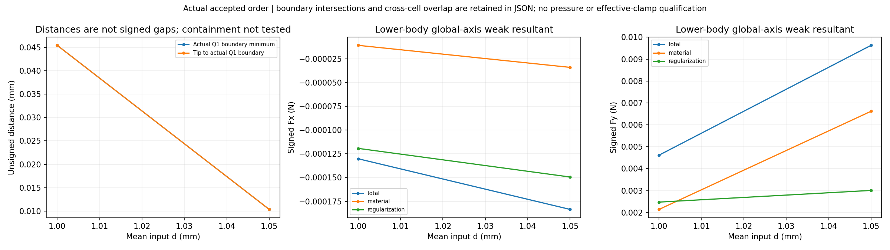
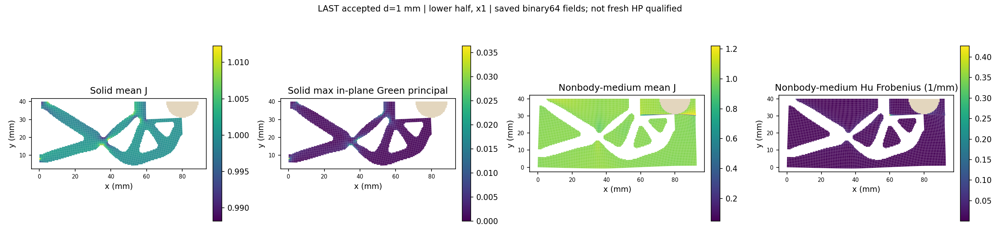
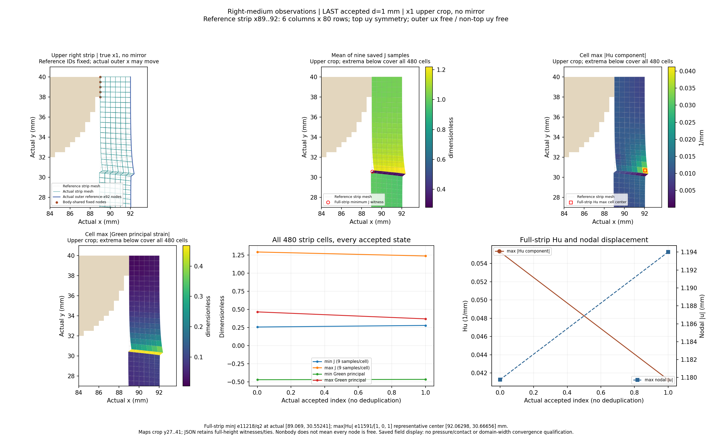
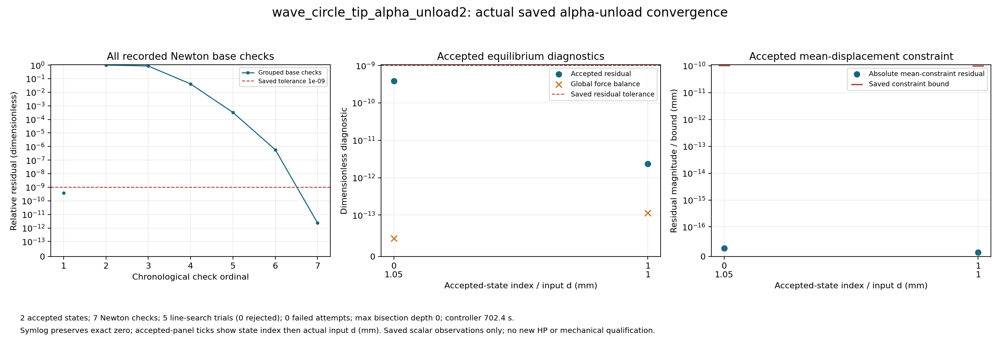

# Alpha2.5e-7 tip-facing circular workpiece same-kind unload: review

At unchanged alpha2.5e-7, solved lower-half wave mechanism, fixed raster circle r9 at (80,40) mm, on the92x40mm reference domain with Lr80mm. Coordinates x1; full-structure views and GIF use a visual symmetry mirror, while numerical tables retain the original lower-half values. All actual accepted states are shown, including controller bisections.

The boundary distance is unsigned between exposed Q1 edges; boundary intersection/near-touch and region overlap are separate observations. Containment is not tested. Weak-form body total includes material and Hu contributions; it is not qualified contact pressure or effective grip. Right-medium observations use the dynamically selected resident reference cells x89..92 (six columns,480cells) and the actual displaced x92 boundary; the tip is selected by reference(80,30), not an old node ID. Observations reuse the resident saved arrays; no additional physics arrays or domain-width convergence claim. Only the inherited unloading1.05mm anchor is freshly revalidated before the next unloading target1.00mm; the complete0/.25/.5/.75/.9/.95/.98/1.00/1.02/1.03/1.04/1.05/1.06/1.05 prefix is not replayed. This child segment does not visit the task peak1.06mm or qualify a complete unload/cycle, release, stability, independent HP for this new unloading state or HF5 qualification. The prior new-alpha peak reference remains limited to its original selected peak; it does not transfer to the unloading state.

[Response](wave_circle_tip_alpha_unload2/response.json) · [Result](wave_circle_tip_alpha_unload2/result.json) · [Exact rows](state_table.json) · [Viewer summary](view/wave_circle_tip_alpha_unload2/summary.json) · [Convergence JSON](convergence/convergence.json)

|index|leg|d (mm)|R input (N)|q out (mm)|body Fy total (N)|minimum Q1 boundary distance (mm)|
|---:|---|---:|---:|---:|---:|---:|
|0|resume_origin|1.05|0.19075825359298318|0.9921056957636342|0.009628058927231453|0.010336706005979579|
|1|unloading|1.0|0.17707577676004574|0.9562482374146859|0.004616547361084258|0.0454478148895312|

Same-input1.00 mm: ALPHA1 row7/global7 is the original zero-start loading target, recorded leg loading; the new global14 row is unloading. The reference is not the old-alpha STEP6 revalidated anchor. Differences are descriptive only, with no equality gate or reversibility claim.

|metric|unit|loading source1.00|unloading1.00|unloading minus loading|
|---|---|---:|---:|---:|
|R_input_N|N|0.17707577676018202|0.17707577676004574|-1.3627987627273797e-13|
|q_out_mm|mm|0.9562482374143294|0.9562482374146859|3.5649261320713777e-13|
|total_body_Fx_N|N|-0.00013020603155553556|-0.00013020603155367824|1.8573196366306055e-15|
|total_body_Fy_N|N|0.004616547361173827|0.004616547361084258|-8.956897723511048e-14|
|material_body_Fx_N|N|-1.0902818474871831e-05|-1.0902818474842109e-05|2.97223861191534e-17|
|material_body_Fy_N|N|0.0021412390748060364|0.002141239074742164|-6.387251838546604e-14|
|regularization_body_Fx_N|N|-0.00011930321308066369|-0.00011930321307883612|1.8275718395230345e-15|
|regularization_body_Fy_N|N|0.002475308286367791|0.0024753082863420953|-2.5695591487906455e-14|
|tip_to_raster_boundary_mm|mm|0.04544781488989713|0.0454478148895312|-3.659295089164516e-13|
|minimum_boundary_distance_mm|mm|0.04544781488989713|0.0454478148895312|-3.659295089164516e-13|
|solid_min_J|1|0.9761668715180571|0.9761668715180488|-8.326672684688674e-15|
|medium_min_J|1|0.034002852813944766|0.03400285281143686|-2.507903607007478e-12|
|medium_max_abs_Hu_per_mm|1/mm|0.2649079814832529|0.26490798148014116|-3.1117330934193888e-12|
