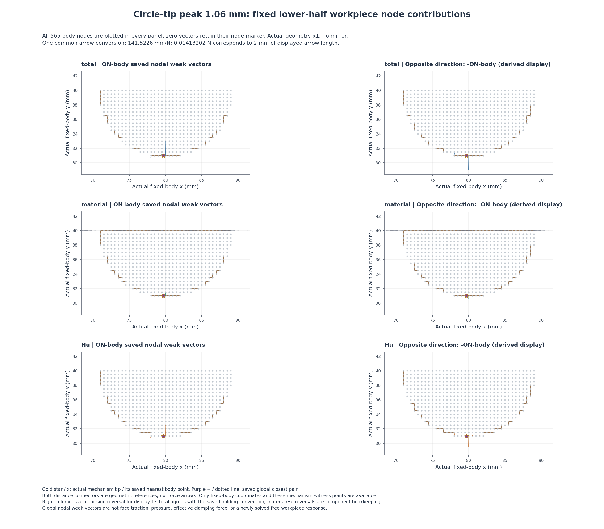
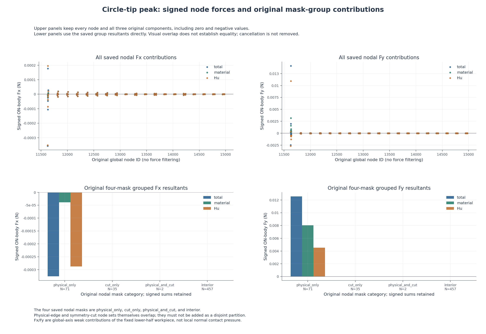

# 尖端对向圆形工件：峰值固定工件节点弱力空间贡献

本页只读取已有普通JSON，显示保存态1.06 mm的固定工件节点力，不新增构模、F/T、HP或平衡求解。
半径9 mm、圆心(80,40) mm、右域界92 mm、正则化长度80 mm及其余物理条件保持。

原state SHA：`dd9288140ae51ff3cfcc7f7f6d6811b2242a55054454002bd7c06ff88a4b6bc6`；原leg：`loading`；原目标序号：12；原接受行：1；d = 1.0600000000000001 mm。

## 全部固定工件节点及保持方向



每个面板均显示全部565个工件节点；零向量仍保留节点标记，不筛选小力或只挑尖端节点。
全部六个面板共用箭头显示比例 141.52259717901308 mm/N。箭头长度为力的显示转换，不是位移或结构变形；工件几何为实际×1、下半模型，无镜像倍增。
左列使用原ON-body弱力向量。右列仅逐节点线性取反以显示平衡保持方向；total对应原support holding约定，material／Hu的反号是分量账本，不冒充新保存的独立支反力数组。
金色星号为真实夹持器尖端，叉号为其原最近工件点；紫色加号为原全边界最近点对。连接线表示距离见证，不表示力，也不补画完整夹持器形状。
原nodal坐标来自参考网格，但原viewer已要求工件全部lift和fluctuation严格为零，所以固定工件的参考坐标等于实际坐标。

## 全节点分量与原mask分组



上排保留所有原节点的三分量Fx／Fy；下排直接使用原summary.groups的四类贡献，不重新定义分类。零值、小负值与相互抵消均保留。
physical_only、cut_only、physical_and_cut、interior是原节点mask类别。physical边和cut边的节点集合另外存在交叠，不能将两个边集合直接当作互斥分区相加。

| 原分量 | 下半工件 ON-body Fx N | 下半工件 ON-body Fy N | 原关于中心力矩 Nmm |
|---|---:|---:|---:|
| total | -0.000326215286673644 | 0.01259251473277105 | 0.00042068304118332762 |
| material | -3.8945182147391937e-05 | 0.008033412258785861 | -0.00049344494840782612 |
| Hu | -0.00028727010452625203 | 0.0045591024739851868 | 0.00091412798959115353 |

原总holding reaction（作用于模型）[Fx,Fy] N：`[0.000326215286673644, -0.01259251473277105]`。

| 原mask | 节点数 | total Fx N | total Fy N | material Fx N | material Fy N | Hu Fx N | Hu Fy N |
|---|---:|---:|---:|---:|---:|---:|---:|
| physical_only | 71 | -0.00032595490139467715 | 0.012572382897218289 | -3.8845985580976862e-05 | 0.0080335678810614323 | -0.00028710891581370027 | 0.0045388150161568552 |
| cut_only | 35 | 0 | 0 | 0 | 0 | 0 | 0 |
| physical_and_cut | 2 | -2.6038527896683299e-07 | 2.0131835552760171e-05 | -9.9196566415072427e-08 | -1.5562227557165826e-07 | -1.6118871255176056e-07 | 2.0287457828331823e-05 |
| interior | 457 | 0 | 0 | 0 | 0 | 0 | 0 |

原mask覆盖观察及完整描述性核对如下；只记录原值、差值和抵消，不增加接触／夹持验收门。

```json
{
  "node_count": 565,
  "group_counts": {
    "physical_only": 71,
    "cut_only": 35,
    "physical_and_cut": 2,
    "interior": 457
  },
  "mask_membership_counts": {
    "1": 565
  },
  "mask_partition_observed": true
}
```

```json
{
  "node_force_fsum_N": {
    "total": [
      -0.000326215286673644,
      0.01259251473277105
    ],
    "material": [
      -3.894518214739194e-05,
      0.008033412258785861
    ],
    "regularization": [
      -0.000287270104526252,
      0.004559102473985187
    ]
  },
  "node_force_fsum_minus_original_N": {
    "total": [
      0.0,
      0.0
    ],
    "material": [
      0.0,
      0.0
    ],
    "regularization": [
      0.0,
      0.0
    ]
  },
  "mask_group_fsum_N": {
    "physical_only": {
      "total": [
        -0.00032595490139467715,
        0.01257238289721829
      ],
      "material": [
        -3.884598558097686e-05,
        0.008033567881061432
      ],
      "regularization": [
        -0.00028710891581370027,
        0.004538815016156855
      ]
    },
    "cut_only": {
      "total": [
        0.0,
        0.0
      ],
      "material": [
        0.0,
        0.0
      ],
      "regularization": [
        0.0,
        0.0
      ]
    },
    "physical_and_cut": {
      "total": [
        -2.60385278966833e-07,
        2.013183555276017e-05
      ],
      "material": [
        -9.919656641507243e-08,
        -1.5562227557165826e-07
      ],
      "regularization": [
        -1.6118871255176056e-07,
        2.0287457828331823e-05
      ]
    },
    "interior": {
      "total": [
        0.0,
        0.0
      ],
      "material": [
        0.0,
        0.0
      ],
      "regularization": [
        0.0,
        0.0
      ]
    }
  },
  "mask_group_fsum_minus_original_N": {
    "physical_only": {
      "total": [
        0.0,
        0.0
      ],
      "material": [
        0.0,
        0.0
      ],
      "regularization": [
        0.0,
        0.0
      ]
    },
    "cut_only": {
      "total": [
        0.0,
        0.0
      ],
      "material": [
        0.0,
        0.0
      ],
      "regularization": [
        0.0,
        0.0
      ]
    },
    "physical_and_cut": {
      "total": [
        0.0,
        0.0
      ],
      "material": [
        0.0,
        0.0
      ],
      "regularization": [
        0.0,
        0.0
      ]
    },
    "interior": {
      "total": [
        0.0,
        0.0
      ],
      "material": [
        0.0,
        0.0
      ],
      "regularization": [
        0.0,
        0.0
      ]
    }
  },
  "nodal_decomposition_max_abs_difference_N": 1.3010426069826053e-18,
  "original_holding_plus_on_body_total_N": [
    0.0,
    0.0
  ],
  "extrema": {
    "total": {
      "max_norm_N": 0.014132018772028214,
      "max_norm_node_id": 11630,
      "max_norm_coordinates_mm": [
        80.0,
        31.0
      ],
      "max_norm_vector_N": [
        0.0001775454279951609,
        0.014130903445779957
      ],
      "max_norm_exact_tie_count": 1,
      "component_min_N": [
        -0.0003570467747807031,
        -0.0024569168088249345
      ],
      "component_max_N": [
        0.0001775454279951609,
        0.014130903445779957
      ],
      "exact_zero_vectors": 492,
      "positive_component_sum_N": [
        0.0003571542777163101,
        0.01672451607639115
      ],
      "negative_component_sum_N": [
        -0.0006833695643899541,
        -0.004132001343620101
      ]
    },
    "material": {
      "max_norm_N": 0.0031889500753253318,
      "max_norm_node_id": 11630,
      "max_norm_coordinates_mm": [
        80.0,
        31.0
      ],
      "max_norm_vector_N": [
        -1.826605998992938e-05,
        0.003188897761605079
      ],
      "max_norm_exact_tie_count": 1,
      "component_min_N": [
        -1.975319484774428e-05,
        -1.4878853150502769e-06
      ],
      "component_max_N": [
        7.890395006609526e-06,
        0.003188897761605079
      ],
      "exact_zero_vectors": 492,
      "positive_component_sum_N": [
        2.2977304719473135e-05,
        0.00804489221328979
      ],
      "negative_component_sum_N": [
        -6.192248686686507e-05,
        -1.1479954503929293e-05
      ]
    },
    "regularization": {
      "max_norm_N": 0.010943757605655484,
      "max_norm_node_id": 11630,
      "max_norm_coordinates_mm": [
        80.0,
        31.0
      ],
      "max_norm_vector_N": [
        0.0001958114879850903,
        0.010942005684174878
      ],
      "max_norm_exact_tie_count": 1,
      "component_min_N": [
        -0.00035168540467694356,
        -0.002679221043890726
      ],
      "component_max_N": [
        0.0001958114879850903,
        0.010942005684174878
      ],
      "exact_zero_vectors": 492,
      "positive_component_sum_N": [
        0.00036132607436095335,
        0.011897518461821676
      ],
      "negative_component_sum_N": [
        -0.0006485961788872054,
        -0.007338415987836489
      ]
    }
  },
  "scope": "New ordinary arithmetic observations only. Signed positive/negative sums and differences retained; no clipping or numerical acceptance tolerance."
}
```

## 既有实际变形入口

[STEP10既有实际变形GIF](<../../lf_circle_tip_step_010/run_001/view/wave_circle_tip_step10/actual_states.gif>)；stat大小 306111 bytes。

[STEP10原人工检查页](<../../lf_circle_tip_step_010/run_001/REVIEW.md>)。

本程序不打开、解码、复制、抽帧或重新哈希旧媒体。当前普通JSON只有工件全部坐标与少量机制距离见证点，不足以重绘完整实际变形夹持器；完整结构查看上述原动画。

## 解释范围

节点向量是组装后的全局弱式力，包含材料与Hu贡献，不能分配成节点某个相邻面的牵引。图中不进行径向投影，不生成压力或有效夹持力，不将physical mask的力单独认定为接触力。
全部Fx／Fy为下半固定工件的有符号全局轴分量，未镜像倍增。保持反力约定与作用在工件上的力方向相反；它不代表自由工件的运动、释放或稳定性已求解。
本轮不改变原峰值参考、全路径参考及压力、有效夹持、释放、稳定性、网格／域宽或HF5资格。

### 原范围说明

Existing peak fixed lower-half workpiece node weak forces in N, at fixed body coordinates in mm. ON-body vectors are the original negative internal weak force. The original total holding reaction opposes ON-body total; component-wise holding glyphs are algebraic negatives for display, not independent reaction measurements. No pressure, continuous face traction, radial pressure projection, mirror doubling or qualified effective grip. Raw node/mask/group values retained. New sums/differences are descriptive only, without a tolerance or acceptance gate. No new F/T/HP/equilibrium/tests/default or API association. These three JSONs do not contain full deformed gripper coordinates.

### 来源

```json
{
  "paths": {
    "nodal": "lf_data_preparation/native_interface_001/lf_circle_tip_step_010/run_001/view/wave_circle_tip_step10/001/nodal.json",
    "derived": "lf_data_preparation/native_interface_001/lf_circle_tip_step_010/run_001/view/wave_circle_tip_step10/001/derived.json",
    "geometry": "lf_data_preparation/native_interface_001/lf_circle_tip_step_010/run_001/view/wave_circle_tip_step10/001/geometry.json"
  },
  "ordinary_JSON_bindings": {
    "lf_data_preparation/native_interface_001/lf_circle_tip_step_010/run_001/view/wave_circle_tip_step10/001/nodal.json": {
      "sha256": "6bad001bcc762cc295d6238b1b33cdaaba9327312592d35550567a43c35f7e2f",
      "bytes": 163731
    },
    "lf_data_preparation/native_interface_001/lf_circle_tip_step_010/run_001/view/wave_circle_tip_step10/001/derived.json": {
      "sha256": "5d3baa7ce000e93431297621fed2a0087fb6d57e51fc64e815a4675fc48e324a",
      "bytes": 6327
    },
    "lf_data_preparation/native_interface_001/lf_circle_tip_step_010/run_001/view/wave_circle_tip_step10/001/geometry.json": {
      "sha256": "3dbf7ac0b94febfce3723f2a2ded942358e20565baf408cd12837ead5c9a632f",
      "bytes": 54909
    }
  },
  "fixed_coordinate_source_contract": {
    "viewer_source": "lf_data_preparation/native_interface_001/lf_circle_tip_step_010/circle_saved_views.py",
    "viewer_sha256": "73b84de22565ac89ce276fbf0a2fa6ef47c2dcd256c26f60495eb9c150c7c8b5",
    "viewer_lines": "480-482: both lift/fluctuation on all workpiece DOFs must be exactly zero before observations",
    "nodal_source": "hf_repo/src/hf_eval/workpiece_nodal.py",
    "nodal_sha256": "697e056fee1bddf4a611f2fc6e83de10747d923627b5f2d28c34eaf9a1d33ae9",
    "nodal_semantics": "All fixed body nodes, four mutually exclusive masks with physical/cut intersection separate; ON-body=-saved internal weak vectors; original holding total opposes total; positions copied from reference coordinates, therefore actual for this fixed body"
  }
}
```
