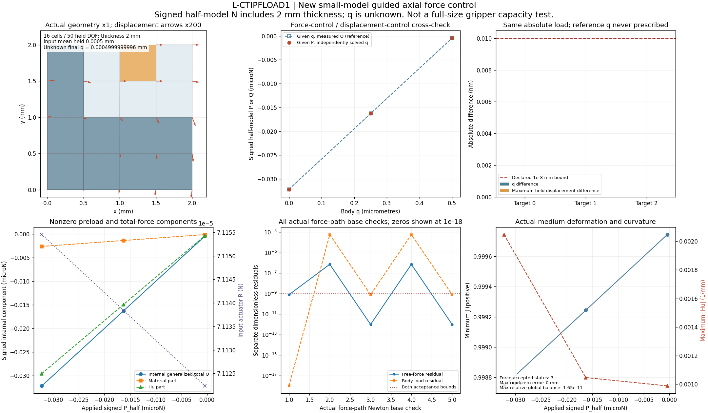

# L-CTIPFLOAD1：导向轴向力控实现及小模型验证

2026-10-23（Asia/Seoul）。**本卡执行PASS：17/17检查通过，一张实际结果图检查通过，两个新模块已安装，唯一窗口已关闭。** 外窗实际51.744712秒；无外部重试、修复重跑或新HP。正式r9力控尚未执行。

## 整体目标、本轮目的及效果

整体目标是HF独立读取LF几何，在一致的大变形／TMC物理条件下分析结构变形、接触作用、工件受力，并逐步建立承载与释放分析能力；HF不重新做LF优化。已有固定工件加载／卸载与导向位移探针。本轮补齐“保持机构平均输入，给工件轴向外载P，求未知刚体位移q”的功能。

这样可以把已有“给q→求Q”的结果反向核对为“只给P→独立求q”。真实小模型交叉通过，说明新增力控方程、符号、半模型口径和保存流程在本卡有限范围可用。它不等于真实夹持器承载已经验证；当前实际小模型的P均为负，更不能描述成正向拉力增大试验。

## 实现与代码对照

仅新增两份生产源码：`hf_repo/src/hf_eval/split_guided_force.py`（407行，reduced非对称方程与N步长）及`hf_repo/src/hf_eval/native_guided_force.py`（221行，严格父态准入、保存、外载账本和公共API）。原55份生产源码逐字节保持；默认fixed、位移probe、CLI、native_response及原力核／切线不改。测试原字节交付于[tests](tests/test_native_guided_force.py)，原始候选树在唯一ZIP中保留。[使用与限制](USAGE.md)给出最简调用。

未知量为自由场w、工件刚体平移q和机构输入乘子R；保留工件uy=0／转角0及原机构加权均值。工件全部原ux的内力求和等于绝对有符号P_half，不作节点平均。导向和支撑去重，外载账本中以显式P取代旧body-x保持反力，避免重复计数；ON-body x与P反号。N力已包含来源厚度，不能再乘厚度；本卡不自动乘2。

fresh锚点复核原split及有符号R、非零P0，直接一次新F/T检查；不投影或修复。随后只给P，未把参考q传入力控，也未从位移参考终态热启动。新g门、原自由平衡门分别满足；非对称reduced切线使用实际两个耦合块，不假定互为转置。

## 唯一执行范围与实际数值

新4×4 Q1／16单元／25节点／50场DOF，域2×2 mm、厚度2 mm、E1 MPa、ν.3、α1e−4、γ1e−6、Lr2 mm。固定父加载[0,.0005] mm成功后，原位移probe给q=[0,.00025,.0005] mm获得三载荷，再从同一父态独立执行力控。正式r9／厚度20 mm／α2.5e−7条件未改变。

|目标|P_half N|力控求得q mm|位移参考q mm|q绝对差 mm|R绝对差 N|
|---|---|---|---|---|---|
|0|-3.216587387036128e-08|0|0|0|0|
|1|-1.627506420836282e-08|0.0002499999996011167|0.00025|3.9888329e-13|2.8460307e-19|
|2|-4.213649168822395e-10|0.0004999999996012887|0.0005|3.9871134e-13|3.1170812e-19|

三态q／全场位移最大差3.9888329184806226e−13 mm，预声明交叉界值1e−8 mm；R最大差3.1170812458958252e−19 N，分别低于预声明的max(1e−12 N,1e−7×|R_ref|)。力控7次F／5次T均完成，save-time F/T均0；3接受态，无内部二分或失败attempt。

这里P从−3.21659e−8增加至−4.21365e−10 N，表示负x外载逐渐减弱，**不是正向承载量增长**。q正向变化是保持机构输入及其介质／材料响应下的新平衡结果。小模型Hu贡献较大，不能把总力直接称为纯接触力。

|态|rho_F|rho_P|mean残差 mm|min J|相对global balance|Newton检查数|
|---|---|---|---|---|---|---|
|0|7.8460372e-10|0|-2.7105054e-20|0.99874372|1.6462876e-11|1|
|1|9.8904283e-13|7.8735148e-10|1.3552527e-20|0.99924372|4.0401719e-16|2|
|2|9.8653361e-13|7.8517408e-10|0|0.99974372|8.93636e-17|2|

原rho_F≤1e−9、新rho_P≤1e−9、mean残差≤5e−14 mm、J>0、global≤1e−6、rigid／zero≤8e−11 mm均通过；实际rigid误差0。rho_P按预先定义的SP=max(|P_target|,|P_anchor|,Ffloor)，本例三态SP均3.216587387036128e−8 N；不能改说成按每态|当前P|归一化。最大|g|2.5325848371540152e−17 N，原界3.216587387036128e−17 N。37×37混合单位矩阵condition约6.31e5～6.33e5仅作诊断，不证明唯一性或稳定性。

## 验证、停止与资源记录

唯一pytest用时11.30秒，17展开项全部通过：原9项＋新8非参数化方法。新30＋旧11次有限控制／拒绝调用；新4＋旧1条真实路径，受控partial在新真实／注入两轴各记一次。覆盖双向非对称dense oracle、fresh错误R／均值／P0、真实q↔P、缓存分量／厚度／账本、来源与输入拒绝、旧代表性兼容。

受控第二次T抛出constraint_failure后正确保存首锚点，父树哈希保持；这是预定异常持久化测试，**不是物理失稳或承载极限**。实际非预期失败0、外部重试0。

四层SUP2均normal_exit、returncode0、全部同实例终止／成员覆盖／句柄释放通过后，top才安装两个同字节新模块。采样最高树RSS258252800字节（约246 MiB），限额8 GiB；四库线程上限16，CPU执行。唯一原字节ZIP216成员，1145474字节，SHA256 `ec19f6d4a57757eb6d736cb3dd3694aa009337686afc5a704ac06dd6b9a7e0b2`；封存于原helper50.345秒／outer51.745秒内完成。详见[实际摘要](result_summary.json)、[安装回执](execution/installation_receipt.json)、[监督与原始封存](execution/EVIDENCE_MANIFEST.json)。

## 可视化与人工检查

唯一新图6面板：实际几何×1、位移箭头×200；给q参考／给P未知q；交叉误差；带非零预载的total／material／Hu与输入R；全部实际Newton检查的双残差；J／Hu及全局／刚体误差。root仅一次像素检查，通过；未重绘。交叉误差远小于图中声明界值，柱高接近不可见，精确值见上表与[原JSON](run/artifacts/validation_summary.json)。残差图只有精确0显示为1e−18，原JSON不改。[人工检查页](inspection.html)。

## 记录、恢复与限制

批准卡及原规格保留在[前阶段](../lf_circle_tip_force_control_preparation_001/L-CTIPFLOAD1_CARD.md)。`author/`保存实现说明、五份独立有限静审、候选冻结、启动资格、实际执行和物理复核。冻结文件中的numerical_launched=false是**启动前历史快照**，本卡终态以result_summary／实际回执为准；不覆写历史。

[execution/execution_evidence.zip](execution/execution_evidence.zip)是原窗口内生成的完整原字节归档，没有交付时重打包。它包含原candidate、run_001科学缓存、模型、来源、日志和receipts；本目录的run只便于读取普通JSON／XML／日志，未额外解码NPZ。可在新目录解压查看与核字节；原JSON中的绝对路径是当时来源记录，不应直接覆盖身份文件。公共API接收当前恢复位置的父result路径，但本轮恢复验收只做Git与字节核对，没有异机环境或数值复算。原冻结launcher含唯一启动保护，不要在已有证据目录重开。

当前只支持从完整固定load_only父末峰开始、沿严格递增的绝对有符号P列表求导向q；未实现force保存态延伸、卸载、自由y／转动、摩擦或动力学。本卡真实小路径只测full；正式chunk256尚待真实任务核对。新HP0、正式r9力控0，压力、纯接触、承载极限、释放、稳定性与HF资格保持未授。

下一步见[具体计划](NEXT_STEPS.md)：先冻结正式低输入父态与既有位移参考的同定义载荷，再安排一次最小r9力控交叉；本卡未运行该任务。
