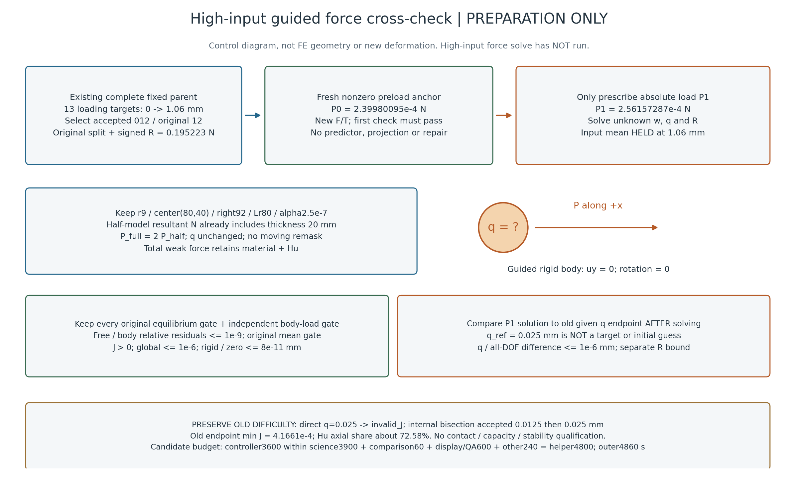

# L-CTIPFHIGHPREP1：高输入1.06 mm两载荷力控交叉准备

2026-10-23。**准备完成；高输入力控尚未执行。** 本轮用户只授权核定父态、参考载荷、比较门、资源窗口及示意说明。本轮无NPZ内容读取／散列／解码、旧包解压、旧媒体重开、构模、F/T、平衡、HP、测试或生产源码修改；仅核普通元数据／源码与科学档stat，生成一张控制示意。

## 整体目标、已做什么与这一步的目的

整体目标是形成独立于LF设计代码的HF大变形／第三介质接触分析器，逐步实现可审查的变形、机构反力、工件受力及加载／卸载功能。现已完成LF多设计前向与保存态续算、选定态高精度参考、可视化／接口关联，以及固定机构输入下的规定q探针；导向力控又通过小模型17项验证及[正式r9／mean.50两载荷交叉](../lf_circle_tip_force_control_real_001/RESULTS.md)。

低输入正式功能闭环已验证，但尖端距离约.519 mm、轴向Hu约86.29%，不足以说明较强闭合工况下力控可用。本次选择已有mean1.06 mm固定父及其位移参考，保持其余物理和全部原门，准备“只给绝对P、独立求未知q”的第二个物理工况。没有把低输入force结果抬升输入或冒充合法固定父，也不新增力核或生产防御层。效果是形成有明确来源、比较规则、困难历史及预算的一次试算方案；没有预授高输入数值成功或承载资格。

## 控制示意

只说明来源／控制／验收顺序，不按真实几何比例，没有新计算变形。q=.025 mm只是求解后的位移参考，不作目标、预测初值或夹限；R是机构平均输入乘子，与工件外载P分开。[SVG](control_schematic.svg)、源码及[一次图像检查](author/SCHEMATIC_QA.json)保留。

## 已核定父态与两载荷

|项|核定内容|
|---|---|
|合法固定父|`D:/hpr1_001/parent_001/result.json`：原完整13目标load_only成功，最后原峰1.06 mm；选accepted12／original12。|
|迁移状态|原lift／fluctuation及signed R=0.19522304147728387 N；state声明SHA=e71c06973b7dc7aff7e5ee4a801b595cb3f054e907cc6e1ad52188e858500a68。|
|原位移参考|`D:/hpr1_001/run_001/science/result.json`，同父；原请求q=[0,.025]，实际接受[0,.0125,.025]。|
|P0|2.399800950672949e−4 N，原q0非零预载，等于原父ON-body Fx反号。|
|P1|2.561572865437846e−4 N，原probe接受索引2的q=.025 mm驱动力；新力控不输入该q。|
|ΔP／Nmin|1.6177191476489698e−5 N／1.011074467280606e−6 N，Nmin=ΔP/16；max_bisections4保持，至多17个实际接受态含锚点。|

P均为固定空间+x方向的有符号**绝对半模型合外载N，已含20mm厚度**；不得用0或ΔP替代P0，不再乘厚度。完整镜像装配轴向载荷取2P，q不倍增。Q_half=Σbody f_int,x、ON-body Fx=−Q_half，g=Q_half−P；显式P只入账一次，旧body-x处方驱动力移除，body-y导向与背景重叠去重。

原α2.5e−7／γ1e−6／r9／圆心(80,40)／right92／Lr80、E1MPa／ν.3／plane strain／t20／h.5、14720单元／29970DOF、510工件单元／565节点、全部端口及支撑保持。机构平均输入保持1.06 mm；工件body-x为未知q，uy=0、转角0，原成员不重mask。响应mechanical／chunk256，新的guided_reduced_tangent保持，父port_projection只为历史记录。

完整普通身份、来源字段及科学档声明／stat见[SOURCE_BINDING](SOURCE_BINDING.md)和[机器记录](SOURCE_BINDING.json)。旧父split_displacement控制器SHA与当前版本不同，而force／tangent核SHA匹配；准入以当前API规定的两kernel硬门及完整源身份为准，不伪称父全部mechanics文件同字节、不改写旧SHA。P0仍必须在未来执行中fresh F/T检查1原样接受，split与R逐位不变；有差即停，不用Newton修复或更换预载。

## 必须保留的旧困难记录

原高输入位移probe首次尝试q=0→+.025 mm出现invalid_J，控制器内部回退／二分接受+.0125，再接受+.025；这是原路径内部行为，无终端失败或外部重跑。原2请求、3接受态及failed_attempts均保留。原force调用28次／完成27次，tangent15次／完成15次，science监督1172.741484099999秒；不能抹去未完成F或据低输入311秒保证高输入耗时。

|原probe接受索引|q/mm|是否原请求|minJ|
|---|---:|---|---:|
|0|0|是／original0|4.6587891715793817e−4|
|1|.0125|否／original1的内部二分|4.3961981824698745e−4|
|2|.025|是／original1|4.166085295994876e−4|

旧末态轴向Hu约72.58%，尖端到原栅格边界无符号距离约.008668 mm。小J、高Hu及很小几何距离同时存在，不能由正P或tiny交叉误差推出纯接触、容量、稳定性或唯一分支。新力控若内部N二分，其P一般不等于旧q=.0125对应Q；不能硬配中间态或插值冒充实测。

## 原门与预先固定的工程比较

每个新接受态含内部二分必须保原free ρF≤1e−9、mean原公式门、J全正／有限、global≤1e−6、rigid／zero≤8e−11 mm，以及独立body ρP≤1e−9。保持原约束公式后，mean界为1.0600000000000001e−10 mm，Ffloor为2.12e−7 N；SP=max(|P|,|P0|,Ffloor)，不得用free门替代body合力门。

锚点：fresh检查1、原split／signed R／state身份逐位保持，不做predictor／投影／线性修正。端点另按下表工程界验收，不要求不同控制器终点逐位相同：

|P1端点对原probe接受2|预先界|
|---|---|
|q对原.025 mm|abs差≤1e−6 mm|
|全部29970DOF物理位移|max abs差≤1e−6 mm|
|R_input对0.19536542042187396 N|abs差≤max(1e−10 N,1e−7×abs(Rref))=1.9536542042187397e−8 N|

全场差逐DOF用fsum([lift_new,w_new,−lift_ref,−w_ref])，不减显示坐标。只用旧参考accepted0／2这两个原目标做锚点／端点科学对照，完整保留旧第1态及失败普通记录。三项是原先声明的功能工程门，不是严格误差界或稳定性证明，也不根据低输入实差收紧。详细公式和stop规则见[COMPARISON_GATES](COMPARISON_GATES.md)。

## 接口、读取、显示及资源

复用现有evaluate_native_guided_force，无生产修改／安装。薄研究包装必须改用selected12、hold1.06；低输入比较器的selected2、hold.50和len(reference)=2硬码不可照抄。先写包装、冻结完整源闭包和只读来源，独立静审后再按获批卡唯一启动；本准备未写或试跑真实包装。

API拟准入3个旧NPZ路径：opaque model只整档hash，snapshot geometry四mask，父accepted012 split两字段。成功后独立比较另读旧probe accepted000／002及新force anchor／P1的4个state档／8字段；合计7路径、6解码档／14字段，旧fields／force／tangent／matrix缓存不读。API字段数由冻结控制流支撑，运行可监测实际open事件，不伪称动态字段hook实测。当前只stat这些旧科学档，未验证payload身份或fresh平衡。

仅科学与工程比较都通过后，纯普通JSON viewer一次输出5PNG及全部实际N帧GIF(N≤17)：实际×1变形、P–q及原目标参考、signed total/material/Hu与独立R／外载账本、尖端／右480格介质几何／全域minJ和maxHu、全部Newton／trial收敛与独立门。原中间参考仅作为已有普通参考点说明，不能冒充新接受态。没有局部J/Hu数组就不画局部场；旧媒体不打开，5新PNG各最多检查一次。

|阶段|拟固定额度与包含关系|
|---|---|
|controller|3600秒，位于science worker内部，不单独叠加。|
|science总窗口|3900秒：进程最多3885＋同实例清理最多15；含导入、准入、实际科学读取、fresh检查、路径、保存。|
|比较|60秒：进程45＋清理15，含4档8字段和比较JSON。|
|显示及root QA共享|600秒：viewer进程最多510＋清理15；5图一次检查须在该阶段585秒前完成，余15秒退出余量。|
|helper|4800秒：3900＋60＋600＋240其他准入／调度／清理／一次封存余量，全部在原窗口。|
|outer|4860秒，最多81分钟。64GiB采样上限、四库线程cap16、CPU；viewer原8GiB子限保持。|

预算依据旧高输入近1173秒困难路径作预留，不保证力控成功或耗时。最终薄包装应将共享绝对deadline、阶段清理reserve和封存余量冻结审阅，不按阶段另开累计超窗。无足够时间或资源即停，不缩验收或加时。

首个终端错误停止后续科学／比较／显示，保存已产生partial和完整失败历史；原内部Armijo／有界N二分允许。无外部重试、修复重跑、延期、force强制执行、q目标fallback、新HP、测试、生产修改／安装、删除或自动回滚。四层SUP2沿用同实例终止信号＋全部成员覆盖＋句柄释放合同；清理证明通过且原窗口有余量才一次原字节封存，不开补封窗口。

## 恢复与准备结论

本机未来直接用D:/hpr1_001既存树，不复制／解压旧科学包。最小父树保完整13目标普通描述及selected012科学缓存，不声称包含13态全部科学档。普通来源副本和原位移结果在已发表PROBE1目录／本次source_context可审查；科学依赖沿用[PROBE1原包](../lf_circle_tip_probe_001/execution_evidence.zip)和[成员清单](../lf_circle_tip_probe_001/EVIDENCE_MANIFEST.json)。本准备未展开或核旧包payload。换机恢复路径必须在新执行范围明确计数／绑定，不能静默增加到本卡读取集。

当前静态前置和来源／门／预算已经明确，现有生产API可用，所需变化限研究包装的高输入来源及参考态选择。独立审阅与当前状态见author记录；57份生产源码保持，没有高输入force数值结果。发布恢复只做同机异目录Git和普通新文件字节核对，不代表异机数值复算。

下一步按[L-CTIPFHIGH1候选执行卡](L-CTIPFHIGH1_CARD.md)另行批准后，先冻结／静审薄包装，再唯一运行。通过则评估该局部导向总力功能在较强闭合工况的适用性；不通过则依据typed失败和实际partial安排诊断，不静默改门、改α或加q。暂不扩容量扫描、force续算／卸载、自由转动或新HP。
