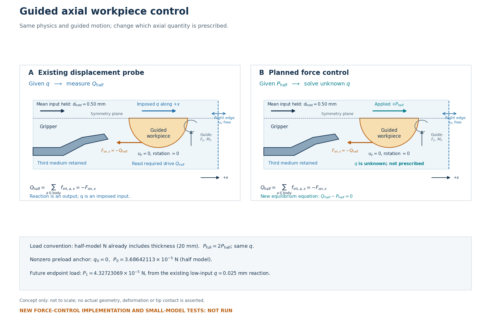
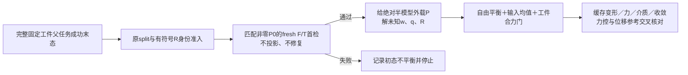

# L-CTIPFLOADPREP1：导向轴向力控制准备

2026-10-23（Asia/Seoul）。**规格、接口和有限验证方案准备完成；没有实现、安装、构模、F/T、HP或新平衡求解。** 本轮用户只批准准备。独立审阅、实际静态检查和发布回执分列，不将文档完成写成力控数值PASS。

## 整体目标与本轮作用

整体目标是HF独立读取LF普通几何，可靠计算一致大变形／TMC响应，逐步回答夹持器作用、承载与释放。HF不重新优化LF。已有固定工件加载／卸载、保存态延伸和导向位移探针；最近LOW1完成从零短父0→.25→.50 mm，再保持机构均值.50，仅使工件q=0→.025 mm。

LOW1证明了“给q→求总驱动力Q”的功能链。高输入1.06 mm在相同q=.025 mm的Q约为低输入5.92倍；但低输入仍有约.519 mm尖端间距和86.29%的轴向Hu贡献。因此既不能把低输入当零力基线，也不能把高低差称纯接触抗拔。当前缺少的是“给外载P→解未知工件位移q”，而不是更多位移步或重复HP。

本轮完成：最小物理／数学合同、半模型和预载口径、三个新文件的接口边界、原门与新增力门、有限小模型交叉验证及下一候选卡。效果是将实现对象缩小为一个导向刚体平移自由度；目前仍无新力控数值结果。依据见[原LOW1结果](../lf_circle_tip_low_probe_001/RESULTS.md)。

## 控制示意（非有限元结果）

图仅说明控制量交换，不按比例，不显示实际夹持器几何／变形，也不认定尖端接触。右界ux自由，导向保留uy=0／转角0及相应反力。PNG有一次排版迭代、两次root检查；不是LOW1旧图重绘，见[示意检查](author/SCHEMATIC_QA.json)。[矢量版本](control_schematic.svg)与绘图源码一并保存。

## 保持的正式物理条件

|内容|正式r9任务保持|
|---|---|
|机构与工件|wave；r9 mm、圆心(80,40) mm，原510格／565节点不重mask|
|域与材料|right92 mm、h.5 mm、Lr80 mm、E1 MPa、ν.3、plane strain、厚度20 mm|
|第三介质|γ1e−6、α2.5e−7，原实际弱残差及非对称切线|
|控制|机构参考加权均值保持.50 mm；body uy=0／转角0；q改为未知|
|其余边界|原支撑、实体／背景对称、零输出弹簧和自由右界；不加摩擦、自由y／转动或动力学|

这里选.50 mm是以后功能交叉检查的较平缓条件；**本轮没有执行正式r9力控**。小模型沿用既有16格fixture自身的2 mm域／2 mm厚度和原参数，仅作软件验证，不替换正式物理条件。

## 阅读与后续安排

1. [任务规格与数学／验收合同](TASK_SPEC.md)：未知量、载荷、预载、非对称块、门与失败含义。
2. [接口能力及拟新增API](API_DESIGN.md)：复用部位、单位、参数、保存与错误语义。
3. [有限小模型方案](SMALL_MODEL_VALIDATION.md)：17个展开项、最多5条真实小路径及独立计数。
4. [L-CTIPFLOAD1候选实施卡](L-CTIPFLOAD1_CARD.md)：下一步只实现并验证小模型，不包含真实r9试算；**尚未批准／编写实现候选／冻结runner或启动**。

独立意见见[数学审阅](author/MATH_REVIEW.md)、[接口审阅](author/API_REVIEW.md)，取舍见[审阅决策](author/REVIEW_DECISIONS.md)。本轮事实见[准备结果](PREPARATION_RESULT.json)及[最终静态核对](author/PREPARATION_REVIEW.json)。原55份生产源码、全部原数值及资格保持。承载极限、纯接触压力、释放、稳定性和HF5均未因此升级。
