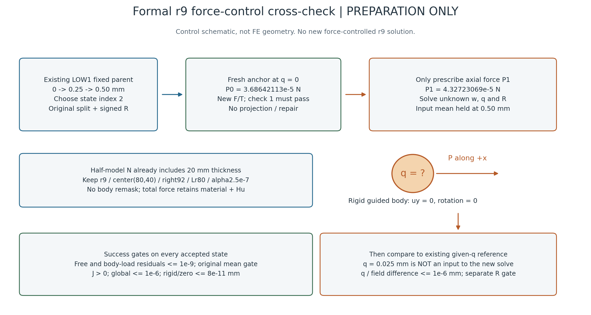

# L-CTIPFREALPREP1：正式r9两载荷力控交叉检查准备

2026-10-23（Asia/Seoul）。**准备完成，正式r9力控尚未执行。** 用户授权本阶段核定父态、参考载荷、比较门和资源窗口；没有授权启动新平衡路径。本阶段不修改生产源码、不读取或散列旧NPZ内容、不重做父加载、HP或测试。

## 整体目标与这一步的作用

目标是以独立HF分析LF夹持器的大变形／TMC响应，逐步形成可审查的工件受力和承载分析能力。L-CTIPFLOAD1已补齐“指定轴向外载P，求未知工件q”的入口并通过17项有限检查，最大小模型q差3.99e−13 mm；但该fixture只测试full模式且三个载荷均负。现在需要首次在正式r9、chunk256模型上做同定义正载荷交叉，不能由小模型结果直接推定真实夹持器可用。

本阶段选择已有LOW1完整固定父及其位移probe作参考，保持机构输入0.50 mm。这样既不新增几何／材料／α，也有独立的给定位移参考检验新力控所得q。总力仍包含Hu；LOW1参考末态轴向Hu约86.29%，此实验即使通过也不是纯接触抗拔容量试验。

## 控制示意

图不按实际几何比例，仅说明控制量和验收顺序。P1只给外载，q=.025 mm只作为求解后的既有参考，不作为处方、预测初值或夹限。[SVG](control_schematic.svg)及绘图源码保留；只用普通元数据，一次绘图、一次像素检查，没有新r9变形结果。

## 已核定来源与载荷

|项目|固定值／来源|
|---|---|
|完整固定父|LOW1从零[0,.25,.50] mm，3态全部成功；选索引2，即第3态accepted/002|
|父result文件SHA|09e37f483f4839ef5c03193d7cdd2f36cc2cccf045d96cd1026766e746ecad46|
|父selected split声明SHA|48fd7c621a8b1a060a5bec81307f2c8fe524569c6a4052da75884a8053e45bd8|
|原signed R|0.08589635225389337 N|
|原位移probe result SHA|acca0b8b97681cabf6e8517b28395b2c5b4cc20db9bb7496d6b10400b5400629|
|P0|3.686421133658022e−5 N；同父q0的Q_drive_half_N，等于父ON-body Fx反号|
|P1|4.3272306948756724e−5 N；同父probe q=.025 mm的Q_drive_half_N|
|输入语义|两个绝对有符号half N，已经包含20 mm厚度；不得以0或ΔP替代P0，不能再乘厚度|
|新增N最小步长|(P1−P0)/16 = 4.0050597576103156e−7 N；原max_bisections4，原mm步长另保留|

完整普通文件、字段及源码绑定见[SOURCE_BINDING](SOURCE_BINDING.md)和[机器记录](SOURCE_BINDING.json)。现存科学NPZ只stat，内部SHA由既有普通描述引用；本阶段**未重授payload身份或fresh平衡通过**。实际执行时原准入仍须核NPZ/字段身份，并用原split及signed R进行一次fresh F/T；P0首检不通过就停止，不修复或替换预载。

原物理保持：α2.5e−7、γ1e−6、r9 mm／圆心(80,40) mm／right92 mm／Lr80 mm、E1 MPa／ν.3／plane strain／厚度20 mm／h=.5 mm，14720单元、29970场DOF，原510工件单元、565节点与所有端口／支撑／背景集合不重选。工件body-x统一为未知q，uy=0、转角0；原机构加权均值保持.50 mm。保持mechanical／chunk256及原非clock数值参数，force采用已验证的guided_reduced_tangent，原port_projection只列父历史。

本目录`source_context`保存必要普通描述的原字节，便于换目录人工核查；它没有NPZ，不能冒充完整可求解来源。完整科学依赖沿用已发表的[LOW1原字节归档](../lf_circle_tip_low_probe_001/execution_evidence.zip)与[原清单](../lf_circle_tip_low_probe_001/EVIDENCE_MANIFEST.json)。在其他工作目录恢复原相对文件树后，API可显式接收恢复位置的父result路径，所有内部身份照原准入；不重写原描述或伪造P0通过。当前只准备这些恢复说明，没有新科学迁移试算。

本机拟执行直接使用已存在的原`D:/hlo1_001/run_001`树，不复制或解压科学包。换机若需解压／复制，必须在后续来源、读取计数及资源范围另行显式绑定，不能暗加到本卡7个NPZ路径内；来源未就绪就停止。准备发布后的恢复检查仅是同机异目录Git／字节核对，不是异机环境验证或fresh数值复算。

## 预先固定的比较门

每个接受态（含内部二分）必须通过原rho_F≤1e−9、尺度相关mean门（本任务5e−11 mm）、J>0、global≤1e−6、rigid／zero≤8e−11 mm，以及新增独立rho_P≤1e−9。SP=max(|P_target|,|P0|,Ffloor)，Ffloor=1e−7 N；两个原目标g界分别为3.686421133658022e−14、4.3272306948756724e−14 N。不能用一个门通过抵消另一个门失败。

fresh锚点必须检查1直接接受，原state hash／lift／fluctuation及signed R位身份保持；这与末态允许有限交叉误差分开。

|正式P1末态交叉|运行前固定门|
|---|---|
|未知q与原probe .025 mm|abs差≤1e−6 mm|
|全部29970DOF物理位移|逐DOF补偿求差的max abs≤1e−6 mm|
|输入R|abs差≤max(1e−10 N,1e−7×abs(R_ref))，本参考约8.589811e−9 N|

1e−6 mm相对q=.025为4e−5、相对h=.5为2e−6。这是事先声明的功能工程回归门，不是严格误差上界，也不由小模型3.99e−13实差倒推。全场差用`math.fsum([lift_new_i, fluctuation_new_i, -lift_ref_i, -fluctuation_ref_i])`，不先合并舍入后的显示位移。参考节点／DOF顺序和原字段身份必须一致。详见[比较门与数学说明](COMPARISON_GATES.md)。

## 读取、显示及资源边界

实际执行拟单次调用已安装API，从同一父q0给[P0,P1]；不回放父任务，不从位移终态热启动。API来源准入3旧NPZ（model只hash；geometry四mask；父state两字段）；成功后的交叉另读旧probe q0/.025与新force anchor/end的4个state NPZ／8字段。合计7个不同NPZ路径，其中6档解码14字段、1档只hash；旧force／tangent／matrix不读。当前准备未执行这些读取。

未来研究viewer仅读新force result、比较普通JSON和新选择说明；输出5PNG＋实际N帧GIF（N≤17）。依次显示实际×1结构／工件变形、P–q、total／material／Hu与输入R、尖端／右侧介质几何、双残差／收敛及全局J/Hu。没有局部场数组读取，不将全局标量图称局部J/Hu场；不打开旧媒体。各新PNG最多检查一次。源选择文件仍含旧1.06输入字段，本阶段另建[observer_binding.json](observer_binding.json)只复用选择ID，.50及父SHA由LOW1权威记录绑定，不回写旧observer。

下一卡预算核定为controller1800秒；科学worker含导入／来源读取／返回／清理最多1900秒；交叉60秒；显示与root检查共享600秒；helper2700／outer2760秒（最多46分钟）。采样64GiB、四库线程上限16、CPU、viewer内部8GiB；所有原字节封存及清理计入原helper，不能延期补封。薄包装必须在启动前把这些共享余量冻结并独立静审；无足额余量就停止，不缩短验收或超窗。

首个终端错误停后续比较／显示，保真实partial和失败历史；不外部重试、修复重跑、延期、force或自动回滚。原内部Armijo／N二分允许，单一P0→P1间隔最多16子增＋锚点，共17态。科学失败、比较不一致或超时均不称释放／极限承载。

## 准备结论与下一张卡

普通来源和静态接口前置相符，正式比较门、读取边界、显示和资源已明确。阶段效果是把首次真实力控收敛到一条可与已有参考对照的局部路径；当前生产源码保持，新正式求解／HP／测试均0。只生成一张控制示意。

[L-CTIPFREAL1执行卡](L-CTIPFREAL1_CARD.md)规定获批后完成薄包装、冻结、独立静审，再唯一启动；本阶段尚未编写运行包装或执行该卡。通过后再决定高输入对照或力控延伸，暂不扩到承载扫描、卸载、自由转动或新HP。

## 发布与恢复

正式力控来源／比较门／资源准备提交`92359ac93bb25a0b149742423ab40c06ef9688b5`已普通推送并核远端main，`D:/hf-restore-20260930`已普通fetch／ff-only恢复到同提交。两工作树当时干净，36份本轮变化文件逐字节一致，仓库清单与Git索引集合相同；详见[实际回执](PUBLICATION_RESTORE_RECEIPT.json)。这是同机异目录核对，没有异机数值复算。归档回执的后续提交也将普通推送并恢复核对。
