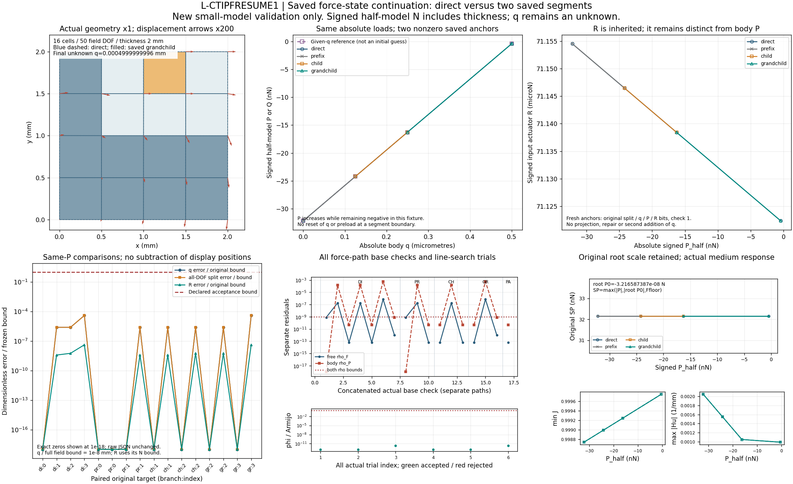

# L-CTIPFRESUME1：力控保存态续载实现与小模型验证

**2026-10-23实际结果：PASS，三份已测源码已安装，科学窗口已关闭。** 用户批准 main `66794cd8e9e84c514a8deff14fe7be3f76cd6f05` 的执行卡后，候选先完成实现、冻结及四份独立源码静审，再唯一启动；没有修复重跑、外部重试、延期、强制执行或新HP。本页记录实际结果；[原准备规格](../lf_circle_tip_force_control_resume_preparation_001/PREPARATION.md)仍保留其历史时点。

## 目标、问题及本轮作用

整体目标是建立独立、可从LF设计输入使用的TMC大变形夹持器分析器，能给出真实变形、输入反力、工件作用力及加载/卸载和导向承载响应，保留来源与资格边界，最终供设计比较和优化使用。已有代码完成多个LF设计、矩形/圆形工件、保存态延伸、完整输入回程、α比较、独立选定态参考、给q探针以及正式r9两载荷力控交叉。此前的[高输入力控](../lf_circle_tip_force_control_high_001/RESULTS.md)已从固定工件父态出发验证P0→P1，却还不能从工件已处在非零q的力控末态继续加载。

本轮补齐这个实际使用缺口：保持机构平均输入，继承已有工件的**绝对q、绝对P、有符号R和原lift/fluctuation**，只计算后续载荷段。根P0决定的残差尺度不随分段漂移；段起点P1与根P0分别记录。这样后续可根据上一步结果渐进探查承载响应，不必反复从固定工件或零q重新开始。

## 实现了什么

- `hf_repo/src/hf_eval/native_guided_force_resume.py`新增显式`extend_native_guided_force`入口。接收成功力控末态和完整绝对载荷列表，只允许精确保留旧前缀并向后追加严格递增的有符号半模型P。
- `split_guided_force.py`接收非零绝对q及独立root P0尺度。工件lift直接取绝对q，零约束及原fluctuation保持，不重复叠加已存在的位移。
- `native_guided_force.py`提取一次共享的运行/保存逻辑，原固定工件入口签名及准入前缀、原组装/求和逻辑经AST核对保持；续载单独输出1.1格式和分段来源，旧入口保留1.0格式。
- 续载fresh核查原q/P/R的binary64身份、split字段SHA及state hash，要求起点一次检查即通过；不以锚点修正掩盖错误。保留原Newton、Armijo、二分、生产门、部分结果和回滚语义。
- 只读取直接力控父的选定split和同身份原固定模型；根力控历史保留pin，不递归重算或读取祖先力控数组。支持显式同字节固定父树迁移，子段再续段也已验证。

三份安装分别为：

|源码|已测并安装SHA256|
|---|---|
|split_guided_force.py|8e902a20e7131733678b5b99aaa9bc5d046323ef151dd73f0681f18198e5dc1f|
|native_guided_force.py|3995cc0afc04907bfa650f1d01af3c93288a3c5fa17243b6536c530dd9fa4daf|
|native_guided_force_resume.py|8455e3aad3de2fed517033f3a715c1a69dd0b41f5c0476a96138290817b230b7|

另外55份生产源码保持原字节，安装后共58份.py。安装发生在12项验证、一次图像检查和四层清理全部通过之后，无自动回滚。

## 实际验证与数值效果

模型为2×2 mm、4×4 Q1、16单元/25节点/50场DOF，t=2 mm、E=1 MPa、ν=.3、平面应变、α=1e−4、γ=1e−6、Lr=2 mm；机构平均输入保持0.0005 mm。原自由DOF35，混合线性系统37×37。这里只验证续载功能，不把此夹具当正式r9。

**唯一pytest进程12项全部通过，pytest耗时9.61秒。** 7条真实路径分别为固定父加载、给q参考、四P直算、两P前缀、child、grandchild及预定partial。37次有限代数/注入/拒绝调用另计；预定partial同时计入真实路径与注入轴一次。

|方法|覆盖|
|---|---|
|V01–V03|非对称稠密代数oracle；非零fresh身份及错误R/mean/P/q；invalid_J回滚|
|V04–V06|直算/分段/给q参考；两次fresh、全局索引、设置/迁移；根P0尺度|
|V07–V08|原固定工件力控入口兼容及非显式opt-in保护；预定第二T失败的部分态保存|
|V09–V10|六个几何/模型/核/split身份反例；五个schema/probe/partial/非末态/覆盖反例|
|V11–V12|八个非法任务延伸、五个clock/output反例；禁止物理覆盖|

本模型的P均为负值且严格递增，代表负x方向外载逐步趋近零，不能称为正向承载增长。P已含本模型厚度，单位为半模型N。

|原目标|P half N|直算得到的绝对q mm|输入R N|
|---|---:|---:|---:|
|0|−3.216587387036128e−8|0|7.115453858590781e−5|
|1|−2.4215824481779638e−8|0.00012499999997504744|7.114647579111752e−5|
|2|−1.6275064208362818e−8|0.00024999999997505273|7.113842249470129e−5|
|3|−4.213649168822395e−10|0.0004999999996012896|7.112234443620257e−5|

child从目标1开始，grandchild从目标2开始，fresh两split、q/P/R、state identity均保持且checks=1。根`SP=max(|P|,|root P0|,Ffloor)`始终为3.216587387036128e−8 N，未误换成较小的段起点尺度；原最小载荷增量4.962975170885513e−10 N保持。

- 6对前缀/child/grandchild与直算同P比较：q、全50DOF物理位移、R差均为**0**。
- 10对力控与给q参考比较：最大q和全场位移差均为**3.987103616015508e−13 mm**，最大R差**2.981555974335137e−19 N**。这些不是HP误差。
- 原比较界均满足：q/全场≤1e−8 mm，R≤max(1e−12 N,1e−7×|Rref|)。全场差使用原四split项`fsum`，没有以总场相减掩盖拆分误差。
- 11个force接受态：最大ρF=7.8460e−10、ρP=7.8517e−10（原界1e−9）；最大mean残差2.7105e−20 mm（界5e−14）；最小J=.9987437160；最大|Hu|=.0020470761 /mm；全局相对平衡最大1.6463e−11，刚体零约束误差0。
- 预定partial在第二T注入`constraint_failure`，只保存已通过的非零fresh锚点，回滚bitwise一致。此预期分支是验证成功的一部分，不代表物理失稳。

真实7路径累计F尝试/完成38/38，T28/27；少完成一次为上述预定注入。HP0，保存时新增F/T0。逐态、Newton、trial、failed_attempts及比较原值见[完整普通摘要](validation_summary.json)，[独立实际结果复核](author/RESULTS_PHYSICS_REVIEW.md)另列12项通过结论。

## 实际图与阅读口径

[人工检查页](inspection.html)展示一次已通过QA的实际图，包含×1变形（箭头×200）、有符号P–q、独立输入R、原比较界、17个force基态检查/6个trial merit及固定根尺度、J/Hu。原图只生成一次、检查一次，无重绘。 helper及renderer在root检查前写入的`ready_for_root_visual_check`/`rendered_pending_root_visual_check`保留其历史时点；最终状态由后续root QA、execution、installation与seal回执确定为PASS。

真实×1网格因位移小而几乎重合；精确零误差点显示在声明的1e−18绘图地板，不改变JSON中的0；小字和branch:index较密但检查时可读。没有由trial merit反造自由残差，也没有绘制真实r9或新动画。

## 资源、读取与封存

helper实耗68.4643秒，outer封存时69.8938秒，均在660/720秒内；tests/display子窗口均满足原卡。四层SUP2均normal_exit/0、全部成员清理proof通过、句柄释放。top采样峰239747072 B（约228.64 MiB）；这是采样树RSS，不是硬峰值或16核实际利用率证明。QA于display+50.5531秒完成，shared elapsed50.6786秒，保留原60秒显示窗口。

观察到新RUN下533次read-capable NPZ open、93个不同路径、43次write-capable事件，包含hash、复制及读写能力open；这不是动态字段解码数。49次自有state验证×2字段=98只按源码控制流计；12次rawcopy含72文件出现/56NPZ出现/861048 B。audit仅观察本RUN范围，不能据此声称证明所有外部路径无读取。没有读取正式r9科学payload；额外结果复核及发布只读普通数据或原文件字节。

一次原包封存226成员，1441228 B，SHA256 `3fddd73e0f5b0927a94f45b5180f38e37019c10186673cdf0c5f2bafb95d43bb`。交付只原字节复制，不解包或重新封存；[成员清单](execution/EVIDENCE_MANIFEST.json)、[安装回执](execution/installation_receipt.json)、[封存回执](execution/seal_receipt.json)、[root QA](execution/root_qa.json)、四层监督及原测试源码均保留。

## 目前能做什么、还缺什么

现在可从成功力控末态在非零q/P/R下追加绝对载荷，连续多段使用，原固定工件入口仍可使用。本轮只授予小模型功能通过；正式r9非零q续载、选定新增态独立参考、极限/稳定性、压力、纯接触抗拔、释放和完整优化功能均未因本轮获得资格。此前正式模型低J和较大的Hu作用仍需保留。

[使用接口](USAGE.md)、[后续计划](NEXT_STEPS.md)、[换目录恢复说明](RECOVERY.md)共同说明下一步。科学窗口已关闭，后续发布核对不重算本卡。

## 发布与恢复

力控保存态续载实现、12项有限小模型验证、实际结果图及三份已测源码安装提交`8b499675bd1a7e8e802f012e6b57d182fa25294d`已普通推送并核远端main，`D:/hf-restore-20260930`已普通fetch／ff-only恢复到同提交。两工作树当时干净，67份本轮变化文件逐字节一致，仓库清单与Git索引集合相同；详见[实际回执](PUBLICATION_RESTORE_RECEIPT.json)。这是同机异目录的交付字节核对，没有异机环境验证或数值复算；本卡仅完成获批小模型功能验证，未新增正式r9续载或独立HP资格。归档回执的后续提交也将普通推送并恢复核对。
