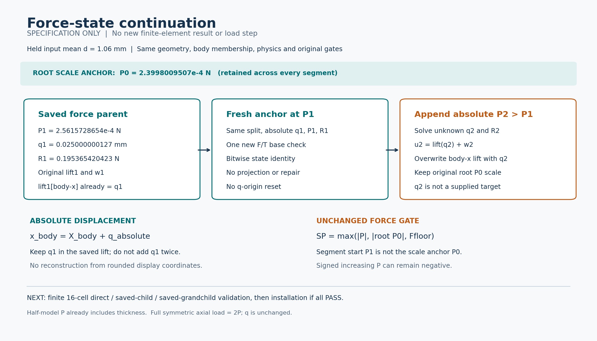

# L-CTIPFRESUMEPREP1：力控保存态续载准备

2026-10-23。**最小规格准备；尚未实现或执行。** 本轮只查源码/普通描述、科学档stat与概念示意；新F/T/HP、平衡、测试、生产修改均0。[来源](SOURCE_BINDING.md)、[接口合同](INTERFACE_SPEC.md)、[验证方案](VALIDATION_PLAN.md)、[候选执行卡](L-CTIPFRESUME1_CARD.md)。

## 目标、进度与目的

整体目标是独立HF读取LF夹持器，在一致大变形/TMC物理下分析实际变形、反力、工件作用及加载/卸载，逐步研究承载。固定工件路径、保存态续算、规定q探针及导向力控已有；[低输入.50](../lf_circle_tip_force_control_real_001/RESULTS.md)和[高输入1.06](../lf_circle_tip_force_control_high_001/RESULTS.md)已完成“给P→未知q→给q参考”局部交叉。

缺口是现力控入口只接受原固定load_only末峰，并从q0/零lift开始，不能接续已经移动的force末态。若每次加P都回原q0重复整段，会丢掉直接复用成功状态的功能。本轮把这一缺口缩成显式保存态续载：继承当前非零q、预载P、R、split与原物理；新载荷仍独立求q，不把旧参考答案输入求解器。

准备的实际效果是明确两处重要继承关系及可检验的最小实现边界；尚没有续载数值成功。当前57份生产源码保持，未来最多改2份/新增1份，不改力核、切线、原fixed/probe默认语义或其历史结果。

## 状态关系示意

图仅表达状态和控制量继承，不画新的真实变形或接触状态。原P0用于残差尺度；P1是本段fresh起点；q1绝对继承，不是从零重定义。新P2下q2未知。[SVG](continuation_schematic.svg)。

|保留项|原值/语义|
|---|---|
|机构mean|1.06 mm，原加权端口，不是每个端口节点固定|
|原预载P0|0.0002399800950672949 N，原全路径尺度锚点|
|本段起点P1|0.0002561572865437846 N，绝对half-N；不是ΔP|
|继承q1|0.025000000126731543 mm，仍相对原未变形坐标|
|继承R1|0.19536542042269825 N，原signed机构乘子|
|原状态|lift1 + fluctuation1；lift1工件x分量已经等于q1|

原物理/网格/材料/工件成员/支撑及所有非clock设置保持。P已含20mm厚度，完整镜像装配轴向载荷2P、q不倍增；Q=Σbody f_int,x、g=Q−P、ON-body Fx=−Q；P与机构R分开，显式P只入账一次。工件uy=0/转角0，不扩自由工件或摩擦模型。

## 两个必须保持的数学事实

1. 保存态的lift已有q1。fresh必须直接使用原两split、q1、P1和R1，首个新F/T检查即通过；不从positions重建、不平移q原点、不加q1第二次、不做predictor/均值投影/Newton修复。后续候选只覆盖`lift[body_x]=q_absolute`，其余lift为原零值，原fixed位置的fluctuation仍0。
2. 把segment_anchor=P1与force_scale_anchor=root_P0分开。始终保`SP=max(abs(P),abs(root_P0),Ffloor)`，不能用P1替换原P0。真实小模型存在负P递增、绝对值下降的历史，正P高输入例不会暴露这个门漂移，因此必须保负P验证。

原freeρF≤1e−9、bodyρP≤1e−9、mean原公式、全部相关J>0/有限、global≤1e−6、rigid/zero≤8e−11 mm不变。正式mean原界1.0600000000000001e−10 mm、Ffloor2.12e−7 N保持；小模型用相同公式及自身尺寸，不照搬正式数值。最小N步长继承来源，不按新小增量重算。

## 准备结论与推进顺序

最小实现与验证限下一张卡的小模型；不在本准备直接给正式模型加P。先编写/冻结/独立静审候选，再唯一执行有限小模型验证和一张实际图；全部通过才安装三份已测源码。成功后另准备正式小增量，候选公式可取P1+(P1−P0)/4=0.00026020158441290701 N，当前不是执行目标或已批准任务，q2不预设。

现正式末态minJ约4.17e−4，轴向Hu约72.58%；功能续载并不自动取得纯接触压力、承载极限、释放、摩擦或稳定性资格。既有失败/二分和资格完整保留。本准备及后续记录须区分源码静审、小模型成功、正式计算三种事实。
