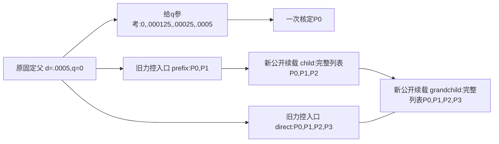

# L-CTIPFRESUMEPREP1：有限小模型验证设计审查

2026-10-23。状态：**准备阶段只读审查完成；以下全部是未来候选验证方案，尚未编写、收集、运行或通过测试。** 本次只读源码与普通结果说明；未打开 NPZ、ZIP 或媒体，未调用力、切线、构模或平衡求解，未改正式仓源码。

正式仓：`D:/Coding/Diversity TO/Compliant-Nonlinear-TMC-O/.github_handoff/Compliant-TO-TMC`。本文件及相邻 JSON 是外部审查材料。

## 判断

最有价值的验证是：在相同原物理模型、同一根 P0 与同一套数值门下，比较“固定父态直接走完整 P 列表”与“先走前缀，再从非零 q/P/R/split 保存态分两次公开 API 续载”。第二次续载必须经过公开新 schema 的保存态准入，单纯多段 controller 代数试验不能替代它。旧固定父入口本身作为前缀计算使用，避免另跑旧全套。

最容易漏掉的问题是归一尺度漂移。现实现的 `SP=max(abs(P),abs(P_anchor),Ffloor)` 使用首目标为 P_anchor。小模型已有三个绝对载荷均负、数值严格递增，越往后其绝对值越小；把新段 P1 误作根 P0 会改变原验收界。本方案明确区分根 `root_P0_half_N` 与局部 `segment_anchor_P_half_N`。

## 已查清的小夹具及证据

以下均为既有源码/普通文档的审阅，不是本次新算结果。

|事实|确切来源|
|---|---|
|4×4 Q1、域 2×2 mm、h=.5 mm、厚度 2 mm；原 PEAK=.0005 mm|`lf_data_preparation/native_interface_001/lf_circle_tip_force_control_001/tests/test_native_guided_force.py:34`、`:164`–`:195`|
|E=1 MPa、nu=.3、alpha=1e−4、gamma=1e−6、Lr=2 mm，机构端口权重 [.25,.5,.25]|同文件 `:184`–`:195`、`:334`–`:340`|
|16 单元、25 节点、50 DOF、35 原自由 DOF；reduced 系统 37×37|同文件 `:333`–`:340`、`:375`–`:376`|
|原工件 cell14，nodes=[17,18,22,23]，与背景对称重叠 y DOF=[45,47]|同文件 `:335`–`:338`|
|夹具先固定父加载 [0,PEAK]，再给 q 得到绝对有符号 P 列表，最后力控从同一固定父重新起算|同文件 `:197`–`:240`|
|既有 q=[0,.00025,.0005] 的力控确实产生非零 q、非零预载 P 和非零输入 R|`lf_data_preparation/native_interface_001/lf_circle_tip_force_control_001/RESULTS.md:23`–`:39`；R 的比较及原 signed R 继承另见测试 `:355`–`:369`|
|三个历史 P 为 −3.216587387036128e−8、−1.627506420836282e−8、−4.213649168822395e−10 N，不能假定 P>0|结果说明 `:25`–`:31`|
|既有三态 SP 均为根 abs(P0)=3.216587387036128e−8 N|结果说明 `:39`|
|已有 source/model/task/lift/fluctuation 失配在 F/T 前拒绝，以及受控第二次 T 错误保存首锚点的先例|原 force 测试 `:445`–`:522`|
|固定/位移保存态已有 fresh 原字节状态、signed R、check1、无矫正，以及后续失败回滚测试先例|`hf_repo/tests/test_saved_native_resume.py:39`–`:102`|

实际新计划重新生成四点给 q 参考 `[0,.000125,.00025,.0005]` mm。历史三个 P 只说明夹具可行性与负载符号，**不作为未来测试的新输入数值**。新生成的四个 P 必须先有限、P0 非零且严格递增；任何一项不满足就按唯一测试窗口首错停止，不搜索或调整目标。

## 同定义直接路径与保存态链

新 API 无 q 目标，也无设置覆盖入口。P1/P2 末态的非零 q 来自此前力控求解，不来自给 q 参考的终态热启动。每个子段只请求 `[P_source_end, 新追加P]`，完整力任务保存精确原前缀。`Nmin=min(diff([P0,P1,P2,P3]))/16` 在 direct、prefix、child、grandchild、受控 partial 中完全相同。原 mm minimum_increment=PEAK/16 及全部非 clock settings 保持。

这 7 条真实路径只生成一次：

1. 固定父 mean `[0,.0005]`，16 单元/50 DOF。
2. 给 q 参考四点；只用于得到四个新 P 和事后交叉对照。
3. 旧固定父力控 API direct 四个 P。
4. 同一旧 API prefix 两个 P，检验原入口仍可用。
5. 新 API child：仅从 prefix 成功末态追加 P2。
6. 新 API grandchild：仅从 child 成功末态追加 P3，覆盖新 schema 二次准入。
7. 从 prefix 非零 q 末态新开受控 partial：fresh 锚点接受后，预定第二次 T 抛出 `constraint_failure`；保存新锚点及 typed failure。本路径同时计入真实路径与注入场景，不是物理承载失败。

所有新测试共享这些路径/普通读出，禁止每个方法重复新建真实夹具。每条真实路径单独 controller 上限 60 秒；总数 7，不根据结果再加路径。

## 12 个最小必要测试方法候选

|ID|验证内容与独立证据|不额外增加的工作|
|---|---|---|
|V01|独立非对称 dense oracle：原力矩阵保留不互为转置的双向耦合；direct 四 P 与三段两 P 的 q、free w、R 对 dense 解；第二/三段非零 q；广义行用求和而非平均；全模型轴向为 2P。|4 次纯代数 controller 调用，无真实内核。沿用既有 `algebra_fixture` 的矩阵定义，oracle 独立 `np.linalg.solve`，不调用候选的 reduced 组装函数。|
|V02|非零 fresh 锚点 6 个受控分支：正确锚点 callback 后停止；错误 R、mean、平衡 P；非有限 q 与 q/lift 失配。正确者只 1 次 fresh F/T，split/q/P/R 位身份保持；平衡错误 `initial_state_not_equilibrated`、无 linear correction/trial/accept；结构/类型错在 F/T 前拒绝。|6 次代数/拒绝调用；冻结候选时给最后两分支确定 typed code，不能把未实现的 code 写成既有能力。|
|V03|非零源锚点接受后的预定 `invalid_J` 终端失败，max_bisections=0，核回滚原两 split 数组、q、P、signed R，及未接受新目标。|1 次纯代数 controller 调用；不引入真实物理失败搜索。|
|V04|真实 direct vs prefix→child→grandchild 全路径交叉：P1、P2、P3 按原目标关联，不按接受行位置盲目配对；另与给 q 参考作事后检查。q 与全 50 DOF 物理位移差≤1e−8 mm；R 差≤max(1e−12 N,1e−7 abs(R_direct))。|使用 7 路共享结果；误差按每 DOF 四 split 项 `math.fsum([lift_a,w_a,-lift_b,-w_b])`，不减已舍入 positions。|
|V05|两次公开续载 fresh anchor 的 archive/field/state hash、lift、w、q/P/R 比特身份，newton_checks=1，第一次新计算输入即原 split；完整 prefix 与局部/全局索引、原机构 d、material、边界/原 body membership、settings 非 clock、force_settings、root 来源及全部 false qualification 继承。|只读已生成结果/两 split 字段；不新增 F/T。父树前后原字节相等。|
|V06|单独防 root_P0 门漂移：四个新负 P 预先核验 strict increase；每个 direct/child/grandchild 接受态按原 root P0 重新计算 SP 与 g bound，和实际记录精确一致。局部源 P 为 P1/P2，不替换原 root P0；局部 step/全局增量分开。|共享真实结果；不为了造边界另开路径。不要求 P>0。若新四点本身不满足预设条件立即停止。|
|V07|原固定父 API 兼容与默认固定入口 guard：prefix 已由原 API 成功生成 q=0 原字节 fresh 锚点、原 schema/默认行为；原 fixed 位移 controller 不经 opt-in 仍拒绝非零 body lift。|prefix 是路径4；另 1 次纯代数拒绝调用，不重跑旧 17 项全套。|
|V08|受控真实 partial：第二次 T typed `constraint_failure`，结果 JSON 留存真实 fresh 非零锚点，P1/q1/R1/split 原位身份、rollback、target_reached=false、所有资格 false；原 prefix、source 固定父保持。|唯一路径7；原窗口内记录，不能将预期异常当作脚本失败重试理由。|
|V09|6 个来源身份拒绝：source geometry 字节、固定 root model 身份、实际 force/tangent kernel pin、选定 split lift、w、state/descriptor 身份。只修改测试副本并明确保留哪一级 pin 以验证对应层；统一 `invalid_saved_state`，F/T=0。|6 次有限拒绝；复用路径4的测试副本。既有 canonical self-hash 不是真实性签名，不要求检测“所有可信 pins 一并重新签写”的任意伪造。|
|V10|5 个资格/来源类型拒绝：不支持 schema、位移 probe 当 force、partial 源、末态非原目标、声明完成却缺原目标覆盖。源普通 JSON/descriptor 合理重签后仍作语义拒绝，F/T=0。|5 次有限拒绝；新 API 只接受成功完整末原目标，无任意选择状态/partial-resume 扩展。|
|V11|8 个完整目标扩展拒绝：没有新 append、改 P0、改旧中间 P、丢前缀、末端重复、下降、NaN、Inf。拒绝以增量载荷、截短 segment 列表代替完整前缀；typed input/extension code 按候选规格固定，F/T=0。|8 次有限拒绝；不扫描大量非法组合。|
|V12|5 个有限输入拒绝：clock=0/NaN/Inf、已存在 output、output 位于 parent 内；检查 API signature 不暴露 q/非 clock 设置覆盖。`invalid_settings` 或 `invalid_input` 在 mechanics 前，父态不变。|5 次拒绝；不通过新增 kwargs 绕过继承，不把 Python TypeError 冒充数值 typed failure。|

上表为 **12 个非参数化方法、最多 7 条真实路径、最多 37 次有限代数/注入/拒绝 controller/API 调用**（V01=4、V02=6、V03=1、V07=1、V08=1、V09=6、V10=5、V11=8、V12=5；受控真实 V08 同时在两轴各记一次）。共享 fixture 实际科学计数另记，不将方法数等同求解次数。未来冻结候选可以在不增规模/语义范围的前提下调整方法拆分，但要先重写可审计的准确计数，不能执行后补称“12 项”。

## 所有真实接受态保持的门

* 自由平衡 rho_F≤1e−9；force floor 与原 settings/held d 相同。
* g=`fsum(sum_body_internal_x,-P)`；SP=`max(abs(P),abs(root_P0),Ffloor)`；rho_P≤1e−9、abs(g)≤1e−9 SP。保绝对有符号 half N，不乘厚度、不做节点平均。
* 机构均值误差≤1e−10 max(abs(d_hold),1e−6)，本夹具为 5e−14 mm。q 未知，uy=0/转角0；原固定 fluctuation 保持零。
* 所有相关字段有限、J>0、相对 global balance≤1e−6、刚体/zero误差≤8e−11 mm；原 body-y/background overlap 去重。
* 原 force/tangent 内核不变；保存不新增 F/T，HP=0；保 material/Hu/total 有符号分量和输入 R 的不同物理含义。
* fresh 锚点不投影、不修复、不重定 q 原点、不从 positions 回算 split；只经过一次新 check，硬身份失败不进入 predictor。

门的现实现依据：`hf_repo/src/hf_eval/displacement.py:24`–`:34`；`hf_repo/src/hf_eval/split_guided_force.py:113`–`:118`、`:172`–`:197`、`:275`–`:301`；`hf_repo/src/hf_eval/native_guided_force.py:103`–`:117`。新增 root scale 是“保原任务门”，不是放宽门。

## 原入口实际限制，不能当作已具备能力

* `split_guided_force.py:101`–`:104` 明确只允许零 lift；`:118` 把 state_q 初始为 0。非零 q 必须显式新增，不能只把保存文件传进旧 API。
* `native_guided_force.py:54`–`:55` 仍借 `native_probe._admit`；`native_probe.py:61`–`:74` 只接受完整固定 load_only 父峰，`:123`–`:127` 拒绝非零 lift。
* 原 `native_resume.py:174`–`:176` 针对零 lift 的位移任务；不能直接宣称支持 force schema。
* 原 force 保存已含 q、P、signed R、两 split/hash、settings/options、source root 和 perstate gates：`native_guided_force.py:145`–`:174`、`:185`–`:220`。新续载应尽量复用此缓存/保存逻辑，而非新写力核或重复防御层。

## 后续实现卡候选边界

仅候选，尚未申请执行：新 `extend_native_guided_force(saved_force_result, full_extended_P_targets, output, *, time_limit_seconds, on_accept=None)`，不增加 q 参数、非 clock settings 参数或 GUI/CLI。只接受成功完整末原目标，严格追加新绝对 P；继承根尺度、原非 clock settings、Nmin、signed R/非零 q/split，新增一次 fresh 校验。生产最大范围 3 文件（2 旧改+1 新）由主 agent 的接口规格冻结；测试单独 1 文件。原默认固定入口、native_resume、力核/切线/材料/全部正式 r9 定义保持。

建议未来窗口：tests 480 秒、显示 60 秒、helper 660 秒、outer 720 秒，8 GiB、四库线程 cap16、CPU；7 条小路径各 60 秒且共享 tests 总窗。只生成 1 张六面板实际结果 PNG：小模型实际×1及声明放大箭头、P–q、direct/split 误差、非零锚点身份/继承、rho_F/rho_P/mean、J/Hu/收敛。图只用新结果，给 q 参考标明参照，不混作未知 q 求解输入。一次像素检查；不重绘、无外部重试/修复重跑/延期/force/HP。只有全部原门与12项有限验证通过，才安装已测候选；真实 r9 的任何新 P 目标另经准备。

本准备阶段不能声称新函数已实现或任何验证已经 PASS。已有 r9 的 q、P、R 和原位移 split 继承规则需在主规格中给出明确字段映射；此审查只给未来最小有限验证方案。
