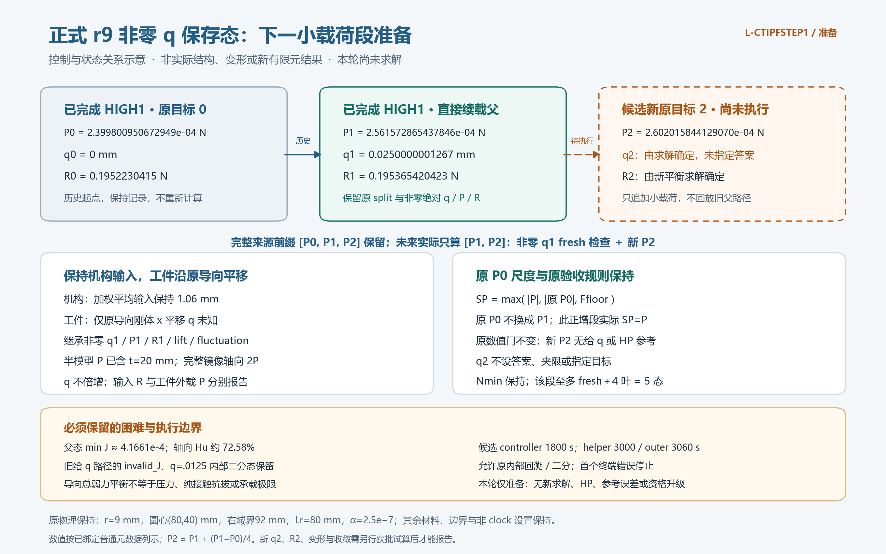

# L-CTIPFSTEPPREP1：正式r9非零q小载荷续载准备

2026-10-24。**准备完成，正式续载尚未执行。** 本轮只核父态/载荷/尺度/门/预算并作控制示意；无HF导入、构模、F/T、平衡、HP、测试或科学NPZ/旧媒体解码，58生产源码保持。图是任务示意，不是新有限元结果。

## 整体目标、已做什么及本轮作用

整体目标是独立HF从LF设计分析TMC大变形夹持器的实际变形、输入反力、工件作用和加载/卸载，逐步支持设计比较、优化及承载研究。已有多设计/圆矩工件、完整输入回程、选定态参考、α对照、给q探针、正式低/高输入两载荷力控交叉；[FRESUME1](../lf_circle_tip_force_control_resume_001/RESULTS.md)最近又通过12项小模型验证并安装非零q保存态续载入口。

当前缺的实际证据是正式r9已移动的force末态能否继续承受一个小载荷增量。本轮将问题缩成一个新目标，避免重复固定父加载，使后续决策依据实际J/Hu、反力和收敛。不预定q2，不开展容量扫描，也不让小模型通过代替正式试算。准备的效果是明确可执行来源、控制量、原门和有限预算；新平衡是否成功仍待求解。

## 控制/状态关系示意

[SVG](control_schematic.svg)和渲染/QA记录保留。已完成HIGH1与未执行新段明确分开；root P0与segment P1不混用，q1绝对继承、q2未知。P是含20mm厚度的半模型合外载，完整镜像轴向2P、q不加倍。

## 核定源及小增量

|项|核定值|
|---|---|
|直接父|`D:/hfh1_001/run_001/force/result.json`，success，accepted1/original1|
|末态|绝对q=0.025000000126731543 mm；signed R=0.19536542042269825 N；原split/state身份继承|
|根P0|0.0002399800950672949 N，保持原根任务值|
|段首P1|0.0002561572865437846 N，新fresh起点，不归零q|
|新P2|**0.000260201584412907 N**，源binary64一次算`P1+(P1-P0)/4`|
|新增量|4.044297869122411e-06 N，约4倍原Nmin|
|完整/新段|full=[P0,P1,P2]；只执行[P1,P2]，global原索引1/2|

保持mean1.06 mm、α2.5e−7/γ1e−6、r9/(80,40) mm、right92/Lr80 mm、E1 MPa/ν.3/plane strain/t20/h.5、14720单元/29970DOF、510工件格/565节点及原端口/支撑/导向。工件仅原+x刚体q未知，uy=0、转角0，不重mask；mechanical/chunk256/guided_reduced_tangent保持。[完整来源](SOURCE_BINDING.md)。

P为绝对有符号半模型N，非ΔP/每节点载荷。`Q=Σbody f_int,x`，`g=Q-P`，ON-body Fx=−Q；R是保持mean的独立乘子。显式P入账一次，移除旧body-x处方驱动力，body-y导向/背景重叠去重。不将节点或Hu弱力称压力/纯接触抗拔力。

## 原尺度、二分和成功条件

SP=max(|P|,|root P0|,2.12e−7 N)。此正增段P≥P1>P0，实际SP=P；根P0仍要精确核元数据/来源，但本例SP不能独证根/段尺度正确，根主导数值检查保留FRESUME1负载小模型证据。

Nmin=1.011074467280606e-06 N，原max_bisections4/max_checks25/Armijo/回溯及全部非clock设置保持。实际Δ/Nmin=3.9999999999999867，不是浮点精确4；原Nmin×(1−1e−12)截止允许两级二分，下一半步不足。最多fresh+4叶=5接受态是派生上界，不改maxdepth或强裁结果。旧minimum_increment=.00625 mm另保，不能当N步长。

所有接受态含内部点保原ρF/ρP≤1e−9、mean原公式界1.0600000000000001e−10 mm、J全正有限/原F-Hu有限性、global≤1e−6、rigid/zero≤8e−11 mm。P2 body残差界2.60201584412907e-13 N；free尺度仍独立按原公式。

fresh须checks1，q/P/R bits、split字段SHA/state身份原样保持，不预测/投影/Newton修复。实际末原目标P2达到后报告真实q2/R2/三力/账本。P2没有给q/HP参考，旧P1工程比较只历史，不沿用其误差界、不填零误差、不以q=.025或预期斜率作为fallback。数值success、目标达到、普通继承核对和显示完成分开报告。

## 低J、Hu与内部二分历史

直接父minJ=0.00041660852936145333、max|Hu|=0.3181733832407684 /mm，轴向Hu约72.5806%，旧尖端栅格边无符号距离约.00866824 mm；均为已有普通保存值，未新定位局部场，不是解析圆有符号接触门。

原PROBE请求[0,.025]，实际q=[0,.0125,.025]；首次+.025的invalid_J、bitwise回滚/二分、F28/27、T15/15完整保留。HIGH1另是两态8F/5T、无failed/内部二分；未来N内部态不与旧q=.0125硬配。[HISTORY.json](HISTORY.json)保完整普通摘录。原低J/Hu及历史不因新success抹去，不授压力、纯接触、容量、稳定性、释放、整路径HP/HF5。

## 最小试算、可视化和资源

复用现有extend_native_guided_force，只需薄研究包装/分段viewer标签；不改生产源码、不重跑小模型、新HP或旧P1参考解码。未来API仅3旧NPZ：model opaque身份、geometry四mask、直接force末态两split，共2解码档6字段；普通核对只读协议/新result，viewer四普通JSON，无科学场。

成功后一次5PNG/实际N帧GIF：×1变形、P–q及根/段关系、三力/独立R/互斥账本、tip/右480格介质几何及全域保存J-Hu、全部Newton/trial/二分/原门。坐标zoom不改变形倍率，箭头倍率明确，无局部场读取不称局部分布；按真实N写全部帧，不硬定2或17。partial不启动后续核对/显示。

|阶段|候选窗口与包含关系|
|---|---|
|controller|1800秒，包含在science中|
|science|2100秒=进程2085+清理15，含导入/准入/科学读/fresh/路径/保存|
|普通核对|60秒=45+清理15，协议/新result原门及继承，无参考NPZ|
|显示/root QA共享|600秒，viewer510+清理15，五图各一次检查须在共享585秒前完成|
|helper|3000秒=2100+60+600+240其他调度/清理/一次封存|
|outer|3060秒/最多51分钟，64GiB采样/四库cap16/CPU，viewer原8GiB|

依据HIGH1 science监督398.9298秒预留；小增量不保证更快/成功，低J/二分可能耗尽额度，按原规则停不加时/降门。最终包装冻结须核绝对deadline和清理/封存余量，不能science后再加controller或显示后另开QA。

首个终端错误停止后续科学/核对/显示，保真实partial和全部内部尝试；原Armijo/有界N二分允许。无外部重试/修复重跑/延期/force、新HP/测试、生产修改/安装、API关联、q回放、旧包解压/科学复制、删除/回滚。四层SUP2同实例终止/全部成员覆盖/句柄释放后，原窗口有余量才一次完整/部分原字节封存，不补开封存窗。

[候选执行卡](L-CTIPFSTEP1_CARD.md)、[接口/验收细则](TASK_SPEC.md)、[机器合同](CONTRACT.json)约束下一步。当前真实包装未编写/试跑；新卡获批后先编写、冻结、独立静审再唯一启动，含记录、普通main推送和同机异目录恢复。旧HIGH1/FRESUME1窗口已关闭。

## 准备结论

[来源审阅](author/SOURCE_AUDIT.md)16项、[数学/资源审阅](author/MATH_RESOURCE_AUDIT.md)12项通过并保限定。当前58源保持；普通来源/stat不等于payload/fresh已通过。先按候选卡安排一个正式P2，再据真实q/R/J/Hu/收敛决定后续，不扩扫描。恢复见[RECOVERY](RECOVERY.md)，总览见[人工页](inspection.html)。
