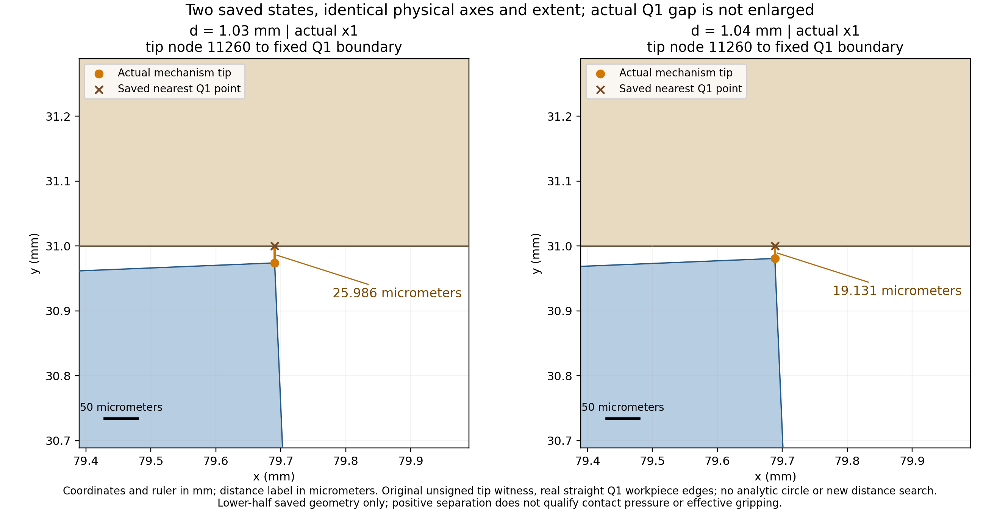
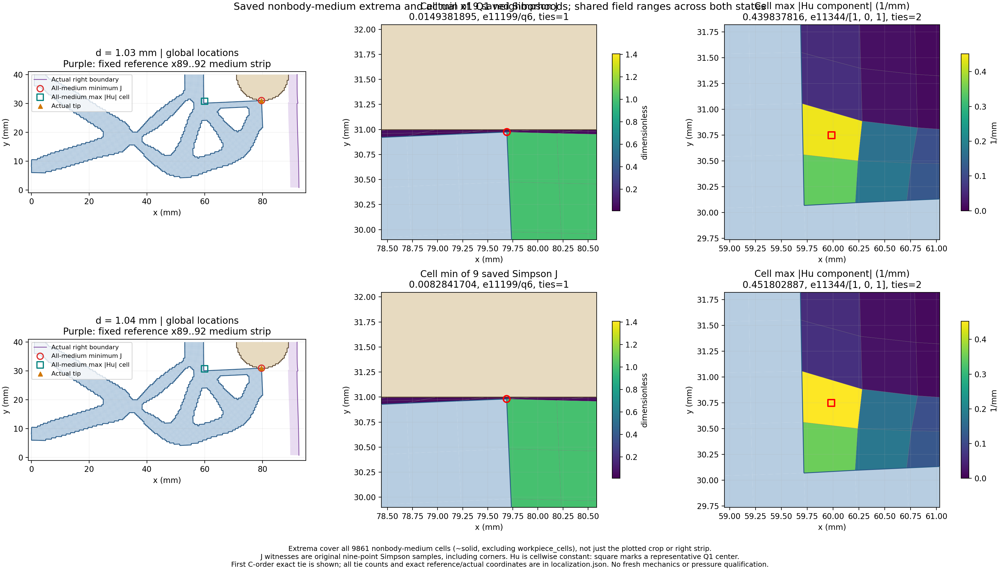

# L-CTIPLOCAL1：尖端近景与介质极值定位

2026-10-19；唯一执行及数值对账 **PASS**；**图像QA未通过**，整阶段完成标志 `False`。

实际像素检查：尖端近景通过；medium_locations.png顶部总标题与上排子图标题重叠，保留原输出并记为排版未通过。原窗口已关闭，没有重绘、覆盖原图或重试。定位JSON和原数值对账通过；计算状态与显示缺口分别记录，原物理门保持。

整体目标是把LF夹持器几何接入独立、可恢复的TMC大变形分析，逐步观察机构接近工件、变形、作用力及卸载。本轮不改变模型或求解新的平衡态。

已完成的前序工作：当前r9 mm、圆心(80,40) mm、right92 mm、Lr80 mm布置已由短行程逐步延伸到1.04 mm，STEP8保存1.03与1.04 mm两态，原生产门通过。宽幅图难以肉眼分辨约19微米的最近距离，原摘要也没有给出全非工件介质minJ/maxabsHu的位置。

本轮做什么及原因：只解码5个既存NPZ的12个批准字段，复用真实Q1边界与原split坐标顺序，生成等比例近景与全介质极值定位，让数值与空间位置可以对照。原J九点为含角点的Simpson；Hu逐单元常值组件，图中中心只是代表标记。保留精确并列数，首个C-order见证不代表唯一极值位置。

数值和空间观察已得到真实结果：两态原unsigned Q1尖端距离为25.986与19.131微米，近景采用共同等比例实际坐标，root检查tip_closeup通过。9861个全非工件介质单元中，minJ由0.0149381895254降至0.00828417040294；首个见证均为e11199/Simpson6、local[1,-1]、reference(80,30)，actual坐标严格等于该态tip。1.04 mm actual为[79.6884963855901, 30.980869329953457] mm，exact tie count=1。它表明所保存九点样本最小J位于该介质单元的尖端共享角点，不能单独认定首次接触、压力或有效夹持。

全介质maxabsHu由0.439837816292增至0.451802886616/mm。首个C-order代表为e11344/component[1,0,1]，signed值-0.451802886616/mm、reference中心[60.25, 30.75]、actual中心[59.981891483801434, 30.74971921671674] mm，exact tie count=2。这个首个代表在尖端左侧约20 mm处，且不在右侧x89..92参考条带；仅有首个代表及并列总数，不能宣称全部并列只在同一单元/位置。Hu逐单元常值，中心仅为代表标记；Hu场峰值位置不等于正则弱力主要来源、压力或夹持力位置。

输入R=0.188497437516 N；下半工件signed Fy total/material/Hu=0.00885936998869/0.0045643384771/0.00429503151159 N，沿用STEP8普通记录、未重新求力，镜像不翻倍。原物理、生产门、路径/参考/压力/有效夹持等资格保持。当前空间定位没有发现原标量对账矛盾（8/8精确），并非新增失败的力学证据。

但medium_locations图的全局suptitle与上排J/Hu标题真实重叠，root已将此图QA记为NOT_PASS；唯一执行和数值对账PASS不覆盖该排版缺口，stage_complete=false。原图保留、未在关闭窗口后重绘。当前源码给ConstrainedLayoutEngine的rect=(0,.075,1,.95)，该接口实际含义为(left,bottom,width,height)，其上缘为1.025而非.95；本机layout_engine.py说明已只读核实。这是可用小型排版修订解决的功能缺口，不能默默将pixel结果改PASS。

读取范围：model的coordinates/connectivity/solid/workpiece_cells；每态state的lift/fluctuation和forces中的J/Hu。其余普通JSON提供身份、原反力、边界与tip见证。没有读取旧媒体、应力、力数组、切线或矩阵；无新构模、F/T/HP/Newton/平衡求解、测试、GIF或默认HF修改。原物理条件、数值设置、验收门及历史保持。

资源与效果记录：helper 2.3857558999989124 /180 s；outer 2.9984235000010813 /240 s；采样进程树峰值 196370432 B /8 GiB；四库线程上限16。唯一启动，owned清理 True。原窗口输出封存 4 份、984270 B。实际审查 pass_record_audit_with_visual_issue；实际像素检查次数 2。

正unsigned Q1距离、介质场或工件含Hu弱式合力，不能直接授予连续接触压力或有效夹持资格；本卡也不授独立高精度参考、自由释放、稳定性、网格/域宽收敛或HF5资格。

入口：[manual.html](run_001/manual.html) · [localization.json](run_001/localization.json) · [实际审查](author/ACTUAL_REVIEW.md) · [原窗口回执](run_001/execution_receipt.json) · [闭卡记录](author/closure.json) · [后续计划](NEXT_STEPS.md)

下一步：建议下一阶段L-CTIPLOCAL2先修复medium_locations图顶部标题重叠：只调整布局并在新目录生成一张介质定位PNG、普通渲染JSON及人工页；继承已通过tip图链接而不读取/重绘旧媒体。同两态、同5NPZ/12字段上限、零新F/T/HP/Newton，原物理与门保持。完成新图一次像素检查后，再决定是否推进1.04→1.05 mm；本轮未实施或执行下一阶段。

恢复开发：origin保持https://github.com/dudaxing/Compliant-TO-TMC.git，后续在main。另一目录或计算机clone后先读README、docs/CURRENT_STATUS.md与docs/RESUME_DEVELOPMENT.md，再读本卡RESULTS/NEXT_STEPS、protocol及author/authorization。不同路径恢复核对采用同机local Git对象fetch/ff-only，不能表述为独立机器或远端对象下载验证。不要重新运行本卡已关闭launcher。
