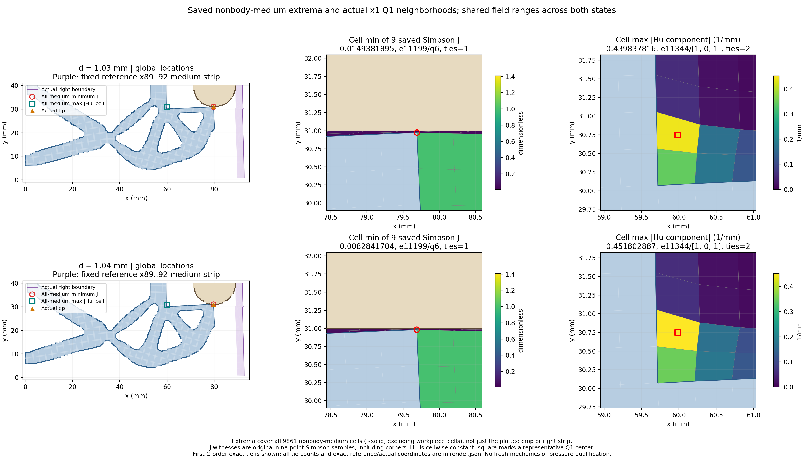

# L-CTIPLOCAL2：补齐介质定位图排版

2026-10-19；唯一执行 **PASS**；**图像QA通过**，本阶段完成 `True`。

整体目标是把LF夹持器几何接入独立可恢复的TMC大变形分析，逐步观察接近工件、变形、作用力与卸载。当前r9/(80,40)、right92/Lr80的真实前向路径已推进至1.04 mm。LOCAL1完成两态局部定位及尖端近景，但介质图标题重叠；本轮只补足该显示功能。

问题与实现：constrained-layout的rect实际为(left,bottom,width,height)，旧值(0,.075,1,.95)使上缘达到1.025。本候选将medium绘图区改为(0,.075,1,.85)、suptitle显式y=.985，保留原图大小、两态共同范围、色标、地图数据与Q1/Simpson/Hu定义。原LOCAL1失败图、执行PASS/图像NOT_PASS及stage_complete=false历史保持。

为何这样做：先让已有介质压缩位置及正则项场峰值能够完整阅读，再根据真实结果决定下一物理目标；没有为排版问题重做平衡或改变任何原物理验收门。

LOCAL2仅修复介质图布局：新图一次像素检查通过，8项原标量及5组继承身份对账均精确；数据、9861非工件介质掩码、坐标范围、色标、原两态见证均未变，无新求解。LOCAL1原视觉失败及stage_complete=false历史保持，由LOCAL2新输出补足视觉功能。

当前最新生产态仍来自STEP8 accepted1/global10、1.04 mm，不能用本卡render.json代替力学saved_result。tip/global unsigned Q1距离0.0191306700465 mm约19.131微米，原相交/near-touch/跨区重叠标志false，containment未测试。全介质minJ=0.00828417040294首个见证e11199/Simpson6/reference(80,30)与actualtip[79.6884963855901, 30.980869329953457]同址，exacttiecount1；maxabsHu=0.451802886616/mm首个代表e11344/[1,0,1]、signed负、actual中心[59.981891483801434, 30.74971921671674] mm、exacttiecount2，位于尖端左侧而非右条带，但未给全部并列位置。不能据Hu峰值位置推导正则弱力主要来源。

原1.04 mm输入R=0.188497437516 N，q_out=0.983481659548 mm；下半工件signed Fy total/material/Hu=0.00885936998869/0.0045643384771/0.00429503151159 N，包含Hu、镜像不翻倍。生产原门已通过，新目标5次Newton检查、4次线搜索全部接受、无失败或二分。局部定位与原标量没有矛盾，因此没有依据重做力核、放宽门或例行插入HP；可准备下一单目标加载，仍不保证收敛、接触或有效夹持。

实际执行仅读取同5NPZ/12字段：model坐标、连接、solid、workpiece_cells，两态各lift/fluctuation/J/Hu。与原普通定位及producer色标记录精确核对，原图媒体仅链接，未重开或重绘尖端图；只输出1张新PNG、render.json及manual.html。无新构模、F/T/HP/Newton/平衡求解、测试、GIF或默认HF修改。

资源：helper 2.2528132000006735 /180 s；outer 2.9164515000011306 /240 s；进程树采样峰值 176828416 B /8 GiB，四库线程上限16。唯一启动、清理 True。原窗口封存 3 份输出、809060 B；像素检查 1 次。

minJ为原含角点九点Simpson样本最小值；Hu逐单元常值组件，中心只是代表标记。首个C-order见证与精确并列数量均保留，未宣称所有并列位置唯一。正unsigned Q1距离及工件包含Hu的弱式合力，不能直接当作连续压力或有效夹持力；不升级完整路径、独立参考、释放/稳定性、网格/域宽或HF5资格。

入口：[manual.html](run_001/manual.html) · [render.json](run_001/render.json) · [原通过尖端图](../lf_circle_tip_local_001/run_001/tip_closeup.png) · [实际审查](author/ACTUAL_REVIEW.md) · [闭卡](author/closure.json) · [后续计划](NEXT_STEPS.md)

下一步：建议准备L-CTIPSTEP9：复用已安装load_only保存态延伸API，从STEP8成功1.04 mm末态仅推进到1.05 mm；保全部原物理、非clock设置、验收门与完整嵌套历史，继续记录实际变形、反力、尖端、右介质和收敛。下一执行窗口需明确授权；本轮未开始新加载。

恢复开发：origin保持https://github.com/dudaxing/Compliant-TO-TMC.git，在main继续。新目录/计算机clone后先读README、docs/CURRENT_STATUS.md与docs/RESUME_DEVELOPMENT.md，再读本卡RESULTS/NEXT_STEPS、protocol和author/authorization。异路径恢复核对使用同机local Git对象fetch/ff-only，不能表述为独立机器或远端对象下载验证。不要重新运行已关闭launcher。
