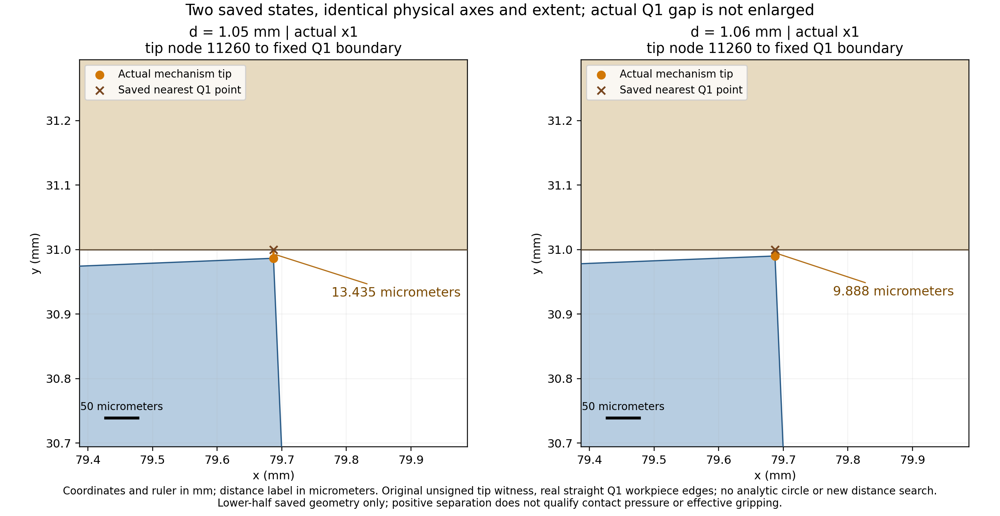
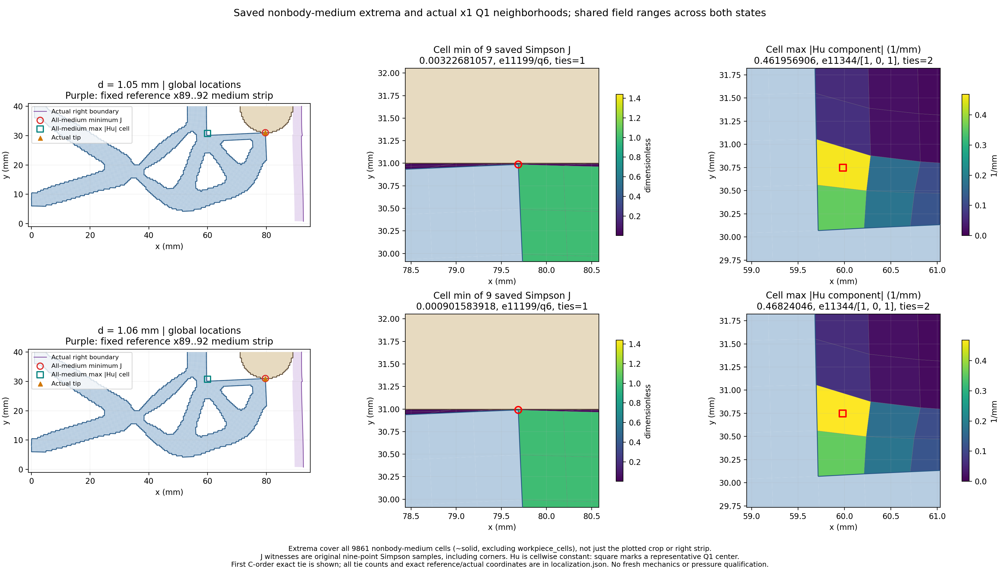

# L-CTIPLOCAL3：尖端近景与介质极值定位

2026-10-19；唯一执行及数值对账 **PASS**；**图像QA pass_root_visual_inspection**，整阶段完成标志 `True`。

本轮图像QA仅依据实际检查记录，两张新PNG各最多检查一次；检查状态与次数见闭卡JSON中的pixel_QA。执行与视觉结果分别保留，只有执行PASS且实际QA为PASS才标记本阶段完成。未自动重绘、覆盖或重试。LOCAL1旧视觉失败及LOCAL2修复记录继续保留，本卡不覆盖旧历史。

整体目标是把LF夹持器几何接入独立、可恢复的TMC大变形分析，逐步观察机构接近工件、变形、作用力及卸载。本轮不改变模型或求解新的平衡态。

已完成的前序工作：当前r9 mm、圆心(80,40) mm、right92 mm、Lr80 mm布置已逐步加载；本卡科学来源为STEP10真实保存结果，选定观察态为1.05 mm/global11、1.06 mm/global12；实际完成范围见回执。原宽幅图与标量不能替代当前态全非工件介质极值的空间位置，旧1.04 mm定位也不转授到新保存态。

本轮做什么及原因：唯一窗口按批准范围观察5个既存NPZ的12个字段，复用真实Q1边界与原split坐标顺序，生成等比例近景与全介质极值定位，让数值与空间位置可以对照。算法继承LOCAL1，介质图采用LOCAL2已修布局；实际完成范围与原值对账由回执、实际审查及以下解释记录。原J九点为含角点的Simpson；Hu逐单元常值组件，图中中心只是代表标记。保留精确并列数，首个C-order见证不代表唯一极值位置。

LOCAL3执行、原8精确比较和两图QA全部PASS。两态J_min均e11199/Simpson6/local[1,-1]、reference(80,30) mm：1.05 actual(79.687143550996,30.986565355120025)，1.06 actual(79.68711006356523,30.990112475289735)，分别精确等于当前tip，数组精确并列数均1。1.06至原Q1工件边4的最近点为(79.68711006356523,31) mm，unsigned距离0.009887524710265438 mm；并不代表圆周连续法向压力或唯一首次接触。

Hu首代表e11344/[1,0,1]在1.06的signedcomponent=-0.4682404604988441/mm，Q1实际中心(59.97960386405724,30.748456951938792) mm，exactties2。首代表在tip左侧约20 mm；没有保存全部并列位置，不能将其说成唯一单元或所有并列都在同处。Hu逐单元常值，中心只是代表。

最新两态的全介质minJ现已逐态定位到实际最右tip，而不是right89..92条带；1.06 mm的J=0.0009015839179744192、Q1最近距离9.887525微米。Hu最大分量首代表在e11344内侧连接附近，和tip强压缩点空间不同。这消除了“压缩位置是否来自右条带”的当前信息缺口，但没有为该c80/right92布局建立独立高精度力/方向切线参考。结合本段首次factor1 invalid_J内部拒绝后factor.5恢复，先核一个最新峰值保存态，比直接增加1.07 mm更能回答当前高压缩计算是否数值一致；不把小J标量或内部拒绝改成新失败门。

批准读取范围：model的coordinates/connectivity/solid/workpiece_cells；每态state的lift/fluctuation和forces中的J/Hu。其余普通JSON提供身份、原反力、边界与tip见证。没有读取旧媒体、应力、力数组、切线或矩阵；无新构模、F/T/HP/Newton/平衡求解、测试、GIF或默认HF修改。原物理条件、数值设置、验收门及历史保持。

资源与效果记录：helper 3.327169500000309 /180 s；outer 4.849101200001314 /240 s；采样进程树峰值 196411392 B /8 GiB；四库线程上限16。唯一启动，owned清理 True。原窗口输出封存 4 份、980259 B。实际审查 pass_record_audit；实际像素检查次数 2。

正unsigned Q1距离、介质场或工件含Hu弱式合力，不能直接授予连续接触压力或有效夹持资格；本卡也不授独立高精度参考、自由释放、稳定性、网格/域宽收敛或HF5资格。

入口：[manual.html](run_001/manual.html) · [localization.json](run_001/localization.json) · [实际审查](author/ACTUAL_REVIEW.md) · [原窗口回执](run_001/execution_receipt.json) · [闭卡记录](author/closure.json) · [后续计划](NEXT_STEPS.md)

下一步：建议下一阶段 L-CTIPREF1：仅对STEP10真实accepted1/global12/d1.06 mm保存态执行HP80/120各一次，复用原十五门核材料/Hu/总力、同一PORT方向切线、CSC/KKT及工件弱式合力，全部通过后生成一张原误差/limit图与普通JSON。先保留1.07 mm，待参考实际结果再决定。本轮只是待新授权的具体提案，未实施或执行HP。

恢复开发：origin保持https://github.com/dudaxing/Compliant-TO-TMC.git，后续在main。另一目录或计算机clone后先读README、docs/CURRENT_STATUS.md与docs/RESUME_DEVELOPMENT.md，再读本卡RESULTS/NEXT_STEPS、protocol及author/authorization。不同路径恢复核对采用同机local Git对象fetch/ff-only，不能表述为独立机器或远端对象下载验证。不要重新运行本卡已关闭launcher。
