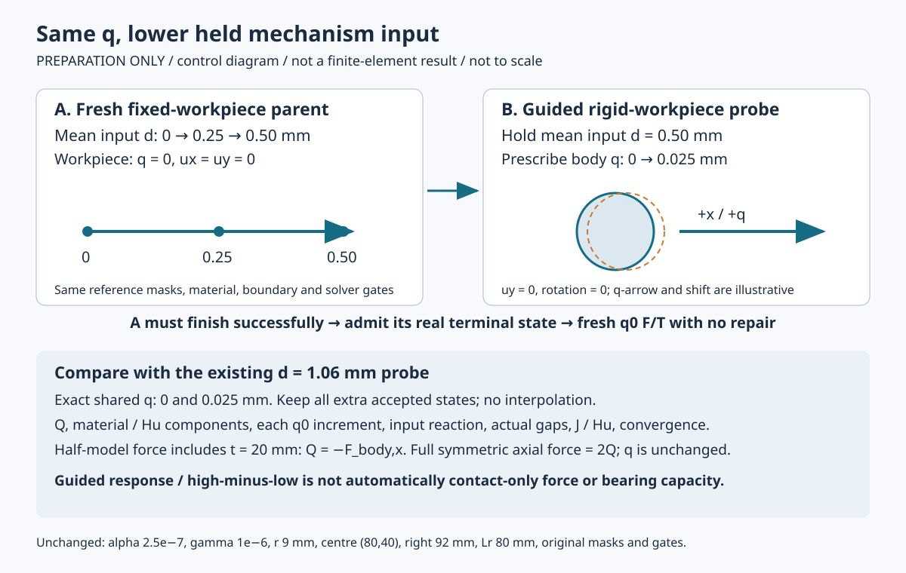
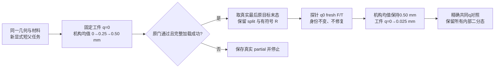

# L-CTIPLOWPREP1：0.50 mm保持输入的同定义探针准备

2026-10-23（Asia/Seoul）。**普通输入与流程准备完成，成品静审15项通过；尚未构模或试算，数值成功状态为空。** 用户本轮授权的是准备与示意说明，不包含后续力学执行。

整体目标是HF独立读取LF普通几何，计算一致大变形／TMC任务的实际响应，供外部研究比较。此前真实探针已经把机构输入均值与工件位移解耦；本阶段准备低输入对照，以判断机构闭合程度、背景介质与Hu对工件驱动力的影响。HF不重新优化LF。

## 为什么先做这个对照

已有高输入1.06 mm探针仅推进q=0→.025 mm，原内部二分产生.0125中间态。轴向驱动力由2.39980095e−4增至2.56157287e−4 N，末态Hu轴向分量占72.58%，本段增量占79.48%；仅凭正Q不能把它解释为纯接触抗拔。高输入尖端距离约.00823 mm，而原α加载路径中.50 mm中间态的历史距离约.51903 mm，可作为选择低输入的线索。后者不是新的对照结果，也不预先证明低输入无接触。

本轮没有新数值结果、变形图或力曲线。下图仅说明控制流程，不表达新的有限元变形、间距或力大小。

## 已准备的输入与不变条件

[parent_task.json](parent_task.json)是未来从零求解的真实任务文件；[TASK_DIFF.json](TASK_DIFF.json)列出与原α=2.5e−7任务的全部差异：只有input目标1.06→.50、完整路径改为[0,.25,.50]这两项物理控制变化，另有四项研究说明元数据变化，其余task字段逐值相同。

|内容|保持或新定义|
|---|---|
|工件与域|原r9 mm、圆心(80,40) mm、右域界92 mm、下半模型y≤40 mm|
|网格与材料|h=.5 mm、厚度20 mm、E=1 MPa、ν=.3、plane strain|
|介质与正则化|γ=1e−6、α=2.5e−7、Lr=80 mm|
|边界与端口|原支撑、实体／背景对称、输入参考弧长加权均值、零输出弹簧保持；右界仍自由|
|成员|原工件510格／565节点与原机制、介质成员；运动时不重mask|
|父任务|fixed_rigid，q=0，从零完整load_only [0,.25,.50] mm|
|后续探针|保持d̄=.50 mm；原全部body ux=q、uy=0、转角0；q请求仅[0,.025] mm|

几何文件沿用仓库相对路径，见[PROPOSED_EXECUTION.json](PROPOSED_EXECUTION.json)，不复制出一个缺少配套NPZ的伪独立几何目录。其geometry.npz本轮只stat为1636 bytes；SHA继承既有descriptor声明，未重新读取或散列payload。14720单元／29970DOF等是原绑定元数据的预期，**不是本轮新构模或新掩码兼容性验收**。未来唯一执行窗口内才按原接口校验实际归档和构模。

## 接口核查与执行顺序

两份独立静审：[接口合同](author/INTERFACE_AUDIT.md)、[物理口径](author/PHYSICS_REVIEW.md)；均只审准备，不替代数值验证。

1. 未来薄包装先绑定任务、geometry descriptor／归档声明、55份生产源码和原SUP2，完成源码静审。输出树全新，父／probe是并列目录；原高输入结果和资格不变。
2. 调用一次`evaluate_native`，显式geometry、parent_task及[0,.25,.50]。`saved_result=None`、不选旧state、不extend。父任务零起点不会自动继承旧设置，必须传完整`DisplacementSettings`和mechanical／chunk256／port_projection。
3. 父result的success、path_completed、target_reached、loading_peak_reached全部通过；原请求逐一完整覆盖，所有接受态保原门，最后态确为原.50目标，才能进入探针。原内部二分会增加接受态，所以选`len(parent['states'])-1`，不硬编码索引2。不得改写旧13态路径或截断旧result来冒充新父末峰。
4. 调用一次`evaluate_native_guided_probe`。它没有新的hold参数；d_hold由合法新父task.input.target_mm=.50继承。只传q=[0,.025]和新clock。q0沿用原两份split与有符号R，fresh F/T必须直接通过且newton_checks=1；不投影或修复。其余非clock设置及模式从新父继承。
5. 探针成功且原门通过后才显示与同q比较。第一个终端错误停止后续科学／显示并保存真实partial；原控制器内部回溯／二分仍允许。父、探针、viewer按独立受监督进程顺序执行，不并发保留两套求解对象。

非clock设置逐值继承：tolerance=1e−9、constraint_tolerance=1e−10、displacement_scale_floor=1e−6、force_scale_floor_factor=1e−8、max_checks=25、armijo_c=1e−4、max_backtracks=12、max_bisections=4、minimum_increment=.00625 mm。原相对残差、带尺度的均值约束、J>0、global balance≤1e−6和处方偏差≤8e−11 mm保持。这里不把旧HP十五门或旧固定工件参考转授给新可动路径。

现有API的调用约束也要保留：传显式settings时，新clock放在settings中，不能再同时传非默认time_limit_seconds或minimum_increment；否则当前API会拒绝。若省略全部显式设置，当前零起点默认会变为complete／full／tangent，最小步长会变为.015625 mm，违背本次同定义任务。

## 力与比较口径

- `Q_drive_half_N = −force_on_body_N.total[0]`；半模型N已含20 mm厚度，不再次乘厚度。对称完整装配的轴向驱动力才为2Q，位移q不倍增。
- 保留每条件q0预载、原有符号Q及total／material／Hu全部分量。分别计算各自Q(q)−Q(0)，再比较两条件增量；Q或差值不强行取绝对值、不替换成“夹持力”。负Q代表该导向运动需要制动。
- 仅精确配对共同实际q，至少0和.025；高输入.0125以及低输入可能新增的二分态完整保留，不插值补配。原父加载d与探针body q分列，绝不混为同一横轴。
- 同时比较R_input、ON-body Fy／导向及互斥反力账本、尖端到真实阶梯边界距离、body到实际自由右界距离、全部非body介质及相同右480参考格的J／Hu、全部收敛记录。y40对称切边不作为物理工件外表面距离；Hu仍为Q1 cell量，不能解释为工件压力。

高输入绑定表的实际容器名是`states`，并已有`newton_history`、`trials`、`failed_attempts`与`linear_solve_diagnostics`；后续薄包装须按该实际schema读取，不能假设旧加载表的`rows`。当前不执行比较程序或生成替代结果。

高减低只能叫不同机构输入下的响应差。几何、预应力和介质状态也随输入改变，不能把它当作可线性相减的纯接触分量。低输入是否确实没有接近、交叉或严格包含，由新实际位置再观察；即使有正间距也不抹去第三介质作用。当前探针仍是导向位移控制，未实现自由y／转动、摩擦、力控承载或probe保存态延伸；非收敛不代表释放。

## 后续试算安排

准备核对通过后，建议按[L-CTIPLOW1候选执行卡](L-CTIPLOW1_CARD.md)申请一个新窗口，顺序执行“新短父→新探针→同q显示比较”。拟定父controller3600秒、probe3600秒、共享显示900秒、helper9000／outer9060秒（最多151分钟），采样64GiB、四库线程上限16、viewer8GiB，不改CPU后端或启用GPU。原加载至.50累计约1623.77秒、PROBE1外层约1186.26秒，仅是预算依据，不是新耗时保证。

预计4张PNG、1份新探针实际N帧动画：实际×1结构／尖端，力与收敛，右介质及全介质极值，同q高低对照。父零参考与成功末态可由新probe参考坐标及同身份q0实际位置显示，不承诺未读取的全部父中间变形。新probe fields只拟读取J／Hu；旧高输入只读绑定普通state_table，不重开旧数组或旧媒体。图像、读取范围、完整依赖与唯一命令将在薄包装冻结静审时具体绑定。

本轮没有产生新数值候选或可启动runner；候选卡授权范围包括后续包装、冻结静审及一次执行，不能把当前准备脚本当力学启动命令。后续窗口未获批准，尚未启动。所有旧结果及独立参考、压力、有效夹持、承载、释放、稳定性、参数／域独立性、HF5资格保持。

准备事实与来源见[PREPARATION_RESULT.json](PREPARATION_RESULT.json)、[SOURCE_BINDINGS.json](SOURCE_BINDINGS.json)。最终静态交付核对见[PREPARATION_REVIEW.json](author/PREPARATION_REVIEW.json)。
