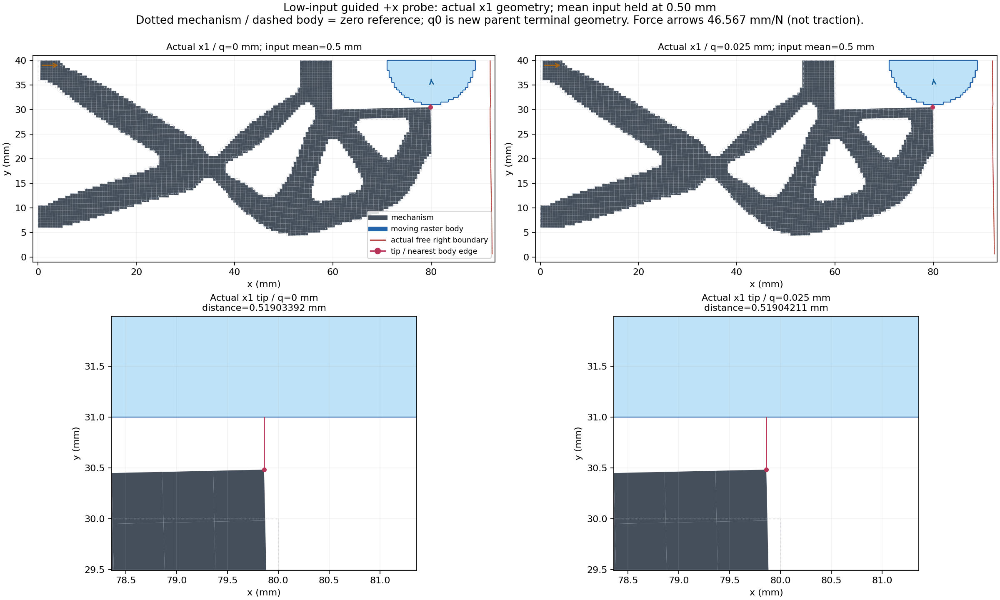
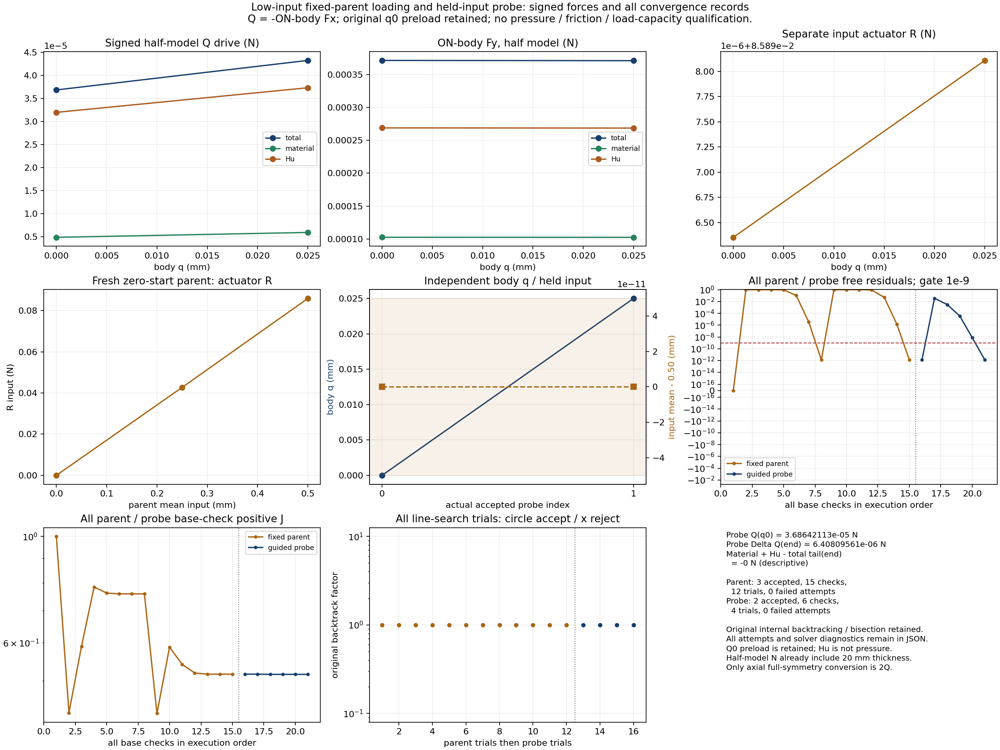
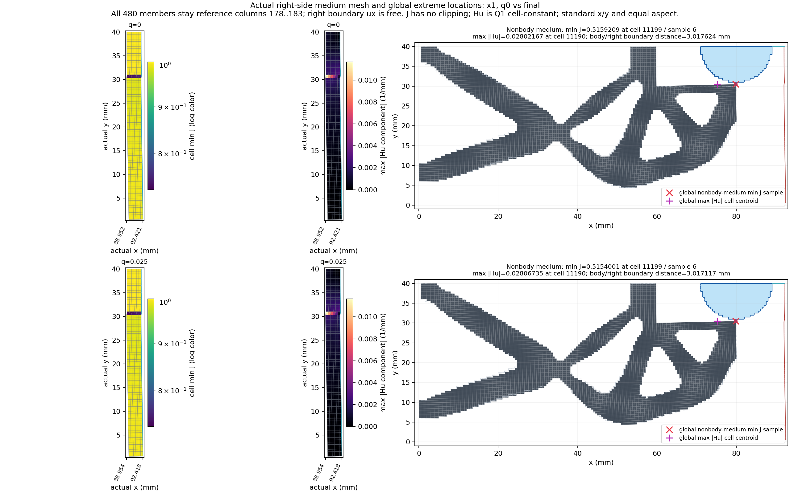
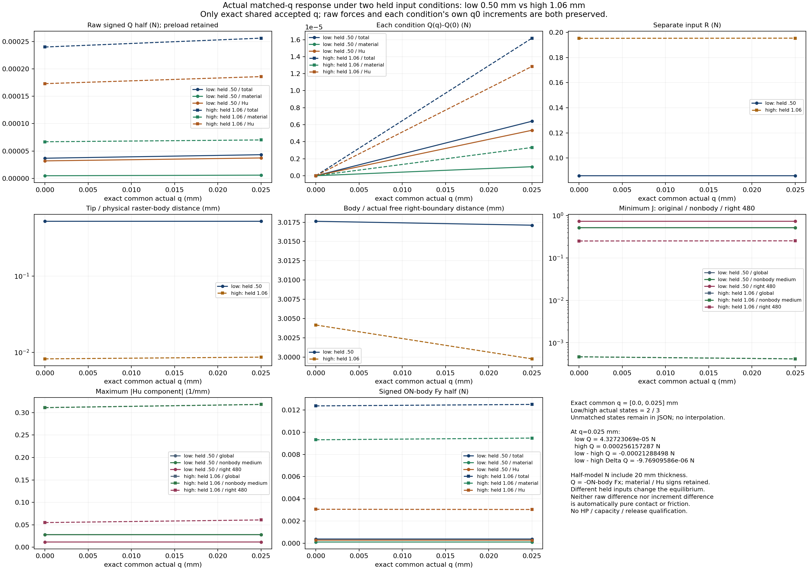
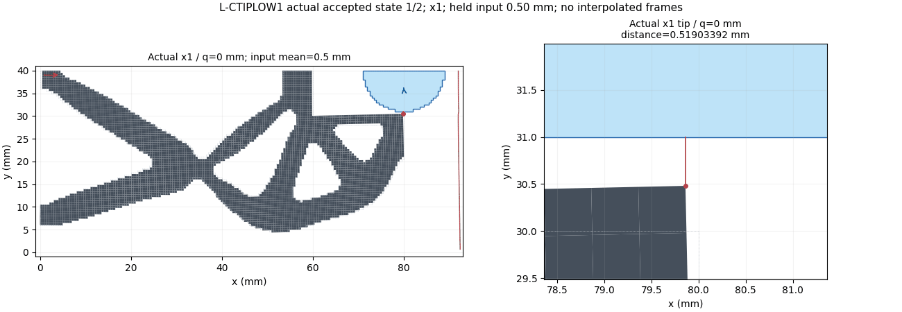

# L-CTIPLOW1：从零低输入父加载与同q导向探针对照

2026-10-23（Asia/Seoul）。两段原数值门 **PASS**（父 PASS／probe PASS）；显示 `rendered_pending_visual_check`；root图像检查 `pass_with_visibility_limits`。以下只汇总唯一运行实际凭证，不重新计算科学量。

## 目标、目的与本次功能

整体目标是HF独立读取LF普通几何，在一致的大变形／Third Medium Contact物理任务下计算力学响应供研究比较；HF不做LF优化、不调用dmftd、不实现MPM。现已能从零加载、保存态迁移、导向刚体工件位移并显示实际缓存。本轮用较低机构输入检查已观察到的导向力及Hu分量是否随夹持机构输入改变。

先用现有evaluate_native从零完成固定工件短父任务：机构平均输入[0,.25,.50] mm。只有原任务完整成功和全部原门通过，才用真实最后原目标态进入evaluate_native_guided_probe；q0必须fresh F/T直接通过并保持原split及有符号R，随后机构平均输入保持.50 mm，工件仅q[0,.025] mm。未将旧13态路径的.50中间态冒充新父末态。

其余物理保持：α2.5e−7、γ1e−6、r9 mm、圆心(80,40) mm、right92 mm、Lr80 mm、E1 MPa、ν.3、plane strain、厚度20 mm、h=.5 mm及原边界；原510工件单元／565节点不重mask。全部工件ux=q、uy=0、转角0，仍由导向夹具控制。模式mechanical／chunk256／port_projection、原非clock设置及验收门保持，没有生产源码安装。

为什么要从零建立新父任务：现有probe准入要求原完整load_only最后峰值；这样既保留真实零起点加载历史，也复用现有接口，不伪造任务完成状态或改宽默认准入。为什么比较同q：只在实际共同接受位移下保留原力、材料／Hu、各自q0增量和介质响应，避免把不同位移或插值值当作相同工况。

## 实际两段执行

|层次|实际父加载|实际低输入probe|
|---|---|---|
|原门核查|PASS|PASS|
|原production status|success|success|
|原failure|null|null|
|API attempts|1|1|
|API returned|True|True|
|实际接受态|3|2|
|实际回调数|3|2|

这里的PASS由原parent_validation／probe_validation证明，不能只用API success或绘图完成代替。未知数值／调用数保持null，已有回调与实际partial保留，不补写未返回结果。原进程部分状态观察：

```json
{
  "scientific_array_fields_decoded": 0,
  "parent": {
    "result_exists": true,
    "accepted_states": 3,
    "production_status": "success",
    "failure": null,
    "call_counts": {
      "force_calls": 27,
      "force_calls_completed": 27,
      "tangent_calls": 15,
      "tangent_calls_completed": 15,
      "solver_invocations": 1,
      "JIT_calls": 0,
      "HP_calls": 0
    }
  },
  "probe": {
    "result_exists": true,
    "accepted_states": 2,
    "production_status": "success",
    "failure": null,
    "call_counts": {
      "force_calls": 10,
      "force_calls_completed": 10,
      "tangent_calls": 6,
      "tangent_calls_completed": 6,
      "solver_invocations": 1,
      "HP_calls": 0,
      "save_force_calls": 0,
      "save_tangent_calls": 0
    }
  }
}
```

### 父加载实际接受态

|态|input target mm|actual mean mm|R input N|min J|relative residual|Newton checks|二分深度|原目标索引|
|---|---|---|---|---|---|---|---|---|
|0|0.0|0.0|0.0|1.0|0.0|1|0|0|
|1|0.25|0.25|0.04270302951454887|0.758855539088504|1.2956089074530156e-12|7|0|1|
|2|0.5|0.5|0.08589635225389337|0.5159209042630142|1.2992785574981461e-12|7|0|2|

### 低输入probe实际接受态

Q_drive_half=−ON-body Fx。所有力为半模型N，已经包含20 mm厚度；只有对称完整装配轴向换算取2Q，q不倍增。保留q0预载和符号；材料／Hu为节点弱力分量，不是纯接触压力。负Q表示制动，不能改称正抗拔容量。

|态|q mm|held input mean mm|Q total N|Q material N|Q Hu N|R input N|ON-body Fy N|min J|relative residual|Newton checks|
|---|---|---|---|---|---|---|---|---|---|---|
|0|0.0|0.5|3.686421133658022e-05|4.871455125018521e-06|3.199275621156169e-05|0.08589635225389337|0.00037155484472476796|0.5159209042630142|1.2992785574981461e-12|1|
|1|0.025|0.5|4.3272306948756724e-05|5.934019104253956e-06|3.733828784450277e-05|0.08589811003453525|0.00037114495632095733|0.5154001178738712|1.3067772097349146e-12|5|

### 原验收门的实际回执

保留原relative free residual≤1e−9、原尺度相关mean constraint、J>0、relative global balance≤1e−6、处方位移误差≤8e−11 mm；minincrement=.00625 mm，maxchecks25／backtracks12／bisections4。以下直接展示原包装记录，不由交付脚本重验科学数组。

父门回执：

```json
{
  "status": "pass",
  "parent_result_identity": {
    "path": "D:\\hlo1_001\\run_001\\parent_fixed\\result.json",
    "bytes": 92963,
    "sha256": "09e37f483f4839ef5c03193d7cdd2f36cc2cccf045d96cd1026766e746ecad46"
  },
  "accepted_states": 3,
  "original_targets_mm": [
    0.0,
    0.25,
    0.5
  ],
  "selected_state_index": 2,
  "selected_state_sha256": "48fd7c621a8b1a060a5bec81307f2c8fe524569c6a4052da75884a8053e45bd8",
  "selected_R_input_N": 0.08589635225389337,
  "call_counts": {
    "force_calls": 27,
    "force_calls_completed": 27,
    "tangent_calls": 15,
    "tangent_calls_completed": 15,
    "solver_invocations": 1,
    "JIT_calls": 0,
    "HP_calls": 0
  },
  "max_relative_residual": 1.2992785574981461e-12,
  "min_J": 0.5159209042630142,
  "max_relative_global_force_balance": 5.36626554083565e-16,
  "cached_production_gates": {
    "actual_accepted_states": 3,
    "minimum_J": 0.5159209042630142,
    "maximum_fixed_split_sum_mm": 0.0,
    "maximum_relative_residual": 1.2992785574981461e-12,
    "native_constraint_bound_pass": true,
    "maximum_relative_global_force_balance": 5.36626554083565e-16,
    "passed": true
  },
  "scientific_array_fields_decoded_by_wrapper": 0,
  "new_archive_byte_identities": [
    {
      "path": "D:\\hlo1_001\\run_001\\parent_fixed\\accepted\\000\\state.npz",
      "bytes": 924,
      "sha256": "569e1e0bc686815b4ba1f39b084d60429b9833a016c5c66845842688be867c7c",
      "accepted_index": 0,
      "kind": "state",
      "decoded_by_wrapper": false
    },
    {
      "path": "D:\\hlo1_001\\run_001\\parent_fixed\\accepted\\000\\forces.npz",
      "bytes": 29298,
      "sha256": "39844ee474a731fdf78b7a98e2ec435d5ae8252f4004306dfa48e64f9f6b8f23",
      "accepted_index": 0,
      "kind": "forces",
      "decoded_by_wrapper": false
    },
    {
      "path": "D:\\hlo1_001\\run_001\\parent_fixed\\accepted\\000\\tangents.npz",
      "bytes": 111063,
      "sha256": "f7deb94bc2f7fa16bca656dabd49e223f9cea5e4117d7eefd84b486d5ec81e83",
      "accepted_index": 0,
      "kind": "tangents",
      "decoded_by_wrapper": false
    },
    {
      "path": "D:\\hlo1_001\\run_001\\parent_fixed\\accepted\\000\\total_matrix.npz",
      "bytes": 211947,
      "sha256": "fc09bbbe4b965bbce65a59e6ee6a9c0c2aa7e81fb982c85a16539756b149a5e6",
      "accepted_index": 0,
      "kind": "matrix",
      "decoded_by_wrapper": false
    },
    {
      "path": "D:\\hlo1_001\\run_001\\parent_fixed\\accepted\\001\\state.npz",
      "bytes": 219311,
      "sha256": "387ce1f667e0e027f69bf2d3f44d0743b3af3d1e7384f06ba00b205f21bf621b",
      "accepted_index": 1,
      "kind": "state",
      "decoded_by_wrapper": false
    },
    {
      "path": "D:\\hlo1_001\\run_001\\parent_fixed\\accepted\\001\\forces.npz",
      "bytes": 12134072,
      "sha256": "d4aecc9c0e537f13770601d857d43de2cd19b8caf9bb64231387ba2f7f13a7e8",
      "accepted_index": 1,
      "kind": "forces",
      "decoded_by_wrapper": false
    },
    {
      "path": "D:\\hlo1_001\\run_001\\parent_fixed\\accepted\\001\\tangents.npz",
      "bytes": 13115801,
      "sha256": "e9684f9baa1b3cf23d1269ba3dab9874544f9d3f27969c19c2d7f0f123aec51c",
      "accepted_index": 1,
      "kind": "tangents",
      "decoded_by_wrapper": false
    },
    {
      "path": "D:\\hlo1_001\\run_001\\parent_fixed\\accepted\\001\\total_matrix.npz",
      "bytes": 3973250,
      "sha256": "21958cfa01a457ef2899b0be39bd55153fdac05b3bac36233eb69233fbcb35f4",
      "accepted_index": 1,
      "kind": "matrix",
      "decoded_by_wrapper": false
    },
    {
      "path": "D:\\hlo1_001\\run_001\\parent_fixed\\accepted\\002\\state.npz",
      "bytes": 219542,
      "sha256": "fe83a2665105b692d6b2422292ecd07d35646c54f0221f29d61d008197ee9310",
      "accepted_index": 2,
      "kind": "state",
      "decoded_by_wrapper": false
    },
    {
      "path": "D:\\hlo1_001\\run_001\\parent_fixed\\accepted\\002\\forces.npz",
      "bytes": 12144641,
      "sha256": "3ac525654c39449f3c8fe56c2a088a8c53c11a179ef5a3dc3109b25e8387d1b0",
      "accepted_index": 2,
      "kind": "forces",
      "decoded_by_wrapper": false
    },
    {
      "path": "D:\\hlo1_001\\run_001\\parent_fixed\\accepted\\002\\tangents.npz",
      "bytes": 13274153,
      "sha256": "32977f78258b8df0a3151a09d2c24b54e929661bace8da40bb5cbb4f02e193a7",
      "accepted_index": 2,
      "kind": "tangents",
      "decoded_by_wrapper": false
    },
    {
      "path": "D:\\hlo1_001\\run_001\\parent_fixed\\accepted\\002\\total_matrix.npz",
      "bytes": 4012518,
      "sha256": "153e18d7f01f07d87fa77e41da9bd0710a95063491a923398aa1f17bd8dc7428",
      "accepted_index": 2,
      "kind": "matrix",
      "decoded_by_wrapper": false
    }
  ]
}
```

probe门回执：

```json
{
  "status": "pass",
  "accepted_states": 2,
  "body_q_original_targets_mm": [
    0.0,
    0.025
  ],
  "q0_identity_preserved": true,
  "selected_parent_state_index": 2,
  "call_counts": {
    "force_calls": 10,
    "force_calls_completed": 10,
    "tangent_calls": 6,
    "tangent_calls_completed": 6,
    "solver_invocations": 1,
    "HP_calls": 0,
    "save_force_calls": 0,
    "save_tangent_calls": 0
  },
  "new_archive_byte_identities": [
    {
      "path": "D:\\hlo1_001\\run_001\\probe_low\\accepted\\000\\state.npz",
      "bytes": 219542,
      "sha256": "fe83a2665105b692d6b2422292ecd07d35646c54f0221f29d61d008197ee9310",
      "accepted_index": 0,
      "kind": "state",
      "decoded_by_wrapper": false
    },
    {
      "path": "D:\\hlo1_001\\run_001\\probe_low\\accepted\\000\\fields.npz",
      "bytes": 5293645,
      "sha256": "19abadc15ac6cda764941ded6476f1764228e8a6c0ef53a4f9583502c97fb492",
      "accepted_index": 0,
      "kind": "fields",
      "decoded_by_wrapper": false
    },
    {
      "path": "D:\\hlo1_001\\run_001\\probe_low\\accepted\\001\\state.npz",
      "bytes": 219678,
      "sha256": "98bbce1374f213c608ec0fbc35b15f1a0d0b18edda2e1eee4d157d44b9adc87e",
      "accepted_index": 1,
      "kind": "state",
      "decoded_by_wrapper": false
    },
    {
      "path": "D:\\hlo1_001\\run_001\\probe_low\\accepted\\001\\fields.npz",
      "bytes": 5294507,
      "sha256": "da71a2c212360a11df3a6d07cd11f14279060bcc142202653cb17a4ee330bccd",
      "accepted_index": 1,
      "kind": "fields",
      "decoded_by_wrapper": false
    }
  ],
  "max_relative_residual": 1.3067772097349146e-12,
  "min_J": 0.5154001178738712,
  "max_prescribed_error_mm": 0.0,
  "max_relative_global_force_balance": 7.923578366790836e-16,
  "scientific_array_fields_decoded_by_wrapper": 0
}
```

真实来源和fresh q0身份：

```json
{
  "accepted_index": 2,
  "path": "D:/hlo1_001/run_001/parent_fixed/accepted/002/state.json",
  "descriptor_file_sha256": "1247551e314aa312df687e1370bc9d011700148f1b2f67b618c31ce449c68347",
  "state_sha256": "48fd7c621a8b1a060a5bec81307f2c8fe524569c6a4052da75884a8053e45bd8",
  "archive_sha256": "fe83a2665105b692d6b2422292ecd07d35646c54f0221f29d61d008197ee9310",
  "R_input_N": 0.08589635225389337,
  "input_mean_mm": 0.5
}
```

## 高低输入同q原值、分量和增量

高输入1.06 mm只使用原绑定state_table普通JSON；不读取旧NPZ或媒体，不插值。下表差值方向low−high，各自ΔQ=Q(q)−Q(0)，与原预载同时保留；低输入没有预先被认定为无接触。

|q mm|条件|Q total N|Q material N|Q Hu N|各自ΔQ total N|ON-body Fy N|R input N|
|---|---|---|---|---|---|---|---|
|0.0|low|3.686421133658022e-05|4.871455125018521e-06|3.199275621156169e-05|0.0|0.00037155484472476796|0.08589635225389337|
|0.0|high|0.0002399800950672949|6.691682951023186e-05|0.00017306326555706304|0.0|0.012372524610902783|0.19522304147728387|
|0.025|low|4.3272306948756724e-05|5.934019104253956e-06|3.733828784450277e-05|6.408095612176505e-06|0.00037114495632095733|0.08589811003453525|
|0.025|high|0.0002561572865437846|7.023681740568895e-05|0.00018592046913809562|1.6177191476489698e-05|0.012505048670471336|0.19536542042187396|

|q mm|原Q差 total N|原Q差 material N|原Q差 Hu N|ΔQ差 total N|ΔQ差 material N|ΔQ差 Hu N|
|---|---|---|---|---|---|---|
|0.0|-0.0002031158837307147|-6.204537438521333e-05|-0.00014107050934550135|0.0|0.0|0.0|
|0.025|-0.00021288497959502786|-6.430279830143499e-05|-0.00014858218129359284|-9.769095864313193e-06|-2.257423916221654e-06|-7.511671948091498e-06|

### 同q几何与介质响应

|q mm|条件|tip/body mm|body/actual right mm|全体min J|非body介质min J|非body介质max abs Hu 1/mm|右480 min J|右480 max abs Hu 1/mm|
|---|---|---|---|---|---|---|---|---|
|0.0|low|0.5190339177997849|3.0176236849145965|0.5159209042630142|0.5159209042630142|0.02802167414492851|0.7297711642912025|0.0116087635109412|
|0.0|high|0.008227522522737729|3.0041605819997415|0.00046587891715793817|0.00046587891715793817|0.31108200242696615|0.25059846167817207|0.05494412008014038|
|0.025|low|0.5190421063444752|3.0171168265335098|0.5154001178738712|0.5154001178738712|0.028067346000868798|0.7302431734902084|0.011649532189515907|
|0.025|high|0.008668243426743771|2.9997619258029147|0.0004166085295994876|0.0004166085295994876|0.318173383204207|0.25285362927613125|0.06078058611117054|

精确共同q：`[0.0, 0.025]` mm；高输入额外实际q：`[0.0125]`；低输入额外实际q：`[]`。额外内部态完整保留，不丢弃或插值。

完整原态对象、有符号原力／材料／Hu、Fy与导向账本、全部标量差和各自增量、两段收敛及原高输入历史见[comparison.json](run_001/view/comparison.json)。

低输入逐态定位和完整新父普通记录见[state_table.json](run_001/view/state_table.json)。J定位是原九点采样，Hu为Q1单元常量、标记实际单元质心；物理距离排除参考y40对称切边，画图仍保留完整半模型轮廓。右480成员固定为原参考格，右界ux自由。几何距离／交叉／严格内部节点只是binary64保存坐标观察，不能升级为接触或自交完备认证。

高低输入会改变整体平衡；原力差和增量差都不能自动解释为纯接触／摩擦／有效抗拔力。物理判断应结合原值、Hu比例、间距和介质定位，不能仅看总Q是否为正。

## 调用计数、失败历史与资源

父调用计数：

```json
{
  "force_calls": 27,
  "force_calls_completed": 27,
  "tangent_calls": 15,
  "tangent_calls_completed": 15,
  "solver_invocations": 1,
  "JIT_calls": 0,
  "HP_calls": 0
}
```

probe调用计数：

```json
{
  "force_calls": 10,
  "force_calls_completed": 10,
  "tangent_calls": 6,
  "tangent_calls_completed": 6,
  "solver_invocations": 1,
  "HP_calls": 0,
  "save_force_calls": 0,
  "save_tangent_calls": 0
}
```

实际父原内部失败尝试：

```json
[]
```

实际probe原内部失败尝试：

```json
[]
```

原内部回溯／二分与首个终端错误分别记录；没有外部重试、修复重跑、延期或force。异常发生后后续科学／显示停止，真实partial与原失败历史不覆盖。完整Newton／line-search／linear-solve在原result和state_table／comparison普通JSON中保留。

一次父controller3600秒＋probe controller3600秒＋纯显示共享900秒；helper9000秒／outer9060秒。采样64GiB、四库各16线程，viewer8GiB；GPU未用，无依赖升级、HP、新测试、默认源码安装或API关联。源冻结、导入、构模、持久化、检查、清理和原窗口一次byte seal都计入原卡范围。

|监督层|reason|returncode|同实例清理|elapsed seconds|sampled peak bytes|
|---|---|---|---|---|---|
|outer|normal_exit|0|PASS|1351.8331690999912|1018052608|
|helper|normal_exit|0|PASS|1350.1661872999975|982188032|
|parent|normal_exit|0|PASS|957.2355200999882|946851840|
|probe|normal_exit|0|PASS|381.0770618999959|816893952|
|viewer|normal_exit|0|PASS|10.090470199997071|254287872|

清理依据原SUP2同实例终止信号、全部成员覆盖及句柄释放证明；进程exit、数值门和清理分别保留，不能互相替代。原监督JSON和NDJSON均按字节公开。若实际清理回执未证明通过，本交付只记录读取时实际快照，不能据此认定进程已closed或缓存稳定；没有追加清理尝试、科学执行或补封。未运行／没有验收回执与实际验收未通过分开报告。

helper／launcher原异常（若无则null）：

```json
{
  "helper_error": null,
  "launch_error": null
}
```

## 可视化、图像检查与恢复

结构和尖端使用实际×1缓存坐标，参考轮廓是未变形坐标；q0是新父真实末态，不展示或伪造父中间变形。合力箭头按明确mm/N尺度绘制，不称局部牵引。GIF每帧对应真实新probe接受态，实际帧数由原renderer一次元数据读取确认。

原renderer回执计数：

```json
{
  "status": "rendered_pending_visual_check",
  "accepted_states": 2,
  "archives_decoded": 2,
  "fields_decoded": 4,
  "new_png_count": 4,
  "gif_frame_count": 2,
  "new_gif_metadata_reads": 1,
  "scientific_calls": 0,
  "elapsed_seconds": 7.66749229998095
}
```

root检查记录：

```json
{
  "stage": "L-CTIPLOW1",
  "status": "pass_with_visibility_limits",
  "created_utc": "2026-10-23T05:47:58.798211+00:00",
  "root_pixel_inspections": 4,
  "rerenders": 0,
  "old_media_opened": 0,
  "images": [
    {
      "path": "01_actual_geometry.png",
      "bytes": 412271,
      "sha256": "6a1ad4e1ee351e5bdcbde55bc27c48b9347649fb003746a2be0bb854cc61e010",
      "pixel_inspections": 1,
      "finding": "PASS: actual x1 full structures and tip closeups, reference outlines, held mean and mm/N force scale are readable. At full-domain scale .025mm shift is small; exact q/bbox and gap remain in ordinary JSON. q0 is the new genuine parent terminal, not an invented intermediate deformation."
    },
    {
      "path": "02_force_and_convergence.png",
      "bytes": 399660,
      "sha256": "7899dfaec965bfe5156b813c4722f48d32f68a79985f1fe2f04d4c371ab976a9",
      "pixel_inspections": 1,
      "finding": "PASS_WITH_LIMITS: signed total/material/Hu Q and Fy, separate parent/input R, held mean, all15 parent+6 probe checks and all12+4 line-search trials are readable. R uses a scientific offset explicitly shown above its axis; the symmetric-log residual axis includes unused negative space. Exact scalars in JSON; no redraw."
    },
    {
      "path": "03_right_medium.png",
      "bytes": 694386,
      "sha256": "ae257fb03191eadfa43be34c4d4a8c2837f715af210d596c8b414a13a0adfcd3",
      "pixel_inspections": 1,
      "finding": "PASS: all480 reference medium cells remain equal aspect in conventional x/y; two rotated x ticks avoid the former collision. Shared J/Hu color ranges, actual free right boundary and global sample/cell-centroid witnesses are readable. Narrow physical strip is intentional; no J clipping."
    },
    {
      "path": "04_same_q_comparison.png",
      "bytes": 438342,
      "sha256": "2eb41943ed2c40b8db6b14eb4d896784db46c9cd89340be2d83cba31b09f9902",
      "pixel_inspections": 1,
      "finding": "PASS: raw signed force/components, own-q0 increments, R, tip and actual-right distance, J/Hu and Fy are readable. Only actual common endpoints0/.025 are paired; connecting lines are visual guides, not extra computed samples. Coincident global/nonbody curves overlap by data equality; unmatched high.0125 is retained in JSON."
    }
  ],
  "notes": "Each of four original new PNGs was inspected once sequentially by root. No GIF pixel inspection, scientific recomputation, image edit or repeated opening. Actual GIF2frames established by original renderer metadata only."
}
```











原byte seal为PASS；execution_evidence.zip与其原manifest整包身份一致，按字节复制，未解压／重压。新科学NPZ及完整执行源码／输入／实际缓存都仅以该原ZIP保留。

原封存状态：

```json
{
  "stage": "L-CTIPLOW1",
  "status": "pass",
  "attempts": 1,
  "scope": "BASE exact files after outer cleanup, excluding archive/manifest/seal receipt themselves; no scientific NPZ decoding",
  "outer_pass": true,
  "shared_window_seconds": 9000,
  "scientific_retries": 0,
  "extra_F_T_HP_tests_or_render_calls": 0,
  "members": 133,
  "archive": {
    "path": "execution_evidence.zip",
    "bytes": 70914947,
    "sha256": "c5e1e6c58ebe20b2a214be9d2519b50e875343f1ad53d8c7630d5065d1cb577e"
  },
  "evidence_completeness": "normal_exit",
  "elapsed_seconds_from_outer_start": 1354.4620687999995
}
```

公开result内的原运行绝对路径是历史上下文；需另行显式恢复原封存到隔离位置才能消费其中科学缓存，本页不冒称已恢复／重算。本交付脚本没有科学导入、NPZ解码、图像像素读取或Git命令。

基线提交：`54a40870bc74bb7137f4c0a62873aab31026f05f`；origin维持`https://github.com/dudaxing/Compliant-TO-TMC.git`。冻结协议、原授权、全部字节绑定、三份静审及来源说明见本目录protocol.json与author记录。原准备文件中numerical_launched=false／待授权等字样是冻结前历史快照，当前执行状态以本页及原终态回执为准。

## 资格与后续决定边界

本卡只建立规定从零父加载和受导向位移探针的数值响应／同q对照；未授独立HP、纯压力、摩擦、自由工件承载、有效夹持、释放、稳定性、α／域独立性或HF5资格。原高输入结果、原失败与原资格均未改写。

下一步由root依据本轮实际结果另写NEXT_STEPS.md；本程序不预写下一物理目标、不启动额外实验。

## 物理解释与后续取舍

[独立实际交付审阅](author/ACTUAL_DELIVERY_REVIEW.md)12/12通过，确认原门、fresh锚点、五层SUP2清理与原字节封存；它是普通元数据与身份审阅，不是HP或再次像素检查。四个新PNG已各一次root检查，见[QA原记录](author/FIGURE_QA.json)，未重绘或重新打开。图2的R采用标注的科学offset，residual symlog保留空负区；图1全域尺度下.025 mm位移小；图4两端点的连线仅作视觉引导，不补计算点。原值以JSON为准。

低输入末态Q=4.3272306948756724e−5 N，Hu=3.733828784450277e−5 N（约86.29%），自身增量6.408095612176505e−6 N中Hu约83.42%。同q高输入Q约为低输入5.92倍、Fy约33.69倍，但高低增量差约76.89%来自Hu。较高机构输入改变响应已经得到本轮同定义数值证据；相减没有把Hu消掉，不能直接认定纯接触抗拔。详见[原值与物理解释](author/PHYSICAL_INTERPRETATION.md)。

实际进展是从零父加载→真实末峰迁移→保持机构输入与工件运动解耦→同q保存态对照已通。下一步选择准备最小导向+x力控功能，使q成为外载平衡未知量，先小模型；本轮不继续加q或启动新力控。具体范围及非零锚点载荷、N/mm单位区别见[NEXT_STEPS.md](NEXT_STEPS.md)。

冻结protocol/authorization及部分准备报告的未launch／pending状态是各自历史时点，保留原字节；当前事实以EXECUTION_RESULT、终态原result、五层监督、seal及FIGURE_QA为准。新输入科学归档与全部父缓存位于原execution_evidence.zip；目录内的普通geometry descriptor不意味着科学NPZ已展开到正式工作树，后续需显式隔离恢复原ZIP。原运行绝对路径是历史来源，当前恢复不是异机数值复算。

## 交付静态核对

七份入口文档仅新增当前状态，旧字节作为历史完整保留；见[入口整合记录](author/FRONT_INTEGRATION.json)。[交付字节与链接核对](author/DELIVERY_CHECK.json)仅检查源码、普通记录、不透明ZIP整体／中央目录及媒体字节身份，没有解码科学数组、解压ZIP成员、重新开图或新增科学验收。三份最终结果／下一步／物理解释文字已由独立代理复核，符号、半模型口径和下一步仅准备的状态一致，无阻断项。

普通Git差异检查仅有原字节SUP2文件第883行末尾空行提示；该43559字节文件SHA保持，未为排版改动已冻结监督源码。其余新增／变更文件均通过检查，见[差异检查记录](author/GIT_DIFF_CHECK.json)。
