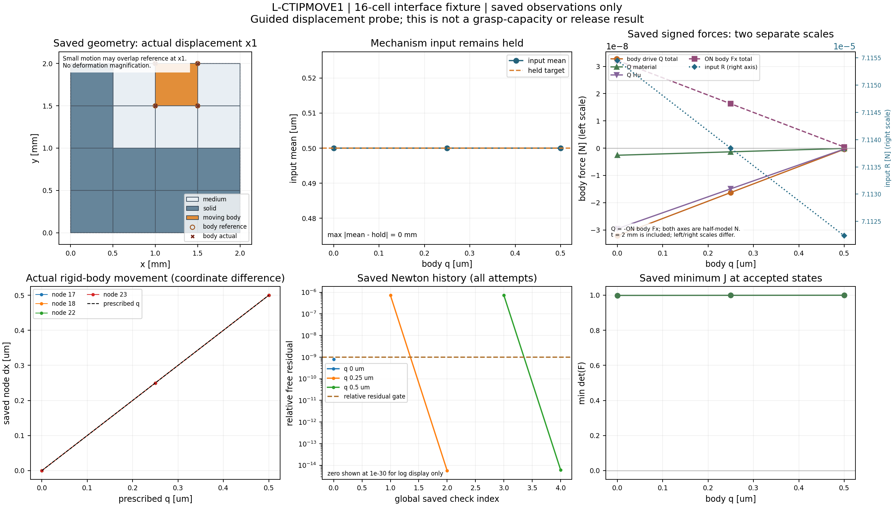

# L-CTIPMOVE1：独立工件位移控制接口与小模型验证

2026-10-22（Asia/Seoul）。**执行PASS；唯一15项验证通过、一张新图完成root一次像素检查、两份生产源码按已测字节安装。** 真实r9圆形工件探针、力控承载和释放未运行／未授资格。本阶段无HP，无外部重试、修复重跑或延期。

## 目标、原因与实现

项目目标仍是HF独立读取LF普通几何，提供一致大变形／TMC响应，供外部研究层比较。此前固定工件加载／卸载与力定义已可用，但不能在机构输入保持时独立移动工件。本轮把该缺口变成可调用的显式入口：`hf_eval.native_probe.evaluate_native_guided_probe`，详见[使用说明](../../../docs/GUIDED_WORKPIECE_PROBE.md)。

唯一旧实现修改是`split_displacement.py`的窄opt-in：body各ux=q、uy=0、波动消元，保持原单输入KKT／非对称切线和一般LU；平均输入d_hold与q解耦。新增`native_probe.py`读取完整固定加载末峰的身份，仅迁移两份split数组和R；q0先做新F/T与原门复核，不投影或Newton修复，不迁移旧矩阵／力／参考资格。原`evaluate_native`／strict resume、parser、力核、切线、SUP2和默认CLI未改。

新入口保存实际位置、三力、split状态、互斥的body-x驱动／body-y导向／其余零支撑账本与收敛历史，写入只使用缓存。输入反力与工件驱动力分开；输出仍为已含厚度的半模型N。当前仅支持从q=0开始严格增加的导向+x探针，不支持已有probe的q续算或力控制。

## 实际数值与物理解释

独立新fixture是2×2 mm、4×4格／50DOF，E1 MPa、ν.3、t2 mm、γ1e−6、α1e−4、Lr2 mm。L形10格solid、6格medium，工件cell14／节点17,18,22,23，右侧仍有介质。它不是原LF夹持器或真实r9工件，不能转移几何／承载资格。

父固定工件路径0→.0005 mm；新探针保持input=.0005 mm，q=0→.00025→.0005 mm，实际接受3态。q0原两数组／R位级身份通过；四body节点共同移动，所记录prescribed偏差均为0，input mean三态均为.0005 mm。

|body q mm|input mean mm|input R N|body drive Q_half N|min J|relative free residual|Newton checks|
|---|---|---|---|---|---|---|
|0 | 0.0005 | 7.11545385859e-05 | -3.21658738704e-08 | 0.998743716002 | 7.84604e-10 | 1|
|0.00025 | 0.0005 | 7.11384224947e-05 | -1.62750642084e-08 | 0.99924371669 | 5.64093e-15 | 2|
|0.0005 | 0.0005 | 7.11223444362e-05 | -4.21364916882e-10 | 0.999743717377 | 6.1561e-15 | 2|

所有原适用门通过：free≤1e−9、补偿mean门、J>0／有限、真实global≤1e−6、逐body处方及零支撑≤8e−11 mm。新观察重组仅针对不同求和顺序使用8eps×对应节点／局部项L1、无floor，不改变生产门。最大global relative balance为1.646517103468458e−11。

Q三态均为负，表示此受导向的小测试件在当前保持状态需要制动；不能把负号去掉改称抗拔力。Q随q接近零，材料／Hu作用均保留，图中工件力与机构R分别用左右尺度。此结果验证控制与反力接口，没有证明真实夹持器承载。

主几何为实际×1，亚微米位移与参考在该比例下接近重合，另用逐节点实际dx曲线检查。root仅检查一次PNG，图像QA为pass_with_visibility_limits：力图图例／说明部分遮近端点，曲线和单位仍可读；minJ轴包含0使微小变化不突出，精确值以上表和原JSON为准。没有重绘、放大冒充实际变形或新力学计算。

## 验证、资源与失败分支

实际pytest为15/15，19.06秒；原controller9展开项、新测试6方法。实际新16格路径3次：完整固定父路径、成功probe、受控partial；加旧2格路径1次共4。新注入／拒绝14、旧静态枚举11，共25；受控partial同时属于真实核路径和注入场景，重叠1项单列，不把它当独立成功物理路径。旧1／11计数由源码枚举并以全9项通过为前提，不声称逐hook实测。

受控partial在第二次切线人为抛出terminal constraint_failure，原设置不改，只q0接受；失败result、两数组／R和rollback记录均保存，release=false。该例是持久化验证，**不是观察到的物理约束失效**。wrong R／mean严格拒绝、五种source/model/task/split身份拒绝及旧extend_path不能改变physics均通过。

四层SUP2（outer/helper/tests/viewer）均normal_exit/0，同实例终止／全成员覆盖／句柄释放通过；最外含清理36.09505599999102秒，低于360秒，共享helper在300秒内。采样8GiB、四库线程16保持，详见[实际执行记录](author/EXECUTION_RESULT.json)。61份冻结依赖运行后仍同字节。兼容验证覆盖本卡9项旧controller测试，未声称全仓库回归。

## 记录、源码与恢复

- [已批准卡及原文](L-CTIPMOVE1_CARD.md)、[明确授权](author/authorization.json)、[候选冻结](author/CANDIDATE_FREEZE.json)。author中的待授权/readiness/wait文件是历史时点，当前以授权、实际结果和安装回执为准。
- [controller独立静审](author/CONTROLLER_STATIC_REVIEW.md)、[API／测试独立静审](author/CANDIDATE_API_TEST_REVIEW.md)，各12项；后者的资源／显示部分标明为作者自检，root另做冻结与实际核查。
- [安装回执](author/INSTALLATION_RECEIPT.json)：两源码SHA与已执行候选一致。原力核／切线／旧入口未改；新增已执行测试文件保留在hf_repo/tests。
- [完整执行证据ZIP](move1_execution_evidence.zip)与[186成员身份](EVIDENCE_MANIFEST.json)：包含精确候选闭包、已选测试、协议、SUP2四层日志、新父／成功／受控partial及拒绝副本。仅字节封存，不做窗口外科学解码或重算。
- 运行脚本[run_move1_validation.py](run_move1_validation.py)、纯显示[render_move1.py](render_move1.py)、[原执行协议](frozen_protocol.json)为已关闭窗口的历史执行源，含本机路径；**不要直接重跑**。另一机器可从普通Git克隆读取新API／测试、文档和ZIP；重新数值执行需新明确任务与窗口。
- 本轮从原main 1e5e9cf出发；普通发布／异目录恢复的实际提交和核查在完成后另记，不预写成功。

## 下一步

见[结果驱动的下一步](NEXT_STEPS.md)。最近是准备真实r9探针的来源／bbox与显示包装，再按明确新卡仅测试q0→.025 mm；本阶段未读取真实旧峰数组或运行该路径。继续保原α2.5e−7、r9／(80,40)／right92／Lr80、input hold1.06与原门；不因小模型通过自动授予真实承载、释放、压力或HF5资格。

## 实际交付复核

[交付审阅](author/ACTUAL_DELIVERY_REVIEW.md)与[12项依据](author/ACTUAL_DELIVERY_REVIEW.json)全部通过、无阻断。核对实际普通JSON、源码与证据身份，未重做数值计算或重开PNG。审阅者参与测试编写，报告明确不将其称为独立测试设计认证。有限交付身份核对见[DELIVERY_CHECK.json](DELIVERY_CHECK.json)；发布和恢复状态随后按实际提交另记。
