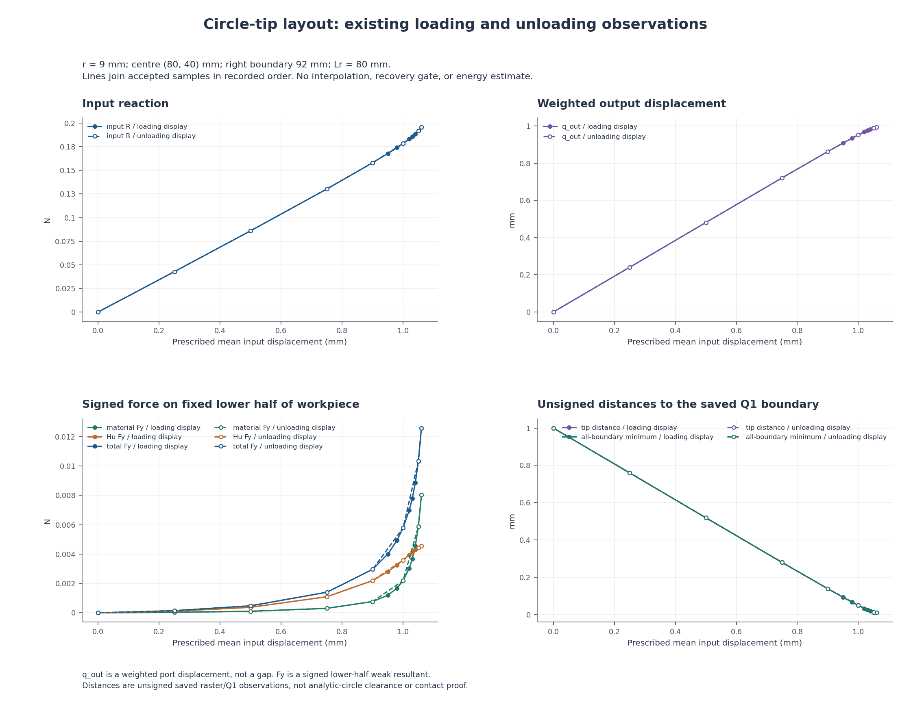
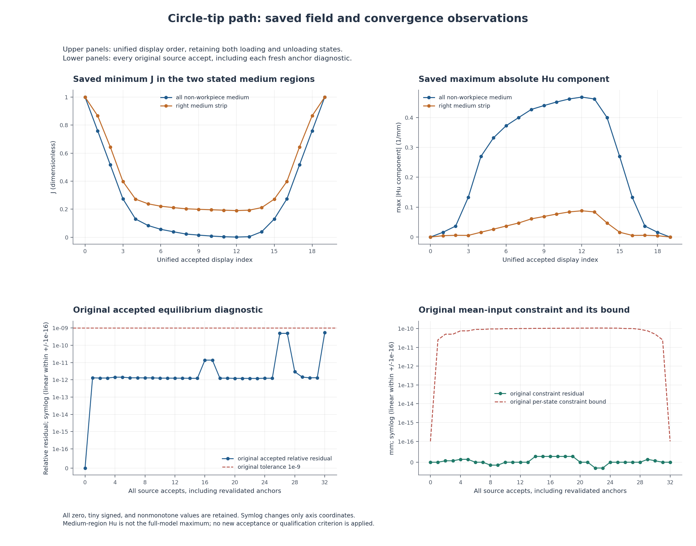

# L-CTIPPATH1：14段已有加载与卸载结果的统一对照

2026-10-20（Asia/Seoul）；执行 **PASS**；图像QA `pass_root_visual_inspection`；本阶段完成 `True`。原运行UTC时间保留，不改历史日期或原结果。

整体目标是把LF夹持器几何接入独立、可恢复的大变形/TMC有限元评估，逐步形成可审查的结构变形、工件作用力及加载卸载响应。本轮实现的是跨保存段的统一读取、精确来源追溯和同输入对照，补齐分段计算后的使用功能。

本轮做什么及原因：汇总pilot、STEP1–10及UNLOAD1–3共14段已有成功结果；读取授权普通摘要与收敛记录，保留每段原记录和嵌套历史，仅在统一显示时间线上合并相邻重复锚。原始leg、原状态SHA、各来源索引与原资格标志保持。合并锚不等于重算平衡，也不把原child中的完整路径未执行标志改成完成。

物理条件保持：固定圆形工件r9 mm、圆心(80,40) mm、右域界92 mm、正则化长度80 mm、alpha=5e-7、gamma=1e-6、E=1 MPa、nu=0.3、plane strain、厚度20 mm、原网格与支撑/加权平均端口/对称条件。原目标路径覆盖0→1.06→0 mm；本卡不新增位移目标、构模、F/T、HP或平衡求解，不修改默认HF源码或原验收门。

实际效果：统一计数 `{'raw_rows': 33, 'timeline_rows': 20, 'merged_boundary_anchors': 13, 'same_input_pairs': 7, 'segments': 14, 'requested_targets': 20}`。原收敛计数按来源完整累计 `{'accepted_states': 33, 'newton_base_checks': 131, 'inferred_check_groups': 33, 'line_search_trials': 103, 'line_search_accepted': 98, 'line_search_rejected': 5, 'failed_attempts': 0, 'linear_solves': 117, 'maximum_bisection_depth': 0, 'zero_newton_residuals': 1}`，不因显示锚合并而扣减重核验、Newton或试探记录。原拒绝/失败试探全部按来源保留，不能把通过的回溯说成外部重试，也不能隐藏它们。

|显示行|原leg|d mm|输入R N|q_out mm|下半工件总Fy N|尖端距离 mm|介质minJ|介质maxabsHu 1/mm|
|---|---|---|---|---|---|---|---|---|
|0|origin|0.0|0.0|0.0|0.0|1.0|1.0|0.0|
|1|loading|0.25|0.042743534147102635|0.24018802342288847|0.00014591711519481185|0.7598854694338719|0.7591252661187656|0.016109379378075217|
|2|loading|0.5|0.08602790333542189|0.480914454124498|0.00047828066183543393|0.5193940639875763|0.5165686928215502|0.036830038296925716|
|3|loading|0.75|0.13029373126695096|0.7209345473765182|0.0014019374851138165|0.2798849153085463|0.27350038751453853|0.13298764084709486|
|4|loading|0.9|0.1580782308108174|0.8625531334711433|0.002963472813601691|0.13886658198055457|0.12974460877888705|0.26949724374504364|
|5|loading|0.95|0.16789587547053317|0.9084279574933386|0.004007918648033684|0.09329207578756282|0.08323634645955613|0.3319973141016455|
|6|loading|0.98|0.1740926144320115|0.9351815112846671|0.004939605732939993|0.06676054983915947|0.05618144722802783|0.37246173781411934|
|7|loading|1.0|0.1784535445979535|0.9524284255775324|0.0057942001574207685|0.04968854162278191|0.03880995688549589|0.3999404059653547|
|8|loading|1.02|0.1831436048338394|0.9688228766079808|0.006986121313647189|0.03350464414994647|0.02244041906689209|0.42695737023581104|
|9|loading|1.03|0.1856995754415686|0.9764698050071479|0.007798735907497663|0.025985908706346095|0.014938189525383425|0.4398378162924799|
|10|loading|1.04|0.18849743751609724|0.9834816595480069|0.00885936998869095|0.01913067004654323|0.008284170402941726|0.4518028866161294|
|11|loading|1.05|0.1917119776052685|0.9893918140696001|0.010344906240341959|0.013434644879975366|0.0032268105740065082|0.46195690592022765|
|12|loading|1.06|0.19568183324206792|0.9932854064102131|0.01259251473277105|0.009887524710265438|0.0009015839179744192|0.4682404604988441|
|13|unloading|1.05|0.1917119776052677|0.9893918140696026|0.01034490624034115|0.013434644879971813|0.0032268105739974096|0.4619569059202286|
|14|unloading|1.0|0.17845354455643678|0.9524284256858055|0.00579420014046935|0.04968854151114499|0.03880995637928876|0.39994040542071757|
|15|unloading|0.9|0.15807823081081884|0.8625531334711388|0.0029634728136028283|0.13886658198055812|0.1297446087788906|0.2694972437450354|
|16|unloading|0.75|0.13029373126695099|0.7209345473765181|0.0014019374851138356|0.27988491530854986|0.27350038751453865|0.1329876408470947|
|17|unloading|0.5|0.08602790333542186|0.48091445412449807|0.0004782806618354332|0.5193940639875763|0.5165686928215502|0.036830038296925716|
|18|unloading|0.25|0.04274353414710264|0.24018802342288847|0.00014591711519481153|0.7598854694338719|0.7591252661187657|0.01610937937807516|
|19|unloading|0.0|1.6317430051868603e-25|-8.903399720651071e-25|-1.0014711119833229e-28|1.0|1.0|9.461787023894838e-25|

上表所有值均来自已有普通摘要。q_out是端口加权位移而非表面间隙；输入反力和工件Fx/Fy均为有符号下半模型原值，未镜像加倍。工件总力含material和Hu弱式贡献，不解释为连续表面压力或有效夹持力。距离为unsigned Q1栅格边界距离；正距离、非零弱力与外观接近均不能单独认定有效接触。

|d mm|参考角色|参考原leg|原metric|loading/origin参考原值|卸载原值|卸载减参考|
|---|---|---|---|---|---|---|
|1.05|loading|loading|R_input_N|0.1917119776052685|0.1917119776052677|-8.049116928532385e-16|
|1.05|loading|loading|q_out_mm|0.9893918140696001|0.9893918140696026|2.55351295663786e-15|
|1.05|loading|loading|tip_x_mm|79.687143550996|79.687143550996|0.0|
|1.05|loading|loading|tip_y_mm|30.986565355120025|30.986565355120028|3.552713678800501e-15|
|1.05|loading|loading|tip_to_raster_boundary_mm|0.013434644879975366|0.013434644879971813|-3.552713678800501e-15|
|1.05|loading|loading|minimum_boundary_distance_mm|0.013434644879975366|0.013434644879971813|-3.552713678800501e-15|
|1.05|loading|loading|solid_min_J|0.9753318497649357|0.9753318497649356|-1.1102230246251565e-16|
|1.05|loading|loading|medium_min_J|0.0032268105740065082|0.0032268105739974096|-9.098624631498353e-15|
|1.05|loading|loading|solid_Green_principal_min|-0.027331796999438537|-0.027331796999438624|-8.673617379884035e-17|
|1.05|loading|loading|solid_Green_principal_max|0.03841718367167843|0.0384171836716784|-2.7755575615628914e-17|
|1.05|loading|loading|medium_max_abs_Hu_per_mm|0.46195690592022765|0.4619569059202286|9.43689570931383e-16|
|1.05|loading|loading|right_medium_min_J|0.19270007749393256|0.19270007749393137|-1.1934897514720433e-15|
|1.05|loading|loading|right_medium_max_J|1.4275997141749524|1.4275997141749648|1.2434497875801753e-14|
|1.05|loading|loading|right_medium_max_abs_Hu_per_mm|0.08409066184842073|0.08409066184842562|4.884981308350689e-15|
|1.05|loading|loading|right_medium_Green_principal_min|-0.48427558295210527|-0.4842755829521056|-3.3306690738754696e-16|
|1.05|loading|loading|right_medium_Green_principal_max|0.6354410964502949|0.635441096450317|2.2093438190040615e-14|
|1.05|loading|loading|right_medium_max_nodal_displacement_mm|1.0507256158949554|1.050725615894948|-7.327471962526033e-15|
|1.05|loading|loading|total_body_Fx_N|-0.00028786695721812243|-0.00028786695721808535|3.707971429900425e-17|
|1.05|loading|loading|total_body_Fy_N|0.010344906240341959|0.01034490624034115|-8.083811398051921e-16|
|1.05|loading|loading|material_body_Fx_N|-2.155147612374835e-05|-2.155147612374278e-05|5.570088661144279e-18|
|1.05|loading|loading|material_body_Fy_N|0.005895873236077016|0.005895873236076284|-7.320533068622126e-16|
|1.05|loading|loading|regularization_body_Fx_N|-0.0002663154810943741|-0.0002663154810943426|3.155028321932818e-17|
|1.05|loading|loading|regularization_body_Fy_N|0.004449033004264943|0.004449033004264867|-7.632783294297951e-17|
|1.0|loading|loading|R_input_N|0.1784535445979535|0.17845354455643678|-4.15167344947065e-11|
|1.0|loading|loading|q_out_mm|0.9524284255775324|0.9524284256858055|1.0827316820893884e-10|
|1.0|loading|loading|tip_x_mm|79.69853124666673|79.69853124660038|-6.635048066527816e-11|
|1.0|loading|loading|tip_y_mm|30.950311458377218|30.950311458488855|1.1163692192894814e-10|
|1.0|loading|loading|tip_to_raster_boundary_mm|0.04968854162278191|0.04968854151114499|-1.1163692192894814e-10|
|1.0|loading|loading|minimum_boundary_distance_mm|0.04968854162278191|0.04968854151114499|-1.1163692192894814e-10|
|1.0|loading|loading|solid_min_J|0.9762585262778355|0.9762585262753055|-2.5299762285158067e-12|
|1.0|loading|loading|medium_min_J|0.03880995688549589|0.03880995637928876|-5.062071317674111e-10|
|1.0|loading|loading|solid_Green_principal_min|-0.026343742730076624|-0.026343742732979004|-2.9023797254446038e-12|
|1.0|loading|loading|solid_Green_principal_max|0.036409653694247965|0.036409653692706545|-1.5414197696017595e-12|
|1.0|loading|loading|medium_max_abs_Hu_per_mm|0.3999404059653547|0.39994040542071757|-5.446371131867522e-10|
|1.0|loading|loading|right_medium_min_J|0.211259303841275|0.21125930290424316|-9.370318410084622e-10|
|1.0|loading|loading|right_medium_max_J|1.3007911051915684|1.300791104259561|-9.320073601770673e-10|
|1.0|loading|loading|right_medium_max_abs_Hu_per_mm|0.04719244605178652|0.04719244592479832|-1.269881977350451e-10|
|1.0|loading|loading|right_medium_Green_principal_min|-0.481083422805752|-0.481083422978454|-1.7270201935204454e-10|
|1.0|loading|loading|right_medium_Green_principal_max|0.42231383229529323|0.4223138309644077|-1.330885512906832e-09|
|1.0|loading|loading|right_medium_max_nodal_displacement_mm|1.0975264244222214|1.0975264252874317|8.652103478112849e-10|
|1.0|loading|loading|total_body_Fx_N|-0.00025622127133659403|-0.00025622127106209155|2.745024802082441e-13|
|1.0|loading|loading|total_body_Fy_N|0.0057942001574207685|0.00579420014046935|-1.6951418567445753e-11|
|1.0|loading|loading|material_body_Fx_N|-1.3298507356617854e-05|-1.3298507391046522e-05|-3.4428667192555953e-14|
|1.0|loading|loading|material_body_Fy_N|0.002199450898848834|0.0021994508888164535|-1.0032380308444555e-11|
|1.0|loading|loading|regularization_body_Fx_N|-0.0002429227639799762|-0.00024292276367104504|3.089311575651954e-13|
|1.0|loading|loading|regularization_body_Fy_N|0.0035947492585719338|0.0035947492516528955|-6.919038259001198e-12|
|0.9|loading|loading|R_input_N|0.1580782308108174|0.15807823081081884|1.4432899320127035e-15|
|0.9|loading|loading|q_out_mm|0.8625531334711433|0.8625531334711388|-4.440892098500626e-15|
|0.9|loading|loading|tip_x_mm|79.73048788725623|79.73048788725623|0.0|
|0.9|loading|loading|tip_y_mm|30.861133418019445|30.861133418019442|-3.552713678800501e-15|
|0.9|loading|loading|tip_to_raster_boundary_mm|0.13886658198055457|0.13886658198055812|3.552713678800501e-15|
|0.9|loading|loading|minimum_boundary_distance_mm|0.13886658198055457|0.13886658198055812|3.552713678800501e-15|
|0.9|loading|loading|solid_min_J|0.9784853423673909|0.978485342367391|1.1102230246251565e-16|
|0.9|loading|loading|medium_min_J|0.12974460877888705|0.1297446087788906|3.552713678800501e-15|
|0.9|loading|loading|solid_Green_principal_min|-0.02393250858579317|-0.023932508585792947|2.220446049250313e-16|
|0.9|loading|loading|solid_Green_principal_max|0.03262969829927792|0.03262969829927799|6.938893903907228e-17|
|0.9|loading|loading|medium_max_abs_Hu_per_mm|0.26949724374504364|0.2694972437450354|-8.215650382226158e-15|
|0.9|loading|loading|right_medium_min_J|0.2716044900094883|0.27160449000954107|5.2791104820926193e-14|
|0.9|loading|loading|right_medium_max_J|1.1406447639258155|1.1406447638451775|-8.06379407691793e-11|
|0.9|loading|loading|right_medium_max_abs_Hu_per_mm|0.016170032723724637|0.01617003257847882|-1.452458153750058e-10|
|0.9|loading|loading|right_medium_Green_principal_min|-0.46820578253086753|-0.46820578253083334|3.419486915845482e-14|
|0.9|loading|loading|right_medium_Green_principal_max|0.18742073175363083|0.18742073165380113|-9.98297000620596e-11|
|0.9|loading|loading|right_medium_max_nodal_displacement_mm|1.144980350028813|1.144980350035047|6.234124327875179e-12|
|0.9|loading|loading|total_body_Fx_N|-0.0002133926267757325|-0.00021339262677680637|-1.07387514679258e-15|
|0.9|loading|loading|total_body_Fy_N|0.002963472813601691|0.0029634728136028283|1.137111238502797e-15|
|0.9|loading|loading|material_body_Fx_N|-1.1522881206422037e-05|-1.152288120642485e-05|-2.8138434507787857e-18|
|0.9|loading|loading|material_body_Fy_N|0.000767649185011958|0.0007676491850118505|-1.0755285551056204e-16|
|0.9|loading|loading|regularization_body_Fx_N|-0.00020186974556931045|-0.00020186974557038153|-1.0710833261984298e-15|
|0.9|loading|loading|regularization_body_Fy_N|0.002195823628589734|0.002195823628590978|1.2437967322753707e-15|
|0.75|loading|loading|R_input_N|0.13029373126695096|0.13029373126695099|2.7755575615628914e-17|
|0.75|loading|loading|q_out_mm|0.7209345473765182|0.7209345473765181|-1.1102230246251565e-16|
|0.75|loading|loading|tip_x_mm|79.78057867418543|79.78057867418543|0.0|
|0.75|loading|loading|tip_y_mm|30.720115084691454|30.72011508469145|-3.552713678800501e-15|
|0.75|loading|loading|tip_to_raster_boundary_mm|0.2798849153085463|0.27988491530854986|3.552713678800501e-15|
|0.75|loading|loading|minimum_boundary_distance_mm|0.2798849153085463|0.27988491530854986|3.552713678800501e-15|
|0.75|loading|loading|solid_min_J|0.9819914053937876|0.9819914053937875|-1.1102230246251565e-16|
|0.75|loading|loading|medium_min_J|0.27350038751453853|0.27350038751453865|1.1102230246251565e-16|
|0.75|loading|loading|solid_Green_principal_min|-0.020104257779683728|-0.020104257779683866|-1.3877787807814457e-16|
|0.75|loading|loading|solid_Green_principal_max|0.027080015613807025|0.027080015613807032|6.938893903907228e-18|
|0.75|loading|loading|medium_max_abs_Hu_per_mm|0.13298764084709486|0.1329876408470947|-1.6653345369377348e-16|
|0.75|loading|loading|right_medium_min_J|0.39762377949682676|0.39762377949682715|3.885780586188048e-16|
|0.75|loading|loading|right_medium_max_J|1.0566830216041518|1.0566830216019045|-2.247313446446242e-12|
|0.75|loading|loading|right_medium_max_abs_Hu_per_mm|0.005591771606663465|0.005591771605254592|-1.4088730182493236e-12|
|0.75|loading|loading|right_medium_Green_principal_min|-0.42938687123227903|-0.42938687123227737|1.6653345369377348e-15|
|0.75|loading|loading|right_medium_Green_principal_max|0.0792718011928778|0.07927180119072708|-2.1507240433038533e-12|
|0.75|loading|loading|right_medium_max_nodal_displacement_mm|1.0537179809464745|1.0537179809466626|1.8807178037150152e-13|
|0.75|loading|loading|total_body_Fx_N|-0.0001334043184808744|-0.000133404318480896|-2.1602728286773676e-17|
|0.75|loading|loading|total_body_Fy_N|0.0014019374851138165|0.0014019374851138356|1.9081958235744878e-17|
|0.75|loading|loading|material_body_Fx_N|-8.866877582537182e-06|-8.8668775825374e-06|-2.168404344971009e-19|
|0.75|loading|loading|material_body_Fy_N|0.0003038428696251693|0.0003038428696251687|-5.963111948670274e-19|
|0.75|loading|loading|regularization_body_Fx_N|-0.0001245374408983372|-0.00012453744089835862|-2.1412992906588713e-17|
|0.75|loading|loading|regularization_body_Fy_N|0.0010980946154886474|0.0010980946154886672|1.973247953923618e-17|
|0.5|loading|loading|R_input_N|0.08602790333542189|0.08602790333542186|-2.7755575615628914e-17|
|0.5|loading|loading|q_out_mm|0.480914454124498|0.48091445412449807|5.551115123125783e-17|
|0.5|loading|loading|tip_x_mm|79.86088009934946|79.86088009934946|0.0|
|0.5|loading|loading|tip_y_mm|30.480605936012424|30.480605936012424|0.0|
|0.5|loading|loading|tip_to_raster_boundary_mm|0.5193940639875763|0.5193940639875763|0.0|
|0.5|loading|loading|minimum_boundary_distance_mm|0.5193940639875763|0.5193940639875763|0.0|
|0.5|loading|loading|solid_min_J|0.9879538763129987|0.9879538763129987|0.0|
|0.5|loading|loading|medium_min_J|0.5165686928215502|0.5165686928215502|0.0|
|0.5|loading|loading|solid_Green_principal_min|-0.013527089011450588|-0.013527089011450655|-6.765421556309548e-17|
|0.5|loading|loading|solid_Green_principal_max|0.017958174249141572|0.01795817424914157|-3.469446951953614e-18|
|0.5|loading|loading|medium_max_abs_Hu_per_mm|0.036830038296925716|0.036830038296925716|0.0|
|0.5|loading|loading|right_medium_min_J|0.644133518565071|0.644133518565071|0.0|
|0.5|loading|loading|right_medium_max_J|1.0129824896884163|1.0129824896884163|0.0|
|0.5|loading|loading|right_medium_max_abs_Hu_per_mm|0.005909855856949434|0.005909855856949489|5.551115123125783e-17|
|0.5|loading|loading|right_medium_Green_principal_min|-0.30461585991290596|-0.30461585991290596|0.0|
|0.5|loading|loading|right_medium_Green_principal_max|0.03124848704379727|0.031248487043797266|-3.469446951953614e-18|
|0.5|loading|loading|right_medium_max_nodal_displacement_mm|0.7147775822035364|0.7147775822035365|1.1102230246251565e-16|
|0.5|loading|loading|total_body_Fx_N|-5.4617501322577725e-05|-5.4617501322577264e-05|4.607859233063394e-19|
|0.5|loading|loading|total_body_Fy_N|0.00047828066183543393|0.0004782806618354332|-7.589415207398531e-19|
|0.5|loading|loading|material_body_Fx_N|-5.308362766779434e-06|-5.308362766779436e-06|-1.6940658945086007e-21|
|0.5|loading|loading|material_body_Fy_N|0.0001040097253926478|0.00010400972539264782|1.3552527156068805e-20|
|0.5|loading|loading|regularization_body_Fx_N|-4.930913855579829e-05|-4.9309138555797835e-05|4.54009659728305e-19|
|0.5|loading|loading|regularization_body_Fy_N|0.0003742709364427861|0.0003742709364427854|-7.047314121155779e-19|
|0.25|loading|loading|R_input_N|0.042743534147102635|0.04274353414710264|6.938893903907228e-18|
|0.25|loading|loading|q_out_mm|0.24018802342288847|0.24018802342288847|0.0|
|0.25|loading|loading|tip_x_mm|79.93430823193623|79.93430823193623|0.0|
|0.25|loading|loading|tip_y_mm|30.240114530566128|30.240114530566128|0.0|
|0.25|loading|loading|tip_to_raster_boundary_mm|0.7598854694338719|0.7598854694338719|0.0|
|0.25|loading|loading|minimum_boundary_distance_mm|0.7598854694338719|0.7598854694338719|0.0|
|0.25|loading|loading|solid_min_J|0.9939667029510496|0.9939667029510496|0.0|
|0.25|loading|loading|medium_min_J|0.7591252661187656|0.7591252661187657|1.1102230246251565e-16|
|0.25|loading|loading|solid_Green_principal_min|-0.006814746173286581|-0.006814746173286604|-2.2551405187698492e-17|
|0.25|loading|loading|solid_Green_principal_max|0.008937097896543459|0.008937097896543459|0.0|
|0.25|loading|loading|medium_max_abs_Hu_per_mm|0.016109379378075217|0.01610937937807516|-5.551115123125783e-17|
|0.25|loading|loading|right_medium_min_J|0.8663258675749972|0.8663258675749972|0.0|
|0.25|loading|loading|right_medium_max_J|1.0034422709744268|1.0034422709744268|0.0|
|0.25|loading|loading|right_medium_max_abs_Hu_per_mm|0.0046474808126793846|0.004647480812679454|6.938893903907228e-17|
|0.25|loading|loading|right_medium_Green_principal_min|-0.133855054293864|-0.13385505429386385|1.3877787807814457e-16|
|0.25|loading|loading|right_medium_Green_principal_max|0.012485630057826953|0.012485630057826939|-1.3877787807814457e-17|
|0.25|loading|loading|right_medium_max_nodal_displacement_mm|0.33795963271708657|0.3379596327170865|-5.551115123125783e-17|
|0.25|loading|loading|total_body_Fx_N|-1.900371381149789e-05|-1.9003713811497887e-05|3.3881317890172014e-21|
|0.25|loading|loading|total_body_Fy_N|0.00014591711519481185|0.00014591711519481153|-3.2526065174565133e-19|
|0.25|loading|loading|material_body_Fx_N|-2.3811938740884575e-06|-2.381193874088457e-06|4.235164736271502e-22|
|0.25|loading|loading|material_body_Fy_N|3.544208329600127e-05|3.5442083296001265e-05|-6.776263578034403e-21|
|0.25|loading|loading|regularization_body_Fx_N|-1.662251993740943e-05|-1.662251993740943e-05|0.0|
|0.25|loading|loading|regularization_body_Fy_N|0.0001104750318988106|0.00011047503189881024|-3.5236570605778894e-19|
|0.0|original_origin|origin|R_input_N|0.0|1.6317430051868603e-25|1.6317430051868603e-25|
|0.0|original_origin|origin|q_out_mm|0.0|-8.903399720651071e-25|-8.903399720651071e-25|
|0.0|original_origin|origin|tip_x_mm|80.0|80.0|0.0|
|0.0|original_origin|origin|tip_y_mm|30.0|30.0|0.0|
|0.0|original_origin|origin|tip_to_raster_boundary_mm|1.0|1.0|0.0|
|0.0|original_origin|origin|minimum_boundary_distance_mm|1.0|1.0|0.0|
|0.0|original_origin|origin|solid_min_J|1.0|1.0|0.0|
|0.0|original_origin|origin|medium_min_J|1.0|1.0|0.0|
|0.0|original_origin|origin|solid_Green_principal_min|0.0|-2.771983068021754e-24|-2.771983068021754e-24|
|0.0|original_origin|origin|solid_Green_principal_max|0.0|2.771983068021754e-24|2.771983068021754e-24|
|0.0|original_origin|origin|medium_max_abs_Hu_per_mm|0.0|9.461787023894838e-25|9.461787023894838e-25|
|0.0|original_origin|origin|right_medium_min_J|1.0|1.0|0.0|
|0.0|original_origin|origin|right_medium_max_J|1.0|1.0|0.0|
|0.0|original_origin|origin|right_medium_max_abs_Hu_per_mm|0.0|1.3808221286067474e-26|1.3808221286067474e-26|
|0.0|original_origin|origin|right_medium_Green_principal_min|0.0|-1.3361647125904056e-25|-1.3361647125904056e-25|
|0.0|original_origin|origin|right_medium_Green_principal_max|0.0|1.3361647125904056e-25|1.3361647125904056e-25|
|0.0|original_origin|origin|right_medium_max_nodal_displacement_mm|0.0|2.499557320893313e-24|2.499557320893313e-24|
|0.0|original_origin|origin|total_body_Fx_N|0.0|2.743760408015235e-30|2.743760408015235e-30|
|0.0|original_origin|origin|total_body_Fy_N|0.0|-1.0014711119833229e-28|-1.0014711119833229e-28|
|0.0|original_origin|origin|material_body_Fx_N|0.0|5.2555845124385524e-30|5.2555845124385524e-30|
|0.0|original_origin|origin|material_body_Fy_N|0.0|-7.63565347238871e-29|-7.63565347238871e-29|
|0.0|original_origin|origin|regularization_body_Fx_N|0.0|-2.511824104423321e-30|-2.511824104423321e-30|
|0.0|original_origin|origin|regularization_body_Fy_N|0.0|-2.3790576474445087e-29|-2.3790576474445087e-29|

同位移对照按原d数值精确配对，不插值、不裁零、不吸附零值、不增归零/相等/可逆性或耗散验收门。零输入参考是pilot原始origin，表中保留其raw leg=origin；loading_value只是共同JSON列名，不能据此说存在loading零态。每项原值、差量、状态SHA和合并后的全部来源见统一JSON与同位移JSON。

两张新图展示标量响应及原收敛/介质质量记录；没有重开旧媒体或旧科学数组。既有14份GIF只核原字节数并提供链接，本卡未解码、拼帧或生成新变形动画。field图的旧定义和原计算结果不变；右条带最大节点位移不等同尖端间隙，极值见证可随状态变化。

实际汇总显示七个同输入样本的加载/卸载标量接近，最大|ΔR|为4.15167344947065e-11 N、最大|Δq_out|为1.0827316820893884e-10 mm；这只是已有样本的描述性比较。1.06 mm时下半工件总Fy=0.01259251473277105 N，材料0.008033412258785861 N、Hu0.004559102473985187 N，Hu约占有符号总Fy的36.2%。同态unsigned tip/Q1边界距离0.009887524710265438 mm、介质minJ=0.0009015839179744192。现有功能缺口是解释工件所受弱式力的空间来源及保持方向，因此应先显示峰值节点力，保留全部原定义；暂不继续压向更小J，也不为新增证据例行HP。

执行与记录：helper `4.965072399994824` s，outer `6.422206799994456` s；峰值采样RSS `147910656` B；清理 `True`。实际封存 `6` 份新输出、`2093575` B。闭卡与发布只继承原helper seal并核大小；旧科学/媒体/CSV读取为0，新力学求解/生产F/T/HP/测试/默认安装为0。

资格保持：当前统一曲线说明既有分段前向响应已可连贯查看，不替代一次从零完成全路径的生产资格。已通过的选定1.06 mm加载态独立参考仍仅覆盖其原范围；本卡不新增完整路径独立参考、压力、有效夹持、自由释放、稳定性、网格/域宽收敛或HF5资格。输入回零只代表已有请求输入回程完成。

实际错误原值：helper `未提供`，outer `未提供`。执行结果、图像QA与阶段完成分开记录；无外部重试、修复重跑、延期、force、回滚或删除。

|原段|已有变形与人工检查入口|
|---|---|
|pilot|[原实际变形动画](../lf_circle_tip_pilot_001/run_001/view/wave_circle_tip_pilot/actual_states.gif) · [原人工页](../lf_circle_tip_pilot_001/run_001/REVIEW.md)|
|STEP1|[原实际变形动画](../lf_circle_tip_step_001/run_001/view/wave_circle_tip_step1/actual_states.gif) · [原人工页](../lf_circle_tip_step_001/run_001/REVIEW.md)|
|STEP2|[原实际变形动画](../lf_circle_tip_step_002/run_001/view/wave_circle_tip_step2/actual_states.gif) · [原人工页](../lf_circle_tip_step_002/run_001/REVIEW.md)|
|STEP3|[原实际变形动画](../lf_circle_tip_step_003/run_001/view/wave_circle_tip_step3/actual_states.gif) · [原人工页](../lf_circle_tip_step_003/run_001/REVIEW.md)|
|STEP4|[原实际变形动画](../lf_circle_tip_step_004/run_001/view/wave_circle_tip_step4/actual_states.gif) · [原人工页](../lf_circle_tip_step_004/run_001/REVIEW.md)|
|STEP5|[原实际变形动画](../lf_circle_tip_step_005/run_001/view/wave_circle_tip_step5/actual_states.gif) · [原人工页](../lf_circle_tip_step_005/run_001/REVIEW.md)|
|STEP6|[原实际变形动画](../lf_circle_tip_step_006/run_001/view/wave_circle_tip_step6/actual_states.gif) · [原人工页](../lf_circle_tip_step_006/run_001/REVIEW.md)|
|STEP7|[原实际变形动画](../lf_circle_tip_step_007/run_001/view/wave_circle_tip_step7/actual_states.gif) · [原人工页](../lf_circle_tip_step_007/run_001/REVIEW.md)|
|STEP8|[原实际变形动画](../lf_circle_tip_step_008/run_001/view/wave_circle_tip_step8/actual_states.gif) · [原人工页](../lf_circle_tip_step_008/run_001/REVIEW.md)|
|STEP9|[原实际变形动画](../lf_circle_tip_step_009/run_001/view/wave_circle_tip_step9/actual_states.gif) · [原人工页](../lf_circle_tip_step_009/run_001/REVIEW.md)|
|STEP10|[原实际变形动画](../lf_circle_tip_step_010/run_001/view/wave_circle_tip_step10/actual_states.gif) · [原人工页](../lf_circle_tip_step_010/run_001/REVIEW.md)|
|UNLOAD1|[原实际变形动画](../lf_circle_tip_unload_001/run_001/view/wave_circle_tip_unload1/actual_states.gif) · [原人工页](../lf_circle_tip_unload_001/run_001/REVIEW.md)|
|UNLOAD2|[原实际变形动画](../lf_circle_tip_unload_002/run_001/view/wave_circle_tip_unload2/actual_states.gif) · [原人工页](../lf_circle_tip_unload_002/run_001/REVIEW.md)|
|UNLOAD3|[原实际变形动画](../lf_circle_tip_unload_003/run_001/view/wave_circle_tip_unload3/actual_states.gif) · [原人工页](../lf_circle_tip_unload_003/run_001/REVIEW.md)|

后续决策：建议 L-CTIPFORCE1：只观察既有1.06 mm峰值工件节点弱力与保持反力的空间来源，复用至多3份既有普通JSON生成2张力分解图及节点/分组记录；先固定实际字段和SHA、完成有限静审，再另行申请唯一180/240秒窗口。本轮不启动新范围。

跨机器继续：origin保持https://github.com/dudaxing/Compliant-TO-TMC.git，后续开发在main。另一计算机clone后先读README、docs/CURRENT_STATUS.md、docs/RESUME_DEVELOPMENT.md和本目录RESULTS/NEXT_STEPS，再按protocol、source_history和原阶段授权确定新工作。不要重跑已关闭launcher，也不要从显示汇总反推或替换真实保存态。该次恢复核对采用同机异目录local Git objects fetch/ff-only，远程main另行核验，不称为异机科学重算。

入口：[人工页](run_001/REVIEW.md) · [统一响应](run_001/unified_response.json) · [同位移对照](run_001/same_input_comparison.json) · [完整来源历史](run_001/source_history.json) · [outer](step_launch.json) · [helper](run_001/execution_receipt.json) · [实际审查](author/ACTUAL_REVIEW.md) · [像素记录](author/pixel_QA.json) · [闭卡JSON](author/closure.json) · [后续](NEXT_STEPS.md)
