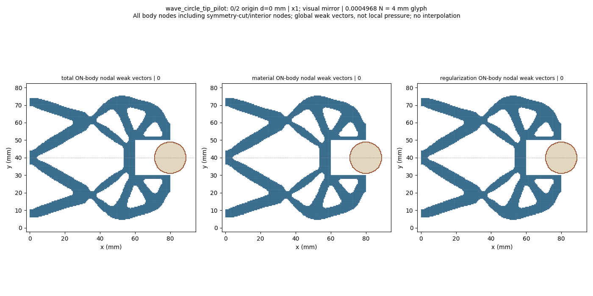
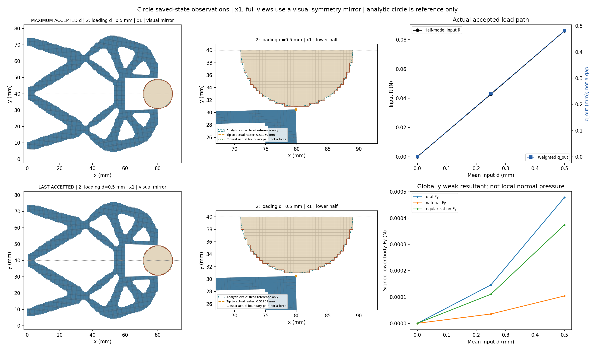
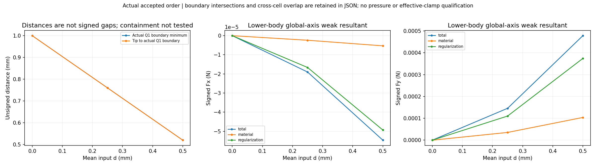
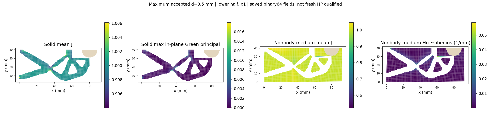
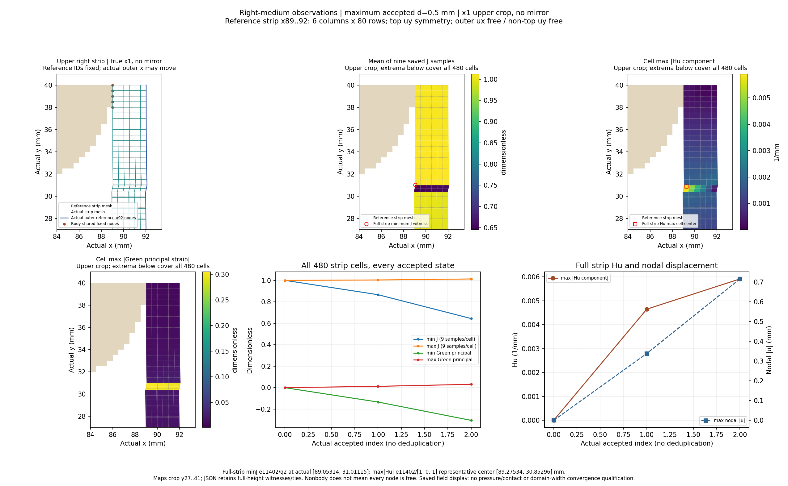
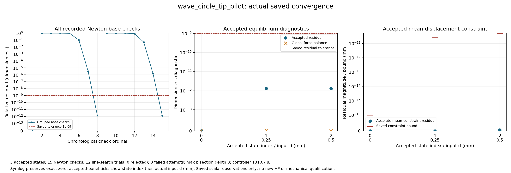

# Circular workpiece pilot: saved-state review

Solved lower-half wave mechanism, fixed raster circle r9 at (80,40) mm, on the92x40mm reference domain with Lr80mm. Coordinates x1; full-structure views and GIF use a visual symmetry mirror, while numerical tables retain the original lower-half values. All actual accepted states are shown, including controller bisections.

The boundary distance is unsigned between exposed Q1 edges; boundary intersection/near-touch and region overlap are separate observations. Containment is not tested. Weak-form body total includes material and Hu contributions; it is not qualified contact pressure or effective grip. Right-medium observations use the dynamically selected resident reference cells x89..92 (six columns,480cells) and the actual displaced x92 boundary; the tip is selected by reference(80,30), not an old node ID. No new archive reads or domain-width convergence claim. Input zero-start0/.25/.5mm is a new case and does not qualify unloading, release, stability, independent HP or HF5 qualification.

[Response](wave_circle_tip_pilot/response.json) · [Result](wave_circle_tip_pilot/result.json) · [Exact rows](state_table.json) · [Viewer summary](view/wave_circle_tip_pilot/summary.json) · [Convergence JSON](convergence/convergence.json)

|index|leg|d (mm)|R input (N)|q out (mm)|body Fy total (N)|minimum Q1 boundary distance (mm)|
|---:|---|---:|---:|---:|---:|---:|
|0|origin|0.0|0.0|0.0|0.0|1.0|
|1|loading|0.25|0.042743534147102635|0.24018802342288847|0.00014591711519481185|0.7598854694338719|
|2|loading|0.5|0.08602790333542189|0.480914454124498|0.00047828066183543393|0.5193940639875763|
