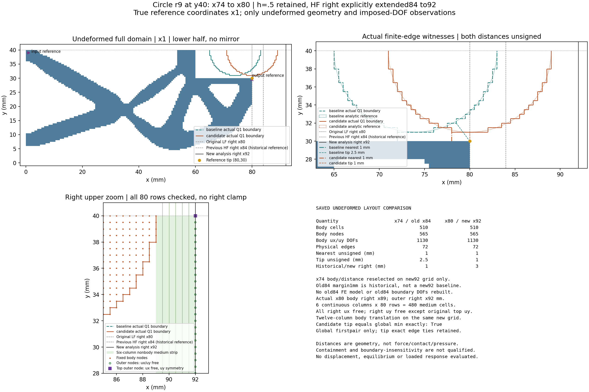

# L-CTIPPREP1：圆底面向最右尖端的92mm域准备

本轮 **PASS**，72/72项检查。只准备输入、构造参考模型及未变形图，未执行加载。默认HF力核、切线及控制器无修改。

## 目标、依据与实现

整体目标是用独立HF第三介质分析器接收LF结构，逐步验证大变形接触、位移/反力和加载/卸载。前一r9/(74,40)、84mm域短程通过，但.5mm时整体最近处仍在x76横梁、tip距仍2.039mm，右介质也参与压缩。因此本轮先把圆底对向最右tip，并扩出明确的右侧介质空间，再决定下一次计算。

本轮圆心从(74,40)改到(80,40)mm、半径9mm；参考域右界84→92mm。调用现有write_right_medium_geometry一次，在旧84mm子域右侧新增16列h.5、共1280介质单元；旧168列四掩码按field身份逐一保持，新列仅passive_void为1，其余为0。原LF机构右端80mm；全92mm网格为HF派生分析域，未重采样、未新做LF优化。

复用原build_native_project/write_native_project各一次，绑定实际新geometry身份；旧模型仅读取普通descriptor核语义，不读取其数组或保存态。节点stride169→185后，原坐标/连接/实体分类、支撑/实体对称与端口的节点、方向、权重、vector均按物理位置映射核对。tip由唯一参考坐标(80,30)重查并核solid/output节点，未沿用旧编号10300。

E1MPa、nu.3、plane strain、厚20mm、gamma1e-6、alpha5e-7、h.5及正则化物理长度Lr80mm保持，原材料常数/kr逐值核对。全域顶部只施加uy对称至92mm；右边界ux和非顶uy保持自由类型。新task改变center_x、背景顶端、新几何绑定及四说明metadata；load_only[0,.25,.5]/input.5仍只是保存的未执行指令。原生产门/settings/options原值记录，本轮未运行这些力学门。

## 实际几何与约束结果

| 同定义的未变形量 | 旧圆心74 | 新圆心80 |
|---|---:|---:|
| 全机构到实际Q1边最近距离 mm | 1.0 | 1.0 |
| 固定参考tip(80,30)到实际Q1边距离 mm | 2.5 | 1.0 |
| 工件覆盖单元/节点 | 510/565 | 510/565 |

两圆仅用同一新92mm驻留网格重建几何，没有构造第二个旧84mm有限元模型或重算旧反力。历史旧74/84域的右介质宽为1.0mm；新80/92候选的实际宽为3.0mm。不能把圆心74放入92域的假想9mm余量当作旧结果。

新tip节点信息见[诊断](run_001/diagnostics.json)；tip/整体距离关系原值：`{'tip_equals_global_minimum_exact': True, 'tip_minus_global_mm': 0.0, 'reported_global_mechanism_witness_is_tip': False, 'global_witness_scope': 'Original public first nearest pair; positive-distance global ties are not exhaustively enumerated', 'tip_tie_scope': 'All exactly tied body edges for the fixed reference tip projection are retained', 'interpretation': 'Exact equality places the tip on the same minimum-distance level; not a unique closest point or first-contact prediction'}`。原public函数返回一个最近见证，不穷举全部正距离并列对；tip自身的精确并列边保留。若两距离精确相同，只能说明指定tip进入最短距离层级，不能据此断言唯一最先接触、加载后一定先触或有效夹持。实际边界是Q1阶梯，解析圆只作参考。

工件实际右端x=89.0mm，新外界x=92.0mm；6列×80行=480个完整非实体、非工件介质单元连续到外界。所谓自由介质是单元分类，不表示相接工件节点或顶部uy也自由；x92逐节点ux/非顶uy自由和原顶uy对称另行核对。3mm余量与完整介质存在不证明域宽已收敛。

实际模型计数：{'cells': 14720, 'nodes': 14985, 'dofs': 29970, 'solid_cells': 4349, 'medium_cells': 10371, 'solid_incident_nodes': 4847, 'fixed_dofs': 1288, 'free_dofs': 28682}。完整body、边、节点、DOF、距离见证及右介质逐项见[layout](run_001/layout.json)。制造阈值pending与原资格保持。

## 执行、效果与后续

helper 6.359824799990747秒／180，outer 9.439431600010721秒／240，进程树采样峰值233070592B／64GiB，四库各16线程配置、清理确认true；不是声称实际用满16核。实际调用计数{'tests': 0, 'force_calls': 0, 'tangent_calls': 0, 'HP_calls': 0, 'solver_calls': 0, 'default_installations': 0}；参考构模可导入/注册JAX，不声称全局动态机械hook或零依赖导入。原窗口封存11文件/1089624B，后续仅继承seal并核stat。

本轮效果是把位置/域变化转为明确的新HF输入，并实际核查tip对向、右介质及全部关键语义；没有生成变形、反力或收敛结果。独立源审、实际普通记录审阅和一次新PNG像素检查均已留档；像素状态`pass_pixel_review`。

下一步：根据已通过的新92mm域与r9/(80,40)输入，另行安排一次零起点load_only[0,.25,.5]mm短试算及实际变形/反力/收敛/右介质显示；不预设tip唯一先触或域宽充分。 本轮不启动短程、HP或更大行程，不升级压力、有效夹持、释放、稳定性、完整路径或HF5资格。

[人工检查页](run_001/REVIEW.md) · [布局](run_001/layout.json) · [检查](run_001/diagnostics.json) · [新任务](run_001/task.json) · [新几何](run_001/derived_geometry/geometry.json) · [模型](run_001/model/model.json) · [helper](run_001/execution_receipt.json) · [outer](preparation_launch.json) · [闭卡](author/closure.json) · [后续计划](NEXT_STEPS.md)

[独立物理取舍与下一步观察项](author/PHYSICAL_DECISION_REVIEW.md)
