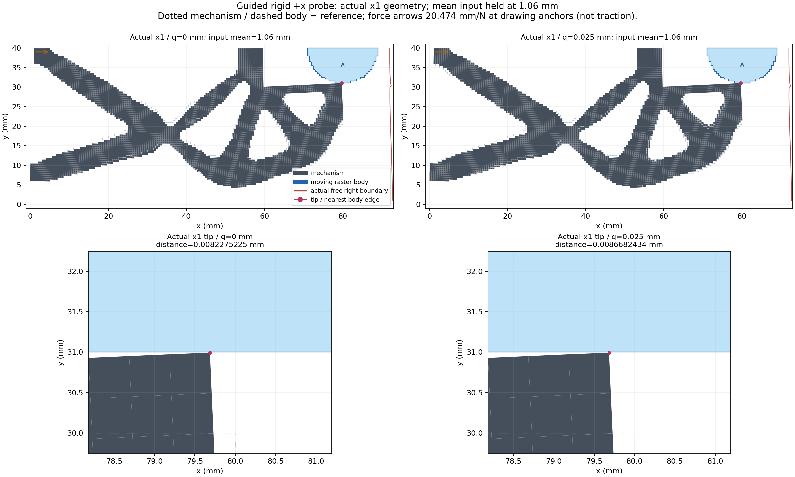
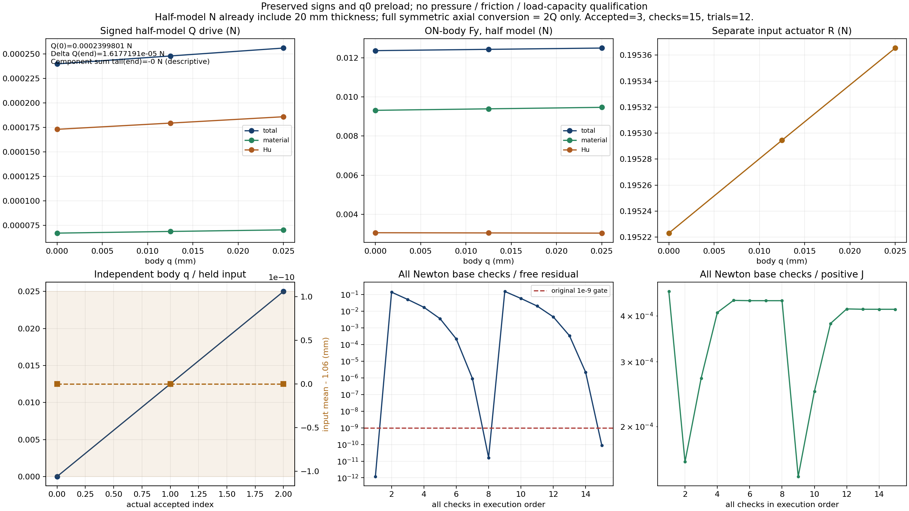
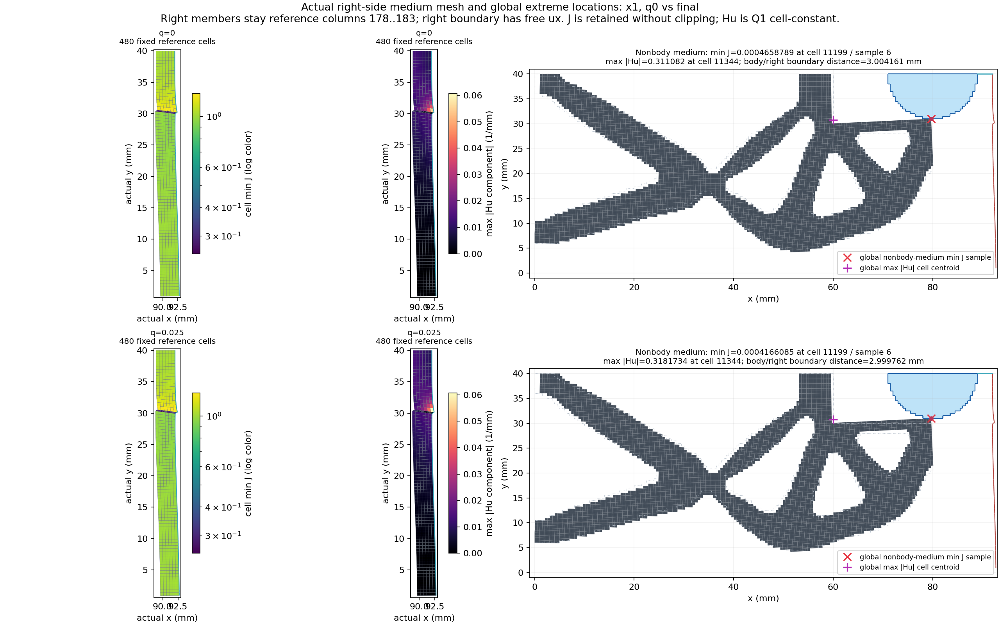
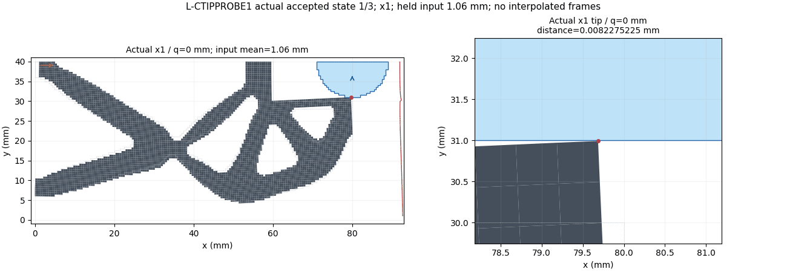

# L-CTIPPROBE1：真实导向工件位移探针

2026-10-22（Asia/Seoul）。数值验收 **PASS**；显示生成 `rendered_pending_visual_check`；root图像检查 `pass_with_visibility_limits`。本页只汇总唯一运行的实际证据。

整体目标是HF独立读取LF普通几何，在一致的大变形／Third Medium Contact任务下计算响应供研究比较。HF不优化、不调用dmftd、不实现MPM。本轮将已验证的小模型移动工件入口用于既有真实夹持器，以观察在机构输入保持时，工件沿+x小幅移动所需的有符号驱动力及介质响应。

本次采用导向夹具的位移控制，不是自由工件的指定外载承载认证。机构平均输入保持1.06 mm，工件全部ux=q、uy=0、转角0，q请求仅[0,.025] mm。保持α2.5e−7、γ1e−6、r9 mm、圆心(80,40) mm、right92 mm、Lr80 mm、E1 MPa、ν.3、plane strain、厚度20 mm、h=.5 mm及原边界／材料／验收门；原510工件单元／565节点不重mask。

入口为已安装的 `evaluate_native_guided_probe`，唯一调用从原完整load_only的accepted12／original12／1.06 mm峰值迁移两份split和原有符号R；不重做加载，不读旧力／矩阵作为新验证。继承mechanical／chunk256／port_projection，仅新增controller时钟。

## 实际终态与证据范围

|层次|实际记录|
|---|---|
|数值门核查|PASS；原生产status=success；failure=null|
|唯一API|attempts=1；returned=True|
|接受态|3；实际回调记录=3|
|显示|rendered_pending_visual_check；PNG=3；实际GIF帧=3|
|root像素检查|pass_with_visibility_limits；详见author/FIGURE_QA.json原记录|
|封存|pass；attempts=1|

数值PASS须由原包装numerical_validation证据证明，不能仅用API返回success替代。没有返回result时，未知接受态／调用计数保留null；已有回调与partial文件按原记录报告，不等同完整结果。没有运行或完成显示时不伪造图像。

原包装的实际部分状态观察：

```json
{
  "result_exists": true,
  "accepted_states": 3,
  "call_counts": {
    "force_calls": 28,
    "force_calls_completed": 27,
    "tangent_calls": 15,
    "tangent_calls_completed": 15,
    "solver_invocations": 1,
    "HP_calls": 0,
    "save_force_calls": 0,
    "save_tangent_calls": 0
  },
  "progress_records": 3,
  "accepted_archive_files": [
    {
      "path": "D:\\hpr1_001\\run_001\\science\\accepted\\000\\fields.npz",
      "bytes": 5326671
    },
    {
      "path": "D:\\hpr1_001\\run_001\\science\\accepted\\000\\state.npz",
      "bytes": 219724
    },
    {
      "path": "D:\\hpr1_001\\run_001\\science\\accepted\\001\\fields.npz",
      "bytes": 5326470
    },
    {
      "path": "D:\\hpr1_001\\run_001\\science\\accepted\\001\\state.npz",
      "bytes": 219911
    },
    {
      "path": "D:\\hpr1_001\\run_001\\science\\accepted\\002\\fields.npz",
      "bytes": 5326986
    },
    {
      "path": "D:\\hpr1_001\\run_001\\science\\accepted\\002\\state.npz",
      "bytes": 219874
    }
  ],
  "scientific_array_fields_decoded": 0,
  "production_status": "success",
  "failure": null
}
```

## 实际保存态

Q_drive_half=Σbody f_int,x=−ON-body Fx；保留q0预载和符号。下表均为半模型N，已含20 mm厚度；对称完整装配轴向换算才取2Q，位移q不倍增。material／Hu为原节点弱力分量，不能称纯压力或摩擦；负Q表示需要制动，不能认定正抗拔容量。

|接受态|body q mm|input mean mm|Q half N|R input N|ON-body Fy total N|Fy material N|Fy Hu N|min J|relative residual|Newton checks|
|---|---|---|---|---|---|---|---|---|---|---|
|0|0.0|1.06|0.0002399800950672949|0.19522304147728387|0.012372524610902783|0.009318152027217278|0.0030543725836855054|0.00046587891715793817|1.1974846636341916e-12|1|
|1|0.0125|1.06|0.00024805986935598885|0.19529451734426592|0.012439112734173054|0.00939500228102461|0.0030441104531484463|0.00043961981824698745|1.633253277706521e-11|7|
|2|0.025|1.06|0.0002561572865437846|0.19536542042187396|0.012505048670471336|0.009471176487845432|0.003033872182625907|0.0004166085295994876|8.840774882078524e-11|7|

逐态Q−Q(0)、material／Hu尾差、互斥反力账本、原门、尖端到物理阶梯边界距离、body到实际右界距离、全介质／右480格J与Hu及定位见 [state_table.json](run_001/view/state_table.json)。几何距离排除参考y40对称切边，只是binary64保存坐标观察。J为原九点采样；Hu为Q1 cell常量，其定位点为实际cell质心。


## 新q0与来源身份

```json
{
  "accepted_index": 12,
  "path": "D:/hpr1_001/parent_001/accepted/012/state.json",
  "descriptor_file_sha256": "c06fc6d2e3400832ca967ad5bffd546feb960c818a4e388cda3af9ec5e2a00ae",
  "state_sha256": "e71c06973b7dc7aff7e5ee4a801b595cb3f054e907cc6e1ad52188e858500a68",
  "archive_sha256": "b106fd6f3a2c3d1b3ddab90ec024f437bda5fc343925b77932631d8aa9c04fdc",
  "R_input_N": 0.19522304147728387,
  "input_mean_mm": 1.06
}
```

q0必须fresh F/T直接通过、保持原split两字段及R身份且checks=1；该证明以数值包装和原科学结果为准，不由本汇总脚本重新计算。

基线提交：`18f3589d406861bde9a34176567b59e23844a39a`；远程origin维持`https://github.com/dudaxing/Compliant-TO-TMC.git`。研究包装、观察定义及68项冻结依赖见protocol.json、author中的CANDIDATE_FREEZE和静审记录。原七份来源只按字节复制；原父任务／参考／失败与资格没有改写。

实际执行力学源码身份：

```json
{
  "hf_repo/src/hf_eval/native_probe.py": "93667361fcb8168d800833a849d411a669b576b11c565cdbfc534bd3457ae8b3",
  "hf_repo/src/hf_eval/split_displacement.py": "65e5cb15a54b53978abb744ee7e99928cadfffefb9afb71fdc6dcfcd139e295e",
  "hf_repo/src/hf_eval/split_numpy_tangent.py": "547143b14c8626f7420b8d5778cb11d4d5680be1a590428d8d46f01b3549857f",
  "hf_repo/src/hf_eval/split_kernel_invariants_hu.py": "d5f7d20a6ec0c92847d67f8782f4dcc89772fc4ea62797626b0beae7effabd9a"
}
```

## 调用、资源及清理

实际调用计数（未有权威结果则null）：

```json
{
  "force_calls": 28,
  "force_calls_completed": 27,
  "tangent_calls": 15,
  "tangent_calls_completed": 15,
  "solver_invocations": 1,
  "HP_calls": 0,
  "save_force_calls": 0,
  "save_tangent_calls": 0
}
```

一次controller3600秒／显示共享600秒／helper4500秒／outer4560秒；采样64GiB、四库各16线程、viewer8GiB。不使用GPU、不升级依赖。原minimum_increment=.00625 mm、25 checks／12回溯／4二分及原残差／平均位移／J／global balance／处方位移门保持。没有外部重试、修复重跑、延期、force、HP或测试。

|监督层|终止原因|returncode|清理证明|elapsed seconds|
|---|---|---|---|---|
|outer|normal_exit|0|PASS|1186.2599043999799|
|helper|normal_exit|0|PASS|1184.0809865000192|
|science|normal_exit|0|PASS|1172.741484099999|
|viewer|normal_exit|0|PASS|9.527139200014062|

清理只依据原SUP2同实例／成员覆盖／句柄释放证明；正常退出、数值成功与清理分别记录，不能互相替代。详见原监督JSON与NDJSON。

## 可视化与恢复









原封存ZIP按字节复制，未解压／重压。新科学NPZ保留在execution_evidence.zip中，含实际源码、最小父来源及新缓存。公开的普通result内原运行路径是历史上下文。要读取已封存的科学缓存，应显式恢复到隔离位置，不把本页当作已重跑或已补齐完整父路径。此交付脚本只复制文件和汇总普通元数据，没有科学导入、NPZ解码或图像像素读取。

本卡仅回答受导向位移探针的实际响应；不授新的HP参考、压力、自由承载、有效夹持、释放、稳定性、参数／域独立性或HF最终标签。下一步由root结合本轮实际结果另写NEXT_STEPS.md，本程序不预写下一物理实验。

## 物理观察与取舍

本轮证明了真实模型中的两套控制量可解耦：机构平均输入保持1.06 mm，全部565工件节点刚体右移到.025 mm，三态处方偏差均为0。原q0两split身份与有符号R保持，先fresh检查再推进，无Newton修复。首次直接尝试.025时出现invalid_J，原控制器回退且按获准内部二分接受.0125，再接受.025；不存在终端错误或外部重跑。该无效J尝试在failed_attempts保留，不伪造有限Newton行。实际28次force中27次完成，15次tangent均完成；15个有效Newton base checks、12次line-search trial和15次linear solve按原值保留。

半模型轴向驱动力从0.0002399800950672949增到0.0002561572865437846 N，增量1.6177191476489698e−5 N（约6.741%）。末态材料轴向分量7.023681740568895e−5 N、Hu分量1.8592046913809562e−4 N；Hu占末态总轴向力约72.58%，占本段总增量约79.48%。这些是既有普通JSON的描述算术，不是独立误差分摊、纯接触力或承载门。下半工件ON-body Fy由0.012372524610902783增到0.012505048670471336 N；y导向仍能提供反力／约束矩，不授自由工件资格。

尖端至实际物理阶梯边界距离从.008227522522737729增到.008668243426743771 mm；原边界交叉／严格内部节点观察在三态均未见几何重叠，但这不是完整自交／接触资格验证。全非工件介质最小J从.00046587891715793817降至.0004166085295994876，见cell11199／原九点sample6，位于尖端邻近；最大|Hu|从.31108200242696615增至.318173383204207 1/mm，cell11344的标记在约x59.97、y30.77 mm，并非body压力测点。

右480格的最小J反而从.25059846167817207增到.25285362927613125。body到实际右界距离为3.0041605819997415→2.9997619258029147 mm，而不是参考x92固定不动时的2.975 mm；实际右上点x从92.00416058199974变到92.02476192580292 mm，说明自由右界随运动发生响应。这组观察没有证明域宽或α独立。

数值成功、实际图像可读和力的物理归因分别判断。最小J仍非常小，轴向Hu贡献较大，因此不把正Q曲线称为有效夹持、压力或抗拔容量。近期选择先准备同定义低输入对照，见[NEXT_STEPS.md](NEXT_STEPS.md)，暂不继续加q、重复降α或追加HP来代替该物理对照。

## 可审查记录的时点

author/EXECUTION_RESULT.json和原终态result／监督／seal为本轮当前事实。author中READINESS／WAIT_AUDIT、authorization的execution_started:false、LIVE_HANDOFF及冻结protocol的numerical_launched:false都是原准备或监控时点，保留原字节，不是当前未执行。三个新PNG各一次root检查，整体为pass_with_visibility_limits；图1全域尺度下.025 mm移动很小，图2左上注释略覆盖曲线，图3等比例窄条x刻度重叠，精确量以state_table为准。没有重绘或重复科学执行。新pure viewer实际解码3个新fields归档的J／Hu共6字段、实际GIF3帧；源API的4mask／2split读取由冻结源码及实际调用合同支撑，未声称有独立系统级I/O追踪。

## 交付核对

[独立实际审阅](author/ACTUAL_DELIVERY_REVIEW.md)12/12通过；[有限交付身份与链接核对](DELIVERY_CHECK.json)分别记录源码保持、原字节封存与新文档链接。审阅中的RESULTS／NEXT哈希为其审阅时快照，后续本节及发布回执属于文档补充，不改原科学结果。没有新测试、NPZ解码或图像重开。
