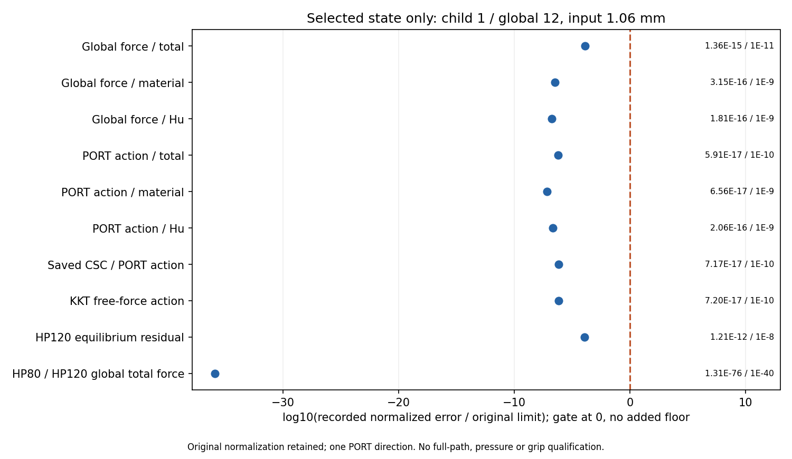

# L-CTIPREF1：当前尖端布置1.06 mm保存态独立参考

2026-10-19；唯一执行 **PASS**；图像QA **pass_root_visual_inspection**；阶段完成 `True`。

outer `pass`、helper `pass`、summary `pass`、lifecycle `pass`。main基线 `8cf86e81e414866a7d5cb110e006c7088f94eb97`；science 0.5.0／b1334保持。执行、数值检查与实际像素检查分别记录，不由生成意图或旧QA代替本卡图像效果。

整体目标是普通LF几何进入独立HF的TMC前向分析，逐步实现可比较的非线性响应和接触相关指标。前序已完成当前r9 mm、圆心(80,40) mm、right92 mm、Lr80 mm布置的保存态延伸和实际变形、力、尖端、右侧介质与收敛显示；LOCAL3定位到当前最小J角点与Hu首个代表。本轮检查当前保存态数值可靠性，不重做生产平衡。

批准对象为STEP10接受行1／全局目标12／loading1.06 mm，state SHA `dd9288140ae51ff3cfcc7f7f6d6811b2242a55054454002bd7c06ff88a4b6bc6`。完整14720单元／29970DOF（固定1288、自由28682），原材料、第三介质、正则化、网格、边界、端口、设置及验收门保持。实际完成范围由以下回执计数给出；缺失记录不视作已完成。

HP启动/完成 `2`／`2`；完成力学态 `1`、工件投影态 `1`、检查 `88465`，绘图启动/完成 `1`／`1`。

原十五门：`{'production_residual': '1e-9', 'independent_residual': '1e-8', 'force_evaluation': '1e-9', 'average_constraint': '1e-10', 'global_force_balance': '1e-6', 'fixed_displacement_mm': '8e-11', 'hp80_hp120': '1e-40', 'total_force': '1e-11', 'material_force': '1e-9', 'regularization_force': '1e-9', 'total_tangent': '1e-10', 'material_tangent': '1e-9', 'regularization_tangent': '1e-9', 'augmented_force_tangent': '1e-10', 'augmented_constraint_tangent': '1e-10'}`。比较材料/Hu/总局部力与全局力、同一固定兼容PORT方向切线、完整CSC系数组装身份及方向作用、KKT力/均值作用、约束/残差/整体平衡和有符号工件/holding投影。只检查这一方向；独立解析能量仅归档，不授候选应力或能量资格。

|观察项|原归一化误差|原门|通过|
|---|---:|---:|---|
|Global force / total|1.35625252474124229211528394649994207089513767529432773829886027255613921348536426388652343949666783129724847198963535140E-15|1E-11|True|
|Global force / material|3.15054159497953273011724235961558450001419958655163991539283897237883257937198735567669599266472155107493226069690410784E-16|1E-9|True|
|Global force / Hu|1.81304435640412592235299612493743369483718724883753353814964274566749131656968543581013443130481587261009146334041992202E-16|1E-9|True|
|PORT action / total|5.91127497872940928975662462593970651886953521314369071631001479503761175025289889356900314750488255934672006701869789211E-17|1E-10|True|
|PORT action / material|6.55955653147260710905799035917526949767460033505605623471051411949190496356093458856015989877021785778047259056275201919E-17|1E-9|True|
|PORT action / Hu|2.06025147561837223257322369698130291875532785396549549854476854744545274514709245845687541199139596322832653017512997299E-16|1E-9|True|
|Saved CSC / PORT action|7.17052893968088513276447343563624627897229650559823007010997647303234251400494693429323585187325484355663076066905324807E-17|1E-10|True|
|KKT free-force action|7.20153351399746993180947716038374886290569568017386110686339570194208638975302164828443148973190484173620865034671751155E-17|1E-10|True|
|HP120 equilibrium residual|1.20620888518680716261259232366099714518970488440528789737255211109632583433232100134132313220908579792034422054189721455E-12|1e-8|True|
|HP80 / HP120 global total force|1.30678310325009250187159912311487783659682158175559374495499049547506458232851737603349303722959816339408664414711339979E-76|1E-40|True|

当前最新强压缩保存态已通过HP80/120原十五门：总力误差约1.3563e-15、PORT总切线5.9113e-17、HP120平衡残差1.2062e-12，误差均明显低于对应原门。局部见证确认minJ位于tip，介质仍被高度压缩，但没有发现这一个状态/声明方向需要修力核的数值矛盾。继续压向1.07会增加点附近压缩；先做小回程可直接检验已实现路径转换和实际响应恢复，丰富当前布置的功能证据。它不预言反力/距离单调、可逆性、滞回或自由释放。

当前1.06 mm的tip实际(79.68711006356523,30.990112475289735) mm，unsigned Q1最近距离9.887525微米；minJ=0.0009015839179744192。Hu首代表在内侧e11344，signedcomponent=-0.4682404604988441/mm、exactties2，Q1中心仅代表标记。下半工件Fy=0.01259251473277105 N，由material0.008033412258785861与Hu0.004559102473985187 N构成；这些是全局轴弱式合力，不是圆周压力或合格夹持力。

本次88465为原实际检查总数，不是十五类门，也不是新审计层。30输出93316426B及原科研gzip均在唯一窗口封存；工件分支完成1态且整体PASS，普通summary只保其gz路径/SHA，没有闭窗重开或声称独立读取具体body误差。1.06态的选定参考不转授未来卸载态或完整路径。

仅在全部原门PASS后允许生成十项误差图，实际生成与否见回执；零误差不加地板、不改变原分母或阈值。逐元素/全局差值及工件核查若已产生，保持在原窗口封存gzip；闭卡不重开载荷、切线、矩阵、科学gzip或媒体。工件Fx/Fy是含材料与Hu的有符号弱式合力；legacy normal_force为全局Fy，2absFy也不是圆周局部压力或有效夹持力。

实际审阅 `pass_record_audit`；像素记录 `{'card': 'L-CTIPREF1', 'status': 'pass_root_visual_inspection', 'inspections': 1, 'media': [{'path': 'lf_data_preparation/native_interface_001/lf_circle_tip_reference_001/run_001/reference/reference_observations.png', 'inspections': 1}], 'observations': {'reference_observations.png': 'Root inspected once at original resolution after unique terminal: all10 raw normalized error/limit markers and numeric annotations readable, child1/global12/input1.06 identity correct; all markers left of original gate at0, HP80/120 log ratio near-35.88 retained without clipping/floor. Row labels, xaxis, title and scope footer separated. Figure explicitly one PORT direction, no fullpath/pressure/grip qualification.'}, 'image_regenerations': 0, 'old_media_opened': 0, 'GIF_decodes': 0, 'inspection_scope': 'One actual original-resolution view_image of the one new PNG after terminal. This ordinary record does not read/hash/decode scientific/media payloads; original producer seal inherited.'}`。原生产成功、失败历史及全部未完成资格保持；本卡通过只覆盖此保存态与同一PORT方向。

资源：helper `106.68545789999916` /900 s，outer `107.40420010000526` /960 s；采样进程树峰值 `1391460352` /8589934592 B；四库线程上限16。实际child wall `107.10406909999438` s、exit `0`、stop `未提供`。合作停止和采样记录不增加SUP2或硬抢占清理资格。

原窗口封存 30 份输出／93316426 B，状态 `complete_inside_original_helper_window`。helper错误 `未提供`；outer错误 `未提供`。首错后的实际partial如实保留；本卡未自动重试、修复重跑、延期或force。

本轮无新生产F/T、平衡求解、测试、默认安装或API关联。旧实际变形、力、收敛和局部定位只链接，不解码或重绘；不升级完整路径参考、接触压力、有效夹持、自由释放、稳定性、网格/域宽收敛或HF5资格。

审查入口：[参考summary](run_001/reference/summary.json) · [选定态summary](run_001/reference/accepted_012/summary.json) · [误差普通JSON](run_001/reference/reference_observations.json) · [lifecycle](run_001/reference/lifecycle.json) · [封存回执](run_001/reference/execution_receipt.json) · [outer](reference_launch.json) · [实际审阅](author/ACTUAL_REVIEW.md) · [闭卡JSON](author/closure.json)

既有实际效果：[STEP10实际变形与力](../lf_circle_tip_step_010/RESULTS.md) · [LOCAL3当前空间定位](../lf_circle_tip_local_003/RESULTS.md)。

下一步：建议下一阶段 L-CTIPUNLOAD1：复用已安装的load_only→ordered_cycle保存态延伸入口，从STEP10真实1.06 mm峰值仅回撤到1.05 mm，保持input峰值1.06及完整前缀、原物理/设置/门，观察实际回程变形、力、尖端距离和收敛；以普通标量表对照旧加载1.05，避免凭位移符号认定恢复。研究viewer只修显示选态和相应标题，使新末态可人工检查。该新物理目标需新明确授权；当前未实施或执行，不自动加载1.07或新增HP。

恢复开发：origin保持https://github.com/dudaxing/Compliant-TO-TMC.git，后续在main。先读README、docs/CURRENT_STATUS.md和docs/RESUME_DEVELOPMENT.md，再读本卡RESULTS/NEXT_STEPS、protocol及授权。异路径恢复使用同机local Git对象fetch/ff-only，不是独立机器或远端对象下载验证。已关闭launcher不再执行。
