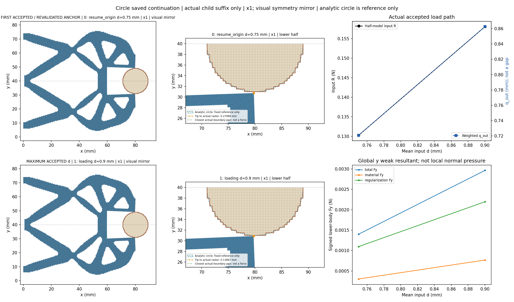
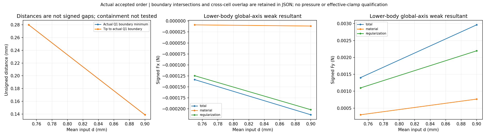
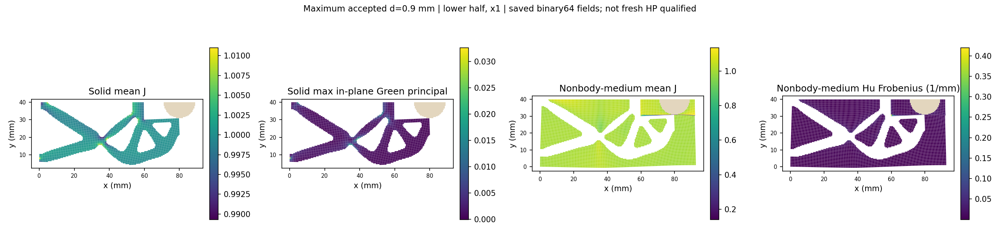
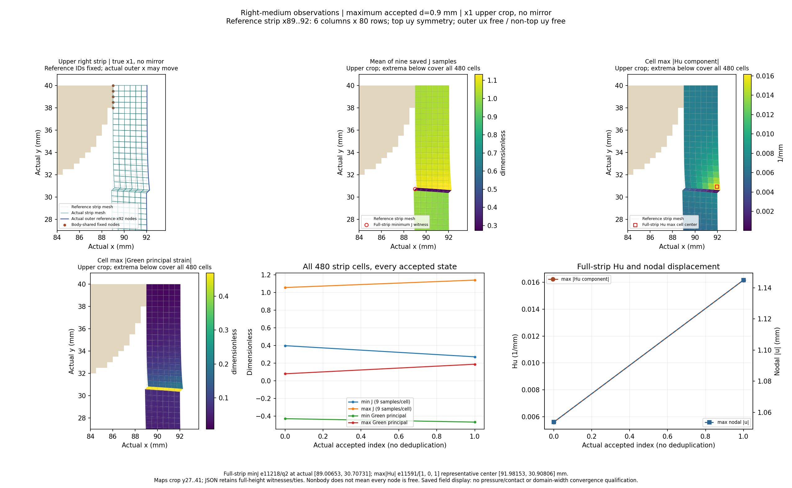
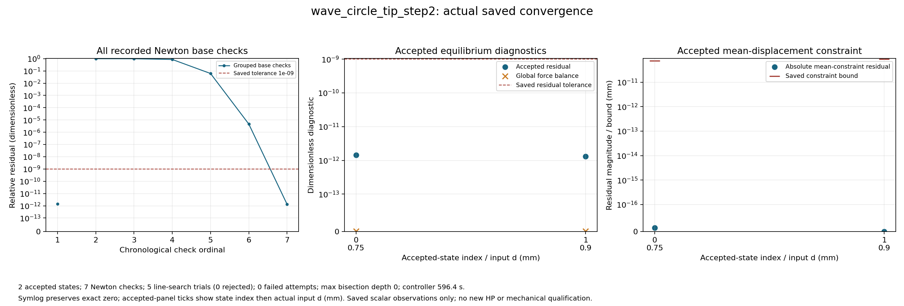
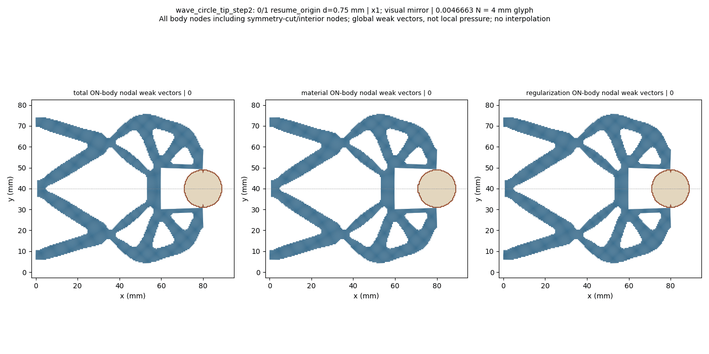

# L-CTIPSTEP2：最右尖端对向圆形工件的保存态延伸

2026-10-19；执行 **PASS**。生产 `success`，helper `pass`，outer `pass`；实际停止阶段 `final_binding_and_seal`。

整体目标是把LF给出的夹持器几何接入独立、可恢复的高保真大变形/TMC有限元分析，逐步实现对工件接近、接触后的变形与作用力及卸载响应的可审查计算。结构优化、有效夹持判定和HF5标签尚不能由单段前向计算替代。

本轮做什么及原因：复用已安装load_only显式保存态延伸接口，从已成功的0.75 mm状态重新核验平衡及SHA/有符号R，再执行唯一新目标0.90 mm。该小步用来观察最右尖端能否继续对向接近，并查看右侧介质压缩和计算成本，避免依据初始布置直接推断大行程效果。未从零重放原加载前缀，也未改默认HF源码。

半径9 mm、圆心(80,40) mm、固定工件ux/uy、右域界92 mm、正则化长度80 mm保持；下半域92×40 mm、h=0.5 mm、厚20 mm、E=1 MPa、nu=0.3、plane strain、gamma=1e-6、alpha=5e-7及原支撑/平均端口/对称保持。完整任务[0,.25,.5,.75,.90]仅追加.90并将input.target改为.90及四项说明身份；本次请求后缀[.75,.90]。

已完成及实际效果：保存接受态 `2`，helper回调 `2`。缺失保存结果记为null，实际二分增加的接受态全部保留。父结果SHA `8bd401cd0ad537edd35446512aaeab94cc3c2fe295615072c53f1310aef69f05` 与授权绑定一致，原成功与失败历史保留。

|child行|global目标|路段|d mm|输入R N|q_out mm|body Fy N|tip距离 mm|最近边界 mm|solid minJ|medium minJ|
|---:|---:|---|---:|---:|---:|---:|---:|---:|---:|---:|
|0|3|resume_origin|0.75|0.13029373126695096|0.7209345473765182|0.0014019374851138165|0.2798849153085463|0.2798849153085463|0.9819914053937876|0.27350038751453853|
|1|4|loading|0.9|0.1580782308108174|0.8625531334711433|0.002963472813601691|0.13886658198055457|0.13886658198055457|0.9784853423673909|0.12974460877888705|

|d mm|右介质 minJ|右介质 maxabsHu 1/mm|右条带最大节点位移 mm|relative residual|
|---:|---:|---:|---:|---:|
|0.75|0.39762377949682676|0.005591771606663465|1.0537179809464745|1.4238145256198373e-12|
|0.9|0.2716044900094883|0.016170032723724637|1.144980350028813|1.3062334517729194e-12|

表中保留原数值。q_out是加权端口位移，不是表面间隙；输入R与工件合力为原下半模型数值。完整Fx/Fy的material/Hu/total分量、实际尖端及边界见证、分区极值与位置、原残差/约束界和整体平衡见[闭卡JSON](author/closure.json)及[显示摘要](run_001/view/wave_circle_tip_step2/summary.json)。

原验收门 `{'production_residual': '1e-9', 'average_constraint': '1e-10', 'global_force_balance': '1e-6', 'fixed_displacement_mm': '8e-11'}`；缓存检查 `{'actual_accepted_states': 2, 'minimum_J': 0.12974460877888705, 'maximum_fixed_split_sum_mm': 0.0, 'maximum_relative_residual': 1.4238145256198373e-12, 'native_constraint_bound_pass': True, 'maximum_relative_global_force_balance': 1.2155508670987057e-15, 'passed': True}`。生产调用 `{'force_calls': 12, 'force_calls_completed': 12, 'tangent_calls': 7, 'tangent_calls_completed': 7, 'solver_invocations': 1, 'JIT_calls': 0, 'HP_calls': 0}`；收敛计数 `{'accepted_states': 2, 'newton_base_checks': 7, 'inferred_check_groups': 2, 'line_search_trials': 5, 'line_search_accepted': 5, 'line_search_rejected': 0, 'failed_attempts': 0, 'linear_solves': 6, 'maximum_bisection_depth': 0, 'zero_newton_residuals': 0}`。API/solver/view等包装调用 `{'api_started': 1, 'solve_started': 1, 'solve_completed': 1, 'api_completed': 1, 'view_child_started': 1, 'view_child_completed': 1, 'convergence_plot_started': 1, 'convergence_plot_completed': 1}`。原门和非clock设置不变。

路径实际标志 `{'path_kind': 'load_only', 'targets_mm': [0.75, 0.9], 'reached_displacement': 0.9, 'path_completed': True, 'loading_peak_reached': True, 'new_peak_reached': True, 'extended_segment_completed': True, 'task_target_executed': False, 'full_original_path_completed': False, 'full_extended_path_completed': False, 'unload_endpoint_reached': None}`。新峰值与延伸段完成只说明本段；task_target_executed、full_original_path_completed、full_extended_path_completed保持false，完整加载前缀没有在child中执行。没有把本段PASS授予整条路径或独立参考。

图中实际坐标×1；完整结构和动画只作对称镜像，数值没有镜像加倍。尖端按唯一参考坐标(80,30)动态查找并跟随实际位移。unsigned Q1外露边界距离、相交/near-touch、跨区凸单元重叠和数值不确定性分别记录；正距离和非零弱力不能单独认定有效接触，完整包含关系/机构自重叠尚未验证。

右侧条带固定参考x89..92、6列480cells，保留实际位移后的外界与原顶uy约束。完整条带极值覆盖80行，局部图是上部裁剪；Green应变不换算为工程压缩百分比，cellwise Hu代表点不当作独立九点量。外角最大节点位移不是尖端间隙。右侧场变化不能单独证明边界污染或域宽充分。

圆形工件表面的法向随位置变化；下半体材料/Hu/总Fx/Fy是有符号弱式合力，Hu也不能当作连续表面压力。因此尚无压力、有效夹持、卸载/自由释放、稳定性、网格/域宽收敛或HF5资格；当前布置也未做新HP，旧布置参考不转授。

最右尖端继续对向接近：0.75→0.90 mm时，tip实际位置由(79.78057867,30.72011508)变为(79.73048789,30.86113342) mm；tip和整体最近Q1边界距离均从0.279884915降至0.138866582 mm。两保存态未报告相交、near-touch或跨区重叠；这是共享最小距离，不是唯一/首次接触或有符号间隙。输入R为0.158078231 N、q_out为0.862553133 mm。下半工件total Fy=0.002963472814 N，其中material=0.000767649185、Hu=0.002195823629 N；Hu约占有符号总Fy的74.10%。它们仍是弱式全局分量，不是连续表面压力或有效夹持力。

实体minJ=0.978485342，非工件介质minJ=0.129744609，两者必须分开解释。介质maxabsHu增长2.03倍至0.269497244/mm；右480单元条带minJ降至0.271604490，其最小J见证移动到e11218/q2、reference(89,30.5) mm；右条带Hu增至0.016170033/mm，约为上态2.89倍，最大绝对分量在e11591（当前分量[1, 0, 1]，与上态最大分量不一定相同）。这说明下一步应更细观察局部变化，不能单独断言右界污染或域宽充分。条带minJ仍高于全非工件介质minJ，未将后者定位到右条带。右条带最大节点位移1.144980350 mm来自底右外角节点184，不是tip间隙。

右条带极值和历史统计覆盖固定参考x89..92的全部80行、480单元；right_medium.png的空间图只显示上部裁剪，不能把裁剪范围当成统计范围。最小J见证由e11402/q2、reference(89,31)变为e11218/q2、reference(89,30.5)，新实际位置为(89.00653107554191,30.70730584924653) mm。Hu的最大绝对分量在e11591，当前代表性Q1单元中心实际位置为(91.98153101715731,30.9080558389762) mm；Hu是逐单元常值张量，此中心只是标记位置，不是独立九点采样。

helper `608.7559810000021`/2700 s，outer `609.2923793000009`/2760 s；controller1800 s，显示共享600 s；进程树采样峰值 `889700352` B/64 GiB，清理 `True`。四库线程配置上限16，不等于实测16核利用率；pure viewer原内部8 GiB限制保持。

原窗口封存 `38` 个输出、`63145580` B；闭卡仅继承seal并核大小。实际审查 `pass_record_audit`，像素记录 `pass_root_visual_inspection`。新测试 `0`、默认安装 `0`、wrapper新HP `0`。

错误原值：helper `未提供`；API `未提供`；outer `未提供`。生产与显示阶段状态分开保留，不覆盖历史，不进行外部重试、修复重跑、延期、force、回滚或删除。













后续决策：建议下一阶段 L-CTIPSTEP3 复用已安装 load_only 保存态延伸接口，从本轮成功0.90 mm末态只推进到0.95 mm（增量0.05 mm）；保持r9、圆心(80,40)、右域界92、Lr80、其余物理和原门，继续显示实际变形、尖端/整体距离、反力及工件力分解、右侧介质和收敛。本轮只记录计划，不自动执行。

复核/恢复：主仓库origin保持https://github.com/dudaxing/Compliant-TO-TMC.git，后续开发在main。另一位置执行git clone该地址后，先读README、docs/CURRENT_STATUS.md、docs/RESUME_DEVELOPMENT.md及本卡RESULTS/NEXT_STEPS；依据仓库固定环境重建依赖，再核对protocol、author/authorization和保存态来源。不要重跑已关闭launcher或从显示数组重建锚；下一科学窗口使用公开evaluate_native(..., saved_result=..., selected_state_index=..., extend_path=True)和明确的新任务。

恢复起点命令（PowerShell；读取状态，不启动旧运行）：

```powershell
git clone https://github.com/dudaxing/Compliant-TO-TMC.git
git -C Compliant-TO-TMC status --short --branch
Get-Content -LiteralPath Compliant-TO-TMC/docs/RESUME_DEVELOPMENT.md
```

入口：[人工页](run_001/REVIEW.md) · [原结果](run_001/wave_circle_tip_step2/result.json) · [原响应](run_001/wave_circle_tip_step2/response.json) · [收敛记录](run_001/convergence/convergence.json) · [outer](step_launch.json) · [helper](run_001/execution_receipt.json) · [闭卡JSON](author/closure.json) · [实际审查](author/ACTUAL_REVIEW.md) · [像素记录](author/pixel_QA.json) · [后续](NEXT_STEPS.md)
