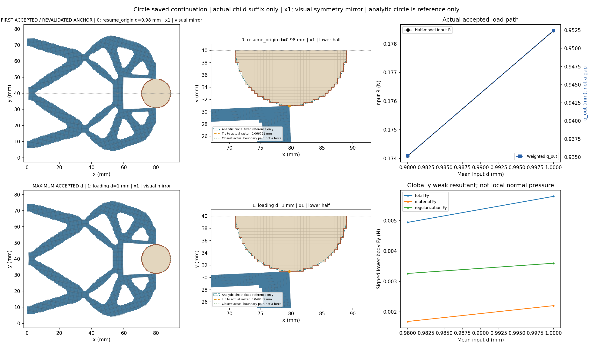
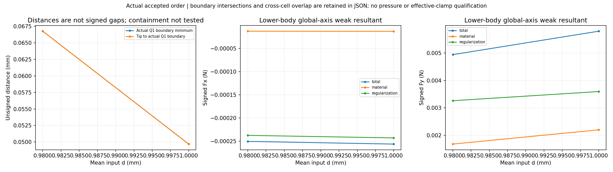
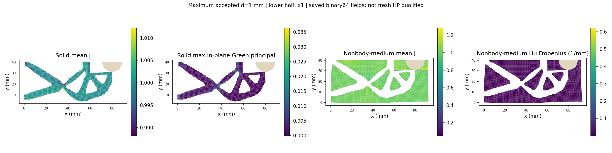
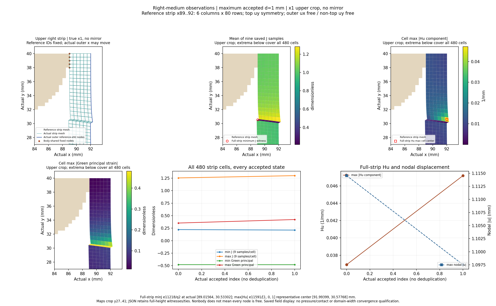
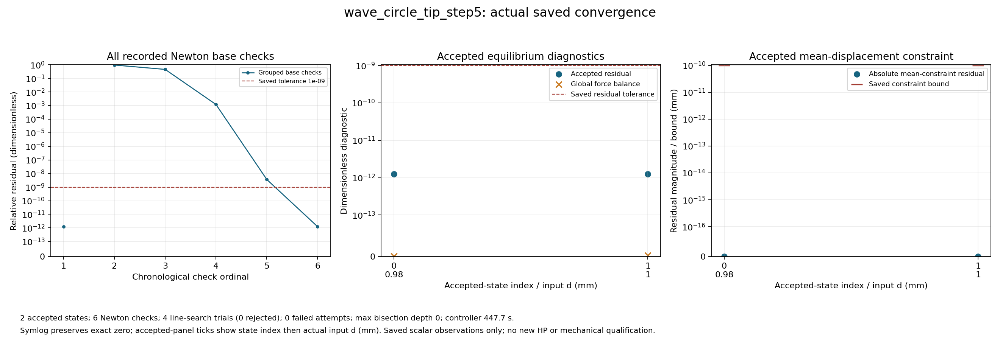
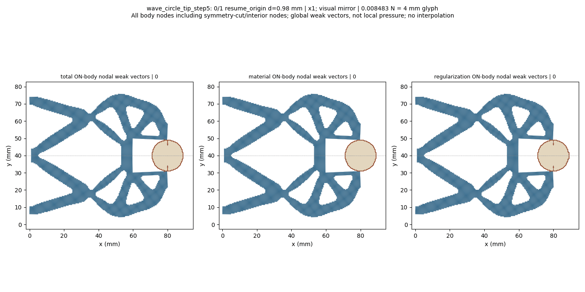

# L-CTIPSTEP5：最右尖端对向圆形工件的保存态延伸

2026-10-19；执行 **PASS**。生产 `success`，helper `pass`，outer `pass`；实际停止阶段 `final_binding_and_seal`。

整体目标是把LF给出的夹持器几何接入独立、可恢复的高保真大变形/TMC有限元分析，逐步实现对工件接近、接触后的变形与作用力及卸载响应的可审查计算。结构优化、有效夹持判定和HF5标签尚不能由单段前向计算替代。

本轮做什么及原因：复用已安装load_only显式保存态延伸接口，从已成功的0.98 mm状态重新核验平衡及SHA/有符号R，再执行唯一新目标1.00 mm。该小步用来观察最右尖端能否继续对向接近，并查看右侧介质压缩和计算成本，避免依据初始布置直接推断大行程效果。未从零重放原加载前缀，也未改默认HF源码。

半径9 mm、圆心(80,40) mm、固定工件ux/uy、右域界92 mm、正则化长度80 mm保持；下半域92×40 mm、h=0.5 mm、厚20 mm、E=1 MPa、nu=0.3、plane strain、gamma=1e-6、alpha=5e-7及原支撑/平均端口/对称保持。完整任务[0,.25,.5,.75,.90,.95,.98,1.00]仅追加1.00并将input.target改为1.00及四项说明身份；本次请求后缀[.98,1.00]。

已完成及实际效果：保存接受态 `2`，helper回调 `2`。缺失保存结果记为null，实际二分增加的接受态全部保留。父结果SHA `4954ff7ac9b8e819200bc7b49a67ea75c3cbc9b49163500034d15c614465049f` 与授权绑定一致，原成功与失败历史保留。

|child行|global目标|路段|d mm|输入R N|q_out mm|body Fy N|tip距离 mm|最近边界 mm|solid minJ|medium minJ|
|---:|---:|---|---:|---:|---:|---:|---:|---:|---:|---:|
|0|6|resume_origin|0.98|0.1740926144320115|0.9351815112846671|0.004939605732939993|0.06676054983915947|0.06676054983915947|0.9766867281893841|0.05618144722802783|
|1|7|loading|1.0|0.1784535445979535|0.9524284255775324|0.0057942001574207685|0.04968854162278191|0.04968854162278191|0.9762585262778355|0.03880995688549589|

|d mm|右介质 minJ|右介质 maxabsHu 1/mm|右条带最大节点位移 mm|relative residual|
|---:|---:|---:|---:|---:|
|0.98|0.22112852371297767|0.03690564373266536|1.114549062013156|1.251133578978498e-12|
|1.0|0.211259303841275|0.04719244605178652|1.0975264244222214|1.2470560062210544e-12|

表中保留原数值。q_out是加权端口位移，不是表面间隙；输入R与工件合力为原下半模型数值。完整Fx/Fy的material/Hu/total分量、实际尖端及边界见证、分区极值与位置、原残差/约束界和整体平衡见[闭卡JSON](author/closure.json)及[显示摘要](run_001/view/wave_circle_tip_step5/summary.json)。

原验收门 `{'production_residual': '1e-9', 'average_constraint': '1e-10', 'global_force_balance': '1e-6', 'fixed_displacement_mm': '8e-11'}`；缓存检查 `{'actual_accepted_states': 2, 'minimum_J': 0.03880995688549589, 'maximum_fixed_split_sum_mm': 0.0, 'maximum_relative_residual': 1.251133578978498e-12, 'native_constraint_bound_pass': True, 'maximum_relative_global_force_balance': 2.666477370003344e-15, 'passed': True}`。生产调用 `{'force_calls': 10, 'force_calls_completed': 10, 'tangent_calls': 6, 'tangent_calls_completed': 6, 'solver_invocations': 1, 'JIT_calls': 0, 'HP_calls': 0}`；收敛计数 `{'accepted_states': 2, 'newton_base_checks': 6, 'inferred_check_groups': 2, 'line_search_trials': 4, 'line_search_accepted': 4, 'line_search_rejected': 0, 'failed_attempts': 0, 'linear_solves': 5, 'maximum_bisection_depth': 0, 'zero_newton_residuals': 0}`。API/solver/view等包装调用 `{'api_started': 1, 'solve_started': 1, 'solve_completed': 1, 'api_completed': 1, 'view_child_started': 1, 'view_child_completed': 1, 'convergence_plot_started': 1, 'convergence_plot_completed': 1}`。原门和非clock设置不变。

路径实际标志 `{'path_kind': 'load_only', 'targets_mm': [0.98, 1.0], 'reached_displacement': 1.0, 'path_completed': True, 'loading_peak_reached': True, 'new_peak_reached': True, 'extended_segment_completed': True, 'task_target_executed': False, 'full_original_path_completed': False, 'full_extended_path_completed': False, 'unload_endpoint_reached': None}`。新峰值与延伸段完成只说明本段；task_target_executed、full_original_path_completed、full_extended_path_completed保持false，完整加载前缀没有在child中执行。没有把本段PASS授予整条路径或独立参考。

图中实际坐标×1；完整结构和动画只作对称镜像，数值没有镜像加倍。尖端按唯一参考坐标(80,30)动态查找并跟随实际位移。unsigned Q1外露边界距离、相交/near-touch、跨区凸单元重叠和数值不确定性分别记录；正距离和非零弱力不能单独认定有效接触，完整包含关系/机构自重叠尚未验证。

右侧条带固定参考x89..92、6列480cells，保留实际位移后的外界与原顶uy约束。完整条带极值覆盖80行，局部图是上部裁剪；Green应变不换算为工程压缩百分比，cellwise Hu代表点不当作独立九点量。右条带最大节点位移不是尖端间隙；其极值节点可随状态切换，具体位置见原摘要。右侧场变化不能单独证明边界污染或域宽充分。

圆形工件表面的法向随位置变化；下半体材料/Hu/总Fx/Fy是有符号弱式合力，Hu也不能当作连续表面压力。因此尚无压力、有效夹持、卸载/自由释放、稳定性、网格/域宽收敛或HF5资格；当前布置也未做新HP，旧布置参考不转授。

0.98→1.00 mm时，tip实际坐标由(79.704559642,30.933239450)变为(79.698531247,30.950311458) mm；tip与完整Q1共同最近距离由0.066760550降至0.049688542 mm。两态均无相交、near-touch、跨区重叠标志，containment仍未测试。正值是unsigned Q1几何观察，不是连续圆面有符号gap、首次接触或唯一接触证明。输入R=0.178453545 N、q_out=0.952428426 mm；下半工件total Fy=0.005794200157 N，其中material=0.002199450899、Hu=0.003594749259 N，Hu占有符号total Fy约62.04%。这些是弱式下半体合力，镜像不加倍，不能授连续压力或有效夹持资格。

实体minJ=0.976258526与非工件介质minJ=0.038809957应分开看；介质maxabsHu=0.399940406/mm（上态1.074倍）。右侧480cells全条带minJ=0.211259304，见证e11218/q2，reference[89.0, 30.5]，actual[89.01563883591507, 30.533015227112557] mm；right maxabsHu=0.047192446/mm（上态1.279倍），e11591/component[1, 0, 1]，Q1代表中心actual[91.99399102928078, 30.57767827140235] mm。Hu是逐单元常值，代表中心不是额外九点采样；全80行统计和上部裁剪图区分。此单一域宽场变化既不证明右界污染，也不证明域宽充分。

新保存态逐态核实right最大位移节点仍为178（reference(89,0)，条带内侧底部），actual[89.66919534016914, 0.8699091038728959] mm；norm由1.114549062降到1.097526424 mm。它不是tip距离、外界角点或卸载/更安全证据；保留非单调量并同时观察J/Hu，原门不要求该量随输入单调。

helper `460.76206269999966`/2700 s，outer `461.5391406999988`/2760 s；controller1800 s，显示共享600 s；进程树采样峰值 `880574464` B/64 GiB，清理 `True`。四库线程配置上限16，不等于实测16核利用率；pure viewer原内部8 GiB限制保持。

原窗口封存 `38` 个输出、`63351203` B；闭卡仅继承seal并核大小。实际审查 `pass_record_audit`，像素记录 `pass_root_visual_inspection`。新测试 `0`、默认安装 `0`、wrapper新HP `0`。

错误原值：helper `未提供`；API `未提供`；outer `未提供`。生产与显示阶段状态分开保留，不覆盖历史，不进行外部重试、修复重跑、延期、force、回滚或删除。













后续决策：建议下一阶段L-CTIPSTEP6复用已安装load_only保存态延伸接口，从成功1.00 mm末态只推进到1.02 mm（增量0.02 mm）；保持r9、圆心(80,40)、右域界92、Lr80及其余物理、非clock设置和原门，继续显示实际变形、尖端/完整Q1距离、反力/工件力分解、右介质和收敛。本轮只记录计划，不自动执行。

复核/恢复：主仓库origin保持https://github.com/dudaxing/Compliant-TO-TMC.git，后续开发在main。另一位置执行git clone该地址后，先读README、docs/CURRENT_STATUS.md、docs/RESUME_DEVELOPMENT.md及本卡RESULTS/NEXT_STEPS；依据仓库固定环境重建依赖，再核对protocol、author/authorization和保存态来源。不要重跑已关闭launcher或从显示数组重建锚；下一科学窗口使用公开evaluate_native(..., saved_result=..., selected_state_index=..., extend_path=True)和明确的新任务。

恢复起点命令（PowerShell；读取状态，不启动旧运行）：

```powershell
git clone https://github.com/dudaxing/Compliant-TO-TMC.git
git -C Compliant-TO-TMC status --short --branch
Get-Content -LiteralPath Compliant-TO-TMC/docs/RESUME_DEVELOPMENT.md
```

入口：[人工页](run_001/REVIEW.md) · [原结果](run_001/wave_circle_tip_step5/result.json) · [原响应](run_001/wave_circle_tip_step5/response.json) · [收敛记录](run_001/convergence/convergence.json) · [outer](step_launch.json) · [helper](run_001/execution_receipt.json) · [闭卡JSON](author/closure.json) · [实际审查](author/ACTUAL_REVIEW.md) · [像素记录](author/pixel_QA.json) · [后续](NEXT_STEPS.md)
